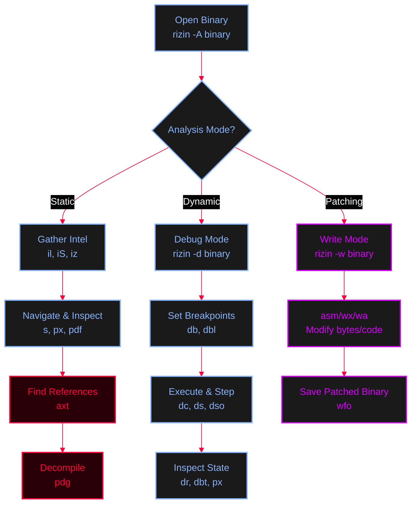

<Callout type="info" title="Concept Overview">
**Rizin** is a powerful, open-source reverse engineering framework. This cheat sheet covers everything from initial setup and Ghidra integration to static/dynamic analysis and binary patching.

**MITRE ATT&CK Mapping:**
* [T1059 - Command and Scripting Interpreter](https://attack.mitre.org/techniques/T1059/)
* [T1027 - Obfuscated Files or Information](https://attack.mitre.org/techniques/T1027/)
</Callout>


---

## 1. Installation & Ghidra Plugin Setup

<AccordionGroup>
  <Accordion title="Base Installation">
    ```bash
    # On Debian/Ubuntu/Kali
    sudo apt update && sudo apt install rizin

    # Or install via the official installer script
    sys/install.sh
    ```
  </Accordion>
  <Accordion title="Installing `rz-ghidra` (Decompiler Plugin)">
    `rz-ghidra` brings Ghidra's decompiler directly into Rizin, allowing you to view C-like pseudocode.
    ```bash
    # 1. Install dependencies
    sudo apt install cmake libzip-dev zlib1g-dev

    # 2. Clone and build rz-ghidra
    git clone https://github.com/rizinorg/rz-ghidra.git
    cd rz-ghidra
    mkdir build && cd build
    cmake ..
    make
    sudo make install
    ```
    *Once installed, you can use the `pdg` command in Rizin to decompile functions!*
  </Accordion>
</AccordionGroup>

---

## 2. Rizin Analysis Workflow



---

## 3. Static Analysis (Information Gathering)

<Callout type="info" title="Opening & Basic Intel (`i` commands)">
Open the binary and analyze it: `rizin -A ./binary`
</Callout>

```bash
# List linked libraries / imports
il

# List binary Sections (e.g., .text, .data, .bss)
iS

# List Strings (data sections only)
iz

# List Strings across the ENTIRE binary
izz

# List all functions recognized by rizin
afl
```

---

## 4. Navigation & Memory Inspection

<Callout type="tip" title="Seeking (`s`) and Hexdump (`px`)">
`s` (seek) moves the cursor. `px` (print hex) displays memory at the current or specified address.
</Callout>

```bash
# Seek to an address
s <address>

# Print 64 bytes of hex at the current seek address
px 64

# Print 64 bytes at a specific absolute address
px 64 @ 0xffff434524324

# Print 64 bytes at a stack/register offset
px 64 @ ebp+0x8

# Print 64 bytes by DEREFERENCING a pointer
# (reads the address stored at ebp+0xC, goes to that address, and prints 64 bytes)
px 64 @ [ebp+0xC]
```

---

## 5. Searching Memory & Binaries

<Callout type="warning" title="Search Commands (`/`)">
```bash
# Search for a String
/ hello world

# Search for Hex Opcodes (e.g., NOPs `9090`)
/x 9090

# Search for Assembly Instructions (e.g., `jmp`, `call`, `ret`)
/a jmp esp
/a ret
/a retn
```
</Callout>

---

## 6. Functions & Cross-References (XREFs)

<Callout type="success" title="Analyzing Function Calls (`pdf`, `axt`)">
```bash
# Disassemble the main function (See what main calls)
pdf @ main

# View the call graph of main (visual map of what it calls)
agC @ main

# Find Cross-References (Who calls this function/address?)
# e.g., Who calls printf?
axt @ sym.imp.printf

# e.g., Who calls this specific address?
axt @ 0x080483b0
```
</Callout>

<AccordionGroup>
  <Accordion title="Advanced: Decompiling with Ghidra (`pdg`)">
    If you installed the `rz-ghidra` plugin, you can view C pseudocode:
    ```bash
    # Decompile the main function
    pdg @ main
    ```
  </Accordion>
</AccordionGroup>

---

## 7. Dynamic Analysis (Debugging)

<Callout type="danger" title="Debugging Commands (`db`, `dc`, `ds`)">
*Note: You must start rizin in debug mode: `rizin -d ./binary`*
</Callout>

<Tabs>
  <Tab title="1. Breakpoints">
    ```bash
    # Set a breakpoint at an address
    db @ 0x08048450
    
    # Set a breakpoint at a function
    db @ main
    
    # List all currently set breakpoints
    dbl
    ```
  </Tab>
  <Tab title="2. Execution & Stepping">
    ```bash
    dc      # Continue execution (run until breakpoint)
    ds      # Step into (one instruction)
    dso     # Step over (skip call functions)
    dcu main # Continue execution until main is reached
    ```
  </Tab>
  <Tab title="3. Inspecting State">
    ```bash
    dr      # Display registers
    dr eax  # Display specific register
    
    # Print the Backtrace (Call Stack) to see how you got to the current instruction
    dbt
    
    # Print 64 bytes at current ESP
    px 64 @ esp
    ```
  </Tab>
</Tabs>

---

## 8. Binary Patching

<Callout type="warning" title="Modifying Bytes and Assembly (`w` commands)">
*Note: Open the binary in write mode: `rizin -w ./binary`*
</Callout>

```bash
# Seek to the address you want to patch
s 0x00401100

# Write Hex bytes (e.g., 90 = NOP)
wx 90909090

# Write Assembly instructions directly
wa jmp esp
wa ret

# Write a string
w hello world\n

# Save the patched binary to a new file
wfo patched_binary.exe
```
