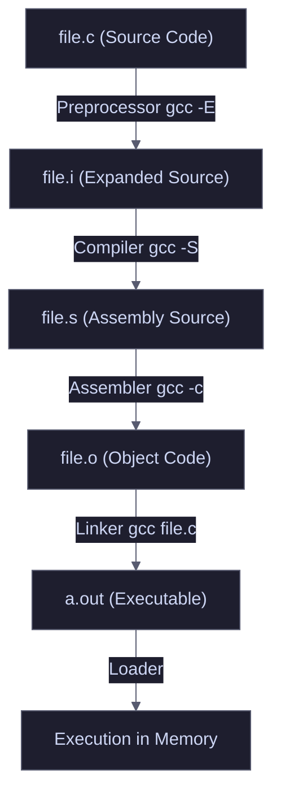

# Compile Time

When a C or C++ program is compiled using GCC, the process goes through several distinct stages before producing the final executable. Using the `-save-temps` flag allows reverse engineers and developers to inspect how the code transforms at each step.

<Callout type="info" title="MITRE ATT&CK Mapping">
Understanding compilation stages is relevant to [T1027 - Obfuscated Files or Information](https://attack.mitre.org/techniques/T1027/), specifically for malware analysis and binary obfuscation.
</Callout>

---

## Compilation Flow Diagram



---

## Intermediate Files Breakdown

The `gcc -save-temps file.c` command generates all intermediate files for inspection.

<Steps>
  <Step title="1. Preprocessing (`file.i`)">
    **Stage:** Preprocessor (`gcc -E file.c`)
    
    **Description:**
    * Removes all comments (`//` or `/* */`) from the source code.
    * Expands macros and `#define` directives.
    * Expands header files (`#include`), copying their content directly into the source.
    * Processes conditional compilation directives (`#if`, `#ifdef`).
    
    **Output:** Pure C code, significantly larger than the original due to inlined standard libraries.
  </Step>

  <Step title="2. Compilation (`file.s`)">
    **Stage:** Compiler (`gcc -S file.c`)
    
    **Description:**
    * Translates preprocessed C code into Assembly language specific to the target architecture (e.g., x86_64, ARM).
    * Checks for syntax errors and warnings.
    * Optimizes the code if flags like `-O2` are used.
    
    **Output:** Human-readable assembly instructions (e.g., `push rbp`, `mov rsp, rbp`).
  </Step>

  <Step title="3. Assembly (`file.o`)">
    **Stage:** Assembler (`gcc -c file.c`)
    
    **Description:**
    * Translates assembly instructions into machine code (binary).
    * Generates a symbol table mapping function/variable names to memory addresses.
    * External references are not yet resolved; the file is "relocatable".
    
    **Output:** Binary data requiring tools like `objdump` or `readelf` to read.
  </Step>

  <Step title="4. Linking (`a.out`)">
    **Stage:** Linker (`gcc file.c`)
    
    **Description:**
    * Links object files together and resolves external references (e.g., links `printf` to `libc.so`).
    * Assigns final absolute memory addresses to functions and variables.
    * Adds the Program Header to tell the OS how to load the file into memory.
    
    **Output:** A ready-to-run executable binary.
  </Step>
</Steps>

---

## GCC & G++ Build Commands

Below are common build configurations for C and C++ compilation. Use `gcc` for `.c` files and `g++` for `.cpp` files. `g++` automatically links the C++ standard library.

<Tabs>
  <Tab title="Standard Executable">
    Basic compilation to ELF executable.
    ```bash
    # C++
    g++ main.cpp -o main
    
    # C
    gcc main.c -o main
    ```
    * `-o` specifies the output filename (default is `a.out`).
  </Tab>

  <Tab title="Shared Library (.so)">
    Creates a dynamic link library. Requires Position Independent Code (PIC).
    ```bash
    # C++
    g++ -fPIC -shared implant.cpp -o libimplant.so
    
    # C
    gcc -fPIC -shared implant.c -o libimplant.so
    ```
    * `-fPIC` generates Position Independent Code (mandatory for shared libraries).
    * `-shared` tells the linker to create a shared object.
  </Tab>

  <Tab title="Linking External Libraries">
    Adds external libraries (like OpenSSL or PCAP) to the build.
    ```bash
    g++ main.cpp -o secure_app -lssl -lcrypto -L/path/to/lib -I/path/to/include
    ```
    * `-l<name>` links the library (strips `lib` prefix and `.so` suffix).
    * `-L/path/to/lib` specifies custom library path.
    * `-I/path/to/include` specifies custom header file path.
  </Tab>

  <Tab title="Debug Build">
    Includes debug symbols and disables optimizations for GDB/Ghidra analysis.
    ```bash
    # C++
    g++ main.cpp -g -O0 -Wall -o debug_implant
    
    # C
    gcc main.c -g -O0 -Wall -o debug_implant
    ```
    * `-g` includes debug symbols (function names, line numbers).
    * `-O0` disables optimization to prevent variable reordering.
  </Tab>

  <Tab title="Hardened Build (Defensive)">
    <Callout type="warning" title="Security Mitigations">
    Compiles the binary with built-in protections against memory corruption and buffer overflows.
    </Callout>
    ```bash
    # C++
    g++ main.cpp -O2 -D_FORTIFY_SOURCE=2 -fstack-protector-strong -fstack-clash-protection -Wl,-z,relro,-z,now -o secure_implant
    
    # C
    gcc main.c -O2 -D_FORTIFY_SOURCE=2 -fstack-protector-strong -fstack-clash-protection -Wl,-z,relro,-z,now -o secure_implant
    ```
    * `-D_FORTIFY_SOURCE=2` adds bounds checking to common memory functions.
    * `-fstack-protector-strong` inserts stack canaries.
    * `-Wl,-z,relro,-z,now` marks GOT as read-only (Full RELRO).
  </Tab>

  <Tab title="Stripped Build (Offensive)">
    <Callout type="danger" title="Anti-Reverse Engineering">
    Compiles the binary to be as hard as possible to reverse engineer. Removes symbols and statically links libraries.
    </Callout>
    ```bash
    # C++
    g++ main.cpp -O3 -flto -fPIE -pie -s -static -o hard_implant
    strip --strip-all hard_implant
    
    # C
    gcc main.c -O3 -flto -fPIE -pie -s -static -o hard_implant
    strip --strip-all hard_implant
    ```
    * `-O3` maximum optimization for speed and size.
    * `-flto` Link-Time Optimization (removes dead code, complicates control flow).
    * `-s` strips all symbol tables during linking.
    * `-static` statically links standard libraries (immune to `LD_PRELOAD` hooking).
    * `strip --strip-all` secondary pass to ensure all metadata is removed.
  </Tab>
</Tabs>
