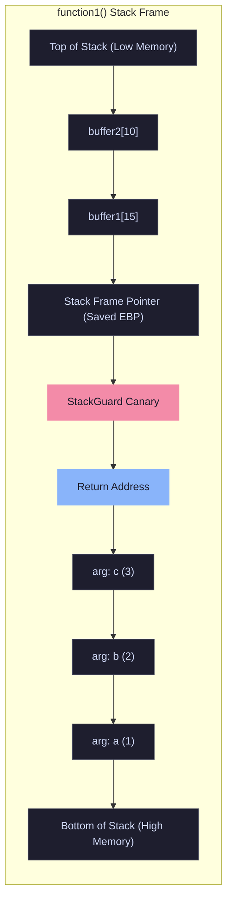
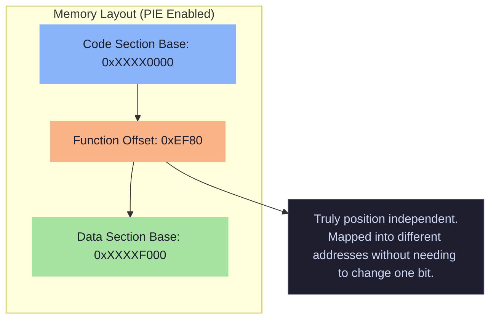
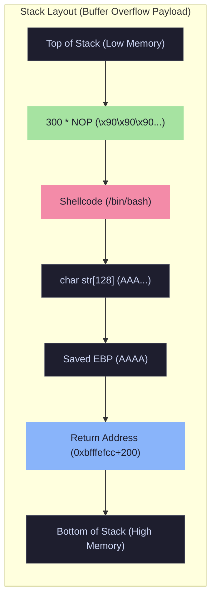

# Exploit Mitigations & Shellcoding

Modern compilers and operating systems deploy several layers of defense to prevent memory corruption exploits. Red teamers and exploit developers must understand these mitigations and know how to disable or bypass them during testing.

<Callout type="info" title="MITRE ATT&CK Mapping">
* [T1068 - Exploitation for Privilege Escalation](https://attack.mitre.org/techniques/T1068/)
* [T1027 - Obfuscated Files or Information](https://attack.mitre.org/techniques/T1027/)
</Callout>

---

## 1. Stack Canaries (`-fstack-protector`)

StackGuard works by inserting a small, random value known as a **canary** between the stack variables (buffers) and the function return address. When a stack-buffer overflows into the function return address, the canary is overwritten first. During function return, the canary value is checked. If the value has changed, the program is immediately terminated (`__stack_chk_fail`).

<Callout type="warning">
**Compiler Flags:**
* Enable: `gcc -fstack-protector`
* Disable: `gcc -fno-stack-protector`
</Callout>

### Stack Frame Layout with Canary


*To exploit a buffer overflow when a canary is present, an attacker must either leak the canary value or brute-force it, placing the correct value in the payload before overwriting the Return Address.*

---

## 2. Position Independent Code (PIE) & ASLR

The idea behind PIC/PIE is simple: add an additional level of indirection to all global data and function references in the code. By cleverly utilizing artifacts of the linking and loading processes, it's possible to make the text section of the binary truly position independent. It can be mapped into different memory addresses without needing to change one bit.

<Callout type="warning">
**Compiler Flags:**
* Enable: `gcc -fpie`
* Disable: `gcc -fno-pie`
</Callout>

### Memory Layout with PIE



### Address Space Layout Randomization (ASLR)

ASLR randomizes the base addresses where the executable and shared libraries are loaded. Even if PIE is enabled, ASLR must be active at the OS level to randomize the PIE base.

<Tabs>
  <Tab title="Linux ASLR">
    ```bash
    # Check ASLR status (0=Disabled, 1=Partial, 2=Full)
    cat /proc/sys/kernel/randomize_va_space

    # Disable ASLR temporarily
    sudo sysctl -w kernel.randomize_va_space=0
    # Enable Full ASLR
    sudo sysctl -w kernel.randomize_va_space=2

    # Better: Disable ASLR for a single binary execution (No root needed)
    setarch x86_64 -R ./vuln 
    ```
  </Tab>
  <Tab title="Windows ASLR (DEP/NX)">
    ```cmd
    :: Compile without ASLR (No PIE equivalent)
    cl vuln.c /link /DYNAMICBASE:NO 

    :: Patch an existing binary to remove ASLR
    editbin /DYNAMICBASE:NO vuln.exe 
    ```
  </Tab>
</Tabs>

---

## 3. NX Bit & Executable Stack (`-z execstack`)

The NX bit marks certain memory regions (like the stack and heap) as non-executable. If an attacker successfully injects shellcode into a buffer on the stack and redirects execution there, the CPU will throw a segmentation fault instead of executing the code.

<Callout type="warning">
**Compiler Flags:**
* Disable NX (Make stack executable): `gcc -z execstack`
* Enable NX: `gcc -z noexecstack`
</Callout>

### Post-Compilation Patching

You don't need to recompile the binary to change this flag. You can use the `execstack` tool.

```bash
# Clear the executable stack flag (Enable NX)
execstack -c bin.elf
checksec bin.elf

# Set the executable stack flag (Disable NX)
execstack -s bin.elf
checksec bin.elf
```

---

## 4. Shellcoding & NOP Sleds

A shellcode is a small piece of code used as the payload in the exploitation of a software vulnerability. It is called "shellcode" because it typically starts a command shell (`/bin/sh` or `cmd.exe`) from which the attacker can control the compromised machine, but any piece of code that performs a similar task can be called shellcode.

### NOP Sled Technique

When ASLR is disabled and the stack is executable (NX disabled), attackers use a NOP sled to handle slight variations in stack addresses. A NOP (`\x90`) instruction does nothing and simply moves to the next instruction. By placing a large block of NOPs before the shellcode, the attacker only needs to guess an address that lands *somewhere* inside the NOP sled. Execution will slide right into the shellcode.



### C Code: Shellcode Execution Test

This C code executes raw shellcode in memory. The shellcode provided spawns `/bin/bash` via `execve` syscall.

```c
#include <stdio.h>
#include <string.h>

char shellcode[] = "\x6a\x0b\x58\x99\x52\x66\x68\x2d\x70"
"\x89\xe1\x52\x6a\x68\x68\x2f\x62\x61"
"\x73\x68\x2f\x62\x69\x6e\x89\xe3\x52"
"\x51\x53\x89\xe1\xcd\x80";

int main(int argc, char *argv[]) {
    fprintf(stdout, "Length: %d\n", strlen(shellcode));
    
    // Cast the char array to a function pointer and execute it
    typedef void (*func)();
    func f = (func) &shellcode;
    f();
    
    return 0;
}
```

<Callout type="tip" title="Resource">
* [7feilee/shellcode GitHub Repo](https://github.com/7feilee/shellcode/tree/master)
</Callout>
