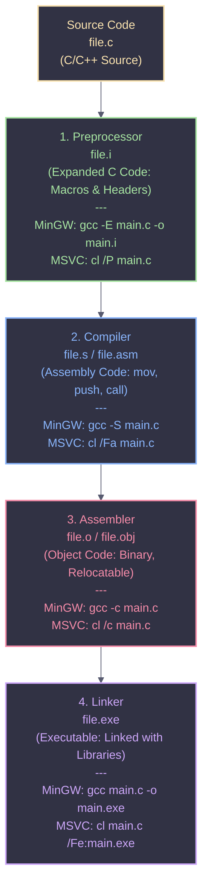

# Compile Time

When a C or C++ program is compiled using GCC or MSVC, the process goes through several distinct stages before producing the final executable. Using the `-save-temps` flag (`gcc -save-temps file.c`) retains all intermediate files, allowing reverse engineers and developers to inspect how the code transforms at each step.

<Callout type="info" title="MITRE ATT&CK Mapping">
Understanding compilation stages and flags is relevant to [T1027 - Obfuscated Files or Information](https://attack.mitre.org/techniques/T1027/), specifically for malware analysis and binary obfuscation.
</Callout>

---

## Compilation Flow Diagram



---

## Windows / MinGW Build Commands

Various compile commands for Windows executables and DLLs, optimized for different scenarios. Use the tabs below to navigate between standard builds, security mitigations, and anti-reverse engineering flags.

<Tabs>
  <Tab title="MSVC Standard (EXE)">
    ```batch
    cl.exe /nologo /Ox /MT /W0 /GS- /DNDEBUG /Tcimplant.cpp /link /OUT:implant.exe /SUBSYSTEM:CONSOLE /MACHINE:x64
    ```
    * `/Ox` – Optimize for speed.
    * `/MT` – Link with static runtime.
    * `/GS-` – Disable buffer security checks.
    * `/DNDEBUG` – Disable debug macros.
    * `/SUBSYSTEM:CONSOLE` – Console application.
    * `/MACHINE:x64` – Target 64-bit.
  </Tab>

  <Tab title="MSVC Standard (DLL)">
    ```batch
    cl.exe /D_USRDLL /D_WINDLL implant.cpp /MT /link /DLL /OUT:implant.dll
    ```
  </Tab>

  <Tab title="MinGW Console">
    ```bash
    x86_64-w64-mingw32-g++ implant.cpp -O3 -static -w -fno-stack-protector -fno-exceptions -fno-rtti -DNDEBUG -s -o tcimplant.exe
    ```
  </Tab>

  <Tab title="MinGW No Console (GUI)">
    ```bash
    x86_64-w64-mingw32-g++ implant.cpp -O3 -static -w -fno-stack-protector -fno-exceptions -fno-rtti -DNDEBUG -mwindows -s -o tcimplant.exe
    ```
    * `-mwindows` – Suppresses console window.
  </Tab>

  <Tab title="MinGW Debug Build">
    ```bash
    x86_64-w64-mingw32-g++ implant.cpp -g -O0 -Wall -o tcimplant.exe
    ```
  </Tab>

  <Tab title="MinGW Strong Security">
    <Callout type="warning" title="Defensive Build">
    Compiles the binary with built-in protections against memory corruption and buffer overflows.
    </Callout>
    ```bash
    x86_64-w64-mingw32-g++ implantc.cpp -O2 -D_FORTIFY_SOURCE=2 -fstack-protector-strong -fstack-clash-protection -Wl,--dynamicbase -Wl,--nxcompat -Wl,--high-entropy-va -Wall -Wextra -o secure.exe
    ```
  </Tab>

  <Tab title="MinGW Anti-Reverse">
    <Callout type="danger" title="Offensive Build">
    Compiles the binary to be as hard as possible to reverse engineer. Removes symbols and uses maximum optimization.
    </Callout>
    ```bash
    x86_64-w64-mingw32-g++ main.cpp -O3 -flto -fstack-protector-strong -fstack-clash-protection -fPIE -pie -s -o hard.exe
    x86_64-w64-mingw32-strip --strip-all hard.exe
    ```
  </Tab>

  <Tab title="MinGW DLL">
    ```bash
    x86_64-w64-mingw32-g++ -D_USRDLL -D_WINDLL -shared -static -o implant.dll main.cpp -lws2_32 -lwininet -ladvapi32 -Wl,--out-implib,libimplant.a
    i686-w64-mingw32-g++ -D_USRDLL -D_WINDLL -shared -static -o implant.dll main.cpp -lws2_32 -lwininet -ladvapi32 -Wl,--out-implib,libimplant.a
    ```
  </Tab>
</Tabs>

<Callout type="tip" title="Flag Explanations">
* `-O3` – Maximum optimization.
* `-static` – Static linking for portability.
* `-fno-stack-protector` / `-fno-exceptions` – Reduce extra checks for testing.
* `-flto` – Link-time optimization for smaller & faster binaries.
* `strip` / `-s` – Removes debug symbols for harder reverse engineering.
</Callout>
