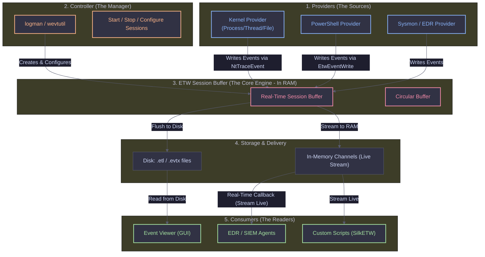
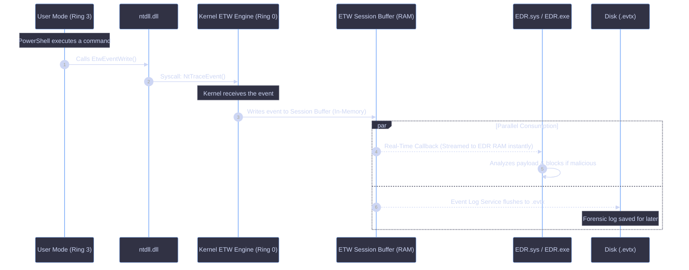

# ETW Architecture: The Nervous System of Windows

Event Tracing for Windows (ETW) is the core tracing mechanism built into the Windows OS. It allows kernel-mode and user-mode components to log events with minimal performance overhead. EDRs, Sysmon, and Event Viewer all rely on ETW to detect malicious behavior in real-time. Understanding its architecture—specifically how data flows from RAM to Disk, the role of controllers like `logman` and `wevtutil`, and how EDRs use Kernel Callbacks—is critical for both defenders and Red Teams.

<Callout type="info" title="MITRE ATT&CK Mapping">
[T1562 - Impair Defenses](https://attack.mitre.org/techniques/T1562/) (From an ETW Bypass perspective)
</Callout>


---

## The 3 Pillars of ETW

ETW is built on a decoupled architecture consisting of Providers, Controllers, and Consumers. This separation allows high-speed tracing without blocking the system.



### Where are ETW Logs Stored?

When a Provider generates an event, it doesn't write directly to a file. It triggers a syscall that writes to an **ETW Session Buffer** in Kernel Memory (RAM). From here, the data takes one of two paths:

<Steps>
  <Step title="The In-Memory Path (Real-Time Channels)">
    Events are streamed directly into RAM buffers. EDRs and SIEM agents act as real-time consumers, attaching to the session buffer and reading events via callbacks in milliseconds, *before they ever touch the disk*. This is the fastest method and how modern EDRs catch malware.
  </Step>
  <Step title="The Disk Path (Forensic/Event Viewer)">
    The Windows Event Log service (`wevsvc`) acts as a consumer. It reads from the real-time session buffer and writes the events to `.evtx` files on disk. Alternatively, controllers can write raw traces to `.etl` files for forensic analysis.
  </Step>
</Steps>

### The Exact Execution Flow (RAM vs Disk)

The diagram below illustrates exactly what happens when a user-mode application (like PowerShell) generates an ETW event. Notice how the Kernel intercepts the event, buffers it in RAM, and then allows parallel consumption by both the EDR (in-memory) and the Disk (forensic).



---

## Managing ETW & Event Logs

Built-in Windows command-line tools act as ETW Controllers. `logman` is used for tracing sessions, while `wevtutil` is used for managing structured Windows Event Logs.

<Tabs>
  <Tab title="logman (Trace Controller)">
    Used to debug telemetry and enumerate what EDRs are watching in real-time.

    **Enumerate Providers:**
    ```cmd
    logman query providers
    ```
    **Output Snippet:**
    ```text
    Name:
    ---------------------------------------------------------------------
    .NET Common Language Runtime
    Microsoft-Windows-Kernel-Process    <-- (Kernel Process/Thread telemetry)
    Microsoft-Windows-PowerShell        <-- (ScriptBlock logging)
    Microsoft-Windows-Sysmon            <-- (Sysmon EDR telemetry)
    Microsoft-Antimalware-AMFilter      <-- (Defender telemetry)
    ```

    **Start a Real-Time Trace to Disk:**
    ```cmd
    :: -p: Provider name | -o: Output file | -ets: Start immediately
    logman start "RedTeam_Trace" -p Microsoft-Windows-Kernel-Process -o C:\temp\kernel_trace.etl -ets

    :: Stop the trace and flush the buffer to disk
    logman stop "RedTeam_Trace" -ets
    ```
  </Tab>

  <Tab title="wevtutil (Log Controller)">
    Used to manage the Windows Event Log (`.evtx` files). It acts as a controller and consumer for structured logs saved on disk.

    **1. Enumerate ETW Publishers:**
    ```cmd
    wevtutil ep
    ```

    **2. Query Specific Logs (Finding Mimikatz via Event ID 4625):**
    ```cmd
    wevtutil qe Security /q:"*[System[(EventID=4625)]]" /f:text
    ```

    **3. Clear Event Logs (Red Team OPSEC - T1070.002):**
    Attackers clear the Security and System logs to destroy forensic evidence.
    ```cmd
    wevtutil cl Security
    wevtutil cl System
    wevtutil cl Application
    ```
  </Tab>
</Tabs>

---

## The Evolution of EDR Bypass: User-Mode vs. Kernel-Mode

<Callout type="danger" title="Why Patching EtwEventWrite is No Longer Enough">
In the past, EDRs used to hook `ntdll.dll` and read ETW events from User-Mode. Red Teams simply patched the `EtwEventWrite` function (overwriting it with a `RET` instruction) to blind the EDR.

**Modern EDRs defeated this by moving to Kernel-Mode ETW Callbacks.**
</Callout>

Instead of waiting for an event to hit `ntdll.dll`, the EDR Driver (`.sys`) registers a callback with the Windows Kernel using APIs like `EtwNotificationRegister` or by creating a dedicated Kernel ETW Session.

<Steps>
  <Step title="1. Syscall Transition">
    When an application calls `EtwEventWrite`, it triggers a syscall (`NtTraceEvent`), transitioning to Ring 0.
  </Step>
  <Step title="2. Kernel Intercept">
    The Kernel ETW Engine receives the event.
  </Step>
  <Step title="3. Callback Execution">
    **Before** the event is even placed in the session buffer, the Kernel invokes the EDR's registered callback function, passing a pointer to the raw event data (e.g., the PowerShell ScriptBlock text).
  </Step>
  <Step title="4. Inspection & Block">
    The EDR inspects the payload in Kernel Memory. If it detects malware, it can block the process *before* the event is ever written to RAM or Disk.
  </Step>
</Steps>

<Callout type="warning">
Because this happens entirely in Kernel-Mode (Ring 0), User-Mode applications (like your malware) cannot patch or bypass it by modifying `ntdll.dll`.
</Callout>

### Red Team OPSEC: Blinding Kernel ETW Callbacks

If you can't patch `ntdll.dll`, modern Red Teams use the following techniques to bypass Kernel ETW:

<Tabs>
  <Tab title="Kernel Driver (BYOVD)">
    The only way to stop a Kernel ETW callback is from inside the Kernel itself. Attackers load a vulnerable signed driver (Bring Your Own Vulnerable Driver) and use DKOM (Direct Kernel Object Manipulation) to unlink the EDR's callback from the kernel's internal ETW callback list (`EtwpNotificationList`).
  </Tab>
  <Tab title="Patching the Callback Function">
    Instead of unlinking, attackers overwrite the first bytes of the EDR's callback function pointer with `0x48, 0x31, 0xC0, 0xC3` (`XOR RAX, RAX; RET`), forcing the callback to immediately return without logging anything.
  </Tab>
  <Tab title="Direct Syscalls">
    While Direct Syscalls don't bypass Kernel ETW, they bypass User-Mode ETW and API Hooks, reducing the overall telemetry footprint and forcing the EDR to rely solely on Kernel callbacks (which are harder to tune for false positives).
  </Tab>
</Tabs>
