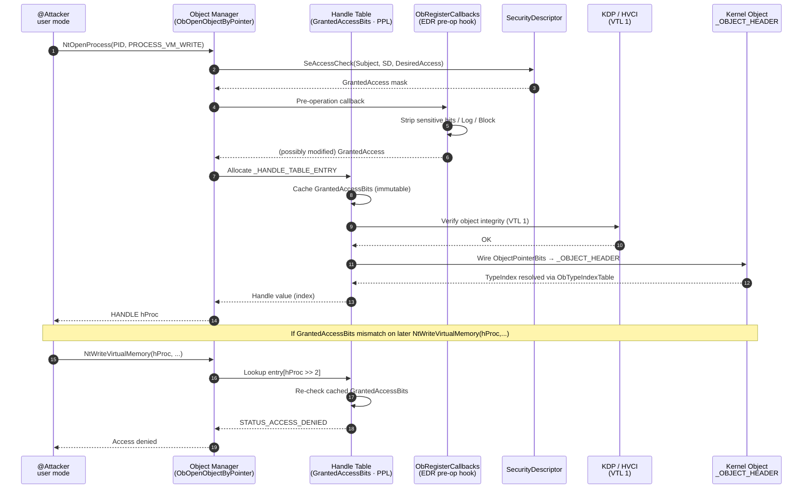

<Info>
  **Source:** *Windows Internals 7, Part 2* · *Vergilius Project*
  · Target architecture: **x64** · Estimated read time: ~12 min
</Info>

A deep dive into how Windows manages object references through a **three-tiered
handle table** — covering the four core kernel structures that bridge a process
to its objects.


---

## What is a Handle

In Windows, a **handle** is an opaque value that represents a reference to a
specific kernel object — be it a file, process, thread, event, mutex, or any
of the dozens of object types managed by the Object Manager. Rather than
handing out raw pointers (which would be a security nightmare and a stability
hazard), the kernel hands out small integer-like values that index into a
per-process structure called the **handle table**.

Every handle in the system lives inside a handle table owned by an
`_EPROCESS`. When a process calls `CreateFile`, `OpenProcess`, or any other
API that returns a handle, the kernel allocates an entry in the calling
process's handle table, fills it with the decoded pointer to the target
object header, and returns the index. When the handle is closed, that slot
is **recycled** for future use — making handle allocation a fast,
sub-microsecond operation in the common case.

### Why Handles Exist — The Security Model Behind the Abstraction

The handle abstraction was not introduced for convenience or elegance. It
exists because **handing raw kernel pointers to user mode is a catastrophic
security and stability failure**. If a process could read or write directly
to a `_EPROCESS`, `_KTHREAD`, or file object in kernel pool memory, the
entire protection boundary between user mode and kernel mode would
collapse: any user-mode process could elevate itself, terminate arbitrary
other processes, or simply corrupt kernel state and bugcheck the system.
Windows ships handles specifically so that **user-mode code never learns
the layout, the address, or even the existence of the underlying kernel
structures**. Every operation goes through a small set of well-audited
system calls — `NtCreate*`, `NtOpen*`, `NtRead*`, `NtWrite*`,
`NtClose` — and the kernel is free to reshuffle, repack, or rename its
internal structures across versions without breaking a single user-mode
binary. This is why a program compiled for Windows 7 still runs on
Windows 11 without recompilation, even though the size and layout of
`_EPROCESS` has changed dramatically between the two releases.

On top of this opacity, the handle table doubles as the **access-control
enforcement point**. Each `_HANDLE_TABLE_ENTRY` carries a 25-bit
`GrantedAccessBits` field — a cached snapshot of the access mask that was
granted at `Open*` time. Every subsequent API call (`ReadFile`,
`WriteFile`, `DuplicateHandle`, …) re-checks this mask against the
operation being requested, **without ever re-querying the security
descriptor**. This means an attacker who somehow obtains a handle with
`FILE_READ_DATA` cannot simply widen it to `FILE_WRITE_DATA` later — the
granted bits are immutable for the lifetime of that handle, and any
attempt to escalate rights triggers `STATUS_ACCESS_DENIED` before the
operation reaches the object itself.

<Expandable title="Handle recycling & use-after-free defenses" icon="shield">
  When a handle is closed, its slot is **not** zeroed and reused
  immediately on the next allocation. The kernel maintains a free-list
  chain (`NextFreeTableEntry`) and, on systems with the
  `StrictFIFO` flag set, deliberately avoids recycling the most recently
  freed slot. This makes the classic **handle-table use-after-free** race
  — where an attacker closes a handle, then races to re-open the slot
  with a different object type before the legitimate thread can detect
  the closure — substantially harder to win. Combined with the
  `RefCnt` lock-free counter on the entry itself, the kernel can detect
  concurrent close attempts and back off safely.
</Expandable>

### Threats the Handle Table Was Designed to Defeat

The design of the handle table is, in large part, a direct response to a
family of kernel-mode attacks that dominated the 2000s and 2010s. The
most prominent is **DKOM** — **Direct Kernel Object Manipulation**. In a
DKOM attack, a rootkit with kernel write capability (often obtained
through a vulnerable driver) patches live kernel structures in place:
flipping the `GrantedAccess` bits inside an `_HANDLE_TABLE_ENTRY` to grant
itself `PROCESS_ALL_ACCESS` on `csrss.exe`, hiding a malicious process by
un-linking it from the `ActiveProcessLinks` list, or zeroing out a
token's privilege fields to silently elevate. Because DKOM operates
directly on the bytes of the structures themselves, traditional
signature-based AV and most integrity checks are blind to it — the
"system call" never happens, so no hook ever fires.

<Warning title="Why DKOM is devastating against unhardened kernels">
  Pre-Vista Windows (and to a lesser extent, every version up to and
  including Windows 7 without the right mitigations) was wide open to
  DKOM. A driver with a write primitive could:

  - **Patch `_EPROCESS.Token`** to swap in the SYSTEM token — silent
    elevation in one store instruction.
  - **Patch `_HANDLE_TABLE_ENTRY.GrantedAccessBits`** to convert a
    read-only handle into a fully privileged one — no syscall, no audit.
  - **Unlink `_EPROCESS.ActiveProcessLinks`** to hide a process from
    `NtQuerySystemInformation` and Task Manager.
  - **Patch `_OBJECT_HEADER.PointerCount`** to prevent an object from
    ever being freed — a permanent kernel memory leak used by fileless
    rootkits.

  None of these attacks touch a system call, so EDR hooking and
  syscall-level filtering are useless against them.
</Warning>

### Modern Mitigations — Beyond the Handle Table

The handle table is only the first layer. Modern Windows stacks several
independent defenses on top of it, each addressing a different stage of
the attack chain. The table below summarizes the most important ones
that explicitly or implicitly protect kernel objects and handles from
DKOM-style tampering:

| Mitigation | Introduced | Layer | What it stops |
| --- | --- | --- | --- |
| **Handle table abstraction** | NT 3.1 | Object Manager | Forged pointers, raw pointer derefs from user mode |
| **`GrantedAccessBits` caching** | NT 4.0 | Object Manager | Privilege escalation on existing handles |
| **Kernel Patch Protection (PatchGuard)** | Vista x64 | Kernel | Persistent in-kernel DKOM hooks on `nt!` and `hal!` |
| **KASLR (kernel ASLR)** | Vista / 7 | Loader | Hard-coded kernel pointer targets |
| **Driver Signature Enforcement (DSE)** | Vista x64 | Loader | Loading unsigned malicious drivers in the first place |
| **WHQL signing** | Vista x64 | Loader | Forbids test-signed drivers in production |
| **Code Integrity (CI)** | 8 / 10 | Loader | Verifies image hashes at load and on-disk |
| **HVCI (Hypervisor-Protected Code Integrity)** | 10 (1607) | VTL 1 | Runtime kernel-code writes from any VTL 0 code, including the kernel itself |
| **IUM / Trustlets** | 10 (1507) | VTL 1 | Hostile VTL 0 reading secrets held by secure processes |
| **KDP (Kernel Data Protection)** | 10 (2004) | VTL 1 | Live DKOM writes to protected `_EPROCESS`, token, and handle-table regions |
| **ACG (Arbitrary Code Guard)** | 10 (1607) | Process | Writable+executable kernel/user pages |
| **CFG / kCFG (Control Flow Guard)** | 8.1 / 10 | Compiler | Dispatch hijacks into legit function pointers |
| **`StrictFIFO` handle recycling** | 7+ | Object Manager | Handle-table UAF races |
| **Protected Process Light (PPL)** | 8.1 | Object Manager | Even admin can't open `WinDefend` with `PROCESS_VM_READ` |
| **Sandboxed handle attribution** | 10 (RS5) | Object Manager | AppContainer handles can't escape the container |
| **WDAC (Windows Defender Application Control)** | 10 (1607) | Loader / CI | Loading unsigned or untrusted binaries — user-mode AND kernel-mode |
| **Credential Guard** | 10 (1607) | VTL 1 | Reading LSA secrets (NTLM hashes, Kerberos tickets, DPAPI keys) from VTL 0 |
| **LSA Protection (`RunAsPPL`)** | 8.1 / 10 (1809) | Object Manager | Even admin dumping `lsass.exe` memory |
| **CET Shadow Stack** | 11 (2020+) | CPU | ROP chains via return-address overwrite |
| **IBT (Indirect Branch Tracking)** | 11 (2020+) | CPU | JOP / indirect-branch hijack chains |
| **MBEC (Mode-Based Execute Control)** | 10 (1607) | Hypervisor | HVCI bypass via user-mode execution of kernel pages |
| **`ObRegisterCallbacks` (EDR hook surface)** | Vista / 7 | Object Manager | Silent handle creation to sensitive objects — every EDR hooks here |

<Expandable title="HVCI — Hypervisor-Protected Code Integrity" icon="shield">
  **HVCI** is arguably the single most consequential defense against DKOM
  introduced in the last decade. It uses the hypervisor (Hyper-V's
  Virtual Trust Level 1, **VTL 1**) to enforce that **no code running in
  VTL 0 — including the kernel itself — can make a writable kernel page
  executable, or vice versa.** Even if a rootkit obtains a full
  kernel-mode write primitive, it cannot:

  - Modify executable kernel code (every `nt!` and driver `.text`
    section is mapped read-only at the SLAT second-level page table).
  - Allocate new executable kernel memory.
  - Convert a data page into a code page to host a shellcode.

  The catch: HVCI requires a recent CPU with the right virtualization
  extensions (Intel VT-x with EPT + MBEC, or AMD-V with AVIC), and a
  UEFI firmware that supports the Windows virtualization-based security
  (VBS) launch protocol. On unsupported hardware, VBS/HVCI simply do not
  turn on, and the system falls back to the older CI-only checks — which
  are blind to runtime kernel patches.
</Expandable>

<Expandable title="WHQL — Windows Hardware Quality Labs signing" icon="shield">
  **WHQL** is the gating mechanism that decides which drivers may load
  on a production x64 Windows system. A driver must be:

  1. Built against a supported WDK and tested against the corresponding
     HLK kit.
  2. Submitted to Microsoft's Partner Center.
  3. Cryptographically signed by Microsoft (not just self-signed) with
     an attestation certificate that says *"we tested this on real
     hardware."*

  On a default Windows 10/11 x64 installation, `bcdedit` enforces
  `nointegritychecks` and `testsigning` to **off**, meaning test-signed
  or self-signed drivers will be rejected at load time. This closes the
  historical path of "ship a vulnerable signed driver, then use it as a
  read/write primitive" — though attestation-signed vulnerable drivers
  still leak through occasionally (the **Bring Your Own Vulnerable
  Driver**, or BYOVD, attack class), which is why Microsoft maintains
  the **Vulnerable Driver Blocklist** shipped through Windows Update.
</Expandable>

<Expandable title="KDP — Kernel Data Protection" icon="shield">
  **KDP** extends HVCI's protection from code to **data**. Selected
  regions of kernel memory — including parts of `_EPROCESS`, the security
  token, certain `_OBJECT_HEADER` fields, and a growing list of other
  structures — are marked as **read-only at the hypervisor level (VTL
  1)**, even from kernel code running in VTL 0. This means a rootkit
  that has fully compromised the kernel **still cannot**:

  - Swap a process's `_EPROCESS.Token` pointer to gain SYSTEM.
  - Patch `_EPROCESS.SigningLevel` to forge a PPL process.
  - Modify the global `ObTypeIndexTable` to redirect type dispatch.

  KDP requires HVCI to be active; without VTL 1 backing it, the
  hypervisor cannot enforce the read-only attribute. As of Windows 10
  version 2004 and later, KDP coverage of `_EPROCESS` is opt-in by
  setting the appropriate kernel protection flag at process creation.
</Expandable>

<Expandable title="PPL — Protected Process Light" icon="shield">
  **PPL** extends the original Vista-era "Protected Process" concept
  (which was built for DRM / media path protection) to general-purpose
  security-critical processes such as `WinDefend` (the Windows Defender
  service), `MsMpEng.exe`, and the LSA-isolated process on systems with
  `RunAsPPL` enabled. A PPL process is protected **by the handle table
  itself**: when `NtOpenProcess` is called against a PPL target, the
  Object Manager checks the protection level of both the caller and the
  target, and refuses to grant `PROCESS_VM_READ`, `PROCESS_VM_WRITE`,
  `PROCESS_CREATE_THREAD`, `PROCESS_DUP_HANDLE`, or
  `PROCESS_QUERY_LIMITED_INFORMATION` unless the caller's protection
  level is **strictly greater** than the target's. This means even an
  administrator-level attacker cannot inject into, dump the memory of,
  or duplicate handles out of `WinDefend`. The only way to bypass PPL
  is to either (a) compromise a process running at a higher protection
  level, or (b) load a kernel driver — which on a properly hardened
  system requires WHQL + HVCI bypass.
</Expandable>

<Expandable title="BYOVD & the Vulnerable Driver Blocklist" icon="shield">
  **BYOVD** — **Bring Your Own Vulnerable Driver** — is the modern
  escape hatch against all of the above. The attacker ships a
  legitimately WHQL-signed but vulnerable driver (`rtcore64.sys`,
  `gdrv.sys`, `iqvw64.sys`, etc.) alongside their payload, loads it via
  `sc create` (admin only), and exploits the driver's read/write
  primitive to perform DKOM from the comfort of a sanctioned kernel
  module. Because the driver is WHQL-signed, DSE does not stop it.

  Microsoft's response is the **Vulnerable Driver Blocklist** — a
  signed, Windows-Update-distributed list of driver file hashes and
  signer certificates that the kernel refuses to map. It is enabled by
  default since Windows 11 22H2 and is also back-ported to supported
  Windows 10 builds. Combined with HVCI, this closes the gap: even if
  the attacker finds a new BYOVD target, the runtime write primitive
  cannot produce executable kernel code on HVCI-protected systems.
</Expandable>

### Putting It Together — Defense in Depth

The handle table is the **first line of defense**, not the last. A modern
Windows 11 system with VBS + HVCI + KDP + PPL + the Vulnerable Driver
Blocklist presents a layered defense: each layer is bypassable in
isolation, but the combination requires the attacker to chain multiple
independent 0-days just to reach the structures the handle table
protects. The diagram below shows how these layers stack:



<Tip title="Why the handle table is still relevant">
  Even with all of the above mitigations in place, the handle table
  remains the **single chokepoint** through which every user-mode
  reference to a kernel object must pass. EDRs hook at this layer
  (`ObRegisterCallbacks` for object pre/post-operation callbacks),
  Microsoft uses it to enforce PPL and Sandbox boundaries, and KDP still
  has to mark specific `_EPROCESS` fields as protected. Understanding
  the handle table is therefore understanding the foundation on which
  every other defense stands.
</Tip>

| Metric | Value | Note |
| --- | --- | --- |
| Hierarchy tiers | **3** | Top → Middle → Leaf |
| Size per handle entry | **16 B** | `_HANDLE_TABLE_ENTRY` |
| Max handles per process | **~16 M** | Theoretical 4.17 M × tiered pools |
| Default leaf entries | **255** | Allocated on first handle creation |

---

## Three-Tier Hierarchy

To keep memory usage proportional to the actual number of handles a process
owns, the handle table is structured as a **three-tiered lookup tree**. Only
the leaf (subhandle) table is allocated up front; higher tiers are spun up
on demand as the process accumulates more handles.

<Steps>
  ### Top-Level Table
  Holds **32 entries**. Each entry points to a middle-level table.
  Allocated lazily once a process crosses ~128 K handles.

  ### Middle-Level Table
  Holds **512 entries**. Each entry points to a subhandle table.
  Allocated lazily as the process crosses ~255 handles.

  ### Subhandle Table (Leaf)
  Holds **255 entries** (one is reserved for bookkeeping).
  This is the only table allocated initially — every process starts here.
</Steps>

The bottom two bits of the `TableCode` field in `_HANDLE_TABLE` encode how
many levels are currently in use (0, 1, or 2). When a process holds fewer
than ~255 handles, only one subhandle table is needed and the lookup is a
single dereference. As handles grow, middle and top-level tables are layered
on top.

<Note title="Capacity math">
  `32 × 512 × 255 = 4,177,920` — but the practical per-process ceiling sits
  at ~16 million because each tier is sized in page-aligned chunks. The
  system-wide limit is enforced separately through quota.
</Note>

---

## `_HANDLE_TABLE_ENTRY`

<Card title="_HANDLE_TABLE_ENTRY" icon="cube">
  **Size:** `0x10` bytes (16 B)  ·  **Type:** `union`

  Describes a single handle in memory. The `TableCode` field in
  `_HANDLE_TABLE` points to an array of these entries. It's a **union** —
  the same 16 bytes are interpreted differently depending on whether the
  slot is free, locked, or holding a live object reference.
</Card>

```c
// 0x10 bytes (sizeof)
union _HANDLE_TABLE_ENTRY {
    volatile LONGLONG VolatileLowValue;
    LONGLONG LowValue;
    struct {
        struct _HANDLE_TABLE_ENTRY_INFO* volatile InfoTable;
        LONGLONG HighValue;
        union _HANDLE_TABLE_ENTRY* NextFreeHandleEntry;
        struct _EXHANDLE LeafHandleValue;
    };
    LONGLONG RefCountField;
    ULONGLONG Unlocked:1;
    ULONGLONG RefCnt:16;
    ULONGLONG Attributes:3;
    struct {
        ULONGLONG ObjectPointerBits:44;
        ULONG GrantedAccessBits:25;
        ULONG NoRightsUpgrade:1;
        ULONG Spare1:6;
    };
    ULONG Spare2;
};
```

<Note title="Decoding `ObjectPointerBits`">
  The 44-bit `ObjectPointerBits` field is shifted left by 4 to recover the
  actual kernel pointer to `_OBJECT_HEADER`. The low nibble is implicitly
  zero — every kernel object is 16-byte aligned. This packing lets the same
  8 bytes carry both the pointer **and** the granted access mask.
</Note>

<Fields title="Key fields at a glance">
  - **`ObjectPointerBits` (44 bits)** — Encoded pointer to `_OBJECT_HEADER`. Shift left by 4 to decode.
  - **`GrantedAccessBits` (25 bits)** — Cached granted access mask. Avoids a trip to the security descriptor on every API call.
  - **`RefCnt` (16 bits)** — Lock-free reference count for concurrent handle operations.
  - **`Attributes` (3 bits)** — `OBJ_INHERIT`, `OBJ_PROTECT_CLOSE`, `OBJ_AUDIT_OBJECT_CLOSE`.
  - **`NextFreeHandleEntry`** — Used only when the slot is free; chains the free list.
</Fields>

---

## `_HANDLE_TABLE`

<Card title="_HANDLE_TABLE" icon="cube">
  **Size:** `0x80` bytes (128 B)  ·  **Type:** `struct`

  Tracks and manages all handles belonging to a single process. It is
  referenced through the `ObjectTable` field of `_EPROCESS`. The structure
  owns the root pointer of the three-tier lookup tree, free-list
  bookkeeping, and the per-table locks used during concurrent handle
  creation and close.
</Card>

```c
// 0x80 bytes (sizeof)
struct _HANDLE_TABLE {
    ULONG NextHandleNeedingPool;
    LONG ExtraInfoPages;
    volatile ULONGLONG TableCode;
    struct _EPROCESS* QuotaProcess;
    struct _LIST_ENTRY HandleTableList;
    ULONG UniqueProcessId;
    union {
        ULONG Flags;
        struct {
            UCHAR StrictFIFO:1;
            UCHAR EnableHandleExceptions:1;
            UCHAR Rundown:1;
            UCHAR Duplicated:1;
            UCHAR RaiseUMExceptionOnInvalidHandleClose:1;
        };
    };
    struct _EX_PUSH_LOCK HandleContentionEvent;
    struct _EX_PUSH_LOCK HandleTableLock;
    union {
        struct _HANDLE_TABLE_FREE_LIST FreeLists[1];
        struct {
            UCHAR ActualEntry[32];
            struct _HANDLE_TRACE_DEBUG_INFO* DebugInfo;
        };
    };
};
```

<Warning title="`TableCode` packing">
  The low **2 bits** of `TableCode` are **not** part of the pointer — they
  encode the current depth of the lookup tree:

  | Bits [1:0] | Depth | Meaning |
  | --- | --- | --- |
  | `00` | 0 | Single leaf table (≤ 255 handles) |
  | `01` | 1 | Two tiers — middle + leaf |
  | `10` | 2 | Full three-tier tree |

  Mask off the bottom two bits before dereferencing, or you'll crash the
  kernel with an unaligned access.
</Warning>

<Fields title="Key fields at a glance">
  - **`TableCode`** — Root pointer + 2-bit depth encoding. The gateway to the entire lookup tree.
  - **`QuotaProcess`** — Back-pointer to the owning `_EPROCESS`; used for pool quota chargeback.
  - **`HandleTableList`** — Links all handle tables in the system into a global list (used by `!handle` and rundown).
  - **`NextHandleNeedingPool`** — Hint for the next allocation boundary; the kernel uses this to know when to grow.
  - **`Flags` / `StrictFIFO`** — Free-list policy: FIFO avoids reusing recently freed slots (better cache locality & security).
</Fields>

---

## `_OBJECT_HEADER`

<Card title="_OBJECT_HEADER" icon="cube">
  **Size:** `0x38` bytes (56 B)  ·  **Type:** `struct`  ·  **Source:** Vergilius Project

  This structure precedes every kernel object in pool memory. It carries
  metadata such as reference and handle counts, the type index used to look
  up the `_OBJECT_TYPE`, optional security descriptor, and quota
  bookkeeping. When kernel code says "object pointer," it actually points
  to the `Body` field; the header sits a fixed offset behind it.
</Card>

```c
// 0x38 bytes (sizeof), src: Vergilius Project
struct _OBJECT_HEADER
{
    LONGLONG PointerCount;                                                  //0x0
    union
    {
        LONGLONG HandleCount;                                               //0x8
        VOID* NextToFree;                                                   //0x8
    };
    struct _EX_PUSH_LOCK Lock;                                              //0x10
    UCHAR TypeIndex;                                                        //0x18
    union
    {
        UCHAR TraceFlags;                                                   //0x19
        struct
        {
            UCHAR DbgRefTrace:1;                                            //0x19
            UCHAR DbgTracePermanent:1;                                      //0x19
        };
    };
    UCHAR InfoMask;                                                         //0x1a
    union
    {
        UCHAR Flags;                                                        //0x1b
        struct
        {
            UCHAR NewObject:1;                                              //0x1b
            UCHAR KernelObject:1;                                           //0x1b
            UCHAR KernelOnlyAccess:1;                                       //0x1b
            UCHAR ExclusiveObject:1;                                        //0x1b
            UCHAR PermanentObject:1;                                        //0x1b
            UCHAR DefaultSecurityQuota:1;                                   //0x1b
            UCHAR SingleHandleEntry:1;                                      //0x1b
            UCHAR DeletedInline:1;                                          //0x1b
        };
    };
    ULONG Reserved;                                                         //0x1c
    union
    {
        struct _OBJECT_CREATE_INFORMATION* ObjectCreateInfo;                //0x20
        VOID* QuotaBlockCharged;                                            //0x20
    };
    VOID* SecurityDescriptor;                                               //0x28
    struct _QUAD Body;                                                      //0x30
};
```

<Tip title="`TypeIndex` → object type lookup">
  `TypeIndex` is a single byte indexing into the global `ObTypeIndexTable`.
  Each entry there points to an `_OBJECT_TYPE` instance (Process, Thread,
  File, Event, …). This indirection is why two completely different objects
  can share the same header layout.
</Tip>

<Fields title="Key fields at a glance">
  - **`PointerCount`** — Total references (kernel + handle-derived). Object is freed when this hits zero.
  - **`HandleCount`** — Number of open handles pointing to this object. When non-zero, `PointerCount` ≥ `HandleCount`.
  - **`TypeIndex`** — Index into `ObTypeIndexTable`; resolves to `_OBJECT_TYPE`.
  - **`InfoMask`** — Bitmap describing which optional info structs (quota, name, creator, security) precede the header.
  - **`SecurityDescriptor`** — Self-relative SD; governs access checks on this object instance.
</Fields>

---

## `_OBJECT_TYPE`

<Card title="_OBJECT_TYPE" icon="cube">
  **Size:** `0xd8` bytes (216 B)  ·  **Type:** `struct`  ·  **Source:** Vergilius Project

  Defines a class of objects in the Windows kernel. An object type bundles
  a name (e.g. `"Process"`, `"File"`), a pool type, accounting counters,
  and an initializer holding all the type-specific callbacks — open, close,
  parse, security, query-name, and more. Every
  `_OBJECT_HEADER.TypeIndex` ultimately resolves to one of these.
</Card>

```c
// 0xd8 bytes (sizeof), src: Vergilius Project
struct _OBJECT_TYPE {
    struct _LIST_ENTRY TypeList;                          // 0x0
    struct _UNICODE_STRING Name;                          // 0x10
    VOID* DefaultObject;                                  // 0x20
    UCHAR Index;                                          // 0x28
    ULONG TotalNumberOfObjects;                           // 0x2c
    ULONG TotalNumberOfHandles;                           // 0x30
    ULONG HighWaterNumberOfObjects;                       // 0x34
    ULONG HighWaterNumberOfHandles;                       // 0x38
    struct _OBJECT_TYPE_INITIALIZER TypeInfo;             // 0x40
    struct _EX_PUSH_LOCK TypeLock;                        // 0xb8
    ULONG Key;                                            // 0xc0
    struct _LIST_ENTRY CallbackList;                      // 0xc8
};
```

<Info title="Built-in object types">
  Windows defines **~40+ object types** at boot, each with its own
  `_OBJECT_TYPE` instance living in the kernel's non-paged pool:

  <Badge text="Process" variant="lightGray" /> <Badge text="Thread" variant="lightGray" />
  <Badge text="File" variant="lightGray" /> <Badge text="Event" variant="lightGray" />
  <Badge text="Mutant" variant="lightGray" /> <Badge text="Semaphore" variant="lightGray" />
  <Badge text="Section" variant="lightGray" /> <Badge text="Key" variant="lightGray" />
  <Badge text="Token" variant="lightGray" /> <Badge text="Desktop" variant="lightGray" />
  <Badge text="IoCompletion" variant="lightGray" /> <Badge text="Timer" variant="lightGray" />
  <Badge text="SymbolicLink" variant="lightGray" /> <Badge text="Directory" variant="lightGray" />
  <Badge text="Type" variant="lightGray" /> <Badge text="DebugObject" variant="lightGray" />
  <Badge text="EventPair" variant="lightGray" /> <Badge text="Job" variant="lightGray" />
  <Badge text="FilterConnectionPort" variant="lightGray" /> <Badge text="ControllerObject" variant="lightGray" />
</Info>

<Fields title="Key fields at a glance">
  - **`Name`** — Unicode string: `"Process"`, `"File"`, `"Event"`, etc. Shown by `WinObj` and `!object`.
  - **`Index`** — Slot in `ObTypeIndexTable`. Matches `TypeIndex` in `_OBJECT_HEADER`.
  - **`TotalNumberOfObjects` / `TotalNumberOfHandles`** — Live counters; queryable via `NtQueryObject`.
  - **`HighWaterNumberOfObjects` / `HighWaterNumberOfHandles`** — Peak values; useful for capacity planning.
  - **`TypeInfo`** — `_OBJECT_TYPE_INITIALIZER` holding all callbacks (`OpenProcedure`, `CloseProcedure`, `ParseProcedure`, `SecurityProcedure`, `QueryNameProcedure`, …).
</Fields>

---

## End-to-End Lookup

Putting it all together — the journey from a process control block to the
actual object type name traverses four structures:
`_EPROCESS` → `_HANDLE_TABLE` → `_handle_table_entry` →
`_OBJECT_HEADER` → `_OBJECT_TYPE`.

```mermaid
graph LR
    subgraph EP["_EPROCESS"]
        direction TB
        UPI["UniqueProcessId"]
        AL["ActiveProcessLinks"]
        IFN["ImageFileName"]
        OT["ObjectTable"]
        TH["ThreadListHead"]
    end

    subgraph HT["_HANDLE_TABLE"]
        direction TB
        TC["TableCode"]
        QC["QuotaProcess"]
        HC["HandleCount"]
        HCL["HandleTableList"]
        FL["Flags"]
    end

    subgraph ENTRIES["handle_table_entries — 4096 Bytes<br/>(256 × 16 B)"]
        direction TB
        R0["0x00 — Reserved"]
        E1["0x04 — Entry 1"]
        E2["0x08 — Entry 2"]
        EN["0x10 — Entry ..."]
        E256["0x100 — Entry 256"]
        R0 --- E1 --- E2 --- EN -.-> E256
    end

    subgraph HTE["_handle_table_entry"]
        direction TB
        OPB["ObjectPointerBits"]
        UL["GrantedAccessBits"]
        AX["AccessMask"]
        NF["NextFreeTableEntry"]
    end

    subgraph OH["_object_header"]
        direction TB
        TI["TypeIndex"]
        RC["ReferenceCount"]
        HS["HandleCount"]
        OBJ["Object Body"]
    end

    subgraph OTYPE["_object_type"]
        direction TB
        NAME["Name"]
        PO["PoolType"]
        TNO["TotalNumberOfObjects"]
        TNH["TotalNumberOfHandles"]
    end

    OT -->|"pointer"| HT
    TC -->|"base addr"| R0
    E1 -->|"decode"| HTE
    OPB -->|"points to"| OH
    TI -.->|"indexes"| OTYPE

    style EP fill:#000000,stroke:#ff0040,stroke-width:2px,color:#ff00ff
    style HT fill:#000000,stroke:#00d4ff,stroke-width:2px,color:#00ffff
    style ENTRIES fill:#000000,stroke:#ff0040,stroke-width:2px,color:#00d4ff
    style HTE fill:#000000,stroke:#00d4ff,stroke-width:2px,color:#00ffff
    style OH fill:#000000,stroke:#ff0040,stroke-width:2px,color:#ff8080
    style OTYPE fill:#000000,stroke:#00d4ff,stroke-width:2px,color:#00ff88

    style UPI fill:#000000,stroke:#ff0040,stroke-width:1px,color:#ff00ff
    style AL fill:#000000,stroke:#ff0040,stroke-width:1px,color:#ff00ff
    style IFN fill:#000000,stroke:#ff0040,stroke-width:1px,color:#ff00ff
    style OT fill:#000000,stroke:#ff0040,stroke-width:1px,color:#ff00ff
    style TH fill:#000000,stroke:#ff0040,stroke-width:1px,color:#ff00ff

    style TC fill:#000000,stroke:#00d4ff,stroke-width:1px,color:#00ffff
    style QC fill:#000000,stroke:#00d4ff,stroke-width:1px,color:#00ffff
    style HC fill:#000000,stroke:#00d4ff,stroke-width:1px,color:#00ffff
    style HCL fill:#000000,stroke:#00d4ff,stroke-width:1px,color:#00ffff
    style FL fill:#000000,stroke:#00d4ff,stroke-width:1px,color:#00ffff

    style R0 fill:#000000,stroke:#ff0040,stroke-width:1px,color:#ff8080
    style E1 fill:#000000,stroke:#ff0040,stroke-width:1px,color:#ff8080
    style E2 fill:#000000,stroke:#ff0040,stroke-width:1px,color:#ff8080
    style EN fill:#000000,stroke:#ff0040,stroke-width:1px,color:#ff8080
    style E256 fill:#000000,stroke:#ff0040,stroke-width:1px,color:#ff8080

    style OPB fill:#000000,stroke:#00d4ff,stroke-width:1px,color:#00ffff
    style UL fill:#000000,stroke:#00d4ff,stroke-width:1px,color:#00ffff
    style AX fill:#000000,stroke:#00d4ff,stroke-width:1px,color:#00ffff
    style NF fill:#000000,stroke:#00d4ff,stroke-width:1px,color:#00ffff

    style TI fill:#000000,stroke:#ff0040,stroke-width:1px,color:#ff8080
    style RC fill:#000000,stroke:#ff0040,stroke-width:1px,color:#ff8080
    style HS fill:#000000,stroke:#ff0040,stroke-width:1px,color:#ff8080
    style OBJ fill:#000000,stroke:#ff0040,stroke-width:1px,color:#ff8080

    style NAME fill:#000000,stroke:#00d4ff,stroke-width:1px,color:#00ff88
    style PO fill:#000000,stroke:#00d4ff,stroke-width:1px,color:#00ff88
    style TNO fill:#000000,stroke:#00d4ff,stroke-width:1px,color:#00ff88
    style TNH fill:#000000,stroke:#00d4ff,stroke-width:1px,color:#00ff88

    linkStyle default stroke:#ff0040,stroke-width:2px,color:#00d4ff
    linkStyle 4 stroke:#00d4ff,stroke-width:2px
```



<Note title="The lookup in one line">
  ```c
  ObjectHeader = (HANDLE_TABLE_ENTRY.ObjectPointerBits << 4);
  ObjectType   = ObTypeIndexTable[ObjectHeader->TypeIndex];
  ```
  That's the entire journey from a user-mode `HANDLE` to a human-readable
  type name like `"Process"` or `"File"`.
</Note>

<Tabs>
  <Tab title="WinDbg">
    ```text
    !process 0 0 explorer.exe
    # → grab the _EPROCESS address

    dx (*((nt!_EPROCESS*)0xffffc80f_12345678)).ObjectTable
    # → _HANDLE_TABLE *

    !handle 0 f 0xffffc80f_12345678
    # → enumerate all handles

    dt nt!_OBJECT_HEADER @HeaderAddr
    # → inspect header

    !object <body_ptr>
    # → resolves _OBJECT_TYPE, prints name
    ```
  </Tab>

  <Tab title="Python (with ctypes)">
    ```python
    def decode_object_pointer(entry: int) -> int:
        """Extract _OBJECT_HEADER pointer from _HANDLE_TABLE_ENTRY."""
        OBJECT_POINTER_BITS_MASK = (1 << 44) - 1
        bits = entry & OBJECT_POINTER_BITS_MASK
        return bits << 4   # low nibble is always zero (16-byte align)

    def lookup_object_type(header_ptr: int, ob_type_index_table: list[int]) -> str:
        """Read TypeIndex byte and resolve to _OBJECT_TYPE.Name."""
        type_index = read_byte(header_ptr + 0x18)
        object_type = ob_type_index_table[type_index]
        return read_unicode_string(object_type + 0x10)
    ```
  </Tab>

  <Tab title="Cheat sheet">
    | Step | Structure | Field | Operation |
    | --- | --- | --- | --- |
    | 1 | `_EPROCESS` | `ObjectTable` | Read pointer |
    | 2 | `_HANDLE_TABLE` | `TableCode` | Mask `& ~3` for ptr, `& 3` for depth |
    | 3 | Leaf table | `[handle >> 2]` | Index entry |
    | 4 | `_HANDLE_TABLE_ENTRY` | `ObjectPointerBits` | `<< 4` to decode |
    | 5 | `_OBJECT_HEADER` | `TypeIndex` | Index into `ObTypeIndexTable` |
    | 6 | `_OBJECT_TYPE` | `Name` | Read `_UNICODE_STRING` |
  </Tab>
</Tabs>
