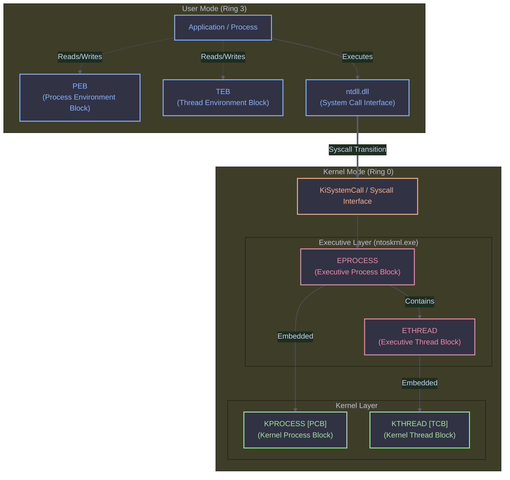
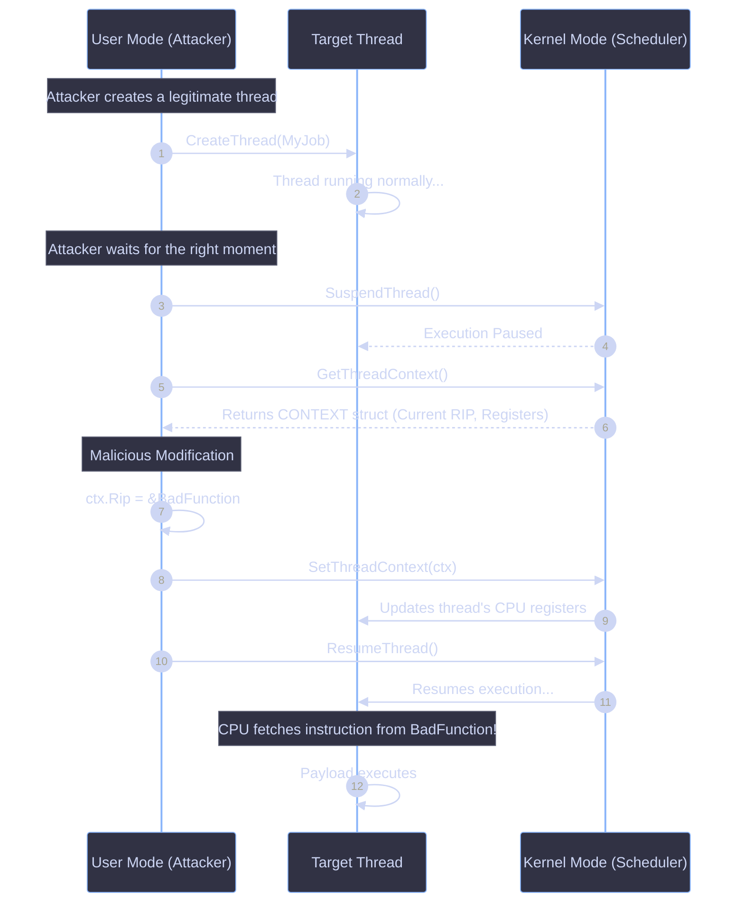

# Thread Architecture & Context Hijacking

A **thread** is the smallest entity that is scheduled by the kernel to execute code. No thread, no execution. A process without a thread is just a very expensive paperweight. A process can contain multiple threads, and each one runs independently.


---

## What a Thread Actually Contains

A thread is more than just a sequence of instructions. It is a complex structure maintained by the Windows Kernel to ensure independent execution, state isolation, and efficient CPU scheduling.

<Steps>
  <Step title="1. Thread Context & Access Mode">
    Each thread maintains the **state of CPU registers** (Context), which includes the instruction pointer, stack pointer, and general-purpose registers.
    Windows exposes this through `GetThreadContext()`, which returns a `CONTEXT` structure.
    Additionally, a thread tracks its **current access mode** (User mode or Kernel mode), depending on whether it is executing normal application code or system calls.
  </Step>

  <Step title="2. Two Stacks (User & Kernel)">
    Each thread has:
    * A **user-mode stack**: Used when the thread runs normal application code.
    * A **kernel-mode stack**: Used when the thread enters the kernel (system calls, interrupts, drivers).

    <Callout type="warning">
    The CPU stack pointer register always points to the active stack. Separate stacks prevent user-mode corruption from directly smashing kernel execution. Windows learned that lesson the hard way.
    </Callout>
  </Step>

  <Step title="3. Thread-Local Storage (TLS)">
    TLS is private memory owned by each thread. Used by runtime libraries, DLLs, and subsystems. If multiple threads run inside one process, TLS ensures each thread gets its own private copy of certain data instead of sharing it. Without TLS, multithreading would be a race-condition festival.
  </Step>

  <Step title="4. Thread ID (TID) & Client ID">
    Every thread has a unique identifier called a **Thread ID (TID)**. Process IDs (PIDs) and Thread IDs come from the same namespace and never overlap. Internally, both are part of a structure called the **Client ID**.
  </Step>

  <Step title="5. Scheduling Attributes (Priority & State)">
    The kernel schedules threads based on their **Priority** (e.g., background vs. foreground). A thread is always in one of several **States**:
    * **Running**: Currently executing on a CPU.
    * **Ready**: Waiting for an available CPU.
    * **Waiting**: Blocked on an I/O operation, synchronization object, or event.
  </Step>

  <Step title="6. Optional Security Token">
    Sometimes a thread has its own security token. This is common in multithreaded servers or applications that impersonate clients.
    <Callout type="info">
    A web server thread impersonates the user making a request so file access checks apply to that user. The process may run as SYSTEM, but the thread temporarily acts as a lower-privileged user. Very useful. Also very dangerous if mishandled.
    </Callout>
  </Step>

  <Step title="7. Optional Message Queue & Windows">
    Threads that interact with the user interface (GUI threads) can optionally own a **message queue** and the **windows** they create. This is how the Windows GUI subsystem routes input (like keystrokes and mouse clicks) to the specific thread that owns the window.
  </Step>
</Steps>



---

## Thread Context & TLS Examples

Because CPU architectures differ, the `CONTEXT` structure is architecture-specific. That is why `CONTEXT` looks different on x86, x64, and ARM64.

<Tabs>
  <Tab title="TLS Variable Example (C++)">
    Demonstrates how `__declspec(thread)` creates a private copy of a variable for each thread.

    ```cpp
    #include <windows.h>
    #include <cstdio>
    #include <thread>

    __declspec(thread) int val; // TLS variable

    void TLSThreadFunc() {
        printf("\nValue inside thread : 0x%x\n", val);
        val = 0x29a;
        printf("Value changed inside thread : 0x%x\n", val);
    }

    int main() {
        val = 0xdeadbeef;
        printf("Value before thread : 0x%x\n", val);
        
        std::thread t1(&TLSThreadFunc);
        t1.join();
        
        printf("\nValue after thread : 0x%x\n", val);
        printf("\n--> Press enter to continue...\n");
        getchar();
        
        return 0;
    }
    ```
  </Tab>
  <Tab title="Thread Context Hijack (C++)">
    This technique suspends a thread, modifies its Instruction Pointer (`Rip`) to point to a malicious function, and resumes it. This is a stealthy method for process injection.

    ```cpp
    #include <windows.h>
    #include <iostream>

    void MyJob() {
        for (int i = 0;; i++) {
            std::cout << i << "\n";
            Sleep(500);
        }
    }

    void BadFunction() {
        MessageBoxA(nullptr, "HIJACKED", "OK", 0);
        ExitThread(0);
    }

    int main() {
        HANDLE Ht1 = CreateThread(
            nullptr, 0, (LPTHREAD_START_ROUTINE)MyJob, nullptr, 0, nullptr
        );

        Sleep(5000); // Let it run for a bit

        SuspendThread(Ht1); // Pause execution

        CONTEXT ctx{};
        ctx.ContextFlags = CONTEXT_CONTROL;
        GetThreadContext(Ht1, &ctx); // Grab the current CPU state

        ctx.Rip = (DWORD_PTR)&BadFunction; // Overwrite Instruction Pointer
        SetThreadContext(Ht1, &ctx);        // Inject new state

        ResumeThread(Ht1); // Execution jumps to BadFunction

        WaitForSingleObject(Ht1, INFINITE);

        std::cout << "Program finished\n";
        return 0;
    }
    ```
  </Tab>
</Tabs>

---

## Context Hijack Execution Flow

The diagram below illustrates how an attacker manipulates the thread context to redirect execution flow without creating a new thread (which would trigger EDR callbacks).



---

## Quick Mental Model

Think of a thread as a combination of specific components that Windows constantly pauses, saves, restores, and rotates like plates in a circus act.

<CardGroup cols={3}>
  <Card title="CPU State & Mode" icon="terminal">
    The Thread Context (Registers, Instruction Pointer) and the current Access Mode (User/Kernel).
  </Card>
  <Card title="Memory Boundaries" icon="database">
    Two separate stacks: User-Mode stack and Kernel-Mode stack.
  </Card>
  <Card title="Private Storage" icon="lock">
    Thread-Local Storage (TLS) for safe variable isolation across threads.
  </Card>
  <Card title="Scheduling Identity" icon="fingerprint">
    A unique Thread ID (TID), Priority, and execution State (Running/Ready/Waiting).
  </Card>
  <Card title="Security Context" icon="shield">
    An optional Security Token for impersonating clients.
  </Card>
  <Card title="GUI Attributes" icon="window">
    An optional Message Queue and Windows created by the thread.
  </Card>
</CardGroup>

