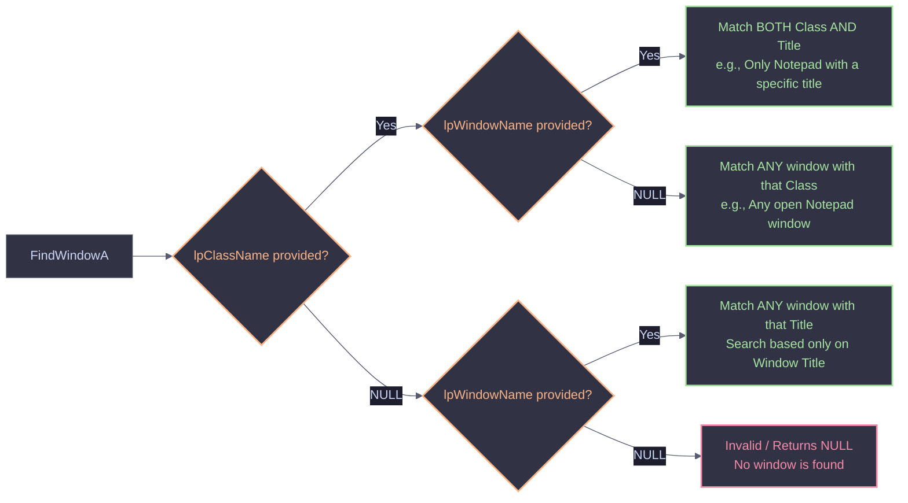

# Windows Process & Window Manipulation


A comprehensive guide to controlling windows and process creation using the Windows API. This covers manipulating existing windows (`FindWindow`/`ShowWindow`) and creating new processes in various stealthy states (Hidden, No Console, Suspended) for malware development, defense evasion, and process injection.

<Callout type="info" title="MITRE ATT&CK Mapping">
* [T1562 - Impair Defenses](https://attack.mitre.org/techniques/T1562/)
* [T1055 - Process Injection](https://attack.mitre.org/techniques/T1055/)
* [T1059 - Command and Scripting Interpreter](https://attack.mitre.org/techniques/T1059/)
</Callout>

---

## 1. Manipulating Existing Windows

The `FindWindowA` function is used to locate a top-level window by its class name and/or window name. The behavior changes based on what parameters you provide.



### Window Control Commands

Once you find the `HWND` (Window Handle), you can change its state using various API functions.

| Action | API Function | Flag / Message | Description |
| :--- | :--- | :--- | :--- |
| **Hide** | `ShowWindow` | `SW_HIDE` (0) | Completely hides the window from the screen and taskbar. |
| **Show** | `ShowWindow` | `SW_SHOW` (5) | Restores and displays the window. |
| **Minimize** | `ShowWindow` | `SW_MINIMIZE` (6) | Minimizes the window to the taskbar. |
| **Close** | `PostMessage` | `WM_CLOSE` (0x0010) | Sends a close message to the window (Safer than killing the process). |

<AccordionGroup>
  <Accordion title="C++ Code: Controlling Notepad (Find, Hide, Minimize, Close)">
    ```cpp
    #include <windows.h>
    #include <stdio.h>

    int main() {
        // Search by Class Name (Finds ANY open Notepad)
        // To check for a specific title: FindWindowA("Notepad", "Untitled - Notepad");
        HWND hWnd = FindWindowA("Notepad", NULL);

        if (hWnd == NULL) {
            printf("[-] Notepad window not found!\n");
            return 1;
        } else {
            printf("[+] Notepad found! HWND: %p\n", hWnd);
            
            int action = 1; // 1=Hide, 2=Minimize, 3=Close

            if (action == 1) {
                ShowWindow(hWnd, SW_HIDE);
                printf("[*] Window hidden successfully.\n");
            } 
            else if (action == 2) {
                ShowWindow(hWnd, SW_MINIMIZE);
                printf("[*] Window minimized successfully.\n");
            } 
            else if (action == 3) {
                PostMessageA(hWnd, WM_CLOSE, 0, 0);
                printf("[*] Window close message sent.\n");
            } 
            else {
                printf("[-] Invalid action.\n");
            }
        }
        return 0;
    }
    ```
  </Accordion>
</AccordionGroup>
