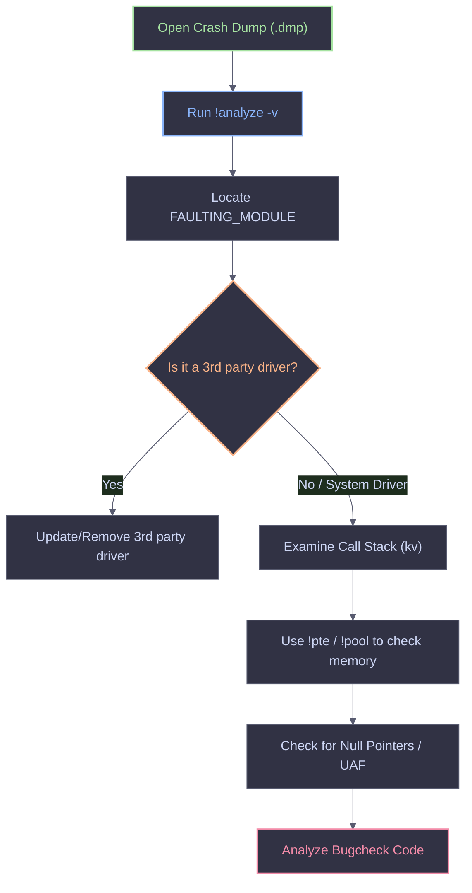

# WinDbg Cheatsheet

WinDbg is the ultimate debugging tool for Windows, capable of analyzing both user-mode applications and kernel-mode crashes (BSODs). This cheat sheet covers the essential commands for controlling execution, inspecting memory, and analyzing crash dumps.

<Callout type="info" title="Environment Setup">
* **Symbols:** Always set your symbol path first: `.sympath srv*C:\Symbols*https://msdl.microsoft.com/download/symbols;` followed by `.reload /f`.
* **DML:** Enable Debugger Markup Language for clickable output: `.prefer_dml 1`.
</Callout>

---

## Execution Control & Breakpoints

Commands to control the debugger execution flow and set breakpoints.

<Tabs>
  <Tab title="Basic Execution">
    | Command | Description |
    | :--- | :--- |
    | `g` | Go (resume execution). |
    | `t` | Trace (step into). |
    | `p` | Step over (step one instruction). |
    | `gu` | Go up (execute until return). |
    | `q` | Quit debugging session. |
    | `r` | Display all registers. |
    | `r rip` | Display a specific register (e.g., RIP). |
  </Tab>
  <Tab title="Breakpoints">
    | Command | Description |
    | :--- | :--- |
    | `bp <address>` | Set a software breakpoint. |
    | `bu <symbol>` | Set an unresolved breakpoint (survives reloads). |
    | `bm <pattern>` | Set breakpoints matching a symbol pattern. |
    | `ba r1 <addr>` | Break on access (read 1 byte). |
    | `ba w4 <addr>` | Break on access (write 4 bytes). |
    | `bl` | List all breakpoints. |
    | `bc *` | Clear all breakpoints. |
    | `bc 1` | Clear breakpoint ID 1. |
    | `bd 1` | Disable breakpoint ID 1. |
    | `be 1` | Enable breakpoint ID 1. |
  </Tab>
</Tabs>

---

## Threads & Processes

Inspecting and switching between threads and processes.

<AccordionGroup>
  <Accordion title="Thread Inspection (User-Mode)">
    ```text
    #### Thread List
    0:000 > ~

    #### Thread Context
    0:000 > dt ctx

    #### Show all of Thread Callstack
    0:000 > ~*e k

    #### Show Special Thread Register
    0:000 > ~3e r
    ```
    <Callout type="tip">
    * `~` lists all threads.
    * `~3s` switches to thread number 3.
    * `~3e r` executes the `r` command in the context of thread 3.
    </Callout>
  </Accordion>
  <Accordion title="Process & Thread Inspection (Kernel-Mode)">
    ```text
    #### List all processes
    kd> !process 0 0

    #### Detailed process info
    kd> !process 0 7

    #### Find process by name
    kd> !process 0 0 malware.exe

    #### Display current thread
    kd> !thread

    #### Display ready threads
    kd> !ready
    ```
  </Accordion>
</AccordionGroup>

---

## Call Stacks & Memory

Commands to inspect the call stack and read/write memory.

<Tabs>
  <Tab title="Call Stack">
    | Command | Description |
    | :--- | :--- |
    | `k` | Show current call stack. |
    | `kv` | Show call stack with FPO data and args. |
    | `kn` | Show call stack with frame numbers. |
    | `kb` | Show call stack with first three parameters. |
    | `kP` | Show call stack with full parameter types. |
    | `.frame 2` | Set local context to frame 2. |
    | `dv` | Display local variables. |
  </Tab>
  <Tab title="Memory Inspection">
    | Command | Description |
    | :--- | :--- |
    | `dd <addr>` | Display DWORDs. |
    | `dq <addr>` | Display QWORDs (64-bit). |
    | `dw <addr>` | Display WORDs. |
    | `db <addr>` | Display bytes & ASCII. |
    | `da <addr>` | Display ASCII string. |
    | `du <addr>` | Display Unicode string. |
    | `dps <addr>` | Display pointers & symbols (very useful). |
    | `u <addr>` | Unassemble (disassemble) memory. |
    | `eb <addr> 90 90` | Edit bytes (e.g., patch with NOPs). |
  </Tab>
  <Tab title="Memory & Pool (Kernel)">
    | Command | Description |
    | :--- | :--- |
    | `!address` | Show memory regions (User-Mode). |
    | `!pte <addr>` | Display Page Table Entry for an address. |
    | `!pool <addr>` | Display pool header info. |
    | `!poolfind <tag>` | Find pool allocations by tag. |
    | `!vm` | Display virtual memory statistics. |
  </Tab>
</Tabs>

---

## Structures & Types

Using `dt` (Display Type) to parse raw memory into readable C structures.

<AccordionGroup>
  <Accordion title="Using dt (Display Type)">
    ```text
    #### List all types in a module
    0:000> dt ntdll!*

    #### Show a specific structure layout
    0:000> dt _EPROCESS

    #### Dump structure at a specific address
    0:000> dt _EPROCESS ffffe78a2b6bbe20

    #### Show nested structures recursively
    0:000> dt -r _EPROCESS ffffe78a2b6bbe20
    ```
    <Callout type="info">
    `dt` is arguably the most powerful command in WinDbg. If you have symbols loaded, it can map raw memory addresses directly to Windows kernel structures like `_EPROCESS`, `_ETHREAD`, or `_PEB`.
    </Callout>
  </Accordion>
  <Accordion title="Using dx (Data Model)">
    The `dx` command uses LINQ-like syntax to query the debugger data model.
    ```text
    #### List all processes in a grid
    kd> dx -g @$curprocess

    #### List all threads
    kd> dx -g @$curthread

    #### Query kernel objects
    kd> dx @$cursession.Processes
    ```
  </Accordion>
</AccordionGroup>

---

## Crash Dump Analysis (BSOD)

When analyzing a kernel crash dump (`.dmp`), the first command you should run is `!analyze -v`.



### Essential Crash Analysis Commands

| Command | Description |
| :--- | :--- |
| `!analyze -v` | The most important command. Analyzes the crash and points to the faulting driver. |
| `.bugcheck` | Displays the bug check code and parameters. |
| `!pte` | Checks if the page table entry is valid (useful for `0x50` PAGE_FAULT_IN_NONPAGED_AREA). |
| `!pool` | Checks if the pool header is valid (useful for `0x19` BAD_POOL_HEADER). |
| `lm t n` | List all loaded modules and their timestamps. |
| `u <addr>` | Disassemble the instruction that caused the crash. |

<Callout type="danger" title="Common Bugcheck Codes">
* **`0x19` (BAD_POOL_HEADER)**: Pool corruption. Use `!pool` on the faulting address.
* **`0x50` (PAGE_FAULT_IN_NONPAGED_AREA)**: Invalid memory access. Use `!pte` to check page status.
* **`0x7F` (UNEXPECTED_KERNEL_MODE_TRAP)**: Usually a stack overflow or division by zero. Check `!thread` stack limits.
* **`0xC5` (DRIVER_CORRUPTED_EXPOOL)**: Use `!analyze -v` to find the corrupting driver.
</Callout>
