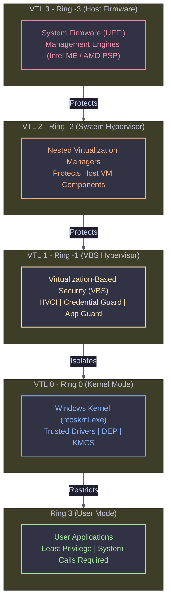

# CPU Privilege Rings & VTL Architecture

Modern x86/x64 and Windows architectures implement multiple **privilege rings** to separate responsibilities and secure system resources. This layered approach creates strict boundaries between hardware, hypervisors, the kernel, and user applications.

---

## The Layered Security Model (VTL Mapping)

Windows uses Virtual Trust Levels (VTLs) to enforce security above the traditional kernel. The diagram below illustrates how higher privilege levels protect and isolate lower levels.

---

## Detailed Ring Breakdown

<Steps>
  <Step title="Ring -3 (Host Hypervisor / Firmware)">
    <Callout type="danger" title="🛡️ Host Firmware & Management Engine">
    Privilege level **higher than Ring -2 and -1**. Used by host firmware, management engines, or root-level hypervisors. Controls system-wide initialization, virtualization extensions, and early platform security.
    </Callout>

    **Capabilities:**
    * Full control over system initialization and virtualization extensions.
    * Can enforce security policies **before OS loads**.
    * Protects all lower VTLs (2, 1, 0) from compromise at boot-time.
    
    **Security Significance:**
    * Can prevent firmware or boot-level malware from affecting OS integrity.
    * Foundation for Secure Boot, TPM attestation, and hardware-based protections.
  </Step>

  <Step title="Ring -2 (Hypervisor / VTL 2)">
    <Callout type="warning" title="☁️ System-Level Hypervisor">
    Runs **system-level hypervisors** or **nested virtualization managers**. Provides isolation for guest operating systems and can protect Ring -1/0 components from tampering.
    </Callout>

    * Typically used for advanced virtualization setups like **Hyper-V nested VMs**.
    * Provides an additional layer **above VTL 1**, mainly for nested VMs or hypervisor management.
    * Can protect the Ring -1 hypervisor instance and critical host VM components.
    * Rarely used in typical Windows deployments.
  </Step>

  <Step title="Ring -1 (Hypervisor / VTL 1)">
    <Callout type="info" title="🔐 Virtualization-Based Security (VBS)">
    Executes standard hypervisors and **Virtualization-Based Security (VBS)** components. Isolates kernel and OS components from each other. Kernel-mode exploits **cannot compromise VTL 1 protections**.
    </Callout>

    **Key Features:**
    * **Device Guard / HVCI** → Enforces kernel and driver code integrity.
    * **Hyper Guard** → Protects critical kernel and hypervisor data structures.
    * **Credential Guard** → Secures domain credentials, secrets, and LSASS memory.
    * **Application Guard** → Sandboxes Microsoft Edge / browser execution.
    * **Host Guardian / Shielded Fabric** → Protects VMs using vTPM, secrets, and attestation.
  </Step>

  <Step title="Ring 0 (Kernel Mode / VTL 0)">
    <Callout type="warning" title="🧠 Windows Kernel (ntoskrnl.exe)">
    Full system access; executes **OS kernel and trusted drivers**. Can read/write all memory and execute privileged CPU instructions. However, it **cannot bypass protections enforced by VTL 1**.
    </Callout>

    **Kernel Protections Enforced:**
    * **Memory Access Control** → System pages tagged Ring 0 only.
    * **Data Execution Prevention (DEP)** → Stack/heap/data non-executable.
    * **KMCS** → Kernel Mode Code Signing required.
    * **EV + Attestation** → Strong certificate enforcement for drivers.
    * **WHQL Certification** → Compatibility & stability assurance.
  </Step>

  <Step title="Ring 1 & 2 (Historical / Skipped)">
    <Callout type="tip" title="🚫 Unused Rings">
    Initially intended for intermediate privilege levels (OS subsystems or device drivers). Modern Windows **does not use these rings**. They are effectively skipped, and no VTLs are assigned here.
    </Callout>
  </Step>

  <Step title="Ring 3 (User Mode)">
    <Callout type="success" title="👤 User Applications">
    Least privileged level. Runs **user applications and software**. Cannot directly access system memory or execute privileged instructions.
    </Callout>

    * Must call system APIs / make system calls (`syscall` instruction) to transition to **Ring 0** for kernel services.
    * This boundary prevents malicious or buggy applications from crashing the entire system.
  </Step>
</Steps>

---

## Summary & Takeaway

| VTL | Ring | Key Security Features |
| :--- | :--- | :--- |
| **VTL 3** | -3 | Host firmware / ME protection, secure boot, early platform security. |
| **VTL 2** | -2 | Nested hypervisor protection, isolates Ring -1. |
| **VTL 1** | -1 | Hypervisor isolation, HVCI, Hyper Guard, Credential Guard, App Guard, Shielded VMs. |
| **VTL 0** | 0 | Kernel protections, DEP, KMCS, WHQL, EV/Attestation. |
| **N/A** | 3 | User Mode isolation, System Call interface. |

<Callout type="danger" title="Final Takeaway">
Each VTL enforces a **layered security model**, where higher levels isolate and protect lower levels. Kernel-mode code (VTL 0) is powerful but still constrained by VTL 1 protections (Hypervisor / VBS). This layered approach prevents advanced malware and driver exploits from compromising system integrity.
</Callout>
