# Retrieving the True Windows Version

Starting with Windows 8.1, Microsoft introduced a behavior called **"Version Lying."** If an application is not explicitly manifested for the new Windows version, APIs like `GetVersionEx` will return the older, compatible version (e.g., Windows 8) instead of the actual OS version. 

For Red Teams and malware developers, knowing the *exact* OS build is critical for using correct shellcode offsets, exploiting vulnerabilities, or avoiding honeypots. This guide covers two stealthy methods to bypass Version Lying and get the real version without triggering EDR API hooks.

<Callout type="warning" title="MITRE ATT&CK Mapping">
[T1082 - System Information Discovery](https://attack.mitre.org/techniques/T1082/)
</Callout>

---

## The Version Lying Architecture

When a standard application calls `GetVersionEx`, the request goes through `kernel32` and `ntdll`, but the kernel intercepts it and applies the "manifest shim" before returning the result. However, reading shared memory completely bypasses this execution flow.

```mermaid
%%{init: {'theme': 'base', 'themeVariables': { 'primaryColor': '#1e1e2e', 'edgeLabelBackground':'#1e1e2e', 'primaryTextColor': '#cdd6f4', 'primaryBorderColor': '#585b70', 'lineColor': '#585b70', 'fontFamily': 'monospace'}}}%%
flowchart TD
    subgraph StandardAPI ["Standard API Approach (Lies)"]
        App1["Application"] -->|"GetVersionEx()"| K32["kernel32.dll"]
        K32 --> NTDLL1["ntdll.dll"]
        NTDLL1 -->|"Syscall"| KM1["Kernel (ntoskrnl.exe)"]
        KM1 -.->|"Applies Manifest Shim\n(Returns Win 8)"| App1
    end

    subgraph NativeAPI ["Native API Approach (Truth)"]
        App2["Application"] -->|"Dynamic Resolve"| NTDLL2["ntdll.dll\nRtlGetVersion"]
        NTDLL2 -->|"Reads Real Data"| KM2["Kernel Shared Data"]
        KM2 -.->|"No Shim Applied"| App2
    end

    subgraph MemoryRead ["Direct Memory Approach (Stealthy)"]
        App3["Application"] -->|"Pointer Arithmetic\n0x7FFE0000"| SharedData["KUSER_SHARED_DATA\n(User-Mode Mapping)"]
        SharedData -.->|"Instant Read\nNo Syscall"| App3
    end

    classDef default fill:#313244,stroke:#585b70,stroke-width:1px,color:#cdd6f4;
    classDef lie fill:#313244,stroke:#f38ba8,stroke-width:2px,color:#f38ba8;
    classDef truth fill:#313244,stroke:#fab387,stroke-width:2px,color:#fab387;
    classDef stealth fill:#313244,stroke:#a6e3a1,stroke-width:2px,color:#a6e3a1;

    class StandardAPI lie;
    class NativeAPI truth;
    class MemoryRead stealth;
```



---

## Method 1: Direct OS Version Query (`RtlGetVersion`)

The `RtlGetVersion` native API does not check the application manifest. By dynamically resolving it from `ntdll.dll` at runtime, we avoid static linking and bypass the version lie.

<Steps>
  <Step title="1. Dynamic Resolution">
    Use `GetModuleHandle` and `GetProcAddress` to find `RtlGetVersion` in `ntdll.dll`. This avoids leaving static import traces in the PE header.
  </Step>
  <Step title="2. Execute and Parse">
    Call the resolved function with a properly initialized `OSVERSIONINFOEXW` structure to retrieve the real `Major.Minor.Build` string.
  </Step>
</Steps>

<Tabs>
  <Tab title="C++ Code">
    ```cpp
    #include <windows.h>
    #include <iostream>

    typedef NTSTATUS (NTAPI* zxRtlGetVersion)(PRTL_OSVERSIONINFOW);

    int main() {
        
        OSVERSIONINFOEXW osv;
        ZeroMemory(&osv, sizeof(osv));
        osv.dwOSVersionInfoSize = sizeof(OSVERSIONINFOEXW);
        
        // Get handle to ntdll.dll
        const HMODULE ntdll = GetModuleHandleW(L"ntdll.dll");
        if (!ntdll) {
            return 1;
        }
        
        // Resolve RtlGetVersion dynamically
        const auto ZxRtlGetVersion =
            reinterpret_cast<zxRtlGetVersion>(
                GetProcAddress(ntdll, "RtlGetVersion")
            );
        
        if (!ZxRtlGetVersion) {
            return 2;
        }
        
        // Call the function
        ZxRtlGetVersion(reinterpret_cast<PRTL_OSVERSIONINFOW>(&osv));
        
        // Print: Major.Minor.Build
        std::cout << osv.dwMajorVersion << "."
                  << osv.dwMinorVersion << "."
                  << osv.dwBuildNumber  << "\n";
        
        return 0;
    }
    ```
  </Tab>
  <Tab title="Explanation">
    * **`RtlGetVersion`**: Native API from `ntdll.dll` that returns the real Windows version.
    * **Dynamic resolution**: Avoids static linking; resolves function at runtime.
    * **`OSVERSIONINFOEXW`**: Structure that holds version details.
    * **Output format**: `Major.Minor.Build` (e.g., `10.0.22621`).
  </Tab>
</Tabs>

---

## Method 2: Pointer Arithmetic (`KUSER_SHARED_DATA`)

The ultimate stealth method. `KUSER_SHARED_DATA` is a read-only page mapped by the kernel into every user-mode process at the fixed virtual address `0x7FFE0000`. By reading specific offsets from this address, you can retrieve the OS version **without calling any API or making any syscalls**. EDRs cannot hook this.


<Tabs>
  <Tab title="C++ Code">
    ```cpp
    #include <windows.h>
    #include <iostream>
    #include <cstdint>

    int main() {
        constexpr uintptr_t kuserBase   = 0x7FFE0000;
        constexpr size_t offsetBuild    = 0x260;
        constexpr size_t offsetMajor    = 0x26C;
        constexpr size_t offsetMinor    = 0x270;
        
        volatile uint32_t* build =
            reinterpret_cast<volatile uint32_t*>(kuserBase + offsetBuild);

        volatile uint32_t* major =
            reinterpret_cast<volatile uint32_t*>(kuserBase + offsetMajor);

        volatile uint32_t* minor =
            reinterpret_cast<volatile uint32_t*>(kuserBase + offsetMinor);
        
        std::cout << "Windows version (via addresses): "
                  << *major << "."
                  << *minor << "."
                  << *build << "\n";
                  
        return 0;
    }
    ```
  </Tab>
  <Tab title="Explanation">
    * **`0x7FFE0000`**: Base address of `KUSER_SHARED_DATA` (mapped into every user-mode process).
    * **Pointer arithmetic**: Adds known offsets to access specific fields.
    * **Offsets used**:
      * `0x26C` → Major version
      * `0x270` → Minor version
      * `0x260` → Build number
    * **`volatile`**: Prevents compiler optimization, ensures direct memory read.
    * Reads version information **without calling any API**.
  </Tab>
</Tabs>

<Callout type="danger" title="OPSEC Consideration">
This method accesses memory directly and relies on stable structure offsets. While it bypasses all API hooks, it is highly dependent on the Windows architecture remaining consistent.
</Callout>

---

## Telemetry Goldmine: `KUSER_SHARED_DATA` Offsets

The `KUSER_SHARED_DATA` structure contains much more than just the OS version. Because it is mapped at a fixed address, red teams use it as a "cheat sheet" to retrieve system context instantly without touching `ntdll`.

<AccordionGroup>
  <Accordion title="Useful Offsets Table">
    | Offset | Size | Field Name | Description |
    | :--- | :--- | :--- | :--- |
    | `0x014` | ULONG | `TickCountLow` | Low part of system tick count (uptime). |
    | `0x020` | ULONG | `NtSystemRoot` | Path to the Windows directory (e.g., `\SystemRoot`). |
    | `0x060` | ULONG | `NtMajorVersion` | OS Major version (e.g., 10). |
    | `0x264` | ULONG | `NtMinorVersion` | OS Minor version (e.g., 0). |
    | `0x260` | ULONG | `NtBuildNumber` | OS Build number (e.g., 22621). |
    | `0x2D4` | ULONG | `ProductType` | 1 = Workstation, 2 = Domain Controller, 3 = Server. |
    | `0x320` | DWORD | `Cookie` | Randomized cookie used for pointer obfuscation. |
  </Accordion>
</AccordionGroup>

<CardGroup cols={3}>
  <Card title="API Hook Bypass" icon="shield">
    Reading `0x7FFE0000` does not trigger `ntdll` hooks placed by EDRs.
  </Card>
  <Card title="Zero Syscalls" icon="terminal">
    No context switch to Kernel Mode is required, making it extremely fast.
  </Card>
  <Card title="Fixed Address" icon="map">
    The address `0x7FFE0000` is hardcoded by the Windows Loader and never changes.
  </Card>
</CardGroup>
