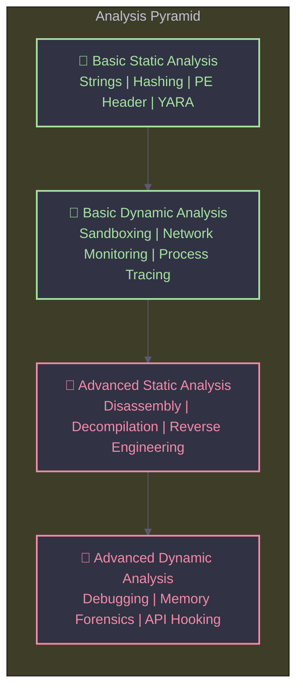

# Malware Analysis Techniques & Classification

Most often, when performing malware analysis, you'll have only the malware executable, which won't be human-readable. In order to make sense of it, you'll use a variety of tools and tricks, each revealing a small amount of information. There are two fundamental approaches to malware analysis: **Static** and **Dynamic**. Both techniques are further categorized as **Basic** or **Advanced**.

<Info>
  You'll need to use a variety of tools in order to see the full picture. No single technique reveals everything. The most effective analysts combine all four approaches.
</Info>

---

## The Analysis Pyramid

The diagram below illustrates the four layers of malware analysis, from the easiest and fastest techniques at the bottom to the most complex and time-consuming at the top.

---

## The Four Analysis Techniques

<Tabs>
  <Tab title="Basic Static Analysis">
    <Callout type="success" title="📄 Fast & Easy">
      Examining the executable file without viewing the actual instructions or running it.
    </Callout>

    **What it does:**

    - Confirms whether a file is malicious.
    - Provides information about its functionality.
    - Sometimes provides information for simple network signatures.

    **Techniques:**

    - Extracting strings (`strings`, `FLOSS`).
    - Calculating file hashes (MD5, SHA256).
    - Examining PE headers, imports, and exports.
    - Scanning with YARA rules and AV engines (VirusTotal).

    <Warning title="Limitations">
      Largely ineffective against sophisticated malware. Can miss important behaviors. Packed or obfuscated binaries will reveal almost nothing.
    </Warning>
  </Tab>
  <Tab title="Basic Dynamic Analysis">
    <Callout type="success" title="🏃 Observe Behavior">
      Running the malware and observing its behavior on the system in a controlled environment.
    </Callout>

    **What it does:**

    - Removes the infection or produces effective signatures.
    - Reveals network communication (C2 endpoints).
    - Shows filesystem and registry modifications.

    **Techniques:**

    - Running in a sandbox (Any.Run, Hybrid Analysis).
    - Monitoring with Process Monitor (ProcMon).
    - Network capture with Wireshark or FakeNet.

    <Warning title="Limitations">
      Requires a safe, isolated lab environment. Can miss important functionality if the malware detects the sandbox or waits for user interaction.
    </Warning>
  </Tab>
  <Tab title="Advanced Static Analysis">
    <Danger title="🔬 Deep Dive">
      Reverse-engineering the malware's internals by loading the executable into a disassembler.
    </Danger>

    **What it does:**

    - Reveals exactly what the program does at the instruction level.
    - Uncovers hidden logic, encryption algorithms, and C2 protocols.
    - Shows the true execution path without running the binary.

    **Techniques:**

    - Disassembly with IDA Pro, Ghidra, or Radare2.
    - Decompilation to pseudo-C code.
    - Analyzing assembly constructs (loops, conditionals, API calls).

    <Warning title="Limitations">
      Steeper learning curve. Requires specialized knowledge of disassembly, code constructs, and Windows OS internals. Very time-consuming for large, obfuscated binaries.
    </Warning>
  </Tab>
  <Tab title="Advanced Dynamic Analysis">
    <Danger title="🔬 Internal State">
      Using a debugger to examine the internal state of a running malicious executable.
    </Danger>

    **What it does:**

    - Extracts detailed information that is difficult to gather with other techniques.
    - Dumps decrypted payloads from memory.
    - Reveals runtime decisions (e.g., which API is actually called after a conditional branch).

    **Techniques:**

    - Debugging with x64dbg, WinDbg, or OllyDbg.
    - Setting breakpoints on APIs (e.g., `VirtualAlloc`, `CreateFile`).
    - Memory dumping and unpacking.

    <Tip title="The Golden Combo">
      The most effective approach is combining **Advanced Static Analysis** with **Advanced Dynamic Analysis** to completely analyze suspected malware. Read the disassembly, then confirm your hypothesis by setting breakpoints in the debugger.
    </Tip>
  </Tab>
</Tabs>

---

## Malware Classification

Malware comes in many forms, each with a specific purpose and behavior pattern. Understanding the classification helps analysts narrow down the scope of their investigation.

<Tabs>
  <Tab title="Access & Control">
    <Danger title="Backdoor">
      Malicious code that installs itself onto a computer to allow the attacker access. Backdoors usually let the attacker connect to the computer with little or no authentication and execute commands on the local system.
    </Danger>

    <Info title="Botnet">
      Similar to a backdoor, in that it allows the attacker access to the system, but all computers infected with the same botnet receive the same instructions from a single command-and-control server.
    </Info>

    <Warning title="Rootkit">
      Malicious code designed to conceal the existence of other code. Rootkits are usually paired with other malware, such as a backdoor, to allow remote access to the attacker and make the code difficult for the victim to detect.
    </Warning>
  </Tab>
  <Tab title="Payload Delivery">
    <Tip title="Downloader">
      Malicious code that exists only to download other malicious code. Downloaders are commonly installed by attackers when they first gain access to a system. The downloader program will download and install additional malicious code.
    </Tip>

    <Info title="Launcher">
      Malicious program used to launch other malicious programs. Usually, launchers use nontraditional techniques to launch other malicious programs in order to ensure stealth or greater access to a system.
    </Info>

    <Danger title="Worm or Virus">
      Malicious code that can copy itself and infect additional computers. Worms spread automatically across networks, while viruses typically attach themselves to legitimate files.
    </Danger>
  </Tab>
  <Tab title="Information & Scams">
    <Warning title="Information Stealing">
      Malware that collects information from a victim's computer and usually sends it to the attacker. Examples include sniffers, password hash grabbers, and keyloggers. This malware is typically used to gain access to online accounts such as email or online banking.
    </Warning>

    <Danger title="Scareware">
      Malware designed to frighten an infected user into buying something. It usually has a user interface that makes it look like an antivirus or other security program. It informs users that there is malicious code on their system and that the only way to get rid of it is to buy their "software," when in reality, the software it's selling does nothing more than remove the scareware.
    </Danger>

    <Info title="Spam Sending">
      Malware that infects a user's machine and then uses that machine to send spam. This malware generates income for attackers by allowing them to sell spam sending services.
    </Info>
  </Tab>
</Tabs>

---

## Essential Resources & Tools

<CardGroup cols={3}>
  <Card title="Hybrid Analysis" icon="external-link" href="https://www.hybrid-analysis.com">
    Free online malware analysis service that uses sandbox technology.
  </Card>

  <Card title="Any.Run" icon="external-link" href="https://app.any.run">
    Interactive online malware analysis sandbox with real-time monitoring.
  </Card>

  <Card title="vx-underground" icon="external-link" href="https://vx-underground.org">
    The largest collection of malware samples, papers, and presentations.
  </Card>

  <Card title="theZoo" icon="github" href="https://github.com/ytisf/theZoo">
    Repository of live malware samples for research and analysis.
  </Card>

  <Card title="VirusBay" icon="external-link" href="https://beta.virusbay.io">
    Community-driven malware analysis platform with collaboration tools.
  </Card>

  <Card title="VirusShare" icon="external-link" href="https://virusshare.com">
    One of the oldest malware sample repositories for security researchers.
  </Card>
</CardGroup>

---

## Recommended Books

<AccordionGroup>
  <Accordion title="0x0 - Mastering Malware Analysis (2019, Packt Publishing)">
    A comprehensive guide covering advanced static and dynamic malware analysis techniques, including anti-debugging, anti-disassembly, and packing.
  </Accordion>

  <Accordion title="0x1 - Practical Reverse Engineering (x86, x64, ARM, Windows Kernel)">
    Deep dive into reverse engineering principles across multiple architectures. Covers kernel-mode reversing, obfuscation, and advanced analysis tools.
  </Accordion>

  <Accordion title="0x2 - Reverse Engineering for Beginners (Understanding Assembly Language)">
    A foundational text for understanding assembly language and the core concepts of reverse engineering. Covers x86, x64, and ARM.
  </Accordion>

  <Accordion title="0x3 - Practical Malware Analysis (The Hands-on Guide)">
    The definitive hands-on guide to dissecting malicious software. Covers everything from basic static analysis to advanced debugging and unpacking.
  </Accordion>

  <Accordion title="0x4 - Learning Malware Analysis (Explore Concepts, Tools & Techniques)">
    A practical guide for beginners to explore the concepts, tools, and techniques used by professional malware analysts.
  </Accordion>
</AccordionGroup>
