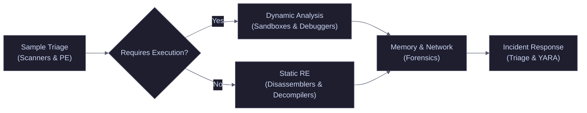

# Malware Analysis & Incident Response Toolkit

A curated collection of tools commonly used for Malware Analysis, Reverse Engineering, DFIR, Incident Response, and Threat Hunting.

<Callout type="warning" title="The Analyst Workflow">
Malware analysis is rarely done with a single tool. It is a pipeline. You start with static triage, move to dynamic execution, and finish with deep memory or kernel forensics.
</Callout>

---

## Toolkit Categories

Navigate through the tabs to explore tools by category.

<Tabs>
  <Tab title="Analysis & Reverse Engineering">
    <Callout type="info" title="Online Scanners & Sandboxes">
      Quick triage and reputation checking.
      <CardGroup cols={3}>
        <Card title="VirusTotal" href="https://www.virustotal.com/" icon="globe">Online scanner aggregating dozens of AV engines.</Card>
        <Card title="Hybrid Analysis" href="https://www.hybrid-analysis.com/" icon="flask">Free online malware analysis sandbox.</Card>
        <Card title="Any.Run" href="https://any.run/" icon="play-circle">Interactive online malware analysis sandbox.</Card>
        <Card title="Malcore" href="https://malcore.io/" icon="shield">Automated malware analysis and triage.</Card>
        <Card title="Malware.id" href="http://malwareid.in/" icon="bug">Malware identification repository.</Card>
        <Card title="Malware Trends" href="https://any.run/malware-trends/" icon="up">Latest malware trends statistics.</Card>
      </CardGroup>
    </Callout>

    <Callout type="info" title="Portable Executable (PE) Analysis">
      Inspect, parse, and reverse PE file structures.
      <CardGroup cols={3}>
        <Card title="CFF Explorer" href="https://ntcore.com/?page_id=388" icon="box">Advanced PE editor and explorer.</Card>
        <Card title="PE-Bear" href="https://github.com/hasherezade/pe-bear-releases" icon="P">Reversing tool for PE files by Hasherzade.</Card>
        <Card title="Detect-It-Easy" href="https://github.com/horsicq/Detect-It-Easy" icon="search">Identify compilers, packers, and protections.</Card>
        <Card title="Dependency Walker" href="http://dependencywalker.com/" icon="link">Scans 32/64-bit Windows module dependencies.</Card>
        <Card title="PE Studio" href="https://winitor.com/" icon="bank">Malware initial assessment tool.</Card>
        <Card title="PPEEE" href="https://www.mzrst.com/" icon="file-text">Professional PE File Explorer.</Card>
        <Card title="Resource Hacker" href="http://angusj.com/resourcehacker/" icon="wrench">Compile, view, decompile, and extract resources.</Card>
        <Card title="Cerbero" href="https://cerbero.io/ea/" icon="flower">Advanced malware analysis suite.</Card>
        <Card title="PE Explorer v2" href="https://github.com/zodiacon/PEExplorerV2" icon="apple">PE analysis tool by Zodiacon.</Card>
        <Card title="CAPA" href="https://github.com/fireeye/capa" icon="search">Detect capabilities in executable files (FireEye).</Card>
        <Card title="Malwoverview" href="https://github.com/alexandreborges/malwoverview" icon="eye">First response tool for malware triage.</Card>
        <Card title="XPEViewer" href="https://github.com/horsicq/XPEViewer" icon="binoculars">PE file viewer.</Card>
      </CardGroup>
    </Callout>

    <Callout type="info" title="Packers, Decrypters & Extractors">
      Unpacking and extracting hidden payloads.
      <CardGroup cols={3}>
        <Card title="Exeinfo PE" href="http://www.exeinfo.xn.pl/" icon="lock">PE identifier and unpacker.</Card>
        <Card title="PEiD" href="https://tuts4you.com/e107_plugins/download/download.php?view.398" icon="lock">Identifies packers and compilers.</Card>
        <Card title="ASPack" href="http://www.aspack.com/downloads.html" icon="archive">PE compression tool (Trial).</Card>
        <Card title="TitanMist" href="https://www.reversinglabs.com/open-source/titanmist" icon="key">Reversing Labs unpacking engine.</Card>
        <Card title="Amber" href="https://github.com/EgeBalci/Amber" icon="fire">Reflective PE packer.</Card>
        <Card title="pyinstxtractor" href="https://github.com/extremecoders-re/pyinstxtractor" icon="python">Extract contents of Python installer executables.</Card>
        <Card title="pyinstxtractor-ng" href="https://github.com/pyinstxtractor/pyinstxtractor-ng" icon="python">Next-gen Python extractor.</Card>
      </CardGroup>
    </Callout>

    <Callout type="info" title="Dynamic Analysis & Debugging">
      Tools for observing malware behavior in a controlled environment.
      <CardGroup cols={3}>
        <Card title="SysInternals" href="https://docs.microsoft.com/en-us/sysinternals/" icon="toolbox">Microsoft's advanced system utilities.</Card>
        <Card title="Process Hacker" href="https://processhacker.sourceforge.io/" icon="pig">Advanced memory and process manipulation.</Card>
        <Card title="ProcDOT" href="https://procdot.com/downloadprocdotbinaries.htm" icon="dog">Visualizes process execution traces.</Card>
        <Card title="RegShot" href="https://sourceforge.net/projects/regshot/" icon="camera">Registry snapshot comparison tool.</Card>
        <Card title="Noriben" href="https://github.com/Rurik/Noriben" icon="terminal">Automates ProcMon for malware analysis.</Card>
        <Card title="x64dbg" href="https://x64dbg.com/#start" icon="bug">Open-source x64/x32 debugger.</Card>
        <Card title="Immunity Debugger" href="https://www.immunityinc.com/products/debugger/" icon="bug">Powerful debugger for vulnerability analysis.</Card>
        <Card title="API Monitor" href="http://www.rohitab.com/apimonitor#Download" icon="key">Spies API calls made by applications.</Card>
        <Card title="Tiny_tracer" href="https://github.com/hasherezade/tiny_tracer" icon="map">Traces execution in PE modules.</Card>
        <Card title="Pe-sieve" href="https://github.com/hasherezade/pe-sieve" icon="filter">Scans process memory for implants.</Card>
        <Card title="Hollows-hunter" href="https://github.com/hasherezade/hollows_hunter" icon="ghost">Detects process hollowing.</Card>
        <Card title="Mal_unpack" href="https://github.com/hasherezade/mal_unpack" icon="box">Generic unpacker for malware.</Card>
      </CardGroup>
    </Callout>

    <Callout type="info" title="Reverse Engineering & Decompilers">
      Static analysis and disassembly of binaries.
      <CardGroup cols={3}>
        <Card title="Ghidra" href="https://ghidra-sre.org/" icon="landmark">NSA's open-source reverse engineering suite.</Card>
        <Card title="IDA Pro" href="https://www.hex-rays.com/products/ida/" icon="code">Industry standard disassembler and debugger.</Card>
        <Card title="dnSpyEx" href="https://github.com/dnSpyEx/dnSpy" icon="C">.NET debugger and assembly editor.</Card>
        <Card title="Malcat" href="https://malcat.fr/" icon="cat">Fast hex editor and pattern finder.</Card>
        <Card title="Binary Ninja" href="https://binary.ninja/" icon="house">Modern, clean reverse engineering platform.</Card>
        <Card title="ExtremeDumper" href="https://github.com/wwh1004/ExtremeDumper" icon="download">Dumps .NET assemblies from memory.</Card>
        <Card title="Cutter" href="https://cutter.re/" icon="scissors">Rizin-powered GUI reverse engineering tool.</Card>
        <Card title="Rizin" href="https://rizin.re/" icon="zap">Reverse engineering framework (Radare2 fork).</Card>
        <Card title="VB Decompiler" href="https://www.vb-decompiler.org/" icon="file-code">Decompiles VB5/VB6 applications.</Card>
      </CardGroup>
    </Callout>
  </Tab>

  <Tab title="Incident Response & Forensics">
    <Callout type="danger" title="Incident Response (IR) & Triage">
      Collect, preserve, and analyze evidence during a breach.
      <CardGroup cols={3}>
        <Card title="Skadi" href="https://github.com/orlikoski/Skadi" icon="shield">Automated forensic collection and processing.</Card>
        <Card title="CyLR" href="https://github.com/orlikoski/CyLR" icon="hard-drive">Live response collection tool.</Card>
        <Card title="Velociraptor" href="https://www.velocidex.com/" icon="dinosaur">Endpoint visibility and digital forensics.</Card>
        <Card title="KAPE" href="https://www.kroll.com/en/services/cyber-risk/incident-response-litigation-support/kroll-artifact-parser-extractor-kape" icon="zap">Targeted forensic artifact collection.</Card>
        <Card title="YARA" href="http://virustotal.github.io/yara/" icon="pizza">Pattern matching tool for malware researchers.</Card>
        <Card title="YExtend" href="https://github.com/BayshoreNetworks/yextend" icon="plus-circle">YARA wrapper for scanning archives.</Card>
        <Card title="IOC Editor" href="https://www.fireeye.com/services/freeware/ioc-editor.html" icon="edit">Editor for Indicators of Compromise.</Card>
        <Card title="ClamAV" href="https://www.clamav.net/" icon="virus">Open-source antivirus engine.</Card>
        <Card title="Osquery" href="https://osquery.io/" icon="database">SQL-powered operating system instrumentation.</Card>
        <Card title="GRR" href="https://github.com/google/grr" icon="server">Remote live forensics framework.</Card>
        <Card title="Beagle" href="https://github.com/yampelo/beagle" icon="dog">Transforms data from IR tools into graphs.</Card>
        <Card title="Thor-Lite" href="https://www.nextron-systems.com/thor-lite/" icon="thunderstorm">Lightweight IOC scanner.</Card>
      </CardGroup>
    </Callout>

    <Callout type="info" title="Memory Forensics">
      Analyzing RAM dumps for stealthy malware and rootkits.
      <CardGroup cols={3}>
        <Card title="Volatility 3" href="https://github.com/volatilityfoundation/volatility3/" icon="bug">The gold standard memory forensics framework.</Card>
        <Card title="Rekall" href="http://www.rekall-forensic.com/" icon="brain">Memory analysis framework.</Card>
        <Card title="Volatility Workbench" href="https://www.osforensics.com/tools/volatility-workbench.html" icon="user">GUI for Volatility.</Card>
        <Card title="Redline" href="https://www.fireeye.com/services/freeware/redline.html" icon="triangle">Memory and file analysis tool (FireEye).</Card>
        <Card title="Belkasoft RAM Capturer" href="https://belkasoft.com/ram-capturer" icon="camera">Forensic memory acquisition tool.</Card>
        <Card title="MAGNET RAM Capture" href="https://www.magnetforensics.com/resources/magnet-ram-capture/" icon="magnet">Captures physical memory.</Card>
        <Card title="DumpIt" href="https://my.comae.io/" icon="download">Comae memory acquisition toolkit.</Card>
        <Card title="WinPmem" href="https://github.com/Velocidex/WinPmem/releases" icon="windows">Physical memory acquisition tool.</Card>
        <Card title="MemProcFS" href="https://github.com/ufrisk/MemProcFS" icon="folder">Mounts memory dumps as a file system.</Card>
        <Card title="Trufflepig Forensics" href="https://trufflepig-forensics.com/en/home" icon="pig">Memory analysis suite.</Card>
      </CardGroup>
    </Callout>

    <Callout type="info" title="Networking & Email Forensics">
      Monitoring malware network communications.
      <CardGroup cols={2}>
        <Card title="ApateDNS" href="https://www.mandiant.com/assets/ApateDNS.zip" icon="globe">Spoofs DNS responses to catch malware beacons.</Card>
        <Card title="WinDump" href="https://www.winpcap.org/windump/install/default.htm" icon="facebook">Windows port of tcpdump.</Card>
        <Card title="CaptureBAT" href="https://www.honeynet.org/files/CaptureBAT-Setup-2.0.0-5574.exe" icon="cat">Captures file and registry changes.</Card>
        <Card title="Fiddler" href="https://www.telerik.com/fiddler" icon="globe">Web debugging proxy to intercept HTTP(S).</Card>
        <Card title="EmlRender" href="https://github.com/xme/emlrender" icon="server">Parses and renders .eml email files safely.</Card>
      </CardGroup>
    </Callout>

    <Callout type="warning" title="Sandboxes & Anti-Analysis">
      Safe execution environments and anti-evasion tools.
      <CardGroup cols={3}>
        <Card title="Qiling" href="https://github.com/qilingframework/qiling" icon="dragon">Advanced binary emulation framework.</Card>
        <Card title="Frida" href="https://frida.re/" icon="fish">Dynamic instrumentation toolkit.</Card>
        <Card title="Windows Sandbox" href="https://docs.microsoft.com/en-us/windows/security/threat-protection/windows-sandbox/windows-sandbox-overview" icon="box">Built-in lightweight Windows sandbox.</Card>
        <Card title="Shadow Defender" href="https://www.shadowdefender.com/" icon="shield">Runs system in a virtual environment.</Card>
        <Card title="CAPEv2" href="https://github.com/kevoreilly/CAPEv2" icon="flask">Malware configuration extraction sandbox.</Card>
        <Card title="DRAKVUF" href="https://github.com/CERT-Polska/drakvuf-sandbox" icon="bat">Agentless dynamic malware analysis.</Card>
        <Card title="Cuckoo" href="https://github.com/cuckoosandbox/cuckoo" icon="clock">Automated malware analysis system.</Card>
        <Card title="VMwareCloak" href="https://github.com/d4rksystem/VMwareCloak" icon="eye-off">Hides VMware VMs from malware.</Card>
      </CardGroup>
    </Callout>
  </Tab>

  <Tab title="Resources & Learning">
    <Callout type="info" title="Documentation & APIs">
      <CardGroup cols={2}>
        <Card title="Vergilius Project" href="https://www.vergiliusproject.com/" icon="book">Windows kernel structures database.</Card>
        <Card title="MalAPI.io" href="https://malapi.io/" icon="code">Windows APIs used by malware.</Card>
        <Card title="Awesome Malware Analysis" href="https://github.com/rshipp/awesome-malware-analysis" icon="star">Curated list of malware analysis resources.</Card>
        <Card title="NtDoc" href="https://ntdoc.m417z.com/" icon="file-text">Undocumented Windows NT APIs.</Card>
      </CardGroup>
    </Callout>

    <Callout type="info" title="Malware Samples & Repositories">
      <CardGroup cols={2}>
        <Card title="Malware Bazaar" href="https://bazaar.abuse.ch/" icon="shopping-bag">Malware sample exchange platform.</Card>
        <Card title="VirusShare" href="https://virusshare.com/" icon="share">Malware repository for researchers.</Card>
        <Card title="vx-underground" href="https://vx-underground.org" icon="ghost">The largest malware archive.</Card>
        <Card title="theZoo" href="https://github.com/ytisf/theZoo" icon="archive">Repository of live malware samples.</Card>
      </CardGroup>
    </Callout>

    <AccordionGroup>
      <Accordion title="🎓 Recommended Courses & Videos">
        <CardGroup cols={2}>
          <Card title="Life of Binaries" href="https://opensecuritytraining.info/LifeOfBinaries.html" icon="graduation-cap">OpenSecurityTraining on PE files.</Card>
          <Card title="Intro to x86" href="https://opensecuritytraining.info/IntroX86.html" icon="dog">Assembly language basics.</Card>
          <Card title="Intro to x64" href="https://opensecuritytraining.info/IntroX86-64.html" icon="key">x64 assembly concepts.</Card>
          <Card title="RE Malware" href="https://opensecuritytraining.info/ReverseEngineeringMalware.html" icon="bug">Intro to reverse engineering malware.</Card>
          <Card title="Dynamic Malware Analysis" href="https://opensecuritytraining.info/MalwareDynamicAnalysis.html" icon="cat">Running malware safely.</Card>
          <Card title="Ransomware 101" href="https://www.cisa.gov/stopransomware/ransomware-101" icon="star">CISA ransomware guide.</Card>
        </CardGroup>

        **Recommended YouTube Channels:**
        * [OALabs](https://www.youtube.com/@OALABS)
        * [Hasherzade](https://www.youtube.com/@hasherezade)
        * [MalwareAnalysisForHedgehogs](https://www.youtube.com/@MalwareAnalysisForHedgehogs)
        * [All Things IDA](https://www.youtube.com/@allthingsida)
        * [Hex-Rays](https://www.youtube.com/@HexRaysSA)
      </Accordion>

      <Accordion title="📄 White Papers & Code Repos">
        * [VXUG Papers](https://github.com/vxunderground/VXUG-Papers)
        * [Kernel Data Structures](https://www.vergiliusproject.com/kernels)
        * [LoadLibrary/GetProcAddress Replacements](https://github.com/zerosum0x0/LoadLibrary-GetProcAddress-Replacements)
        * [Defcon25 Workshop](https://github.com/zerosum0x0/defcon-25-workshop)
        * [Windows Internals](https://github.com/Faran-17/Windows-Internals/tree/main/Processes%20and%20Jobs/Processes)
      </Accordion>

      <Accordion title="🛠️ Misc Utilities & Tips">
        * [bstrings](https://ericzimmerman.github.io/#!index.md) - Better strings extraction.
        * [BinText](http://b2b-download.mcafee.com/products/tools/foundstone/bintext303.zip) - ASCII/Unicode string extractor.
        * [StringSifter](https://www.fireeye.com/blog/threat-research/2019/09/open-sourcing-stringsifter.html) - ML string ranking.
        * [Graphviz](https://graphviz.org/download/) - Graph visualization software.
        * [Viper](https://viper.li/en/latest/) - Binary analysis framework.
        * [Exe_to_dll](https://github.com/hasherezade/exe_to_dll) - Converts EXE to loadable DLLs.
        * [YARA Generation Tip](https://twitter.com/cyb3rops/status/1273530690068496385)
        * [Win32 Shellcode](https://github.com/snowcra5h/win32-shellcode)
      </Accordion>
    </AccordionGroup>
  </Tab>
</Tabs>
