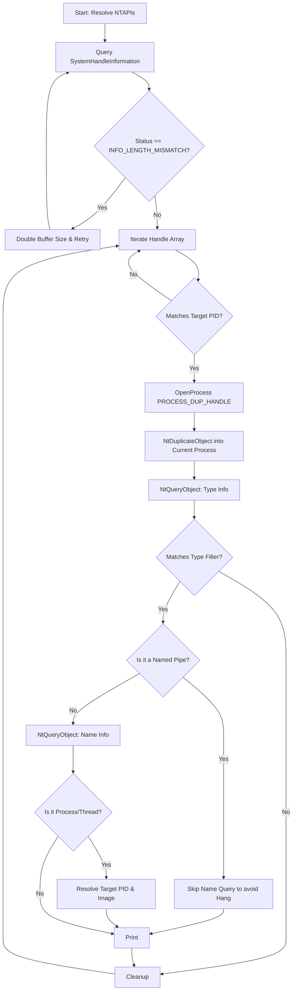

<Callout type="info" title="Overview">
Every open file, registry key, process, or token in Windows is represented by a **Handle**. The kernel maintains a global table of all these handles. 

Advanced malware doesn't always try to open new handles (which triggers EDR `ObRegisterCallbacks`). Instead, it queries the system for existing handles owned by privileged processes and **duplicates** them into its own process space using `NtDuplicateObject`. This technique is mapped to **MITRE ATT&CK T1574 - Hijack Execution Flow** and is a precursor to Token Impersonation and Handle Hijacking.
</Callout>


## Execution Flowchart

The tool follows a complex sequence of querying, duplicating, and filtering handles. The logic ensures resources are properly cleaned up and avoids hanging on Named Pipes.



## Code Implementation

This C++ tool dynamically resolves NTAPI functions, dumps all handles in the system, and filters them by PID and object type. It includes critical bug-fixes like avoiding `NtQueryObject` hangs on Named Pipes.

<CodeGroup>
```cpp Source Code (handle_enum.cpp)
#include <windows.h>
#include <stdio.h>
#include <shlwapi.h>
#include <Psapi.h>

#pragma comment(lib, "shlwapi")
#pragma comment(lib, "psapi")

#define NT_SUCCESS(x)               ((x) >= 0)
#define STATUS_INFO_LENGTH_MISMATCH 0xc0000004

#define SystemHandleInformation     16
#define ObjectBasicInformation      0
#define ObjectNameInformation       1
#define ObjectTypeInformation       2

#define QUERY_DIR        0x01
#define QUERY_FILE       0x02
#define QUERY_KEY        0x04
#define QUERY_PROC       0x08
#define QUERY_THREAD     0x10
#define QUERY_TOKEN      0x20
#define QUERY_ALL       (QUERY_DIR | QUERY_FILE | QUERY_KEY | QUERY_PROC | QUERY_THREAD | QUERY_TOKEN)

// ============================================================================
// NT API typedefs
// ============================================================================
typedef NTSTATUS(NTAPI* NtQuerySystemInformation_t)(
    ULONG SystemInformationClass,
    PVOID SystemInformation,
    ULONG SystemInformationLength,
    PULONG ReturnLength);

typedef NTSTATUS(NTAPI* NtDuplicateObject_t)(
    HANDLE SourceProcessHandle,
    HANDLE SourceHandle,
    HANDLE TargetProcessHandle,
    PHANDLE TargetHandle,
    ACCESS_MASK DesiredAccess,
    ULONG Attributes,
    ULONG Options);

typedef NTSTATUS(NTAPI* NtQueryObject_t)(
    HANDLE ObjectHandle,
    ULONG ObjectInformationClass,
    PVOID ObjectInformation,
    ULONG ObjectInformationLength,
    PULONG ReturnLength);

// ============================================================================
// NT structures
// ============================================================================
typedef struct _UNICODE_STRING {
    USHORT Length;
    USHORT MaximumLength;
    PWSTR  Buffer;
} UNICODE_STRING, * PUNICODE_STRING;

typedef struct _SYSTEM_HANDLE_TABLE_ENTRY_INFO {
    USHORT UniqueProcessId;
    USHORT CreatorBackTraceIndex;
    UCHAR  ObjectTypeIndex;
    UCHAR  HandleAttributes;
    USHORT HandleValue;
    PVOID  Object;
    ULONG  GrantedAccess;
} SYSTEM_HANDLE_TABLE_ENTRY_INFO, * PSYSTEM_HANDLE_TABLE_ENTRY_INFO;

typedef struct _SYSTEM_HANDLE_INFORMATION {
    ULONG NumberOfHandles;
    SYSTEM_HANDLE_TABLE_ENTRY_INFO Handles[1];
} SYSTEM_HANDLE_INFORMATION, * PSYSTEM_HANDLE_INFORMATION;

typedef enum _POOL_TYPE {
    NonPagedPool,
    PagedPool,
    NonPagedPoolMustSucceed,
    DontUseThisType,
    NonPagedPoolCacheAligned,
    PagedPoolCacheAligned,
    NonPagedPoolCacheAlignedMustS
} POOL_TYPE, * PPOOL_TYPE;

typedef struct _OBJECT_TYPE_INFORMATION {
    UNICODE_STRING Name;
    ULONG TotalNumberOfObjects;
    ULONG TotalNumberOfHandles;
    ULONG TotalPagedPoolUsage;
    ULONG TotalNonPagedPoolUsage;
    ULONG TotalNamePoolUsage;
    ULONG TotalHandleTableUsage;
    ULONG HighWaterNumberOfObjects;
    ULONG HighWaterNumberOfHandles;
    ULONG HighWaterPagedPoolUsage;
    ULONG HighWaterNonPagedPoolUsage;
    ULONG HighWaterNamePoolUsage;
    ULONG HighWaterHandleTableUsage;
    ULONG InvalidAttributes;
    GENERIC_MAPPING GenericMapping;
    ULONG ValidAccess;
    BOOLEAN SecurityRequired;
    BOOLEAN MaintainHandleCount;
    USHORT MaintainTypeList;
    POOL_TYPE PoolType;
    ULONG PagedPoolUsage;
    ULONG NonPagedPoolUsage;
} OBJECT_TYPE_INFORMATION, * POBJECT_TYPE_INFORMATION;

// ============================================================================
// Globals - resolved NT API pointers
// ============================================================================
static NtQuerySystemInformation_t pNtQuerySystemInformation = NULL;
static NtDuplicateObject_t        pNtDuplicateObject = NULL;
static NtQueryObject_t            pNtQueryObject = NULL;

// ============================================================================
// Resolve NT API pointers from ntdll.dll
// ============================================================================
static BOOL LoadNtApis(VOID) {
    HMODULE hNtdll = GetModuleHandleA("ntdll.dll");
    if (!hNtdll) {
        printf("[-] GetModuleHandleA(ntdll.dll) failed\n");
        return FALSE;
    }
    pNtQuerySystemInformation = (NtQuerySystemInformation_t)GetProcAddress(hNtdll, "NtQuerySystemInformation");
    pNtDuplicateObject = (NtDuplicateObject_t)GetProcAddress(hNtdll, "NtDuplicateObject");
    pNtQueryObject = (NtQueryObject_t)GetProcAddress(hNtdll, "NtQueryObject");
    if (!pNtQuerySystemInformation || !pNtDuplicateObject || !pNtQueryObject) {
        printf("[-] Failed to resolve NT APIs\n");
        return FALSE;
    }
    return TRUE;
}

// ============================================================================
// GetHandles - dump handles, optionally filtered by PID and object type
// ============================================================================
int GetHandles(int pid, const BYTE flags) {
    NTSTATUS  status;
    PSYSTEM_HANDLE_INFORMATION handleInfo = NULL;
    ULONG     handleInfoSize = 0x10000;
    ULONG     i;
    WCHAR     Filter[100] = { 0 };

    if (!LoadNtApis()) return 1;

    // Choose type filter
    switch (flags) {
    case QUERY_DIR:    swprintf_s(Filter, 100, L"%s", L"Directory"); break;
    case QUERY_FILE:   swprintf_s(Filter, 100, L"%s", L"File");      break;
    case QUERY_KEY:    swprintf_s(Filter, 100, L"%s", L"Key");       break;
    case QUERY_PROC:   swprintf_s(Filter, 100, L"%s", L"Process");  break;
    case QUERY_THREAD: swprintf_s(Filter, 100, L"%s", L"Thread");    break;
    case QUERY_TOKEN:  swprintf_s(Filter, 100, L"%s", L"Token");     break;
    default:           swprintf_s(Filter, 100, L"%s", L"DirectoryFileKeyProcessThreadToken"); break;
    }

    // Allocate initial buffer - NtQuerySystemInformation won't give exact size,
    // so we keep doubling until it fits.
    handleInfo = (PSYSTEM_HANDLE_INFORMATION)malloc(handleInfoSize);
    if (!handleInfo) {
        printf("[-] malloc(handleInfo) failed\n");
        return 1;
    }
    while ((status = pNtQuerySystemInformation(
        SystemHandleInformation,
        handleInfo,
        handleInfoSize,
        NULL)) == STATUS_INFO_LENGTH_MISMATCH) {
        handleInfoSize *= 2;
        PSYSTEM_HANDLE_INFORMATION newBuf =
            (PSYSTEM_HANDLE_INFORMATION)realloc(handleInfo, handleInfoSize);
        if (!newBuf) {
            free(handleInfo);
            printf("[-] realloc failed (size=%lu)\n", handleInfoSize);
            return 1;
        }
        handleInfo = newBuf;
    }
    if (!NT_SUCCESS(status)) {
        printf("[!] NtQuerySystemInformation failed: 0x%08lx\n", (long)status);
        free(handleInfo);
        return 1;
    }

    // Iterate every handle in the system
    for (i = 0; i < handleInfo->NumberOfHandles; i++) {
        SYSTEM_HANDLE_TABLE_ENTRY_INFO handle = handleInfo->Handles[i];

        // Per-iteration resources - all freed at 'cleanup' label
        HANDLE processHandle = NULL;
        HANDLE dupHandle = NULL;
        POBJECT_TYPE_INFORMATION typeInfo = NULL;
        PVOID  nameInfo = NULL;
        char   procHostName[MAX_PATH] = { 0 };
        char   procNameTemp[MAX_PATH] = { 0 };
        int    procID = 0;
        UNICODE_STRING objectName = { 0 };
        ULONG  returnLength = 0;

        // Filter by PID if requested
        if ((pid != 0) && (handle.UniqueProcessId != pid)) continue;

        // Open the owning process to duplicate its handle
        processHandle = OpenProcess(
            PROCESS_DUP_HANDLE | PROCESS_QUERY_INFORMATION,
            FALSE, handle.UniqueProcessId);
        if (!processHandle) continue;

        // Get owning process image path
        GetProcessImageFileNameA(processHandle, procHostName, MAX_PATH);

        // Duplicate the handle into our process so we can query it
        if (!NT_SUCCESS(pNtDuplicateObject(
            processHandle, (HANDLE)handle.HandleValue,
            GetCurrentProcess(), &dupHandle, 0, 0, 0))) {
            goto cleanup;
        }

        // Query object type info
        typeInfo = (POBJECT_TYPE_INFORMATION)malloc(0x1000);
        if (!typeInfo) goto cleanup;
        if (!NT_SUCCESS(pNtQueryObject(
            dupHandle, ObjectTypeInformation,
            typeInfo, 0x1000, NULL))) {
            goto cleanup;
        }

        // Apply type filter
        if (!typeInfo->Name.Buffer ||
            !StrStrIW(Filter, typeInfo->Name.Buffer)) {
            goto cleanup;
        }

        // Skip named pipes with specific access rights (they hang NtQueryObject)
        if ((GetFileType(dupHandle) == FILE_TYPE_PIPE) &&
            ((handle.GrantedAccess == 0x0012019f) ||
                (handle.GrantedAccess == 0x001a019f) ||
                (handle.GrantedAccess == 0x00120089) ||
                (handle.GrantedAccess == 0x00120189))) {
            printf("[HP:%#25s : %#5d] [%#7x]  (0x%p) %#10x %.*S: Unable to query (PIPE)\n",
                PathFindFileNameA(procHostName),
                GetProcessId(processHandle),
                handle.HandleValue,
                handle.Object,
                handle.GrantedAccess,
                typeInfo->Name.Length / 2,
                typeInfo->Name.Buffer);
            goto cleanup;
        }

        // Query object name
        nameInfo = malloc(0x1000);
        if (!nameInfo) goto cleanup;
        if (!NT_SUCCESS(pNtQueryObject(
            dupHandle, ObjectNameInformation,
            nameInfo, 0x1000, &returnLength))) {
            // Buffer too small - resize and retry
            PVOID newBuf = realloc(nameInfo, returnLength);
            if (!newBuf) {
                free(nameInfo);
                nameInfo = NULL;
                // Print with type name only
                printf("[HP:%#25s : %#5d] [%#7x] (0x%p) %#10x %.*S: (could not get name)\n",
                    PathFindFileNameA(procHostName),
                    GetProcessId(processHandle),
                    handle.HandleValue,
                    handle.Object,
                    handle.GrantedAccess,
                    typeInfo->Name.Length / 2,
                    typeInfo->Name.Buffer);
                goto cleanup;
            }
            nameInfo = newBuf;
            if (!NT_SUCCESS(pNtQueryObject(
                dupHandle, ObjectNameInformation,
                nameInfo, returnLength, NULL))) {
                printf("[HP:%#25s : %#5d] [%#7x] (0x%p) %#10x %.*S: (could not get name)\n",
                    PathFindFileNameA(procHostName),
                    GetProcessId(processHandle),
                    handle.HandleValue,
                    handle.Object,
                    handle.GrantedAccess,
                    typeInfo->Name.Length / 2,
                    typeInfo->Name.Buffer);
                goto cleanup;
            }
        }

        // Reinterpret the buffer as UNICODE_STRING
        objectName = *(PUNICODE_STRING)nameInfo;

        // For Process/Thread handles, also resolve the target PID + image name
        if (flags == QUERY_PROC)   procID = GetProcessId(dupHandle);
        if (flags == QUERY_THREAD) procID = GetProcessIdOfThread(dupHandle);

        if (procID != 0) {
            if (flags == QUERY_THREAD) {
                // Need a fresh process handle to query target image
                HANDLE pH = OpenProcess(
                    PROCESS_DUP_HANDLE | PROCESS_QUERY_INFORMATION,
                    FALSE, procID);
                if (pH) GetProcessImageFileNameA(pH, procNameTemp, MAX_PATH);
                else    sprintf_s(procNameTemp, MAX_PATH, "non existent?");
                if (pH) CloseHandle(pH);
            }
            else {
                GetProcessImageFileNameA(dupHandle, procNameTemp, MAX_PATH);
            }
        }

        // Print the entry
        if (objectName.Length) {
            if (procID == 0) {
                printf("[HP:%#25s : %#5d] [%#7x]  (0x%p) %#10x %.*S: %.*S\n",
                    PathFindFileNameA(procHostName),
                    GetProcessId(processHandle),
                    handle.HandleValue,
                    handle.Object,
                    handle.GrantedAccess,
                    typeInfo->Name.Length / 2,
                    typeInfo->Name.Buffer,
                    objectName.Length / 2,
                    objectName.Buffer);
            }
            else {
                printf("[HP:%#25s : %#5d] [%#7x]  (0x%p) %#10x %.*S: %.*S [PID:%#5d : %s]\n",
                    PathFindFileNameA(procHostName),
                    GetProcessId(processHandle),
                    handle.HandleValue,
                    handle.Object,
                    handle.GrantedAccess,
                    typeInfo->Name.Length / 2,
                    typeInfo->Name.Buffer,
                    objectName.Length / 2,
                    objectName.Buffer,
                    procID,
                    PathFindFileNameA(procNameTemp));
            }
        }
        else {
            if (procID == 0) {
                printf("[HP:%#25s : %#5d] [%#7x]  (0x%p) %#10x %.*S: (unnamed)\n",
                    PathFindFileNameA(procHostName),
                    GetProcessId(processHandle),
                    handle.HandleValue,
                    handle.Object,
                    handle.GrantedAccess,
                    typeInfo->Name.Length / 2,
                    typeInfo->Name.Buffer);
            }
            else {
                printf("[HP:%#25s : %#5d] [%#7x]  (0x%p) %#10x %.*S: [PID:%#5d : %s]\n",
                    PathFindFileNameA(procHostName),
                    GetProcessId(processHandle),
                    handle.HandleValue,
                    handle.Object,
                    handle.GrantedAccess,
                    typeInfo->Name.Length / 2,
                    typeInfo->Name.Buffer,
                    procID,
                    PathFindFileNameA(procNameTemp));
            }
        }

    cleanup:
        // Single point of cleanup - all resources freed here regardless of path taken
        if (typeInfo)      free(typeInfo);
        if (nameInfo)      free(nameInfo);
        if (dupHandle)     CloseHandle(dupHandle);
        if (processHandle) CloseHandle(processHandle);
    }

    free(handleInfo);
    return 0;
}

// ============================================================================
// CLI
// ============================================================================
static void PrintUsage(const char* exe) {
    printf("Usage:\n");
    printf("  %s                 - dump all handles (all types, all PIDs)\n", exe);
    printf("  %s <pid>           - dump handles for PID only (all types)\n", exe);
    printf("  %s <pid> <flags>   - dump handles for PID filtered by type\n", exe);
    printf("\nFlags (bitmask, can be combined):\n");
    printf("  0x01 DIR    0x02 FILE    0x04 KEY\n");
    printf("  0x08 PROC   0x10 THREAD 0x20 TOKEN\n");
    printf("  0x3F ALL\n");
    printf("\nExamples:\n");
    printf("  %s                       (everything)\n", exe);
    printf("  %s 1234                   (PID 1234 only)\n", exe);
    printf("  %s 1234 0x02              (PID 1234, only File handles)\n", exe);
    printf("  %s 0 0x08                 (all PIDs, only Process handles)\n", exe);
}

int main(int argc, char** argv) {
    int  pid = 0;
    BYTE flags = QUERY_ALL;

    if (argc == 2 && (strcmp(argv[1], "-h") == 0 || strcmp(argv[1], "/?") == 0)) {
        PrintUsage(argv[0]);
        return 0;
    }
    if (argc >= 2) pid = atoi(argv[1]);
    if (argc >= 3) flags = (BYTE)strtoul(argv[2], NULL, 0);

    // Allow pid=0 with explicit "0" arg to mean "all processes"
    // (atoi returns 0 for both missing arg and "0", so this is fine)
    return GetHandles(pid, flags);
}
```
</CodeGroup>

## Compilation Instructions

This code relies on NTAPI structures and requires `shlwapi` (for `PathFindFileName`) and `psapi` (for `GetProcessImageFileName`).

<Tabs>
  <Tab title="MSVC (cl.exe)">
    ```bash
    cl.exe /nologo /Ox /MT /W0 /GS- /Tp handle_enum.cpp /link /OUT:handle_enum.exe /SUBSYSTEM:CONSOLE shlwapi.lib psapi.lib
    ```
  </Tab>
  <Tab title="MinGW (g++)">
    ```bash
    g++ .\handle_enum.cpp -o handle_enum.exe -std=c++17 -mconsole -lshlwapi -lpsapi
    ```
  </Tab>
</Tabs>

## How to Use (CLI Tutorial)

The tool accepts up to two arguments: `<PID>` and `<Flags>`. If PID is `0` or omitted, it scans all processes. The flags are a bitmask representing the object types you want to filter by.

<Tabs>
  <Tab title="Dump All Handles">
    To dump the global handle table and enumerate every open handle across all processes on the system:
    ```bash
    handle_enum.exe
    ```
    <Warning title="High Noise">
      This will generate a massive output and may take several seconds to complete due to handle duplication overhead.
    </Warning>
  </Tab>
  <Tab title="Target Specific PID">
    If you want to inspect only the handles owned by a specific process (e.g., `explorer.exe` which is PID `1234`):
    ```bash
    handle_enum.exe 1234
    ```
  </Tab>
  <Tab title="Filter by Type">
    You can combine flags using bitwise math. For example, to extract only `Process` (`0x08`) and `Token` (`0x20`) handles for PID `1234` (0x08 + 0x20 = 0x28):
    ```bash
    handle_enum.exe 1234 0x28
    ```
  </Tab>
  <Tab title="System-Wide Hunt">
    To find every process that has a handle to another process (useful for finding who is monitoring who), pass `0` as the PID and `0x08` as the flag:
    ```bash
    handle_enum.exe 0 0x08
    ```
  </Tab>
</Tabs>

<Expandable icon="CLI" title="Available CLI Flags (Bitmask)">
  - `0x01` : Directory
  - `0x02` : File
  - `0x04` : Key (Registry)
  - `0x08` : Process
  - `0x10` : Thread
  - `0x20` : Token
  - `0x3F` : All Types
</Expandable>

## Code Structure & Internals

1. **Dynamic NTAPI Resolution**
   The code resolves `NtQuerySystemInformation`, `NtDuplicateObject`, and `NtQueryObject` directly from `ntdll.dll`. This keeps the IAT clean and bypasses Win32 wrapper hooks.

2. **System Handle Query**
   `NtQuerySystemInformation` is called with `SystemHandleInformation` (class 16). Because the kernel doesn't tell us the exact buffer size needed, the code uses a `while` loop that doubles the buffer size on every `STATUS_INFO_LENGTH_MISMATCH` until it fits.

3. **Handle Duplication**
   You cannot query a handle owned by another process directly. The code calls `OpenProcess` with `PROCESS_DUP_HANDLE` on the owning PID, then uses `NtDuplicateObject` to clone the handle into the current process space (`GetCurrentProcess()`).

4. **Named Pipe Hang Mitigation**
   Querying the name of a Named Pipe handle via `NtQueryObject` will often block forever waiting on I/O. The code uses `GetFileType` to check if the handle is a pipe and skips the name query, printing `(PIPE)` instead to prevent the tool from hanging.

5. **Process/Thread Resolution**
   If the duplicated handle is a `Process` or `Thread`, the tool extracts the target PID using `GetProcessId` or `GetProcessIdOfThread`, and resolves the target image path, allowing you to see "who has a handle to whom".

## Defense & Detection

<Callout type="warning" title="Blue Team Perspective">
Handle duplication is heavily monitored by kernel-level defenses because it is a primary technique for Token Impersonation and Handle Hijacking.

- **`ObRegisterCallbacks` (Process Protection):** EDRs register callbacks to monitor `OpenProcess`. Even though this tool duplicates handles instead of opening them, it still calls `OpenProcess` with `PROCESS_DUP_HANDLE` on the owning process, which triggers the EDR callback.
- **Sysmon Event ID 10 (ProcessAccess):** Sysmon can log when a process requests `PROCESS_DUP_HANDLE` rights on another process. Seeing an unknown binary duplicate handles from `lsass.exe` or `svchost.exe` is a critical alert.
- **NtQuerySystemInformation Hooking:** EDRs hook this NTAPI to monitor for `SystemHandleInformation` queries, flagging binaries that attempt to dump the global handle table.
</Callout>
