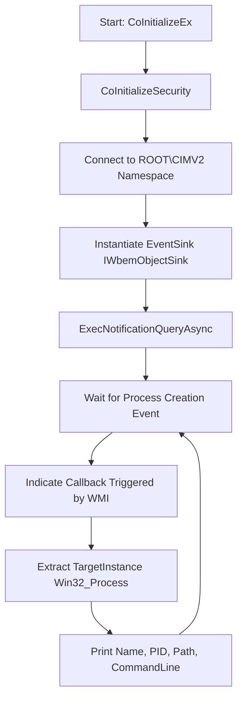

<Callout type="info" title="Overview">
WMI (Windows Management Instrumentation) allows for powerful asynchronous event subscriptions. By querying `__InstanceCreationEvent` for `Win32_Process`, a payload can monitor in real-time whenever a new process starts on the system. 

This technique is heavily used by malware to wait for a specific target process to spawn before performing injection or evasion. Because it is event-driven (callback-based), it avoids noisy polling loops and keeps CPU usage at 0%.
</Callout>


## Execution Flowchart

The tool initializes COM, connects to the WMI service, registers an asynchronous event query, and waits for the `Indicate` callback to fire whenever a process is created.



## Code Implementation

This C++ tool implements a custom COM object (`EventSink`) that inherits from `IWbemObjectSink`. When a process starts, WMI calls the `Indicate` method, passing an `IWbemClassObject` containing the new process details.

<CodeGroup>
```cpp Source Code (wmi_monitor.cpp)
#define _WIN32_DCOM

#include <Windows.h>
#include <Wbemidl.h>
#include <comdef.h>
#include <cstdio>
#include <new>

#pragma comment(lib, "wbemuuid.lib")
#pragma comment(lib, "ole32.lib")
#pragma comment(lib, "oleaut32.lib")

class EventSink final : public IWbemObjectSink {
private:
    LONG refCount = 1;

    static void PrintProperty(
        IWbemClassObject* object,
        const wchar_t* property)
    {
        VARIANT value;
        VariantInit(&value);

        HRESULT hr = object->Get(
            property, 0, &value, nullptr, nullptr);

        if (SUCCEEDED(hr)) {
            wprintf(L"  %ls: ", property);

            switch (value.vt) {
            case VT_BSTR:
                wprintf(L"%ls", value.bstrVal
                    ? value.bstrVal : L"(null)");
                break;

            case VT_I4:
                wprintf(L"%ld", value.lVal);
                break;

            case VT_UI4:
                wprintf(L"%lu", value.ulVal);
                break;

            case VT_I2:
                wprintf(L"%d", value.iVal);
                break;

            case VT_UI2:
                wprintf(L"%u", value.uiVal);
                break;

            case VT_NULL:
                wprintf(L"NULL");
                break;

            case VT_EMPTY:
                wprintf(L"EMPTY");
                break;

            default:
                wprintf(L"<unsupported VARIANT type: %u>",
                    static_cast<unsigned>(value.vt));
                break;
            }

            wprintf(L"\n");
        }
        else {
            wprintf(L"  %ls: <error 0x%08lX>\n",
                property, static_cast<unsigned long>(hr));
        }

        VariantClear(&value);
    }

public:
    ULONG STDMETHODCALLTYPE AddRef() override
    {
        return static_cast<ULONG>(
            InterlockedIncrement(&refCount));
    }

    ULONG STDMETHODCALLTYPE Release() override
    {
        LONG count = InterlockedDecrement(&refCount);

        if (count == 0) {
            delete this;
        }

        return static_cast<ULONG>(count);
    }

    HRESULT STDMETHODCALLTYPE QueryInterface(
        REFIID riid,
        void** ppv) override
    {
        if (ppv == nullptr) {
            return E_POINTER;
        }

        *ppv = nullptr;

        if (riid == IID_IUnknown ||
            riid == IID_IWbemObjectSink) {
            *ppv = static_cast<IWbemObjectSink*>(this);
            AddRef();
            return S_OK;
        }

        return E_NOINTERFACE;
    }

    HRESULT STDMETHODCALLTYPE SetStatus(
        LONG flags,
        HRESULT result,
        BSTR,
        IWbemClassObject*) override
    {
        if (flags == WBEM_STATUS_COMPLETE) {
            wprintf(L"[WMI] Query completed: 0x%08lX\n",
                static_cast<unsigned long>(result));
        }

        return WBEM_S_NO_ERROR;
    }

    HRESULT STDMETHODCALLTYPE Indicate(
        LONG count,
        IWbemClassObject** objects) override
    {
        if (count < 0 || (count > 0 && objects == nullptr)) {
            return E_INVALIDARG;
        }

        for (LONG i = 0; i < count; ++i) {
            if (objects[i] == nullptr) {
                continue;
            }

            VARIANT target;
            VariantInit(&target);

            HRESULT hr = objects[i]->Get(
                L"TargetInstance", 0, &target,
                nullptr, nullptr);

            if (FAILED(hr)) {
                VariantClear(&target);
                continue;
            }

            IUnknown* unknown = nullptr;

            if (target.vt == VT_UNKNOWN) {
                unknown = target.punkVal;
            }
            else if (target.vt == VT_DISPATCH) {
                unknown = target.pdispVal;
            }

            IWbemClassObject* process = nullptr;

            if (unknown != nullptr) {
                hr = unknown->QueryInterface(
                    IID_IWbemClassObject,
                    reinterpret_cast<void**>(&process));
            }
            else {
                hr = E_NOINTERFACE;
            }

            VariantClear(&target);

            if (FAILED(hr) || process == nullptr) {
                continue;
            }

            wprintf(L"\n[+] Process created\n");

            PrintProperty(process, L"Name");
            PrintProperty(process, L"ProcessId");
            PrintProperty(process, L"ExecutablePath");
            PrintProperty(process, L"CommandLine");

            process->Release();
        }

        return WBEM_S_NO_ERROR;
    }
};

int wmain()
{
    HRESULT hr = CoInitializeEx(
        nullptr, COINIT_MULTITHREADED);

    if (FAILED(hr)) {
        wprintf(L"CoInitializeEx failed: 0x%08lX\n",
            static_cast<unsigned long>(hr));
        return 1;
    }

    IWbemLocator* locator = nullptr;
    IWbemServices* services = nullptr;
    EventSink* sink = nullptr;
    bool registered = false;
    int exitCode = 1;

    hr = CoInitializeSecurity(
        nullptr,
        -1,
        nullptr,
        nullptr,
        RPC_C_AUTHN_LEVEL_DEFAULT,
        RPC_C_IMP_LEVEL_IMPERSONATE,
        nullptr,
        EOAC_NONE,
        nullptr);

    // RPC_E_TOO_LATE means COM security was already initialized.
    if (FAILED(hr) && hr != RPC_E_TOO_LATE) {
        wprintf(L"CoInitializeSecurity failed: 0x%08lX\n",
            static_cast<unsigned long>(hr));
        goto cleanup;
    }

    hr = CoCreateInstance(
        CLSID_WbemLocator,
        nullptr,
        CLSCTX_INPROC_SERVER,
        IID_IWbemLocator,
        reinterpret_cast<void**>(&locator));

    if (FAILED(hr)) {
        wprintf(L"CoCreateInstance failed: 0x%08lX\n",
            static_cast<unsigned long>(hr));
        goto cleanup;
    }

    hr = locator->ConnectServer(
        _bstr_t(L"ROOT\\CIMV2"),
        nullptr,
        nullptr,
        nullptr,
        0,
        nullptr,
        nullptr,
        &services);

    if (FAILED(hr)) {
        wprintf(L"ConnectServer failed: 0x%08lX\n",
            static_cast<unsigned long>(hr));
        goto cleanup;
    }

    hr = CoSetProxyBlanket(
        services,
        RPC_C_AUTHN_WINNT,
        RPC_C_AUTHZ_NONE,
        nullptr,
        RPC_C_AUTHN_LEVEL_CALL,
        RPC_C_IMP_LEVEL_IMPERSONATE,
        nullptr,
        EOAC_NONE);

    if (FAILED(hr)) {
        wprintf(L"CoSetProxyBlanket failed: 0x%08lX\n",
            static_cast<unsigned long>(hr));
        goto cleanup;
    }

    sink = new (std::nothrow) EventSink();

    if (sink == nullptr) {
        wprintf(L"Failed to allocate EventSink.\n");
        goto cleanup;
    }

    {
        _bstr_t language(L"WQL");
        _bstr_t query(
            L"SELECT * FROM __InstanceCreationEvent "
            L"WITHIN 1 "
            L"WHERE TargetInstance ISA 'Win32_Process'");

        hr = services->ExecNotificationQueryAsync(
            language,
            query,
            WBEM_FLAG_SEND_STATUS,
            nullptr,
            sink);
    }

    if (FAILED(hr)) {
        wprintf(L"ExecNotificationQueryAsync failed: 0x%08lX\n",
            static_cast<unsigned long>(hr));
        goto cleanup;
    }

    registered = true;
    exitCode = 0;

    wprintf(L"Monitoring process creation through WMI.\n");
    wprintf(L"Press Enter to exit.\n");
    (void)getchar();

cleanup:
    if (registered && services != nullptr && sink != nullptr) {
        HRESULT cancelHr = services->CancelAsyncCall(sink);

        if (FAILED(cancelHr)) {
            wprintf(L"CancelAsyncCall failed: 0x%08lX\n",
                static_cast<unsigned long>(cancelHr));
        }
    }

    if (sink != nullptr) {
        sink->Release();
    }

    if (services != nullptr) {
        services->Release();
    }

    if (locator != nullptr) {
        locator->Release();
    }

    CoUninitialize();
    return exitCode;
}
```
</CodeGroup>

## Compilation Instructions

This code requires the COM libraries and the WMI UUID library to link correctly.

<Tabs>
  <Tab title="MSVC (cl.exe)">
    ```bash
    cl.exe /nologo /Ox /MT /W0 /GS- /Tp wmi_monitor.cpp /link /OUT:wmi_monitor.exe /SUBSYSTEM:CONSOLE wbemuuid.lib ole32.lib oleaut32.lib
    ```
  </Tab>
  <Tab title="MinGW (g++)">
    ```bash
    g++ .\wmi_monitor.cpp -o wmi_monitor.exe -std=c++17 -mconsole -lwbemuuid -lole32 -loleaut32
    ```
    <Warning title="MinGW Note">
      Ensure your MinGW distribution includes `libwbemuuid`. If not, you may need to install the `mingw-w64-wbemuuid` package or link against the Windows SDK.
    </Warning>
  </Tab>
</Tabs>

## How It Works

1. **COM Initialization**
   The program initializes the COM library using `CoInitializeEx` with `COINIT_MULTITHREADED` and sets up security via `CoInitializeSecurity`. This is mandatory for interacting with WMI.

2. **WMI Connection**
   Using `CoCreateInstance`, it instantiates `IWbemLocator` and connects to the `ROOT\CIMV2` namespace, which contains the `Win32_Process` class. `CoSetProxyBlanket` is called to set the authentication level for the proxy.

3. **Event Sink Implementation**
   A custom class `EventSink` inherits from `IWbemObjectSink`. The `Indicate` method is overridden to act as the callback function. When WMI detects an event, it calls this method and passes an array of `IWbemClassObject` pointers.

4. **Async Query Registration**
   The code calls `ExecNotificationQueryAsync` with the WQL query `SELECT * FROM __InstanceCreationEvent WITHIN 1 WHERE TargetInstance ISA 'Win32_Process'`. The `WITHIN 1` clause tells WMI to check for new processes every 1 second.

5. **Data Extraction**
   When the `Indicate` callback fires, the code retrieves the `TargetInstance` property from the event object. This property contains a reference to the newly created `Win32_Process` instance, from which `Name`, `ProcessId`, `ExecutablePath`, and `CommandLine` are extracted and printed.

6. **Cleanup**
   Upon pressing Enter, `CancelAsyncCall` unregisters the event sink, COM objects are released, and `CoUninitialize` closes the COM library.

## OpSec & Red Team Perspective

<Expandable title="Why malware uses WMI Event Subscriptions">
- **Trigger-based Execution:** Malware can use this to sleep silently until a specific process (e.g., `explorer.exe` or `notepad.exe`) is spawned by the user. The moment it spawns, the WMI callback fires, and the payload can instantly perform Process Injection (T1055) into the new process before any EDR hooks are fully initialized.
- **Low CPU Overhead:** By using asynchronous callbacks (`ExecNotificationQueryAsync`), the payload avoids `while(true)` polling loops. The thread simply waits on `getchar()`, keeping CPU usage at 0% and avoiding behavioral detection rules based on rapid API polling.
- **Blinding Defenses:** EDRs themselves use similar WMI queries to monitor for malicious process spawns. Malware can attempt to register competing or destructive WMI queries to blind the EDR's monitoring capabilities.
</Expandable>

## Defense & Detection

<Callout type="warning" title="Blue Team Perspective">
WMI activity is heavily scrutinized by defensive tools because it is a dual-use technology (used by both admins and malware).

- **ETW (Event Tracing for Windows):** The `Microsoft-Windows-WMI-Activity/Trace` ETW provider logs all WMI queries. A query for `__InstanceCreationEvent` on `Win32_Process` from an unknown executable is a strong behavioral indicator of process monitoring malware.
- **Sysmon Event ID 19, 20, 21:** If the malware were to use permanent WMI event subscriptions (via `__EventFilter` and `__FilterToConsumerBinding`), Sysmon would log the filter creation, consumer binding, and event delivery. This code uses temporary async subscriptions, which are harder to catch via Sysmon but visible via ETW.
- **API Hooking:** EDRs hook `IWbemServices::ExecNotificationQueryAsync` to inspect the WQL query string before allowing the subscription to register.
</Callout>
