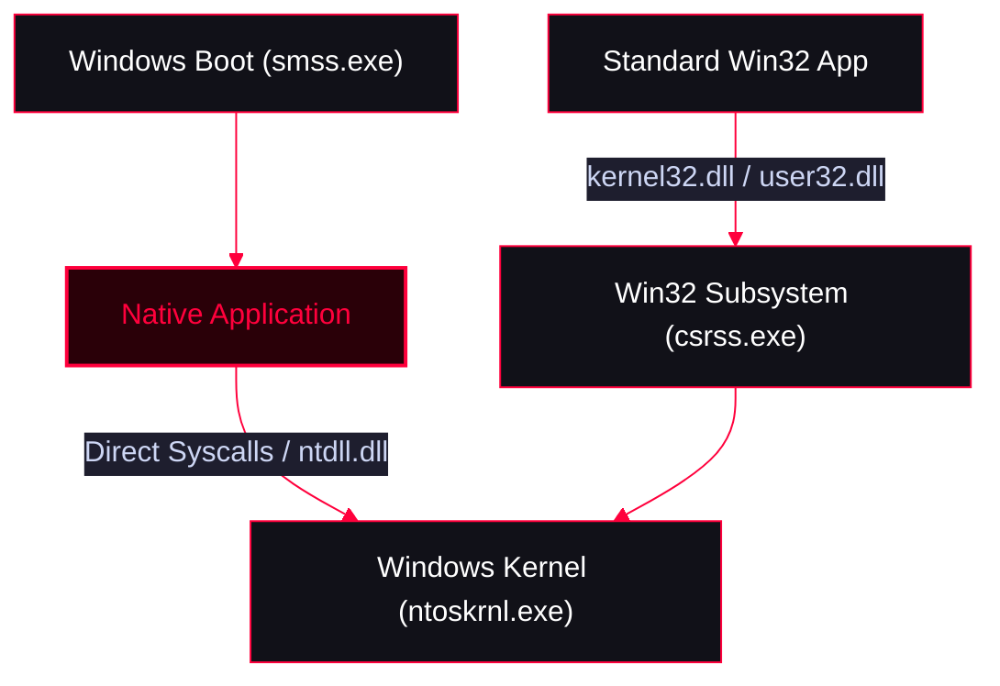

<Callout type="info" title="Concept Overview">
Native Applications are executables that use only the Native API (`ntdll.dll`) and do not depend on the Win32 subsystem (like `kernel32.dll` or `user32.dll`). They can run very early in the Windows boot process (before the Win32 subsystem is even initialized, e.g., `autochk.exe`). Malware developers use this technique to create highly stealthy tools that bypass standard user-mode hooks and leave a minimal footprint.
</Callout>



---

## Key Characteristics

<CardGroup cols={3}>
  <Card title="No Win32 Dependencies" icon="unlink">
    The executable does not import functions from `kernel32.dll` or `user32.dll`. It relies entirely on `ntdll.dll`.
  </Card>
  <Card title="Custom Entry Point" icon="code">
    Instead of `main()` or `WinMain()`, the entry point is typically `NtProcessStartUp` or `DriverEntry`.
  </Card>
  <Card title="Early Execution" icon="clock">
    Can execute during the Windows boot sequence before the graphical subsystem is fully loaded.
  </Card>
</CardGroup>

---

## Hello World Example

<Callout type="warning" title="Native API Implementation">
This code demonstrates a "Hello World" application written entirely using the Native API. It defines its own Native API prototypes, uses `NtDrawText` to print to the screen, and `NtTerminateProcess` to exit without ever calling the standard C runtime or Win32 APIs.
</Callout>

<AccordionGroup>
  <Accordion title="C++ Code (Native Hello World)">
    ```cpp
    #include <winternl.h>
    #include <windows.h>
    #pragma comment(lib,"ntdll");

    #define NtGetCurrentProcess() ((HANDLE)(LONG_PTR)-1)

    extern "C" {
       NTSTATUS NTAPI NtTerminateProcess(_In_opt_ HANDLE ProcessHandle,_In_ NTSTATUS ExitStatus);
       NTSTATUS NTAPI NtDelayExecution(_In_ BOOLEAN Alertable,_In_opt_ PLARGE_INTEGER DelayInterval);
       NTSTATUS NTAPI NtDrawText(_In_ PUNICODE_STRING Text);
    }

    extern "C" void NTAPI NtProcessStartUp(PPEB PEB){
         UNICODE_STRING text;
        RtlInitUnicodeString(&text,L"Hello world From Native Code");
        NtDrawText(&text);

        LARGE_INTEGER interval{};
        interval.QuadPart = -10000 * 10000;
        NtDelayExecution(FALSE,&interval);
        NtTerminateProcess(NtGetCurrentProcess(),0);
    }
    ```
  </Accordion>
</AccordionGroup>
