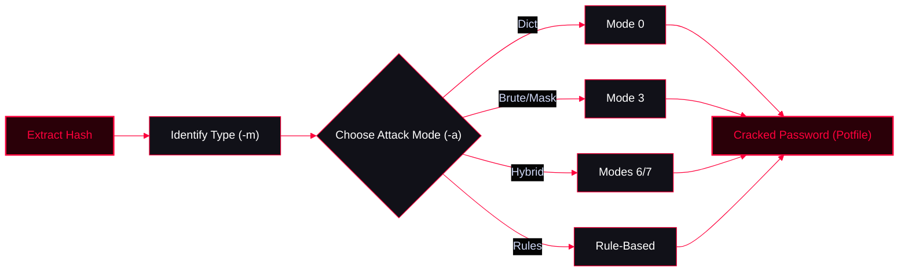

## Hash Extraction & Preparation

Before cracking, you need to extract the hashes from the target system.

<Tabs>
  <Tab title="System Hashes">
    ```bash
    # Linux local hashes
    cat /etc/shadow
    cat /etc/passwd
    unshadow passwd.txt shadow.txt > unshadowed.txt

    # Windows (Metasploit)
    meterpreter> hashdump
    ```
  </Tab>
  <Tab title="Network Captures (NTLMv2)">
    ```bash
    responder.py -I wlp7s0
    ```
  </Tab>
  <Tab title="Hash Identification">
    If you don't know the hash type, let the tools identify it for you.
    ```bash
    # Hashcat auto-identify
    hashcat --identify hashes.txt

    # Search for specific algorithms in help
    hashcat -h | grep -i wpa
    hashcat -h | grep -i sha512
    ```
  </Tab>
</Tabs>

---

## John the Ripper

<Callout type="warning" title="Basic John Usage">
John is great for quick dictionary attacks and offline cracking without needing a GPU.
</Callout>

```bash
# Install
sudo snap install john-the-ripper

# List all supported formats
john --format=list

# Crack Linux sha512crypt hashes
john --format=sha512crypt unshadowed.txt --wordlist=/usr/share/wordlists/rockyou.txt

# Crack Windows NTLM hashes
john --format=NT --wordlist=/usr/share/wordlists/rockyou.txt file.txt
```

---

## Hashcat Fundamentals



### Core Parameters

| Parameter | Description |
| :--- | :--- |
| `-m` | Hash type (Algorithm). Example: `-m 1000` (NTLM), `-m 1800` (sha512crypt). |
| `-a` | Attack mode. |
| `0` | Straight (Dictionary) |
| `1` | Combinator (Two wordlists combined) |
| `3` | Brute-force / Mask |
| `6` | Hybrid Wordlist + Mask |
| `7` | Hybrid Mask + Wordlist |
| `--force` | Force CPU usage if no compatible GPU is available. |

### Attack Modes

<Tabs>
  <Tab title="Dictionary (Mode 0)">
    Standard dictionary attack using a single wordlist.
    ```bash
    # Crack NTLM hashes (-m 1000) with a wordlist
    hashcat -m 1000 -a 0 hashes.txt /usr/share/wordlists/rockyou.txt

    # Run quietly and ignore usernames in the hash file
    hashcat --quiet --username htpasswd.txt rockyou.txt
    ```
  </Tab>
  <Tab title="Mask / Brute Force (Mode 3)">
    Define specific character sets and patterns.
    
    **Hashcat Mask Charsets (Placeholders):**
    In Hashcat Mask attacks (Brute-force), instead of defining every single character, you use Markers (Placeholders) to tell the tool which set of characters to try for each position of the password. This significantly speeds up the cracking process by narrowing down the keyspace.

    | Marker | Character Sequence | Description |
    | :--- | :--- | :--- |
    | `?l` | `abcdefghijklmnopqrstuvwxyz` | Lowercase letters |
    | `?u` | `ABCDEFGHIJKLMNOPQRSTUVWXYZ` | Uppercase letters |
    | `?d` | `0123456789` | Digits |
    | `?s` | `«space!»#%&()'-+. :;=?@^_\`~` | Special characters |
    | `?a` | `?l?u?d?s` | All (Lower + Upper + Digits + Special) |

    **Practical Example:**
    If you know a company's password policy requires exactly 6 characters: starting with an uppercase letter, followed by 4 lowercase letters, and ending with a single digit. Instead of trying billions of useless combinations, you can directly apply this specific mask:
    ```bash
    # Crack sha512crypt (-m 1800) with a specific mask: Uppercase, 5 lowercase, 2 digits
    hashcat -m 1800 -a 3 hashes.txt ?u?l?l?l?l?l?d?d
    
    # Mask: ?u?l?l?l?l?d
    hashcat -m 1000 -a 3 hashes.txt ?u?l?l?l?l?d
    ```
  </Tab>
  <Tab title="Hybrid (Modes 6 & 7)">
    Combine a wordlist with a mask (e.g., wordlist + 2 digits).
    ```bash
    # Wordlist + Mask (Mode 6)
    hashcat -m 1000 -a 6 hashes.txt words.txt ?s?d

    # Mask + Wordlist (Mode 7)
    hashcat -m 1000 -a 7 hashes.txt ?d?d?d?d words.txt
    ```
  </Tab>
  <Tab title="Rule-Based">
    <Callout type="danger" title="Rule-Based Attacks">
    Rules modify the wordlist (e.g., capitalize first letter, add '123' to the end). This is the most efficient way to crack complex passwords.
    </Callout>
    ```bash
    # Test rules on a wordlist and output to screen (--stdout)
    hashcat -r file.rule --stdout wordlist.txt

    # Perform a rule-based attack using CPU (--force)
    hashcat -m 0 hashfile.txt rockyou.txt -r file.rule --force
    ```
    *Default rules location: `/usr/share/hashcat/rules`*
  </Tab>
</Tabs>

---

## Specific File & Token Cracking

<Tabs>
  <Tab title="ZIP Files">
    Extract the hash from a ZIP file and crack it.
    ```bash
    # Extract hash using zip2john, isolate the hash part using awk
    zip2john story.zip | awk -F: '{print $2}' > story.hash

    # Find the correct hashcat mode for PKZIP
    hashcat -h | grep PKZIP

    # Crack with mode 17200
    hashcat -m 17200 -a 0 story.hash wordlist.txt
    ```
  </Tab>
  <Tab title="JWT (JSON Web Tokens)">
    JWTs can be cracked if they are signed with a weak HMAC secret.

    **Format:** Save the raw JWT string in a text file (e.g., `jwt.txt`).
    *Example:* `eyJhbGciOiJIUzI1NiIsInR5cCI6IkpXVCJ9.eyJzdWIi...`
    ```bash
    # Hashcat mode for JWT is 16500
    hashcat -m 16500 -a 0 jwt.txt /usr/share/wordlists/rockyou.txt
    ```
  </Tab>
</Tabs>

---

## Managing Cracked Hashes (Potfile)

<Callout type="tip" title="Viewing Results">
Hashcat saves cracked passwords in a potfile (usually `~/.hashcat/hashcat.potfile` or `~/.local/share/hashcat/`). It won't show them by default on subsequent runs unless asked.
```bash
# Show cracked passwords (ignores already cracked)
hashcat hashfile.txt --show --user

# Show only uncracked hashes
hashcat hashfile.txt --left --user
```
</Callout>

---

## Custom Wordlist Generation

Create custom wordlists tailored to the target.

<Tabs>
  <Tab title="Crunch (Pattern Based)">
    ```bash
    # Generate 6-character passwords starting with 'pas' followed by 3 numbers
    crunch 6 6 -t pas%%% > file.txt
    ```
  </Tab>
  <Tab title="CeWL (Website Scraping)">
    ```bash
    # Scrape words from a target website
    cewl https://example.com -w custom_wordlist.txt
    ```
  </Tab>
  <Tab title="RTGen (Rainbow Tables)">
    ```bash
    # Generate custom rainbow tables (for fast cracking of unsalted hashes)
    rtgen
    ```
  </Tab>
</Tabs>
