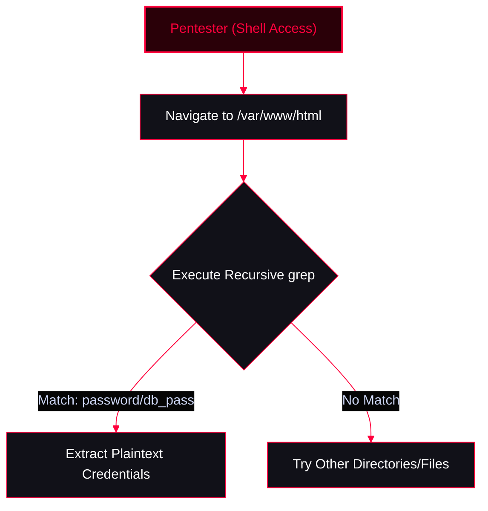

# Linux Local Stored Credentials

In Linux, local stored credentials refer to authentication data, such as passwords, tokens, or keys, stored on the system to facilitate user authentication, access control, and secure communication. Properly managing and enumerating these credentials is critical during post-exploitation.

<Callout type="info" title="MITRE ATT&CK Mapping">
* [T1552 - Unsecured Credentials](https://attack.mitre.org/techniques/T1552/)
* [T1003.008 - OS Credential Dumping: /etc/passwd and /etc/shadow](https://attack.mitre.org/techniques/T1003/008/)
</Callout>


---

## Key Locations & Methods of Storing Credentials

<Callout type="warning" title="Where Linux Stores Credentials">
1. **Password Hashes (`/etc/shadow`)**: Stores user account password hashes. Accessible only by the root user. Passwords are hashed using algorithms like SHA-512 or bcrypt.
2. **SSH Keys (`~/.ssh/`)**: 
   - Private keys: `id_rsa` or `id_ecdsa` (Permissions should be tightly controlled: `chmod 600`).
   - Public keys: `id_rsa.pub` or `id_ecdsa.pub`.
3. **Credential Caching (Keyring)**: Linux supports tools like `libsecret` or `gnome-keyring`, which securely store sensitive information. These are encrypted and unlocked using the user’s session credentials.
4. **Plain Text Configuration Files**: Some applications store credentials in plain text, such as `.netrc`, `.aws/credentials`, or custom web app configs. (Storing passwords in plain text is highly discouraged).
5. **Kerberos Tickets**: Linux systems using Kerberos store tickets in `/tmp` as temporary credential caches (ccache).
6. **Environment Variables**: Credentials like API keys or tokens may be stored in environment variables (e.g., `~/.bashrc` or `~/.profile`).
7. **Third-Party Tools**: Tools like `Vault` (HashiCorp) or `Pass` (Unix password manager) provide secure, encrypted storage.
</Callout>

---

## Practical Example: Enumerating Web App Credentials

A web server’s directory structure is often audited for potential exposure of sensitive credentials stored in clear text. The first directory to investigate is `/var/www/html`, where web application files are typically located.



<Steps>
  <Step title="Step 1: Navigate to the Target Directory">
    ```bash
    cd /var/www/html
    ```
  </Step>
  <Step title="Step 2: Search for Keywords Related to Credentials">
    Use the `grep` command to recursively search for common credential-related terms.
    ```bash
    # Search for various credential patterns
    grep -nr "username" .
    grep -nr "password" .
    grep -nr "db_user" .
    grep -nr "db_pass" .
    ```
    *Flags:*
    - `-n`: Displays the line number where the match occurs.
    - `-r`: Recursively searches all files in the directory.
    - `.`: Specifies the current directory as the search scope.
  </Step>
  <Step title="Step 3: Analyze the Output">
    If credentials are stored in clear text, you might see output like this:
    ```text
    ./config.php:12:$db_user = 'admin';
    ./config.php:13:$db_pass = 'password123';
    ./settings.py:24:DB_USERNAME = 'root'
    ./settings.py:25:DB_PASSWORD = 'mypassword'
    ```
    **Key Observations:**
    - **File Name**: The file where the credentials are located (e.g., `config.php`).
    - **Line Number**: The specific line containing the sensitive information.
    - **Content**: The actual text, including the clear-text credentials.
  </Step>
</Steps>

---

<Callout type="tip" title="Pro-Tip: Using `find` and `grep` Together">
To search only specific file extensions (like `.php` or `.py`) and avoid binary files, you can combine `find` and `grep`:
```bash
find . -type f \( -name "*.php" -o -name "*.py" -o -name "*.conf" \) -exec grep -Hn "password" {} \;
```
</Callout>
