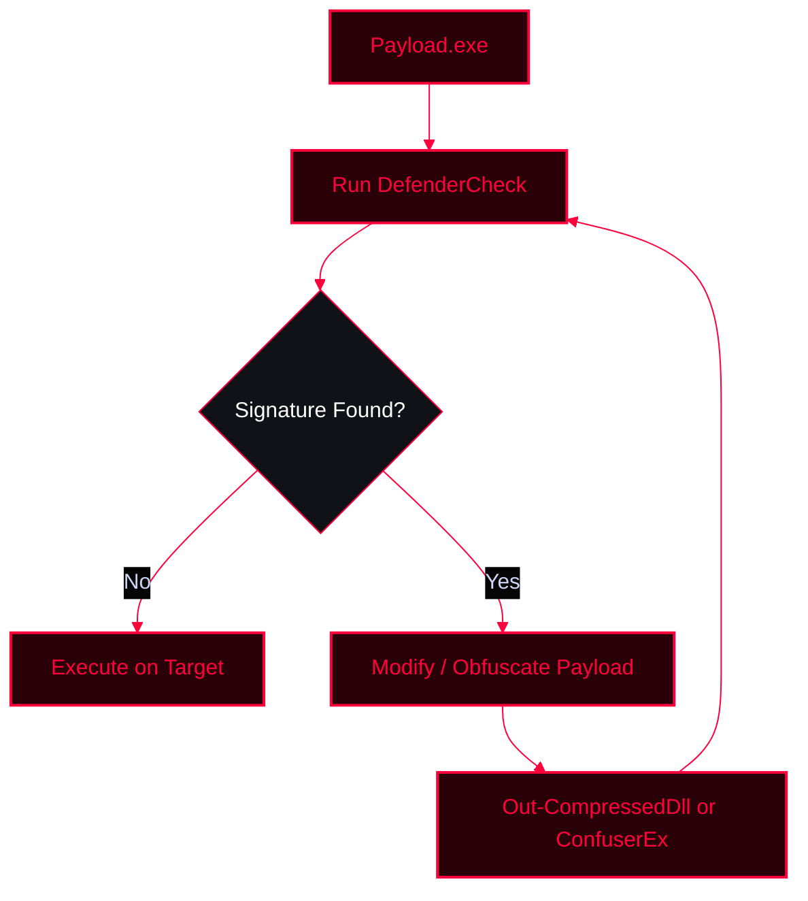

**DefenderCheck** is a tool used in red teaming and penetration testing to assess the configuration and detection capabilities of Windows Defender. It helps identify exactly which parts of a file or payload trigger Windows Defender signatures, allowing testers to modify and bypass AV detection.

<Callout type="info" title="MITRE ATT&CK Mapping">
* [T1027 - Obfuscated Files or Information](https://attack.mitre.org/techniques/T1027/)
* [T1562.001 - Impair Defenses: Disable or Modify Tools](https://attack.mitre.org/techniques/T1562/001/)
</Callout>




---

## Key Features

<CardGroup cols={3}>
  <Card title="Assessing Status" icon="shield-check">
    Checks if Defender is enabled and displays configuration settings (Real-time Protection, Cloud-delivered Protection, Sample Submission).
  </Card>
  <Card title="Simulating Attacks" icon="bug">
    Tests if malware or payloads can evade detection by breaking the binary into chunks to find the exact signature match.
  </Card>
  <Card title="Vulnerability Testing" icon="alert-triangle">
    Identifies weaknesses in Defender's detection capabilities, highlighting areas where payloads need to be obfuscated.
  </Card>
</CardGroup>

---

## Enumeration: Checking DeviceGuard

Before attempting to run custom payloads, it is critical to check if Windows Defender Device Guard (Credential Guard/VBS) is active, as it can block dynamic code execution and protect LSASS.

<Tabs>
  <Tab title="Using WMI">
    ```powershell
    gwmi -Class win32_deviceguard -Namespace root/microsoft/Windows/DeviceGuard
    ```
  </Tab>
  <Tab title="Using CIM">
    ```powershell
    gcim -ClassName win32_deviceguard -Namespace root/microsoft/Windows/DeviceGuard
    ```
  </Tab>
</Tabs>


---

## Bypassing Defenses: Payload Modification

<Callout type="warning" title="Modifying Payloads to Bypass Defender">
If `DefenderCheck` identifies specific malicious signatures (e.g., in `mimikatz.exe`), you must modify or obfuscate the payload. One method involves importing PowerSploit and compressing the executable into a DLL, which can then be loaded reflectively in memory.
</Callout>

<Steps>
  <Step title="Step 1: Import PowerSploit Module">
    ```powershell
    Import-Module PowerSploit
    ```
  </Step>
  <Step title="Step 2: Compress Executable into DLL">
    ```powershell
    Out-CompressedDll mimikatz.exe > sourcecode.txt
    ```
    <Callout type="tip">
    This allows you to load the executable in-memory via PowerShell, bypassing traditional disk-based AV scans.
    </Callout>
  </Step>
</Steps>

---

## .NET Obfuscation with ConfuserEx

<Callout type="danger" title="Obfuscating .NET Assemblies">
For .NET executables (C#/VB.NET), **ConfuserEx** is a powerful protector and obfuscator. It applies anti-tampering, anti-debugging, and control flow obfuscation to make it significantly harder for Windows Defender to statically analyze and detect the payload.
</Callout>

---

## Resources

<CardGroup cols={3}>
  <Card title="DefenderCheck" href="https://github.com/matterpreter/DefenderCheck" icon="github">
    Tool to identify signature matches in Windows Defender.
  </Card>
  <Card title="ConfuserEx" href="https://github.com/yck1509/ConfuserEx" icon="github">
    .NET assembly obfuscator and protector.
  </Card>
  <Card title="PowerSploit" href="https://github.com/PowerShellMafia/PowerSploit" icon="github">
    PowerShell Post-Exploitation Framework.
  </Card>
</CardGroup>
