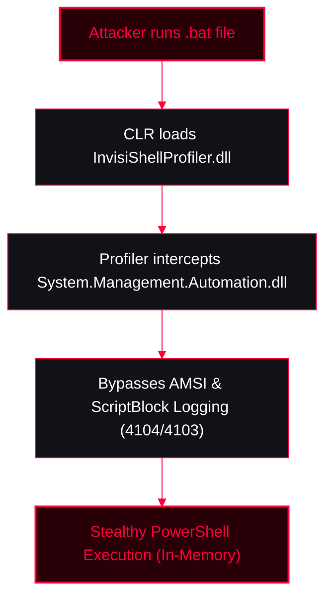

**Invisi-Shell** is a stealthy tool used by red teamers and adversaries to execute PowerShell scripts while remaining largely undetectable by traditional security tools. It bypasses all of PowerShell's security features (ScriptBlock logging, Module logging, Transcription, AMSI) by hooking .NET assemblies.

<Callout type="info" title="MITRE ATT&CK Mapping">
* [T1562.001 - Impair Defenses: Disable or Modify Tools](https://attack.mitre.org/techniques/T1562/001/)
* [T1027 - Obfuscated Files or Information](https://attack.mitre.org/techniques/T1027/)
</Callout>


---

## Key Features

<Callout type="info" title="Why Use Invisi-Shell?">
1. **Stealth Execution:** Runs PowerShell scripts without invoking standard `powershell.exe` detection hooks, evading Endpoint Detection and Response (EDR) solutions.
2. **No Disk Footprint:** Focuses on fileless attacks. Commands or scripts are executed in-memory, leaving no trace on the hard disk.
3. **Bypasses Logging:** Execution doesn't generate standard PowerShell logs (Event ID 4104/4103), bypassing SIEM monitoring tools.
4. **Framework Independence:** Can be integrated with various exploitation frameworks, including Metasploit, Empire, and Cobalt Strike.
</Callout>

```bash
git clone https://github.com/OmerYa/Invisi-Shell.git
cd Invisi-Shell
```

---

## How It Works: CLR Profiler API

<Callout type="tip" title="Technical Mechanism">
Invisi-Shell hooks the .NET assemblies `System.Management.Automation.dll` and `System.Core.dll` to bypass logging.

It performs this hook using the **CLR (Common Language Runtime) Profiler API**.
* A CLR profiler is a dynamic link library (DLL) that consists of functions that receive messages from and send messages to the CLR using the profiling API.
* The profiler DLL (`InvisiShellProfiler.dll`) is loaded by the CLR at runtime, allowing it to intercept and modify the execution of PowerShell code before AMSI or Event Logging can see it.
</Callout>



---

## Usage & Execution

<Callout type="danger" title="Running Invisi-Shell">
*Note: This is a POC. The code currently works only on x64 processes and is tested against PowerShell V5.1.*

**Prerequisites:**
Copy the compiled `InvisiShellProfiler.dll` (from `/x64/Release/` folder) along with the two batch files (`RunWithPathAsAdmin.bat` & `RunWithRegistryNonAdmin.bat`) to the same directory.
</Callout>

<Steps>
  <Step title="Step 1: Clone the Repository">
    ```bash
    git clone https://github.com/OmerYa/Invisi-Shell.git
    cd Invisi-Shell
    ```
  </Step>
  <Step title="Step 2: Execution (Choose based on privileges)">
    <Tabs>
      <Tab title="Local Administrator">
        ```cmd
        :: If you have local Administrator privileges
        .\RunWithPathAsAdmin.bat
        ```
      </Tab>
      <Tab title="Standard User (Non-Admin)">
        ```cmd
        :: If you are a standard user (Non-Admin)
        .\RunWithRegistryNonAdmin.bat
        ```
      </Tab>
    </Tabs>
  </Step>
  <Step title="Step 3: Proper Cleanup">
    <Callout type="warning" title="Important Cleanup Note">
    A PowerShell console will open after running the batch file. **Exit the PowerShell using the `exit` command (DO NOT CLOSE THE WINDOW).** This is critical to allow the batch file to perform proper cleanup and remove registry/path hooks.
    </Callout>
  </Step>
</Steps>

---

## Resources

<CardGroup cols={1}>
  <Card title="Invisi-Shell GitHub" href="https://github.com/OmerYa/Invisi-Shell" icon="github">
    Official repository for Invisi-Shell.
  </Card>
</CardGroup>
