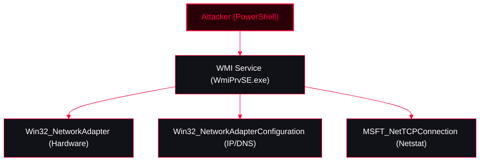

Using Windows Management Instrumentation (WMI) and Common Information Model (CIM) to enumerate network adapters, IP configurations, and active connections. This approach is highly stealthy as it relies on built-in WMI providers rather than standard networking tools like `ipconfig.exe` or `netstat.exe`, which are heavily monitored by EDRs.

<Callout type="info" title="MITRE ATT&CK Mapping">
* [T1018 - Remote System Discovery](https://attack.mitre.org/techniques/T1018/)
* [T1046 - Network Service Discovery](https://attack.mitre.org/techniques/T1046/)
* [T1087 - Account Discovery](https://attack.mitre.org/techniques/T1087/)
</Callout>




---

## 1. Listing WMI Network Classes

<Callout type="info" title="Discovering Network Classes">
You can use wildcards to find all WMI classes related to network adapters.
</Callout>

<Tabs>
  <Tab title="Using WMI (gwmi)">
    ```powershell
    gwmi -Class *NetworkAdapter* -List
    ```
  </Tab>
  <Tab title="Using CIM (gcim)">
    ```powershell
    get-cimClass -ClassName *NetworkAdapter*
    ```
  </Tab>
</Tabs>

---

## 2. Hardware Level: `Win32_NetworkAdapter`

The `Win32_NetworkAdapter` class provides information about the hardware itself, such as the adapter name, MAC address, physical adapter type, and connection speed.

<Tabs>
  <Tab title="Basic Enumeration">
    ```powershell
    # List all network adapters
    gwmi -Class Win32_NetworkAdapter
    gcim -Class Win32_NetworkAdapter
    ```
  </Tab>
  <Tab title="Filter for Active/Physical Adapters">
    *Filters out disabled adapters and virtual/loopback interfaces.*
    ```powershell
    # Find only enabled physical adapters
    gwmi -Class Win32_NetworkAdapter | ? { $_.NetEnabled -eq $true } | select Name, MACAddress, Speed, NetConnectionID
    ```
  </Tab>
</Tabs>

---

## 3. Software Level: `Win32_NetworkAdapterConfiguration`

<Callout type="tip" title="Extracting IP, DNS, and Gateway Info">
While the previous class gives hardware info, `Win32_NetworkAdapterConfiguration` provides the actual network configuration (IP addresses, subnets, default gateways, DNS servers, and DHCP status). This is the WMI equivalent of `ipconfig /all`.
</Callout>

<Tabs>
  <Tab title="Get IP Configuration (WMI)">
    ```powershell
    # Filter for adapters that have IP enabled
    gwmi -Class Win32_NetworkAdapterConfiguration | ? { $_.IPEnabled -eq $true }

    # Extract specific useful properties
    gwmi -Class Win32_NetworkAdapterConfiguration | ? { $_.IPEnabled -eq $true } | select Description, IPAddress, DefaultIPGateway, DNSServerSearchOrder, MACAddress
    ```
  </Tab>
  <Tab title="Get IP Configuration (CIM)">
    ```powershell
    gcim -ClassName Win32_NetworkAdapterConfiguration | ? { $_.IPEnabled -eq $true } | select IPAddress, DefaultIPGateway, DNSServerSearchOrder
    ```
  </Tab>
</Tabs>

---

## 4. Routing & Active Connections

<Callout type="warning" title="Network Routes & TCP States (Alternatives to `route print` & `netstat`)">
Attackers can use WMI to view the routing table and active TCP connections to map the network and identify lateral movement opportunities.
</Callout>

<Tabs>
  <Tab title="IP Routing Table">
    *Equivalent to `route print`.*
    ```powershell
    gwmi -Class Win32_IP4RouteTable

    # View specific routing details
    gwmi -Class Win32_IP4RouteTable | select Destination, Mask, NextHop
    ```
  </Tab>
  <Tab title="Active TCP Connections">
    *Equivalent to `netstat -ano`.*
    ```powershell
    # Enumerate active TCP connections (Local/Remote IPs and Ports, and Process ID)
    gwmi -Namespace root\StandardCimv2 -Class MSFT_NetTCPConnection | select LocalAddress, LocalPort, RemoteAddress, RemotePort, State, OwningProcess
    ```
  </Tab>
  <Tab title="Mapped Network Drives">
    *Equivalent to `net use`.*
    ```powershell
    gwmi -Class Win32_NetworkConnection | select LocalName, RemoteName, UserName
    ```
  </Tab>
</Tabs>

---

## OPSEC & Detection Notes

<Callout type="danger" title="Operational Security (OPSEC) & Detection">
* **Stealth:** Querying `Win32_NetworkAdapterConfiguration` executes entirely in-memory via the `WmiPrvSE.exe` process. It does not spawn `ipconfig.exe` or `netstat.exe`, making it an excellent technique for stealthy network mapping in heavily monitored environments.
* **Remote Execution:** All these commands can be executed against remote machines by adding `-ComputerName <IP> -Credential domain\user`, generating standard WMI DCOM (Port 135) network logons (Event ID 4624 Type 3).
</Callout>
