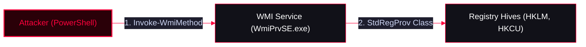

The `StdRegProv` class in the `root\default` WMI namespace provides methods for reading, writing, and enumerating Windows Registry keys. Attackers use this technique to interact with the registry stealthily, avoiding standard executables like `reg.exe` or `regedit.exe` which are heavily monitored by EDRs.

<Callout type="info" title="MITRE ATT&CK Mapping">
* [T1012 - Query Registry](https://attack.mitre.org/techniques/T1012/)
* [T1112 - Modify Registry](https://attack.mitre.org/techniques/T1112/)
* [T1547.001 - Boot or Logon Autostart Execution: Registry Run Keys](https://attack.mitre.org/techniques/T1547/001/)
</Callout>




---

## Registry Hive Values

<Callout type="warning" title="WMI Registry Constants">
WMI requires numeric values (Hex/Decimal) to specify the target Registry Hive instead of strings like "HKLM".

| Hive | Value (Decimal) | Description |
| :--- | :--- | :--- |
| `HKCR` | `2147483648` | HKEY_CLASSES_ROOT |
| `HKCU` | `2147483649` | HKEY_CURRENT_USER |
| `HKLM` | `2147483650` | HKEY_LOCAL_MACHINE |
| `HKUS` | `2147483651` | HKEY_USERS |
| `HKCC` | `2147483653` | HKEY_CURRENT_CONFIG |

*Resource:* [Posh-SecMod Registry.ps1](https://github.com/darkoperator/Posh-SecMod/blob/master/Registry/Registry.ps1)
</Callout>

---

## 1. Enumerating WMI Registry Methods

Before interacting with the registry, you can enumerate the available methods (like `EnumKey`, `GetStringValue`, `CreateKey`, etc.) provided by `StdRegProv`.

<Tabs>
  <Tab title="Using WMI (gwmi)">
    ```powershell
    gwmi -Namespace root\default -Class StdRegProv -List
    gwmi -Namespace root\default -Class stdregprov -list | select -ExpandProperty methods

    $reg = gwmi -Namespace root\default -Class stdregprov -list
    $reg.Methods
    ```
  </Tab>
  <Tab title="Using CIM (gcim)">
    ```powershell
    Get-CimClass -ClassName stdregprov -Namespace root/default | select -ExpandProperty cimclassmethods
    ```
  </Tab>
</Tabs>

---

## 2. Enumerating Registry Keys & Values (Local)

<Tabs>
  <Tab title="Enumerate Subkeys (EnumKey)">
    *Lists the subkeys under a specific registry path.*
    ```powershell
    # Enumerate subkeys under IE typed URLs (HKCU = 2147483649)
    iwmi -Namespace root/default -Class StdRegProv -Name EnumKey @(2147483649,"Software\Microsoft\Internet explorer\") | select -ExpandProperty sNames
    ```
  </Tab>
  <Tab title="Read String Value (GetStringValue)">
    *Reads a specific string value from the registry.*

    <Tabs>
      <Tab title="Method 1: Invoke-WmiMethod (iwmi)">
        ```powershell
        iwmi -Class StdRegProv -Name GetStringValue @(2147483649,"Software\Microsoft\Internet explorer\typedurls","url1") | select -ExpandProperty sValue
        ```
      </Tab>
      <Tab title="Method 2: Instantiating WMI Class">
        ```powershell
        # View method details
        (gwmi -Namespace root/default -Class stdregprov -list).methods | select Name
        (gwmi -Namespace root/default -Class stdregprov -list).getstringvalue

        # Execute the method and extract the value
        (gwmi -Namespace root/default -Class stdregprov -list).getstringvalue(2147483649,"Software\Microsoft\Internet explorer\typedurls","url1").sValue

        # Alternative using a variable
        $reg = gwmi -Namespace root\default -Class stdregprov -list
        $reg.getstringvalue(2147483649,"Software\Microsoft\Internet explorer\typedurls","url1")
        ```
      </Tab>
    </Tabs>
  </Tab>
</Tabs>

---

## 3. Remote Registry Enumeration (Lateral Movement)

<Callout type="danger" title="Reading Registry on Remote Machines">
You can use the exact same WMI methods to read the registry of a remote machine by passing the `-ComputerName` and `-Credential` parameters. This uses DCOM (Port 135) for remote execution.
</Callout>

<Tabs>
  <Tab title="Method 1: Invoke-WmiMethod Remotely">
    ```powershell
    iwmi -Class StdRegProv -Name GetStringValue @(2147483649,"Software\Microsoft\Internet explorer\typedurls","url1") | select -ExpandProperty sValue -ComputerName x.x.x.x -Credential domain\user
    ```
  </Tab>
  <Tab title="Method 2: Instantiating Remote WMI Class">
    ```powershell
    # 1. Connect to the remote StdRegProv class
    $regonRemote = gwmi -NameSpace root/default -Class StdRegProv -List -ComputerName x.x.x.x -Credential domain\user

    # 2. View available methods
    $regonRemote.Methods | select Name
    $regonRemote.GetStringValue

    # 3. Read a value from the remote machine (e.g., HKLM Run keys = 2147483650)
    $regonRemote.GetStringValue(2147483650,"software\microsoft\windows\currentversion\run","hponeagentservice")
    ```
  </Tab>
</Tabs>

---

## OPSEC & Detection

<Callout type="danger" title="Operational Security (OPSEC) & Detection">
* **Stealth:** Using WMI to query the registry does not spawn `reg.exe` or `regedit.exe`. It operates entirely within the `WmiPrvSE.exe` host process, making it stealthier than traditional registry tools.
* **Remote Access:** Remote WMI registry queries generate **Event ID 4624 (Type 3 - Network Logon)** on the target machine. EDRs monitoring WMI activity will log RPC calls to the `StdRegProv` class.
</Callout>
