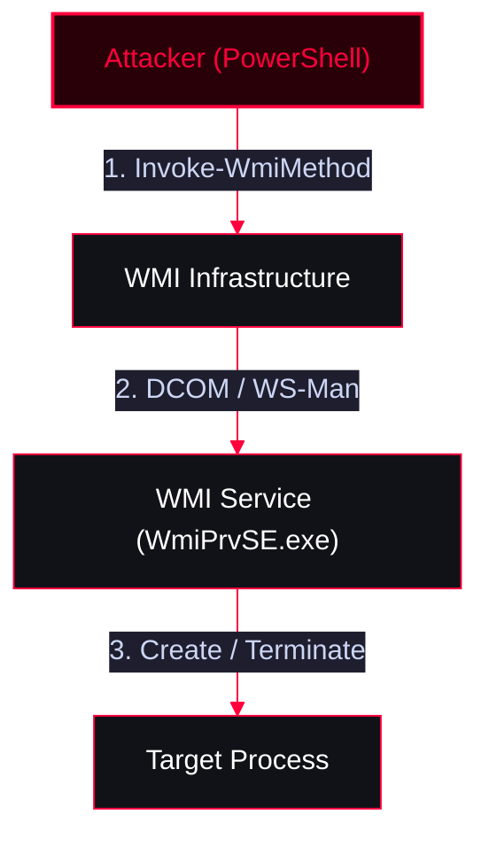

<Callout type="info" title="MITRE ATT&CK Mapping">
[T1047 - Windows Management Instrumentation](https://attack.mitre.org/techniques/T1047/)
</Callout>




---

## 1. Help & Class Discovery

<Callout type="info" title="Finding Help and Listing Classes">
```powershell
# Get help for WMI cmdlets
get-help *wmi*

# List WMI Namespaces (starting from 'root')
gwmi -Namespace "root" -Class "__namespace" | select Name
# or
Get-WMIObject -Namespace "root" -Class "__namespace" | select Name

# List all Classes in root/cimv2
gwmi -NameSpace "root/cimv2" -List

# Search for specific classes (e.g., process)
gwmi -NameSpace "root/cimv2" -List | ? {$_.Name -Match "process"}
```
</Callout>

---

## 2. Local Process Enumeration & Filtering

Use `gwmi` (Legacy WMI) or `gcim` (Modern CIM) to query process information.

<Tabs>
  <Tab title="Basic Queries (WMI)">
    ```powershell
    # Basic queries
    gwmi -Class win32_process
    gwmi -Class Win32_process | select Name

    # View class methods
    gwmi -Class Win32_Process -List | select -ExpandProperty Methods | fl
    ```
  </Tab>
  <Tab title="Filtering (WMI)">
    *Filtering for a specific process (e.g., `lsass.exe`).*
    ```powershell
    gwmi -Class Win32_process -Filter {Name = "lsass.exe"}
    gwmi -Class Win32_process | ? {$_.Name -eq "lsass.exe"}
    gwmi -Query {Select * From Win32_Process Where Name = "lsass.exe"}
    ```
  </Tab>
  <Tab title="Modern CIM">
    ```powershell
    # Modern CIM cmdlet equivalent
    gcim -Class Win32_Process
    ```
  </Tab>
</Tabs>

---

## 3. Remote Machine: Get Info & Kill Process

<Callout type="danger" title="Remote Process Management">
Manage processes on remote machines using `-ComputerName` and `-Credential`.
</Callout>

<Steps>
  <Step title="Step 1: Get Process Info">
    ```powershell
    gwmi -Class Win32_Process -ComputerName x.x.x.x -Credential domain\user
    ```
  </Step>
  <Step title="Step 2: Kill a Remote Process">
    *Pipes the WMI object to `rwmi` (Remove-WmiObject) to terminate it.*
    ```powershell
    gwmi -class win32_process -Filter { Name = "powershell.exe" } -ComputerName x.x.x.x -Credential domain\user | rwmi
    ```
  </Step>
</Steps>

---

## 4. Process Creation (Local & Remote)

<Callout type="warning" title="Spawning New Processes via WMI">
Use `iwmi` (Invoke-WmiMethod) to execute the `Create` method of the `Win32_Process` class. This is a common technique for stealthy lateral movement.
</Callout>

<Tabs>
  <Tab title="Local Execution">
    ```powershell
    # View available methods first
    gwmi -class Win32_Process -List | select -ExpandProperty Methods | select Name

    # Spawn powershell.exe locally
    iwmi -Class win32_process -Name Create -ArgumentList "powershell.exe" 

    # Spawn powershell.exe with a command
    iwmi -Class win32_process -name create -ArgumentList "powershell.exe -noexit -c get-process" 
    ```
  </Tab>
  <Tab title="Remote Execution (Lateral Movement)">
    ```powershell
    # Spawn cmd.exe on a remote machine
    iwmi -Class win32_process -name create -ArgumentList "cmd.exe" -ComputerName x.x.x.x -Credential domain\user

    # Spawn powershell.exe with a command on a remote machine
    iwmi -Class win32_process -name create -ArgumentList "powershell.exe -noexit -c get-process" -ComputerName x.x.x.x -Credential domain\user
    ```
  </Tab>
</Tabs>

---

## PowerShell Alias Reference

<CardGroup cols={2}>
  <Card title="WMI Cmdlets (Legacy)" icon="terminal">
    * `gwmi` = `Get-WmiObject` (Uses DCOM)
    * `iwmi` = `Invoke-WmiMethod`
    * `rwmi` = `Remove-WmiObject`
  </Card>
  <Card title="CIM Cmdlets (Modern)" icon="code">
    * `gcim` = `Get-CimInstance` (Uses WS-Man/DCOM)
    * `icim` = `Invoke-CimMethod`
    * `rcim` = `Remove-CimInstance`
  </Card>
</CardGroup>
