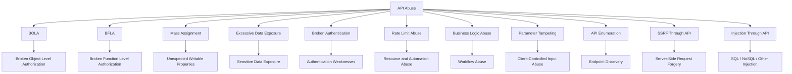
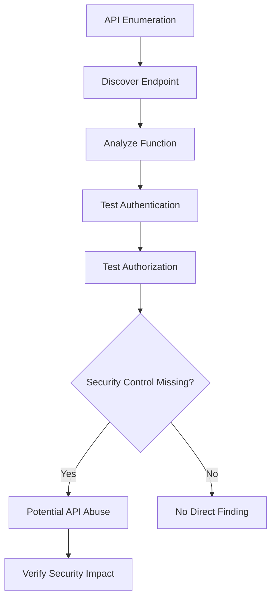
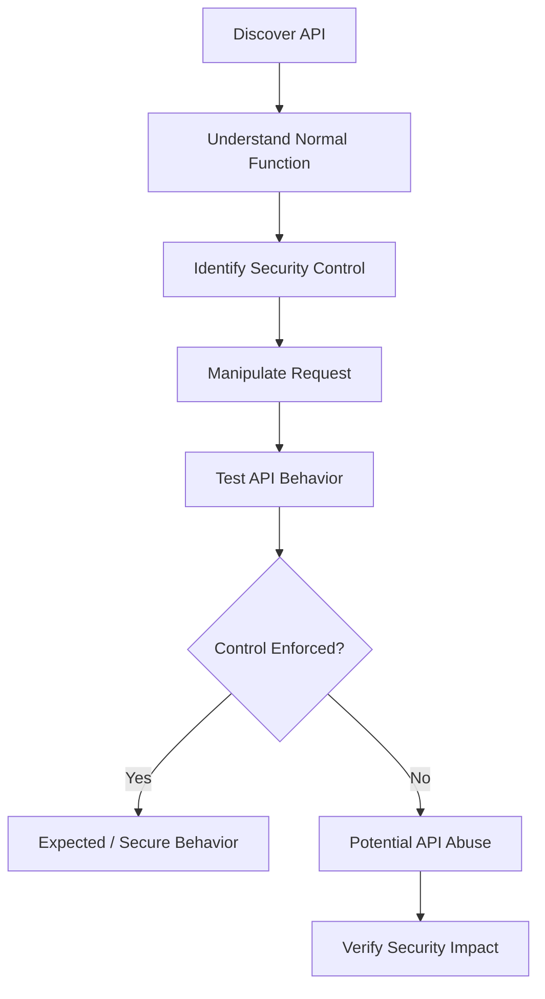

<Callout type="info" title="Overview">
**API Abuse** refers to the misuse of an API's legitimate functionality in a way that violates the application's security or business requirements.

The API itself may be working exactly as the developer intended. The problem is that the application may fail to properly enforce authentication, authorization, rate limits, input validation, business rules, resource limits, or data exposure controls.

As a result, an attacker may use a legitimate API function in an unintended way.
</Callout>

## How API Abuse Works

```text
Request
   |
   v
  API
   |
   v
Valid Function
```

The general abuse pattern is:

```text
Legitimate API Function
          |
          v
Attacker Manipulates
Request / Parameters / Workflow
          |
          v
Security Control Bypassed
          |
          v
Unauthorized Result
```

## API Abuse Categories



<Callout type="info" title="Important: These Categories Are Not Identical">
These categories do not all represent the same type of vulnerability. **API Abuse** is a broad category describing how APIs can be misused. Some examples below are formal vulnerability classes, while others are common abuse techniques or attack surfaces.
</Callout>

| Category | Main concern |
|---|---|
| BOLA / BFLA | Authorization failures |
| Rate Limit Abuse | Resource and automation abuse |
| Business Logic Abuse | Workflow abuse |
| Parameter Tampering | Client-controlled input abuse |
| API Enumeration | Discovering endpoints and functionality |
| SSRF Through API | Server-side requests to unintended destinations |
| Injection Through API | Unsafe input passed to backend interpreters |

---

# 5. Broken Authentication

<Callout type="info" title="Overview">
**Broken Authentication** occurs when an API incorrectly implements the mechanisms used to identify and authenticate users.

Depending on the weakness, an attacker may be able to obtain, predict, or reuse a session, bypass authentication, or perform excessive authentication attempts.
</Callout>

Authentication should answer one fundamental question:

```text
"Who is making this request?"
```

If the API cannot reliably answer that question, all authorization decisions built on top of it become unreliable.

## Common Authentication Problems

```text
Weak / Predictable Tokens
Missing Token Expiration
Weak Password Policy
Authentication Bypass
Improper Session Handling
Missing MFA Where Required
Token Reuse
Weak Password Reset
```

## Vulnerable Login API

Example request:

```http
POST /api/login
Content-Type: application/json
```

```json
{
  "username": "admin",
  "password": "password"
}
```

Example response:

```json
{
  "token": "123456"
}
```

The response illustrates a potentially weak token design:

```text
Token
  |
  v
Predictable / Weak
  |
  v
Potential Session Compromise
```

A secure token should be generated using a cryptographically secure mechanism. It should not be predictable from user information, timestamps, or previous tokens.

<Callout type="warning" title="Example Limitation">
The value `123456` illustrates a predictable token. A short token alone does not prove that a real application is vulnerable, but tokens must have sufficient entropy and be validated correctly.
</Callout>

## Testing with curl

Use a test account and an authorized test environment:

```bash
curl -X POST \
  "https://target.com/api/login" \
  -H "Content-Type: application/json" \
  -d '{
    "username": "admin",
    "password": "password"
  }'
```

## What to Test

- Can authentication be bypassed?
- Are tokens unpredictable and generated securely?
- Do tokens expire correctly?
- Are invalid or revoked tokens rejected?
- Does logout invalidate sessions when required?
- Does password reset properly verify the user's identity?
- Can MFA be bypassed through another API endpoint?
- Are authentication failures handled consistently?

## Impact

```text
Account Takeover
Session Compromise
Unauthorized API Access
Privilege Escalation
```

---

# 6. Rate Limit Abuse

<Callout type="info" title="Overview">
**Rate Limit Abuse** occurs when an API does not sufficiently restrict how frequently a client can perform a sensitive operation.

Rate limiting is particularly important for operations where repeated requests provide additional opportunities to guess credentials, trigger messages, redeem benefits, or consume server resources.
</Callout>

Commonly sensitive operations include:

```text
Login
OTP Verification
Password Reset
Email Verification
Coupon Redemption
API Resource Creation
Expensive Search Operations
```

## Why Rate Limiting Matters

Consider a six-digit one-time password (OTP):

```text
OTP = 6 digits
```

The possible values range from:

```text
000000
000001
000002
...
999999
```

Without an effective limit, repeated attempts may eventually allow an attacker to guess the correct value.

### Without an Effective Rate Limit

```text
Attacker
   |
   v
Repeated Requests
   |
   v
Large Number of Attempts
   |
   v
Potential OTP Guess
```

### With an Effective Rate Limit

```text
Attacker
   |
   v
Several Requests
   |
   v
Rate Limit Enforced
   |
   v
429 Too Many Requests
```

## Vulnerable API Example

Endpoint:

```http
POST /api/verifyOTP
```

Request:

```json
{
  "phone": "+989121234567",
  "otp": "123456"
}
```

The basic verification logic may look like this:

```text
Is OTP correct?
      |
      v
YES -> Authenticate
NO  -> Reject
```

However, the application also needs controls such as:

```text
Maximum Attempts
Cooldown
IP / Account Limits
Device Limits
Temporary Lockout
```

Without appropriate restrictions, an attacker may submit excessive guesses.

## Testing with curl

A single test request can be sent as follows:

```bash
curl -X POST \
  "https://target.com/api/verifyOTP" \
  -H "Content-Type: application/json" \
  -d '{
    "phone": "+989121234567",
    "otp": "123456"
  }'
```

During authorized testing, send a small, controlled number of requests and observe:

- HTTP status code
- Response headers
- Response body
- `Retry-After` header
- Response timing

A rate-limited endpoint may eventually return:

```http
HTTP/1.1 429 Too Many Requests
```

## What Makes It Vulnerable?

Sending two requests does not automatically demonstrate a vulnerability.

The important question is:

> Can a client perform an excessive number of sensitive operations without meaningful restriction?

For example:

```text
100 Requests
     |
     v
No Meaningful Restriction
     |
     v
Potential Rate Limit Vulnerability
```

Compared with:

```text
5 Requests
     |
     v
429 Too Many Requests
     |
     v
Rate Limit Triggered
```

These numbers are illustrative, not universal thresholds. Whether a limit is adequate depends on the operation, the application's risk, and the configured policy.

## Impact

```text
Credential Brute Force
OTP Guessing
Account Takeover
Resource Exhaustion
Email / SMS Abuse
Financial Abuse
Automated Enumeration
```

---

# 7. Business Logic Abuse

<Callout type="info" title="Overview">
**Business Logic Abuse** occurs when an attacker uses legitimate application functionality in a sequence or combination that the developer did not intend.

Unlike SQL Injection, this class of issue may not require malformed syntax. The requests themselves can be completely valid while producing an invalid business result.
</Callout>

```text
Valid Request
      +
Valid Authentication
      +
Valid Endpoint
      =
Invalid Business Result
```

This is one reason business logic vulnerabilities can be difficult to detect with automated scanners.

## Example: Coupon Abuse

Suppose the intended business rule is:

```text
One coupon per order
```

The API provides:

```http
POST /api/applyCoupon
```

Request:

```json
{
  "coupon": "DISCOUNT50"
}
```

### Vulnerable Logic

A simplified backend might call:

```python
apply_coupon(user, coupon)

return {
    "status": "success"
}
```

The problem occurs if the application fails to verify:

- Has this coupon already been used?
- Is the coupon valid for this user?
- Has the maximum redemption count been reached?
- Is the coupon valid for this order?

### Example Request

```bash
curl -X POST \
  "https://target.com/api/applyCoupon" \
  -H "Authorization: Bearer TOKEN" \
  -H "Content-Type: application/json" \
  -d '{
    "coupon": "DISCOUNT50"
  }'
```

If the same operation can improperly be repeated, the result may look like this:

```text
Request 1 -> Discount Applied
Request 2 -> Discount Applied
Request 3 -> Discount Applied
```

The workflow may violate the intended business rule if the coupon is supposed to be applied only once.

## Another Important Pattern: Race Conditions

<Callout type="info" title="Example: Concurrent Withdrawals">
Suppose an account has a balance of `$100`, and the withdrawal API accepts this request.
</Callout>

```http
POST /api/withdraw
```

```json
{
  "amount": 100
}
```

The intended business rule is:

```text
Balance >= Amount
       |
       v
Withdraw
       |
       v
Balance = Balance - Amount
```

If multiple requests are processed concurrently without appropriate atomic controls, both may read the original balance before either withdrawal is committed:

```text
Request A -> Check balance = $100
Request B -> Check balance = $100

Request A -> Withdraw $100
Request B -> Withdraw $100
```

The resulting state may violate the business rule. This is a **race-condition/business-logic** issue rather than simply a malformed request.

## Impact

```text
Financial Loss
Coupon Abuse
Inventory Abuse
Unauthorized Transactions
Workflow Bypass
Privilege Abuse
Account State Manipulation
```

---

# 8. Parameter Tampering

<Callout type="info" title="Overview">
**Parameter Tampering** occurs when an application trusts security-sensitive values supplied by the client instead of calculating or validating them on the server.

Any value controlled by the client should be considered untrusted until the server validates it.
</Callout>

The fundamental mistake is:

```text
Client Input
     |
     v
Backend Trusts Value
     |
     v
Security / Business Decision
```

## Example: Price Manipulation

A normal order request might look like this:

```http
POST /api/order
Content-Type: application/json
```

```json
{
  "product": "Laptop",
  "price": 1000
}
```

The application should determine the price from a trusted source:

```text
Product ID
    |
    v
Database
    |
    v
Official Price
```

Instead, a vulnerable application trusts the client-supplied `price` field.

### Example of a Tampered Request

```json
{
  "product": "Laptop",
  "price": 1
}
```

Example request for an authorized test environment:

```bash
curl -X POST \
  "https://target.com/api/order" \
  -H "Content-Type: application/json" \
  -H "Authorization: Bearer TOKEN" \
  -d '{
    "product": "Laptop",
    "price": 1
  }'
```

### Vulnerable Behavior

```text
Client
  |
  v
price = 1
  |
  v
Backend Trusts Value
  |
  v
Order Created for $1
```

### Secure Design

```text
Product ID
    |
    v
Database
    |
    v
Official Price
    |
    v
Server Calculates Total
    |
    v
Payment
```

The server should not trust client-controlled values for security-sensitive decisions, including:

```text
price
discount
role
userId
accountBalance
permissions
```

The correct implementation derives or validates these values using trusted server-side state.

## Parameter Tampering vs. Mass Assignment

<Accordion title="Parameter Tampering">
Parameter tampering modifies an existing parameter or changes its value.

Example:

```json
{
  "price": 1
}
```

The issue occurs when the backend trusts a client-controlled value that should instead be derived or validated server-side.
</Accordion>

<Accordion title="Mass Assignment">
Mass assignment occurs when an application automatically binds client-supplied fields to internal object properties without restricting which fields the user is allowed to modify.

Example:

```json
{
  "username": "john",
  "isAdmin": true
}
```

If the application allows a user to modify a privileged property such as `isAdmin`, it may create a privilege escalation vulnerability.
</Accordion>

Both issues arise when the backend trusts client-controlled data too much, but they are distinct vulnerability patterns.

## Impact

```text
Financial Loss
Privilege Escalation
Unauthorized Modification
Business Rule Bypass
Data Manipulation
```

---

# 9. API Enumeration

<Callout type="info" title="Overview">
**API Enumeration** is the process of discovering API endpoints, parameters, HTTP methods, versions, and functionality that are not obvious from the application's normal interface.

Enumeration itself is not necessarily a vulnerability. The security issue arises when discovering an endpoint reveals unprotected resources, undocumented administrative functions, deprecated APIs, debug endpoints, or hidden functionality that lacks appropriate controls.
</Callout>

The general process is:

```text
Known API
    |
    v
Discover Related Endpoints
    |
    v
Find Security Weakness
    |
    v
Abuse Functionality
```

## Common Locations

```text
/api/
/api/v1/
/api/v2/
/api/internal/
/api/admin/
/swagger/
/swagger.json
/openapi.json
/graphql
```

Other sources of endpoint information include:

```text
JavaScript Files
Mobile Applications
API Documentation
Source Maps
Burp HTTP History
```

## Example

A known endpoint is:

```http
GET /api/users
```

During authorized testing, another endpoint may be discovered:

```http
GET /api/admin/users
```

The important question is not merely:

```text
"Does this endpoint exist?"
```

It is:

```text
"Does this endpoint enforce the correct authorization?"
```

## Testing with curl

Check whether API documentation is exposed:

```bash
curl \
  "https://target.com/swagger.json"
```

Compare API versions:

```bash
curl \
  "https://target.com/api/v1/users"

curl \
  "https://target.com/api/v2/users"
```

An endpoint returning a response does not automatically indicate a vulnerability. Evaluate the data it exposes, the functions it provides, and the access controls applied to it.

## Enumeration to Abuse



## Impact

Enumeration can reveal:

```text
Increased Attack Surface
Administrative Functions
Deprecated Functionality
Debug Interfaces
Hidden Parameters
Potential Authorization Weaknesses
```

---

# 10. SSRF Through API

<Callout type="info" title="Overview">
**Server-Side Request Forgery (SSRF)** occurs when an API allows an attacker to influence a request made by the server.

The important distinction is that the attacker does not necessarily connect directly to the destination. Instead, the attacker causes the application server to make the request.
</Callout>

```text
Normal Request:

Attacker -> Server
```

```text
SSRF:

Attacker -> Server -> Target
```

The attacker is abusing the server's network position and privileges.

## Vulnerable API

Suppose an API provides URL-fetching functionality:

```http
POST /api/fetch
Content-Type: application/json
```

Request:

```json
{
  "url": "https://example.com"
}
```

A simplified backend might look like this:

```python
requests.get(url)
```

The intended functionality is:

```text
User
  |
  v
API
  |
  v
Public Website
```

The risk arises when the server accepts attacker-controlled URLs without properly restricting the destinations it can access.

## SSRF Condition

During an authorized test, a controlled request might use a loopback destination:

```json
{
  "url": "http://127.0.0.1:8080/admin"
}
```

Example request:

```bash
curl -X POST \
  "https://target.com/api/fetch" \
  -H "Content-Type: application/json" \
  -d '{
    "url": "http://127.0.0.1:8080/admin"
  }'
```

If the server performs the request, the destination is interpreted from the **server's perspective**:

```text
Attacker
   |
   v
target.com
   |
   v
127.0.0.1:8080
```

The address `127.0.0.1` refers to the machine making the request. In this case, that may be the application server, not the attacker's computer.

## Why SSRF Is Dangerous

<Callout type="danger" title="Server Network Access">
The application server may have network access that an external attacker does not have. A vulnerable API can therefore become a path to internal services.
</Callout>

```text
External Attacker
       |
       X
       |
Internal Network
```

A vulnerable server may change that situation:

```text
External Attacker
       |
       v
Vulnerable API
       |
       v
Internal Network
```

Potentially exposed targets include:

```text
Internal Web Services
Internal APIs
Administrative Interfaces
Cloud Metadata Services
Development Services
Monitoring Systems
```

## SSRF Testing Concept

Do not assume every URL-fetching API is automatically vulnerable. Determine whether the server:

```text
Accepts Attacker-Controlled URL
          |
          v
Makes Server-Side Request
          |
          v
Allows Access to Unintended Destinations
```

A secure implementation should restrict and validate:

```text
Destination
Protocol
Redirects
Network Range
DNS Resolution
```

Validation should account for redirects and DNS resolution behavior, not merely compare the original URL string against a simple blocklist.

## SSRF Impact

```text
Internal Service Access
Internal Network Discovery
Cloud Metadata Access
Credential Exposure
Administrative Interface Access
Potential Remote Code Execution
```

The actual impact depends on what the server can reach and what those internal services expose. Remote code execution is a possible downstream impact in some environments, not an automatic consequence of SSRF.

---

# 11. Injection Through API

<Callout type="info" title="Overview">
APIs frequently pass user-controlled input into backend interpreters. If the application fails to validate input types and safely parameterize or encode input, an attacker may inject syntax understood by the backend.

Common examples include SQL Injection, NoSQL Injection, Command Injection, LDAP Injection, and Template Injection.
</Callout>

```text
Attacker Input
      |
      v
     API
      |
      v
Backend Interpreter
      |
      v
Unexpected Execution
```

## SQL Injection Through API

### Vulnerable API

```http
GET /api/user?id=1
```

A simplified query might look like this:

```sql
SELECT *
FROM users
WHERE id = INPUT;
```

If the application directly concatenates untrusted input into SQL, the query structure may become attacker-controlled.

```text
SQL Query
    +
Attacker-Controlled Input
    =
Potential SQL Injection
```

### Test

In an authorized environment, a basic syntax-handling test might be:

```bash
curl \
  "https://target.com/api/user?id=1%27"
```

The encoded `%27` represents a single quote. If the application returns a database error, changes behavior unexpectedly, or otherwise reveals evidence of unsafe query construction, investigate further.

A database error alone is not definitive proof of SQL injection. Confirm the behavior using controlled tests and the application's expected response.

### Secure Design

Use parameterized queries rather than concatenating input into SQL. Validate the expected type and range of parameters, and avoid exposing detailed database errors to clients.

## NoSQL Injection Through API

Suppose an API accepts a login request:

```http
POST /api/login
Content-Type: application/json
```

```json
{
  "username": "admin",
  "password": "test"
}
```

A simplified backend might look like this:

```javascript
db.users.find({
    username: req.body.username,
    password: req.body.password
})
```

If the application accepts structured query operators directly from the client, an attacker may attempt to manipulate the query structure.

For example, a security test may examine how the application handles unexpected object values instead of the expected strings:

```json
{
  "username": {
    "$ne": null
  },
  "password": {
    "$ne": null
  }
}
```

Example request for an authorized lab:

```bash
curl -X POST \
  "https://target.com/api/login" \
  -H "Content-Type: application/json" \
  -d '{
    "username": {
      "$ne": null
    },
    "password": {
      "$ne": null
    }
  }'
```

The risk is that the application treats client JSON as a trusted query structure:

```text
Client JSON
     |
     v
Application
     |
     v
Trusted as Query Structure
```

A safer design validates expected input types and constructs the query using fixed server-side logic:

```text
Client JSON
     |
     v
Validate Expected Types
     |
     v
Construct Safe Query
```

<Callout type="warning" title="Implementation Note">
The examples above are simplified and database-specific. NoSQL query syntax and driver behavior vary. Applications should validate that fields such as `username` and `password` are strings, use safe query construction, and never treat arbitrary client-supplied objects as trusted query operators.
</Callout>

---

# API Abuse Testing Methodology

<Callout type="info" title="General Workflow">
The objective is to understand what the API is supposed to do, identify the relevant security control, and verify whether manipulating a request causes the application to violate its security or business requirements.
</Callout>



The key is to first understand **what the API is supposed to do**, then determine whether a user can manipulate the request to make it perform something it should not.

## API Abuse Testing Checklist

<Accordion title="Authentication">
- [ ] Can authentication be bypassed?
- [ ] Are tokens securely generated?
- [ ] Are sessions properly invalidated?
</Accordion>

<Accordion title="Authorization">
- [ ] Can users access objects belonging to other users?
- [ ] Can users execute privileged functions?
</Accordion>

<Accordion title="Rate Limiting">
- [ ] Are sensitive endpoints rate limited?
- [ ] Are repeated operations restricted?
</Accordion>

<Accordion title="Business Logic">
- [ ] Can workflows be repeated?
- [ ] Can required steps be skipped?
- [ ] Can operations be performed out of order?
</Accordion>

<Accordion title="Parameters">
- [ ] Can prices be modified?
- [ ] Can user-controlled security fields be changed?
- [ ] Does the server recalculate sensitive values?
</Accordion>

<Accordion title="Enumeration">
- [ ] Are undocumented APIs exposed?
- [ ] Are old API versions accessible?
- [ ] Are administrative or debug endpoints protected?
</Accordion>

<Accordion title="SSRF">
- [ ] Can the server fetch attacker-controlled URLs?
- [ ] Can unintended internal destinations be reached?
</Accordion>

<Accordion title="Injection">
- [ ] Is input passed unsafely into SQL?
- [ ] Is input passed unsafely into NoSQL queries?
- [ ] Is input passed into operating-system commands?
- [ ] Is input passed into other interpreters?
</Accordion>

---

# Final Concept

<Callout type="info" title="The Core Idea">
API Abuse occurs when an API provides legitimate functionality, but a client manipulates a request or workflow and a security or business control fails.
</Callout>

```text
API Provides Legitimate Functionality
                |
                v
Attacker Understands How It Works
                |
                v
Attacker Manipulates Request
                |
                v
Security / Business Control Fails
                |
                v
API Performs Unintended Action
```

When testing an API, do not only ask:

```text
"Can I access this endpoint?"
```

Ask:

```text
Who can access it?

Which objects can they access?

Which functions can they execute?

How many times can they execute an operation?

Which parameters can they control?

Can they change the intended workflow?

Can the server be tricked into making requests?

What backend interpreter receives the input?
```

That is the core mindset behind API Abuse testing.
