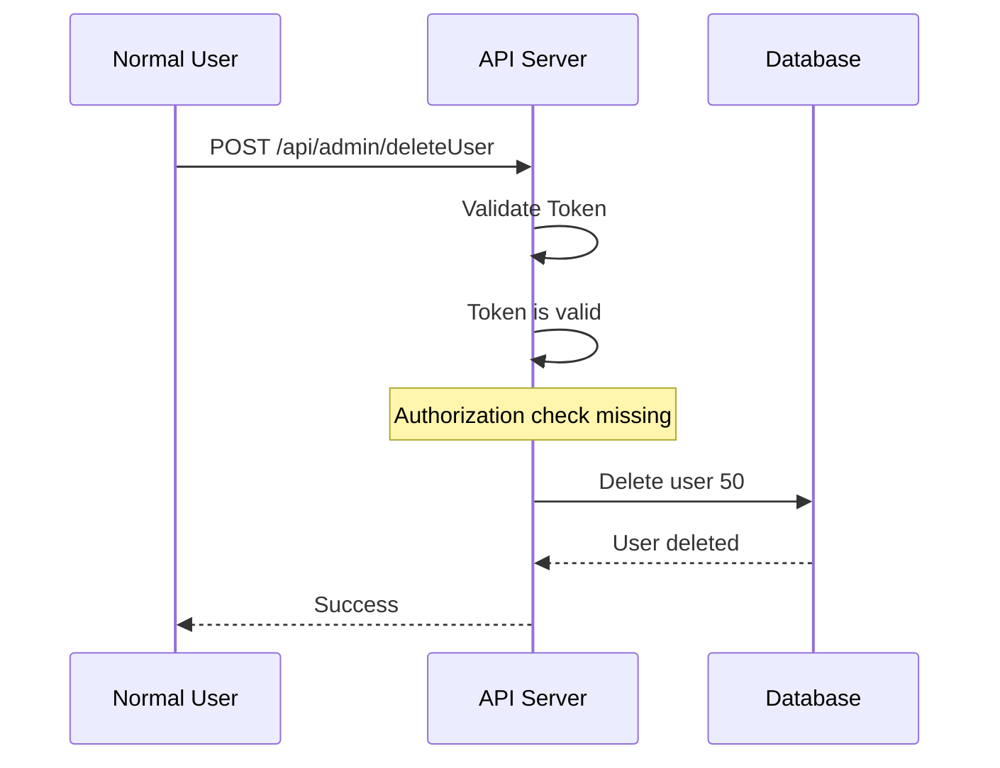
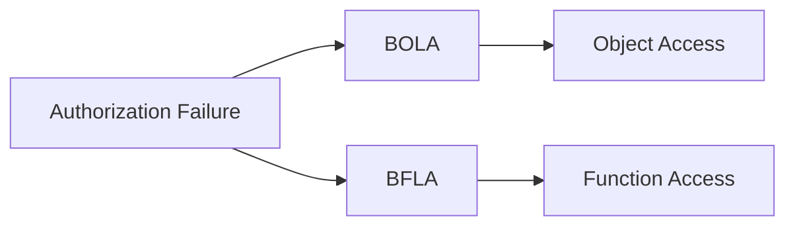

# Broken Function Level Authorization (BFLA)

<Callout type="info" title="Overview">
**Broken Function Level Authorization (BFLA)** occurs when an application fails to properly enforce authorization for a specific function or API endpoint.

In other words, the user is authenticated, but the application does not verify whether that user is allowed to execute the requested function.
</Callout>

```text
The user is authenticated,
but the application does not verify
whether that user is allowed to execute this function.
```

BFLA differs from Broken Object Level Authorization (BOLA):

| Vulnerability | Main question |
|---|---|
| BOLA | Can I access this object? |
| BFLA | Can I execute this function? |

For example, an ordinary user might attempt to access an administrative endpoint:

```text
Normal User
     |
     v
POST /api/admin/deleteUser
     |
     v
Admin Function
```

If the server executes the function without checking the user's permissions, the application may be vulnerable to BFLA.

```text
Normal User
     +
Missing Function Authorization
     =
BFLA
```

## Authentication vs. Authorization

<Callout type="info" title="Important Difference">
**Authentication** determines who the user is.

**Authorization** determines what the user is allowed to do.
</Callout>

For example, authentication may establish:

```text
"This token belongs to John."
```

The server must additionally determine:

```text
"Is John allowed to delete users?"
```

If the application only verifies the token, the request may pass authentication:

```text
Valid Token
     |
     v
Request Authenticated
```

However, the server must also check the user's role and required permission:

```text
User Role
     |
     v
Required Permission
     |
     v
Allow or Deny
```

If that authorization check is missing, the endpoint may be vulnerable to BFLA.

## Privilege Levels

A typical application might define the following roles:

```text
Guest
  |
  v
User
  |
  v
Moderator
  |
  v
Admin
```

Different roles should have different permissions.

| Function | User | Moderator | Admin |
|---|:---:|:---:|:---:|
| View Profile | ✅ | ✅ | ✅ |
| Edit Profile | ✅ | ✅ | ✅ |
| Delete Comment | ❌ | ✅ | ✅ |
| Delete User | ❌ | ❌ | ✅ |
| Create Admin | ❌ | ❌ | ✅ |

These permissions are illustrative. Actual access rules depend on the application's requirements.

---

# Vulnerable API

<Callout type="warning" title="Admin Endpoint">
Suppose the application exposes the following endpoint, which should only be available to administrators.
</Callout>

```http
POST /api/admin/deleteUser
```

A simplified vulnerable implementation might look like this:

```python
@app.post("/api/admin/deleteUser")
def delete_user():
    delete_user(request.json["id"])
    return "deleted"
```

## What Is Missing?

The application does not verify whether the authenticated user has the required administrative permission.

For example, the application is missing an authorization check equivalent to:

```python
current_user.role == "admin"
```

Without this check, the request flow may look like this:

```text
Request
   |
   v
Authentication Check
   |
   v
Valid Token
   |
   v
deleteUser()
   |
   v
User Deleted
```

The authorization step is missing.

<Callout type="warning" title="Implementation Note">
The Python snippets in this section are simplified pseudocode. In a real application, the route handler and deletion service should use distinct function names to avoid accidentally calling the handler recursively.
</Callout>

## Normal Admin Request

<Callout type="info" title="Expected Behavior">
An administrator sends a request using a valid administrative token.
</Callout>

```http
POST /api/admin/deleteUser
Authorization: Bearer ADMIN_TOKEN
Content-Type: application/json
```

```json
{
  "id": 50
}
```

The server should perform the following checks:

```text
Is Token Valid?
       |
       v
      YES
       |
       v
Is User an Admin?
       |
       v
      YES
       |
       v
Execute Function
```

This is the intended behavior.

## Attack Scenario: Normal User Accesses an Admin Function

<Callout type="danger" title="Missing Function-Level Authorization">
Assume an ordinary user discovers an administrative endpoint and attempts to access it using their own valid session or token.
</Callout>

```text
Username: attacker
Role: user
```

The endpoint is:

```http
POST /api/admin/deleteUser
```

The important distinction is that the request uses a normal user's token, not an administrator's token.

### Example Request

Use this request only in an authorized test environment:

```bash
curl -X POST \
  "https://target.com/api/admin/deleteUser" \
  -H "Authorization: Bearer USER_TOKEN" \
  -H "Content-Type: application/json" \
  -d '{
    "id": 50
  }'
```

The relevant part is:

```text
USER_TOKEN
```

not:

```text
ADMIN_TOKEN
```

The requester is authenticated as a normal user. The security test determines whether the server also enforces the required authorization.

## Vulnerable Request Flow



The problem is straightforward:

```text
Authorization Check
        |
        v
      MISSING
```

A response such as the following may indicate that the action succeeded:

```json
{
  "message": "User deleted"
}
```

However, a response body alone is not definitive proof. Confirm the result through the application's actual state and the behavior observed in the authorized test environment.

The vulnerability is demonstrated when a lower-privileged user can successfully execute a function they are not permitted to use.

---

# Correct Behavior

<Callout type="info" title="Secure Response">
The server should reject a request when the authenticated user lacks the required permission.
</Callout>

A typical response is:

```http
HTTP/1.1 403 Forbidden
Content-Type: application/json
```

```json
{
  "error": "Admin privileges required"
}
```

The authorization decision must happen **server-side**, before the privileged operation is executed.

A `401 Unauthorized` response is generally used when authentication is missing or invalid. A `403 Forbidden` response is generally appropriate when the requester is authenticated but lacks permission.

## Frontend Protection Is Not Enough

<Callout type="warning" title="Hidden Buttons Are Not Authorization">
Hiding a button in the frontend does not prevent a user from directly sending an API request.
</Callout>

A frontend might contain logic such as:

```javascript
if (user.role === "admin") {
    showDeleteUserButton();
}
```

This only controls what the interface displays. It does not secure the backend endpoint.

The incorrect assumption is:

```text
Normal User
     |
     v
Button Hidden
     |
     v
Function Protected
```

An attacker can send an HTTP request directly without using the frontend.

The correct architecture is:

```text
Frontend
   |
   v
  API
   |
   v
Authorization Check
   |
   +---- User  -> DENY
   |
   +---- Admin -> ALLOW
```

The server must independently enforce the required permission for every privileged operation.

---

# BFLA Testing Methodology

## Step 1: Identify Roles

Create or identify test accounts with different privilege levels:

```text
User A -> Normal User
User B -> Admin
```

The goal is to compare which functions each role is permitted to execute.

## Step 2: Discover Functions

Look for API endpoints that may expose privileged functionality:

```text
/api/admin/*
/api/manage/*
/api/users/delete
/api/users/create
/api/settings/*
/api/roles/*
```

Other useful sources include:

- JavaScript files
- API documentation
- Swagger/OpenAPI specifications
- Burp Suite HTTP history
- Mobile applications
- GraphQL queries and schemas

Endpoint names are clues, not proof of authorization requirements. Confirm the intended access policy before reporting a finding.

## Step 3: Capture an Admin Request

In an authorized test environment, capture a request generated by an administrator.

```http
POST /api/admin/deleteUser
Authorization: Bearer ADMIN_TOKEN
Content-Type: application/json
```

Record the relevant request details:

```text
Endpoint
HTTP Method
Parameters
Headers
Authorization Mechanism
```

## Step 4: Replay as a Lower-Privilege User

Replace the administrative test token with a token belonging to an ordinary test account.

```text
ADMIN_TOKEN
     |
     v
USER_TOKEN
```

Example:

```bash
curl -X POST \
  "https://target.com/api/admin/deleteUser" \
  -H "Authorization: Bearer USER_TOKEN" \
  -H "Content-Type: application/json" \
  -d '{
    "id": 50
  }'
```

Use a non-destructive test function or a dedicated test object when possible. Do not delete real users merely to establish that a missing authorization check exists.

## Step 5: Compare the Result

Expected behavior:

```text
Admin Token -> 200 OK
User Token  -> 403 Forbidden
```

Potentially vulnerable behavior:

```text
Admin Token -> 200 OK
User Token  -> Successful Privileged Action
```

A matching status code alone is insufficient. Some applications return the same status for multiple outcomes. Verify whether the privileged action actually occurred.

If a lower-privileged user successfully executes a function intended for an administrator, BFLA may be confirmed.

---

# BFLA Examples

<Accordion title="Example 1: Delete User">

Endpoint:

```http
DELETE /api/admin/users/50
```

Expected behavior for an ordinary user:

```http
403 Forbidden
```

If the ordinary user can successfully delete the user despite lacking permission, the endpoint may be vulnerable to BFLA.
</Accordion>

<Accordion title="Example 2: Create Administrator">

Endpoint:

```http
POST /api/admin/createAdmin
Content-Type: application/json
```

Request:

```json
{
  "username": "attacker"
}
```

If a normal user can execute this administrative function, the result may be privilege escalation.
</Accordion>

<Accordion title="Example 3: Change User Role">

Endpoint:

```http
PUT /api/admin/users/50/role
Content-Type: application/json
```

Request:

```json
{
  "role": "admin"
}
```

If an ordinary user can invoke the role-management function without authorization, the application may allow privilege escalation.

```text
Normal User
     |
     v
Role Management Function
     |
     v
Privilege Escalation
```
</Accordion>

---

# HTTP Method Testing

<Callout type="info" title="Test Authorization Consistently">
Authorization may be implemented incorrectly for one HTTP method while working correctly for another.
</Callout>

For example, the application may correctly protect:

```http
GET /api/admin/users
```

but fail to enforce the same policy for:

```http
POST /api/admin/users
```

Test the relevant methods according to the endpoint's intended functionality:

```text
GET
POST
PUT
PATCH
DELETE
```

The objective is not to change methods blindly. It is to verify that each operation consistently enforces the correct authorization policy.

---

# BFLA vs. BOLA

<Callout type="info" title="Important Difference">
BFLA and BOLA are both authorization vulnerabilities, but they focus on different authorization decisions.
</Callout>

**BOLA:**

```text
Can I access another user's OBJECT?
```

Example:

```http
GET /api/users/101
```

**BFLA:**

```text
Can I execute a FUNCTION
that my role should not have access to?
```

Example:

```http
POST /api/admin/deleteUser
```



| Vulnerability | What fails? | Example |
|---|---|---|
| BOLA | Authorization to access a specific object | Reading another user's private record |
| BFLA | Authorization to execute a specific function | A normal user invoking an admin-only operation |

---

# Impact

<Callout type="danger" title="Security Impact">
Depending on the exposed function, BFLA can lead to privilege escalation, unauthorized administrative actions, sensitive data access, or destructive changes.
</Callout>

Potential consequences include:

```text
Privilege Escalation
Account Administration
User Deletion
Role Modification
Sensitive Data Access
Configuration Changes
Administrative Actions
```

In severe cases, an ordinary user may gain access to administrative functionality:

```text
Normal User
     |
     v
Administrative API
     |
     v
Unauthorized Administrative Control
```

The actual impact depends on the privileges of the exposed function and the application's security boundaries.

---

# Prevention

<Callout type="tip" title="Enforce Authorization on the Server">
Every privileged API function should verify the authenticated user's permissions before performing the operation. Frontend checks are useful for the user experience, but they are not a security boundary.
</Callout>

## Vulnerable Implementation

```python
@app.post("/api/admin/deleteUser")
def delete_user():
    delete_user(request.json["id"])
    return "deleted"
```

The example does not enforce an administrative permission check.

## Secure Implementation

The following is illustrative Flask-style pseudocode. It assumes that authentication middleware has already populated `current_user` and that the deletion service is named `delete_user_by_id`.

```python
@app.post("/api/admin/deleteUser")
def delete_user_endpoint():
    if current_user.role != "admin":
        return {
            "error": "Forbidden"
        }, 403

    user_id = request.json["id"]
    delete_user_by_id(user_id)

    return {
        "message": "User deleted"
    }, 200
```

The important property is the order of operations:

```text
Authenticate User
       |
       v
Check Required Permission
       |
       +---- Denied -> Return 403
       |
       +---- Allowed
                 |
                 v
        Validate Request Data
                 |
                 v
        Execute Privileged Action
```

For production applications, prefer explicit permission checks or a centralized authorization policy over relying only on a role-name comparison. Also validate request data, handle missing users, and apply appropriate audit logging.

## Quick Testing Checklist

- [ ] Identify user roles.
- [ ] Discover privileged endpoints.
- [ ] Capture an authorized request.
- [ ] Replay it using a lower-privileged test account.
- [ ] Compare HTTP status codes.
- [ ] Compare response bodies.
- [ ] Verify whether the privileged action actually occurred.
- [ ] Test relevant HTTP methods.
- [ ] Confirm that authorization is enforced server-side.

---

# Summary

<Callout type="info" title="Core Concept">
**BFLA = Broken Function Level Authorization**

The vulnerability occurs when a user is authenticated, a function requires higher privileges, and the server fails to enforce that requirement.
</Callout>

```text
User Is Authenticated
         +
Function Requires Higher Privileges
         +
Server Fails to Enforce Authorization
         |
         v
        BFLA
```

The central penetration-testing question is:

> Can a lower-privileged user execute a function intended for a higher-privileged user?

Example:

```text
Normal User
     |
     v
POST /api/admin/deleteUser
     |
     v
Server Fails to Check Role
     |
     v
Unauthorized Action
```

The essential distinction is:

```text
BOLA -> Unauthorized OBJECT Access

BFLA -> Unauthorized FUNCTION Execution
```