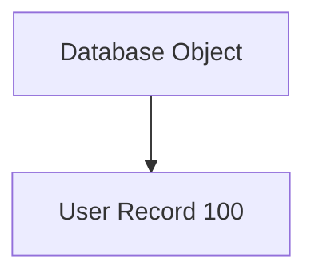
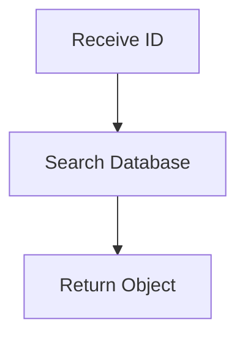
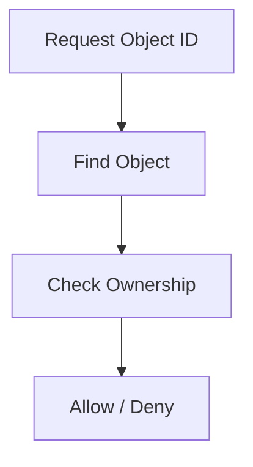
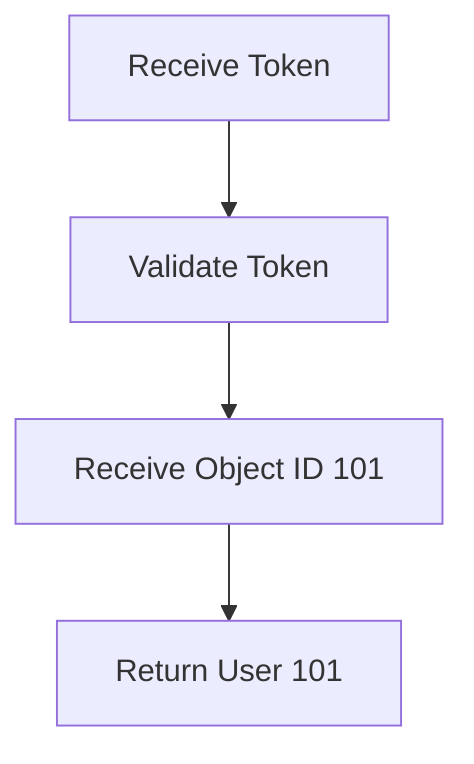
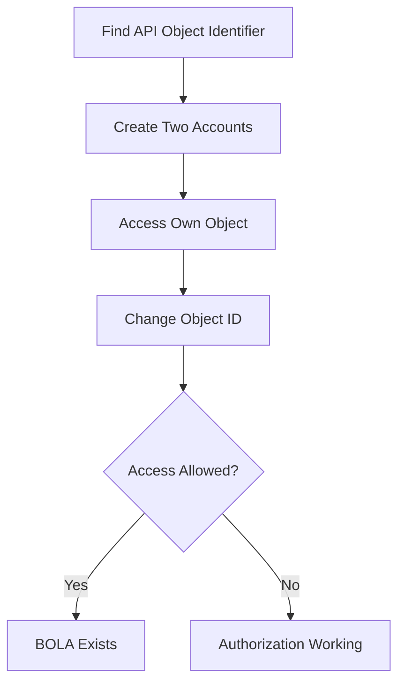

<Frame type="image" caption="Broken Object Level Authorization">

</Frame>

<Callout type="default" title="Overview">
**Broken Object Level Authorization (BOLA)** is an API authorization vulnerability where an application exposes direct references to objects (such as IDs, UUIDs, filenames, or account numbers) but fails to verify whether the authenticated user has permission to access that object.

In simple terms:

```text
The user is authenticated,
but the application does not check ownership.
```

<Columns>
  <Column>
    <Callout type="info" title="Authentication">
      Authentication answers:

      ```text
      Who are you?
      ```
    </Callout>
  </Column>
  <Column>
    <Callout type="warning" title="Authorization">
      Authorization answers:

      ```text
      What are you allowed to access?
      ```
    </Callout>
  </Column>
</Columns>

BOLA occurs when the first question is answered correctly, but the second one is ignored.
</Callout>

# Object-Level Authorization Concept

<Expandable title="What is an Object?" defaultOpen={true}>
In APIs, an object is any resource that belongs to a user or system.

Examples:

```text
User Account
Profile
Invoice
Order
Message
Document
Payment Record
File
Ticket
```

APIs usually identify these objects using identifiers:

```text
Integer ID
UUID
Username
Email
Filename
Reference Number
```
</Expandable>

## Common API Pattern

A common API design:

```http
GET /api/users/{user_id}
```

Example:

```http
GET /api/users/100
```

The server receives:

```text
Object ID = 100
```

Then retrieves:



The security question:

```text
Does the current user have permission to access object 100?
```

If the answer is not checked:

```text
BOLA Vulnerability
```

# Vulnerable Backend Logic

<Warning title="Missing Authorization Check">
Example vulnerable code:

```python
@app.get("/api/user/<id>")
def get_user(id):

    user = database.get_user(id)
    
    return user
```

The backend performs:



But missing:

```text
Is this object owned by the logged-in user?
```
</Warning>

## Secure Backend Logic

A secure implementation should check ownership:

```python
@app.get("/api/user/<id>")
def get_user(id):

    user = database.get_user(id)

    if user.owner != current_user:
        return "Unauthorized"

    return user
```

Secure flow:



# Normal Application Flow

Assume the database contains:

```text
Users Table

ID      Username
----------------
100     john
101     admin
102     alice
```

User John logs in:

```text
User:
john

Token:
USER_A_TOKEN
```

---

John requests his profile:

```http
GET /api/users/100

Authorization:
Bearer USER_A_TOKEN
```

Backend:

```text
Token belongs to John

Requested Object:
User ID 100

Ownership:
YES

Allow
```

Response:

```json
{
  "id": 100,
  "username": "john"
}
```

---

# Attack Scenario

<Callout type="error" title="ID Manipulation">
The attacker notices that the API uses predictable IDs:

```text
/api/users/100
```

The attacker changes:

```text
100 → 101
```

Request:

```http
GET /api/users/101

Authorization:
Bearer USER_A_TOKEN
```
</Callout>

## Vulnerable Server Behavior

Backend:



Problem:

```text
Token is valid,
but object ownership was never checked.
```

---

Response:

```json
{
  "id": 101,
  "username": "admin",
  "email": "admin@test.com"
}
```

Impact:

```text
John accessed Admin's data
```

---

# Exploitation with curl

Request:

```bash
curl -X GET \
"https://target.com/api/users/101" \
-H "Authorization: Bearer USER_A_TOKEN"
```

<Tabs>
  <Tab title="Vulnerable Response">
    ```json
    {
      "id": 101,
      "username": "admin",
      "email": "admin@test.com"
    }
    ```

    Meaning:

    ```mermaid
    graph LR
      A[Authenticated User] --> B[Unauthorized Object Access]
    ```
  </Tab>
  <Tab title="Secure Response">
    ```json
    {
      "error": "Unauthorized"
    }
    ```

    or:

    ```http
    HTTP/1.1 403 Forbidden
    ```
  </Tab>
</Tabs>

---

# Common BOLA Locations

<Accordion>
  <AccordionItem title="User Profiles">
    ```http
    GET /api/users/100/profile
    ```

    Test:

    ```http
    GET /api/users/101/profile
    ```
  </AccordionItem>
  <AccordionItem title="Orders">
    Normal:

    ```http
    GET /api/orders/5001
    ```

    Attack:

    ```http
    GET /api/orders/5002
    ```

    Possible impact:

    ```text
    View another user's order
    ```
  </AccordionItem>
  <AccordionItem title="Documents">
    API:

    ```http
    GET /api/documents/abc123
    ```

    Attack:

    ```text
    Change document ID
    ```

    Impact:

    ```text
    Private file disclosure
    ```
  </AccordionItem>
  <AccordionItem title="Messages">
    API:

    ```http
    GET /api/messages/900
    ```

    Attack:

    ```http
    GET /api/messages/901
    ```

    Impact:

    ```text
    Read another user's messages
    ```
  </AccordionItem>
</Accordion>

# Types of BOLA

<Tabs>
  <Tab title="1. Read-Based BOLA">
    Attacker can read another user's object.

    Example:

    ```http
    GET /api/profile/101
    ```

    Impact:

    ```text
    Information Disclosure
    ```
  </Tab>
  <Tab title="2. Write-Based BOLA">
    Attacker can modify another user's object.

    Example:

    ```http
    PUT /api/profile/101
    ```

    Request:

    ```json
    {
      "email": "attacker@test.com"
    }
    ```

    Impact:

    ```text
    Account Modification
    ```
  </Tab>
  <Tab title="3. Delete-Based BOLA">
    Attacker can delete another user's resource.

    Example:

    ```http
    DELETE /api/files/101
    ```

    Impact:

    ```text
    Data Loss
    ```
  </Tab>
</Tabs>

# BOLA Testing Methodology



<Tip title="Testing Checklist">
Look for:

```text
/api/users/{id}
/api/orders/{id}
/api/accounts/{id}
/api/files/{id}
/api/messages/{id}
```

Test changing:

```text
ID
UUID
Username
Reference Number
Filename
```

Check:

```text
GET
POST
PUT
PATCH
DELETE
```

<Note title="Note">
Because many developers remember to protect viewing but forget modifying and deleting. Humanity's favorite security strategy: "we secured the front door, ignore the windows."
</Note>
</Tip>

<Callout type="error" title="Security Impact">
Successful BOLA can lead to:

```text
Unauthorized Data Access
Privacy Violation
Account Takeover
Financial Data Exposure
Modification of User Data
Deletion of Resources
Privilege Escalation
```
</Callout>

<Callout type="info" title="Secure Development">
Never trust object identifiers from users.

Bad:

```python
object = get_object(id)
return object
```

Good:

```python
object = get_object(id)

if object.user_id != authenticated_user.id:
    deny()
```

Security checks must happen on:

```text
Every API Request
Every Object Access
Every HTTP Method
```
</Callout>

# Summary

<Callout type="default" title="Summary">
BOLA happens when:

```text
User Authentication
        +
Missing Object Authorization
        =
Unauthorized Object Access
```

The attacker usually performs:

<Steps>
  1. Authenticate normally
  2. Find object identifier
  3. Modify ID/UUID/reference
  4. Access another user's resource
</Steps>

The core question during testing:

```text
Can User A access User B's object by changing an identifier?
```
</Callout>