<Frame type="image" caption="Insecure Direct Object Reference">

</Frame>

<Callout type="default" title="Overview">
**Insecure Direct Object Reference (IDOR)** is an access control vulnerability where an application exposes a direct reference to an object (such as a user ID, document ID, order number, or filename) without verifying whether the authenticated user is authorized to access that object.

An attacker can manipulate the object identifier to access or modify resources belonging to other users.
</Callout>

## How IDOR Works

Applications often expose object identifiers in requests.

Example:

```http
GET /profile?id=1001
```

The application retrieves:

```sql
SELECT * FROM users WHERE id = 1001;
```

If no authorization check exists, an attacker can simply change:

```http
GET /profile?id=1002
```

and obtain another user's information.

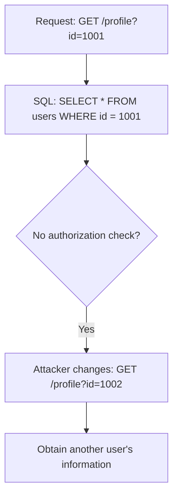

---

## Attack Flow

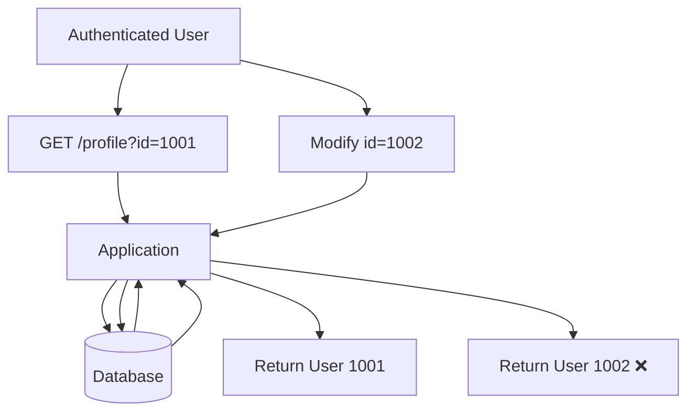

---

## Why Does IDOR Happen?

The application validates that the user is authenticated but fails to verify ownership of the requested object.

### Incorrect Authorization Flow

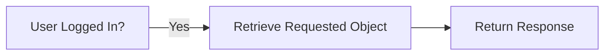

### Correct Authorization Flow

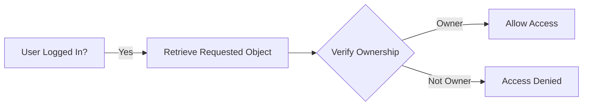

## Common IDOR Targets

- User Profiles
- Orders
- Invoices
- Documents
- Images
- Medical Records
- Support Tickets
- Messages
- File Downloads
- REST API Resources

---

## Example 1 - User Profile

Request:

```http
GET /profile?id=5
```

Response:

```json
{
    "id":5,
    "username":"alice"
}
```

Attacker changes:

```http
GET /profile?id=6
```

Response:

```json
{
    "id":6,
    "username":"bob"
}
```

---

## Example 2 - File Download

Request

```http
GET /download?file=invoice_102.pdf
```

Attacker changes

```http
GET /download?file=invoice_101.pdf
```

If access control is missing:

```text
Sensitive invoice disclosed
```

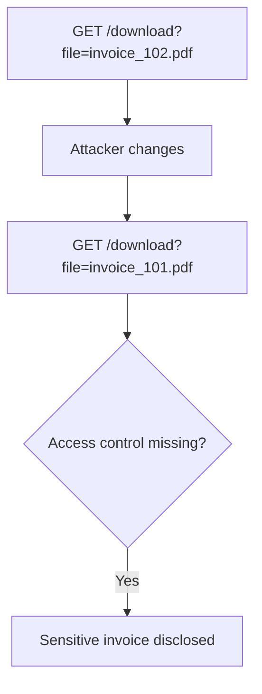

---

## Example 3 - REST API

Request

```http
GET /api/users/15
```

Attacker changes

```http
GET /api/users/16
```

Application returns another user's data.

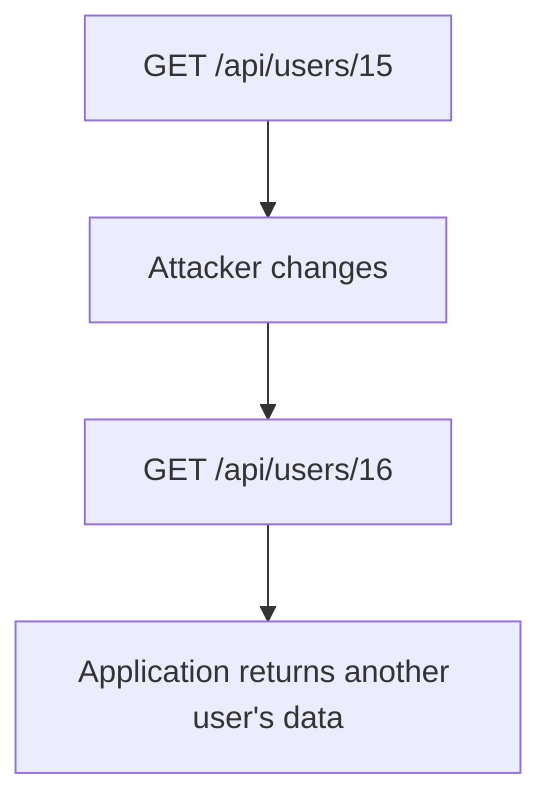

---

## Example 4 - Order History

```http
GET /orders/5001
```

↓

```http
GET /orders/5002
```

If both succeed:

```text
Possible IDOR
```

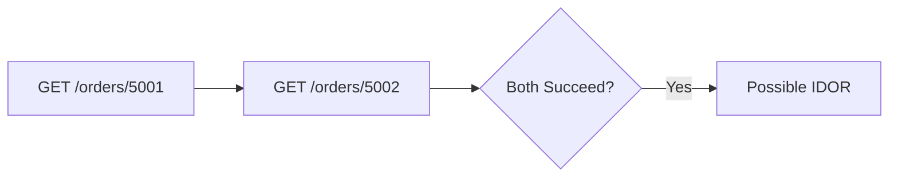

---

## IDOR Flow

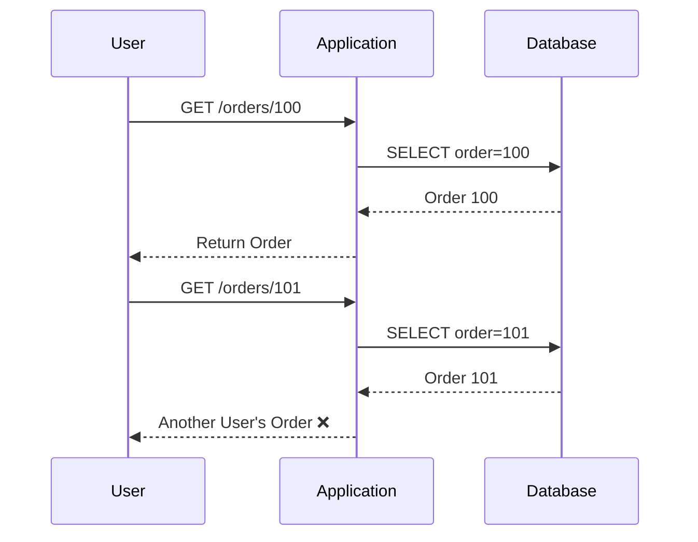

---

## Testing IDOR With curl

### User Profile

```bash
curl -i \
https://target.com/profile?id=10
```

Change:

```bash
curl -i \
https://target.com/profile?id=11
```

Compare:

- Status Code
- Response Body
- Response Length

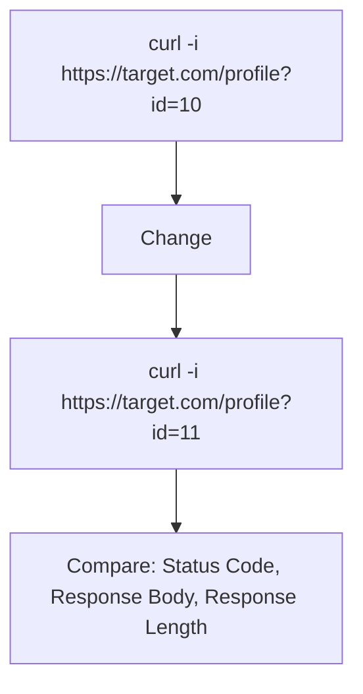

---

### REST API

```bash
curl -i \
https://target.com/api/users/10
```

↓

```bash
curl -i \
https://target.com/api/users/11
```

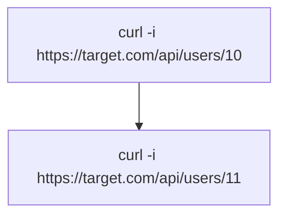

---

### Download Endpoint

```bash
curl -i \
"https://target.com/download?file=invoice_100.pdf"
```

↓

```bash
curl -i \
"https://target.com/download?file=invoice_101.pdf"
```

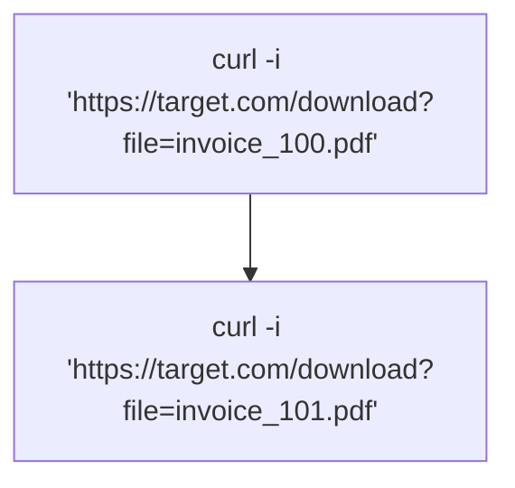

---

## Common Object References

<Expandable title="Common Object References" defaultOpen={true}>
### Numeric IDs

```text
?id=1
?id=2
?id=3
```

---

### UUID

```text
/users/3d3470fa-657f-4586-a063-d84b0cf8af65
```

---

### Filenames

```text
invoice.pdf
report.docx
backup.zip
```

---

### Order Numbers

```text
ORD-1001
ORD-1002
```

---

### API Keys

```text
/api/token/abcd1234
```
</Expandable>

---

## IDOR in REST APIs

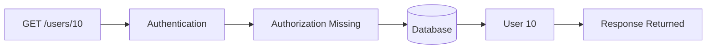

---

## Authentication ≠ Authorization

<Warning title="Warning">
Authentication verifies **who you are**.

Authorization verifies **what you are allowed to access**.

Most IDOR vulnerabilities occur because authentication exists but authorization is missing.
</Warning>

---

## Indicators During Pentest

<Tip title="Tip">
Look for user-controlled identifiers in:
- URL parameters
- REST API paths
- POST parameters
- JSON bodies
- Cookies
- Hidden form fields
- File names
</Tip>

Examples

```text
?id=
```

```text
/user/15
```

```text
/order/500
```

```text
/document/42
```

<Callout type="info" title="Checklist">
<Steps>
  1. Identify object identifiers.
  2. Modify numeric IDs.
  3. Modify UUIDs.
  4. Test sequential values.
  5. Test deleted object IDs.
  6. Test file names.
  7. Compare responses.
  8. Compare status codes.
  9. Compare response sizes.
  10. Test different user accounts.
  11. Test API endpoints.
  12. Test download functionality.
</Steps>
</Callout>

<Tip title="Prevention">
<Steps>
  1. Enforce authorization checks for every object access.
  2. Never trust user-supplied object identifiers.
  3. Verify object ownership before returning data.
  4. Use indirect object references where appropriate.
  5. Implement server-side access control.
  6. Log unauthorized access attempts.
  7. Apply least privilege.
</Steps>
</Tip>

---

## Related Vulnerabilities

<CardGroup cols={2}>
  <Card title="Broken Access Control" href="https://owasp.org/www-community/Broken_Access_Control">
    Exploiting server-side applications to send unauthorized requests.
  </Card>
  <Card title="Forced Browsing" href="https://owasp.org/www-community/attacks/Forced_browsing">
    Accessing restricted pages by guessing URLs.
  </Card>
  <Card title="Privilege Escalation" href="https://owasp.org/www-community/Privilege_escalation">
    Gaining higher privileges than originally intended.
  </Card>
  <Card title="Information Disclosure" href="https://owasp.org/www-community/Information_Leakage">
    Unintended exposure of sensitive information.
  </Card>
  <Card title="API Authorization Issues" href="https://owasp.org/API-Security/">
    Flaws in how APIs verify user permissions.
  </Card>
</CardGroup>

---

## References

<CardGroup cols={2}>
  <Card title="OWASP Top 10 - Broken Access Control" href="https://owasp.org/Top10/A01_2021-Broken_Access_Control/">
    OWASP Top 10 category for Broken Access Control.
  </Card>
  <Card title="OWASP Web Security Testing Guide" href="https://owasp.org/www-project-web-security-testing-guide/">
    Comprehensive web application testing guide.
  </Card>
  <Card title="OWASP API Security Top 10" href="https://owasp.org/API-Security/">
    Security risks specific to APIs.
  </Card>
  <Card title="CWE-639" href="https://cwe.mitre.org/data/definitions/639.html">
    Authorization Bypass Through User-Controlled Key.
  </Card>
  <Card title="PortSwigger Web Security Academy" href="https://portswigger.net/web-security/access-control">
    Access control vulnerabilities training.
  </Card>
</CardGroup>