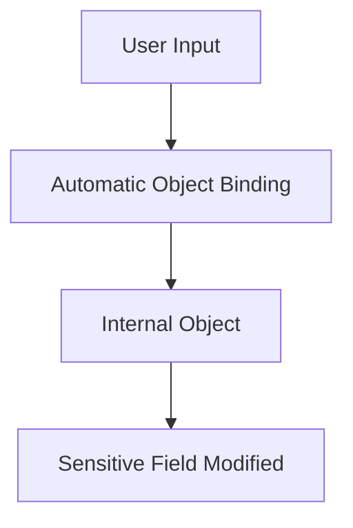
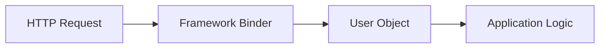
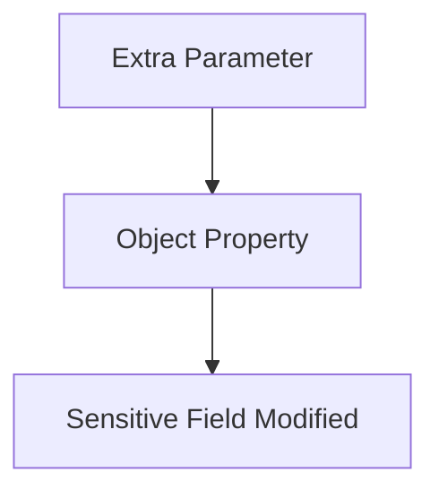
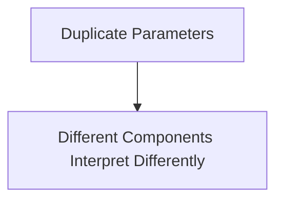
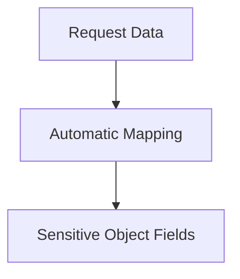
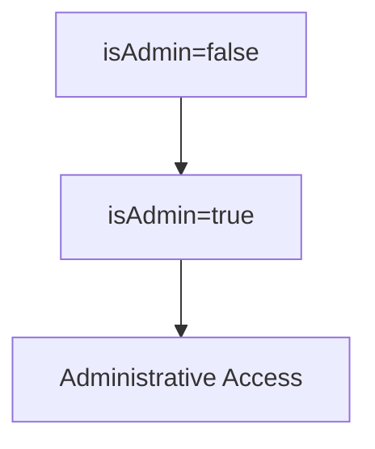
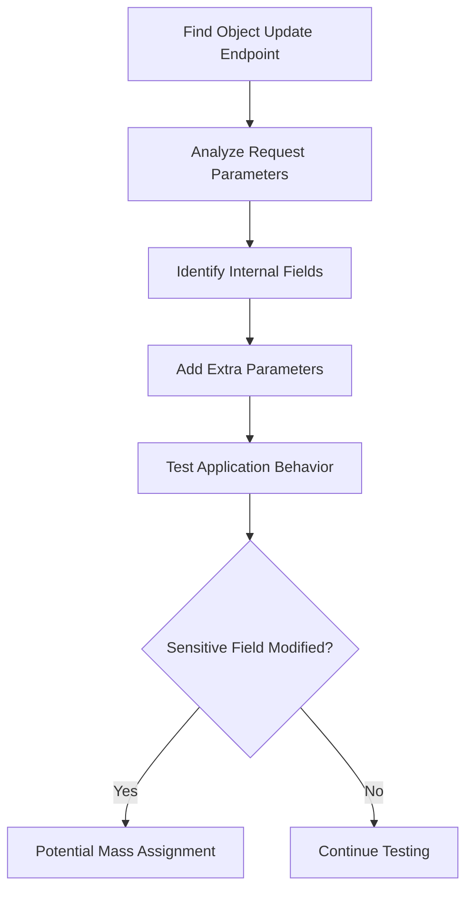
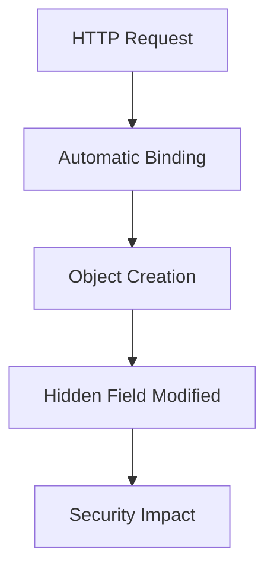

<Frame type="image" caption="Mass Assignment">

</Frame>

<Callout type="default" title="Overview">
**Mass Assignment** is a vulnerability that occurs when an application automatically binds user-controlled input to internal objects or variables without properly restricting which fields can be modified.

The problem happens when the application exposes fields that were intended to be controlled only internally.

Example:



A common scenario is when a user can modify fields such as:

```text
isAdmin
role
balance
permissions
accountStatus
```

even though these fields should only be changed by the application.
</Callout>

<Expandable title="Normal Object Binding" defaultOpen={true}>
Modern frameworks often provide automatic request-to-object mapping.

Instead of manually assigning every parameter:

```java
user.setUsername(request.getParameter("username"));
user.setEmail(request.getParameter("email"));
```

frameworks may automatically perform:

```java
User user = new User(requestParameters);
```

The framework maps request parameters to object properties.



This feature is convenient, but it becomes dangerous when sensitive properties are also mapped.
</Expandable>

<Expandable title="Vulnerable User Class" defaultOpen={true}>
Consider the following Java class:

```java
public class User {

    private String userid;
    private String password;
    private String email;
    private boolean isAdmin;

    // Getters & Setters

}
```

The class contains:

```java
private boolean isAdmin;
```

This field should normally be controlled by the application, not by the user.

However, because getters and setters exist:

```java
public void setAdmin(boolean isAdmin)
```

the framework may allow external users to modify it.
</Expandable>

<Callout type="error" title="Vulnerable Controller">
Example Spring MVC controller:

```java
@RequestMapping(value = "addUser", method = RequestMethod.POST)
public String submit(User user) {

    userService.add(user);

    return "success";
}
```

The problem:

```java
User user
```

is automatically populated from HTTP parameters.

The framework performs something similar to:

```java
user.setUserid(request.userid);
user.setPassword(request.password);
user.setEmail(request.email);
user.setAdmin(request.isAdmin);
```

The developer may only expect:

```text
userid
password
email
```

but the framework also accepts:

```text
isAdmin
```
</Callout>

---

<Expandable title="Exploitation Scenario" defaultOpen={true}>
Normal registration request:

```http
POST /addUser HTTP/1.1
Content-Type: application/x-www-form-urlencoded

userid=john&
password=password123&
email=john@example.com
```

The application creates:

```text
User
├── userid = john
├── password = password123
├── email = john@example.com
└── isAdmin = false
```

---

An attacker adds an extra parameter:

```http
POST /addUser HTTP/1.1
Content-Type: application/x-www-form-urlencoded

userid=john&
password=password123&
email=john@example.com&
isAdmin=true
```

If automatic binding is enabled:

```text
User
├── userid = john
├── password = password123
├── email = john@example.com
└── isAdmin = true
```

The attacker has modified a field that should not be user-controlled.
</Expandable>

---

<Warning title="Root Cause">
The root cause is:

```text
User-Controlled Input
         +
Automatic Binding
         +
Sensitive Internal Fields
         =
Mass Assignment
```

Developers often create objects containing both:

User-editable fields:

```text
username
email
password
```

Internal fields:

```text
role
isAdmin
accountStatus
permissions
```

When both exist in the same object, automatic binding may expose internal fields.
</Warning>

---

<Note title="Common Vulnerable Fields">
Attackers usually look for parameters such as:

```text
role
isAdmin
admin
permissions
accessLevel
balance
credits
verified
status
accountType
```

Example:

```http
POST /updateProfile

username=test&
email=test@test.com&
role=admin
```
</Note>

---

<Expandable title="Identifying Mass Assignment" defaultOpen={true}>
A basic testing methodology:

### Step 1 — Find Object Updates

Look for endpoints:

```text
/register
/createUser
/updateProfile
/changeSettings
/api/user
```

---

### Step 2 — Analyze Parameters

Normal request:

```http
POST /api/user

username=test
email=test@test.com
```

Add suspicious fields:

```http
POST /api/user

username=test
email=test@test.com
role=admin
isAdmin=true
```

---

### Step 3 — Observe Behavior

Check:

- Response changes
    
- Permission changes
    
- Returned JSON
    
- Account privileges
    
- Database changes
</Expandable>

---

<Expandable title="JSON API Example" defaultOpen={true}>
Vulnerable endpoint:

```http
PUT /api/profile
Content-Type: application/json
```

Normal JSON:

```json
{
  "username":"john",
  "email":"john@example.com"
}
```

Attacker adds:

```json
{
  "username":"john",
  "email":"john@example.com",
  "role":"admin"
}
```

If the backend automatically maps JSON fields:

```json
{
  "username":"john",
  "email":"john@example.com",
  "role":"admin"
}
```

the attacker may gain elevated privileges.
</Expandable>

---

<Warning title="Mass Assignment vs Parameter Pollution">
These issues can look similar but are different.

### Mass Assignment

The problem is:



---

### Parameter Pollution

The problem is:



Example:

```http
role=user&role=admin
```

Different layers may choose different values.
</Warning>

---

<Note title="Framework Examples">
Mass assignment can appear in many frameworks.

Examples:

<Tabs>
  <Tab title="Spring MVC">
    ```java
    public String submit(User user)
    ```

    Automatic binding occurs.
  </Tab>
  <Tab title="Ruby on Rails">
    Vulnerable pattern:

    ```ruby
    User.create(params[:user])
    ```
  </Tab>
  <Tab title="Laravel">
    Vulnerable pattern:

    ```php
    User::create($request->all());
    ```
  </Tab>
  <Tab title="Django">
    Risky patterns:

    ```python
    Model.objects.create(**request.POST)
    ```
  </Tab>
</Tabs>

The common problem is always the same:


</Note>

---

<Callout type="error" title="Impact">
Mass Assignment can lead to:

- Privilege escalation
    
- Account takeover
    
- Unauthorized role changes
    
- Financial manipulation
    
- Data modification
    
- Security control bypass

Example:


</Callout>

---

<Note title="Prevention">
The main defense is:

```text
Never automatically bind all user input to internal objects
```

Recommended approaches:

### Use Allow Lists

Allow only expected fields:

```text
Allowed:
username
email
password

Block:
role
isAdmin
permissions
```

---

### Use Separate DTO Objects

Instead of:

```java
User user
```

Use:

```java
UserRegistrationDTO dto
```

Example:

```text
User Object

username
email
password
role
isAdmin


Registration DTO

username
email
password
```

The user never receives access to internal fields.

---

### Explicit Field Mapping

Instead of:

```java
bind(request, User.class)
```

use:

```java
user.setEmail(request.email);
user.setUsername(request.username);
```

---

### Server-Side Authorization

Never trust:

```json
{
"role":"admin"
}
```

from the client.

Privileges should always be decided server-side.
</Note>

---

<Callout type="default" title="Detection Methodology">


The key question:

```text
Can an attacker provide parameters
that modify object properties
they should not control?
```

If yes, the application may be vulnerable to **Mass Assignment**.
</Callout>

---

<Tip title="Key Takeaways">


The vulnerability is not caused by object binding itself.

The problem is allowing users to control fields that were never meant to be exposed.
</Tip>