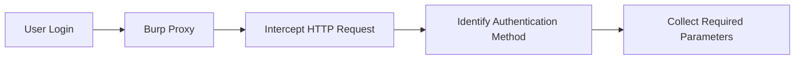
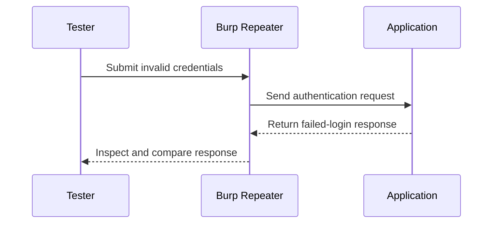

<Callout type="info" title="Before Testing">

Before performing an authentication brute-force test, identify **how the application authenticates users** and determine **how failed login attempts are indicated**. This information is necessary to correctly configure tools such as **Hydra**.

Perform authentication testing only against systems you own or are explicitly authorized to assess.

</Callout>

## Step 1: Identify the Authentication Mechanism

Intercept the login request using **Burp Suite** and analyze the HTTP request responsible for authentication.

Common authentication methods include:

- **Form-Based Authentication:** Credentials are commonly submitted in the body of a `POST` request.
- **HTTP Basic Authentication:** Credentials are encoded using Base64 and sent in the `Authorization` header. Base64 is encoding, not encryption, so HTTPS is essential.
- **HTTP Digest Authentication:** A challenge-response mechanism that can use MD5, depending on the server's configuration. MD5-based Digest authentication is considered outdated.

Collect the following information:

- HTTP method (`GET` or `POST`)
- Authentication endpoint
- Username parameter
- Password parameter
- Authentication headers, if applicable



## Step 2: Identify the Failed Login Response

Send a small number of invalid authentication attempts using **Burp Repeater** in an authorized test environment, then compare the server responses.

Analyze:

- HTTP status code
- Response body
- Error message
- Response length
- Redirect behavior

The objective is to determine a reliable **failure indicator**. A status code alone may not be sufficient because some applications return the same status for both successful and failed logins.



## Form-Based Authentication Example

<Accordion title="Example HTTP Request">

```http
POST /login HTTP/1.1
Host: target.com
User-Agent: Mozilla/5.0 (X11; Linux x86_64; rv:68.0) Gecko/20100101 Firefox/68.0
Accept: text/html,application/xhtml+xml,application/xml;q=0.9,*/*;q=0.8
Accept-Language: en-US,en;q=0.5
Accept-Encoding: gzip, deflate
Content-Type: application/x-www-form-urlencoded
Content-Length: 29
Origin: http://target.com
Connection: close
Referer: http://target.com/login
Cookie: PHPSESSID=ab23cd45ef678901234567890abcdef

username=admin&password=test123
```

The request contains the username and password in the URL-encoded request body. The cookie is an illustrative session value and should not be reused outside a lab.

</Accordion>

<Accordion title="Hydra Syntax: Form-Based Authentication">

For an authorized lab, Hydra's `http-post-form` module uses a format similar to:

```text
/login:<form parameters>:<failure indicator>
```

The original example illustrates the parameter and failure-string structure:

```bash
hydra -l admin -P passwords.txt target.com -s 8080 http-post-form "/login:username=^USER^&password=^PASS^:Invalid login"
```

Before using a test command, confirm the exact endpoint, form parameters, and failure indicator from the application's response. The example assumes the application returns `Invalid login` when authentication fails.

</Accordion>

<Accordion title="cURL: Submit Form Credentials">

Use a lab account to inspect how the application handles a single login request:

```bash
curl -X POST "http://target.com/login" \
  -d "username=admin&password=P%40ssWord123"
```

`curl` sends one request here. The response can help you inspect status codes, redirects, and error messages. Use HTTPS when testing a real deployment.

</Accordion>

## HTTP Basic Authentication Example

<Accordion title="Example HTTP Request">

```http
GET /basic HTTP/1.1
Host: example.com
User-Agent: Mozilla/5.0 (X11; Linux x86_64; rv:115.0) Gecko/20100101 Firefox/115.0
Accept: text/html,application/xhtml+xml,application/xml;q=0.9,*/*;q=0.8
Accept-Language: en-US,en;q=0.5
Accept-Encoding: gzip, deflate
Connection: close
Upgrade-Insecure-Requests: 1
Authorization: Basic dXNlcjpwYXNz
```

The value `dXNlcjpwYXNz` is Base64-encoded text representing `user:pass`. Basic authentication does not encrypt credentials by itself.

</Accordion>

<Accordion title="Hydra Syntax: HTTP Basic Authentication">

For a controlled test environment, Hydra supports HTTP Basic authentication through its `http-get` module. The original example shows the general placement of the username, password list, target, and protected path:

```bash
hydra -l admin -P /path/to/lab-passwords.txt example.com http-get /basic/
```

The target and password list should be replaced with lab-specific values, and the test should remain within the agreed scope.

</Accordion>

<Accordion title="cURL: HTTP Basic Authentication">

Use `curl -u` to test a single credential pair:

```bash
curl -u 'admin:P%40ssWord123' "http://example.com/basic/"
```

For deployments that support HTTPS, use an HTTPS URL to protect credentials in transit.

</Accordion>

## HTTP Digest Authentication Example

<Accordion title="Example HTTP Request">

```http
GET /digest/ HTTP/1.1
Host: example.com
User-Agent: Mozilla/5.0 (X11; Linux x86_64; rv:68.0) Gecko/20100101 Firefox/68.0
Accept: text/html,application/xhtml+xml,application/xml;q=0.9,*/*;q=0.8
Accept-Language: en-US,en;q=0.5
Accept-Encoding: gzip, deflate
Connection: close
Cookie: PHPSESSID=fks6f012miogmkr21loussglf5
Upgrade-Insecure-Requests: 1
Authorization: Digest username="test", realm="Private", nonce="p3bi8RoEBgA=fc270e510ca071228fd4f92d219a7acbc074b1e9", uri="/digest/", algorithm=MD5, response="a69b760a71bc89f76fe296c08137a567", qop=auth, nc=00000001, cnonce="5649e7b4a314ba0e"
```

The `Authorization` header contains fields used in the Digest challenge-response calculation, including the username, realm, nonce, URI, algorithm, and response digest. Real values are generated as part of the authentication exchange.

</Accordion>

<Accordion title="Hydra Syntax: HTTP Digest Authentication">

Hydra supports HTTP Digest authentication through its `http-get` module in compatible versions. The following illustrates the original command structure using a lab target and a local wordlist:

```bash
hydra -l test -P /path/to/lab-passwords.txt example.com http-get /digest/ -t 4 -V -f
```

The `-t` option controls the number of parallel tasks, `-V` displays login attempts, and `-f` stops after a valid credential pair is found. Keep concurrency low during testing and follow the rules of engagement.

</Accordion>

<Accordion title="cURL: HTTP Digest Authentication">

Use `curl --digest` to perform a single Digest authentication attempt:

```bash
curl --digest -u 'admin:adminpasswd' "http://example.com/digest/"
```

`curl` handles the Digest challenge-response exchange. The username and password above are illustrative test credentials.

</Accordion>

## Key Takeaways

- Identify the authentication method before selecting a testing tool.
- Use Burp Suite to inspect the request and compare successful and failed authentication responses.
- Confirm the exact failure indicator before interpreting automated test results.
- Basic authentication uses Base64 encoding, not encryption.
- Digest authentication depends on a challenge-response exchange and may use outdated algorithms such as MD5.
- Use rate limits and low concurrency during authorized tests, and stop if the application shows signs of disruption.
- Never treat a tool's output as proof of a vulnerability without validating the result.
