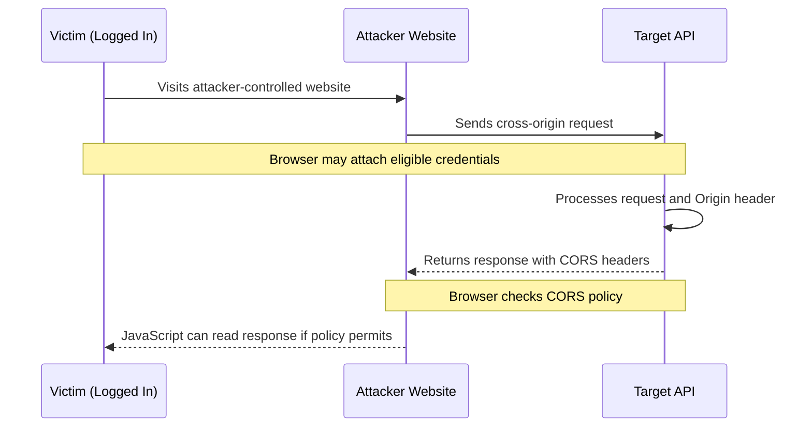

<Callout type="info">
**Cross-Origin Resource Sharing (CORS) misconfiguration** occurs when a server uses insecure headers to define which origins are allowed to access its resources. Depending on the configuration and the affected endpoint, this can allow unauthorized cross-origin access to sensitive user data.

CORS is a browser-enforced mechanism. It controls whether browser JavaScript can read a cross-origin response; it is not a replacement for server-side authentication or authorization.
</Callout>

## Attack Flow



The browser's Same-Origin Policy normally prevents a website from reading responses from a different origin. A permissive or incorrectly validated CORS policy can relax that restriction.

### Conditions for a Successful Attack

<Callout type="danger">
For a typical credentialed CORS data-exposure scenario, the following conditions generally need to be met:

1. **Reflected or improperly trusted origin:** The server reflects an arbitrary `Origin` value into `Access-Control-Allow-Origin`, or otherwise allows an origin controlled by the attacker.
2. **Credentials allowed:** The response includes `Access-Control-Allow-Credentials: true` when credentialed access is required.
3. **Sensitive endpoint:** The endpoint returns sensitive information, such as profile details, account data, or API information.
4. **Authenticated victim:** The victim has an active session, and the browser is permitted to send the relevant credentials.
5. **Browser-readable response:** The browser accepts the CORS response, allowing the attacker's JavaScript to read it.

These conditions depend on the application. For example, a public endpoint may expose data cross-origin without credentials, while cookie-based attacks may be limited by `SameSite` cookie settings or other browser protections.
</Callout>

## Pentest Methodology

1. **Map the application:** Identify API endpoints that return sensitive data, such as `/api/user` or `/account/details`.
2. **Establish a baseline:** Send a normal request without an `Origin` header and observe the response.
3. **Submit an arbitrary origin:** Test with `Origin: https://attacker.com`.
4. **Analyze the response:** Check whether the origin is reflected in `Access-Control-Allow-Origin` and whether `Access-Control-Allow-Credentials: true` is present.
5. **Test origin-validation logic:** In an authorized environment, check how the server handles untrusted origins, similar-looking domains, subdomains, and the special `null` origin.
6. **Verify browser behavior:** Confirm that a real browser allows the intended cross-origin JavaScript to read the response. A `curl` result alone cannot prove browser exploitability.

---

## Testing with curl: Comprehensive Cases

The following examples use placeholder domains. Run them only against systems you own or are explicitly authorized to assess.

<Accordion title="1. Baseline request without an Origin header">

```bash
curl -i https://api.victim.com/user/profile
```

**Look for:**

- The default response headers.
- Whether the endpoint returns sensitive data.
- Whether authentication is required.
- Whether the server includes any CORS headers by default.

A request without an `Origin` header helps establish baseline behavior, but does not test whether a browser will permit cross-origin access.
</Accordion>

<Accordion title="2. Test arbitrary Origin reflection">

```bash
curl -i \
  -H "Origin: https://attacker.com" \
  https://api.victim.com/user/profile
```

**Look for:**

```http
Access-Control-Allow-Origin: https://attacker.com
Access-Control-Allow-Credentials: true
```

If the server reflects an untrusted origin, investigate whether that origin is actually allowed to read sensitive responses in a browser.

Reflection by itself does not establish the full impact. Check the endpoint's sensitivity, credential requirements, and the browser's CORS enforcement.
</Accordion>

<Accordion title="3. Test the null Origin">

```bash
curl -i \
  -H "Origin: null" \
  https://api.victim.com/user/profile
```

**Look for:**

```http
Access-Control-Allow-Origin: null
```

Some browser contexts, including certain sandboxed documents and opaque origins, serialize their origin as `null`. A server that trusts `null` indiscriminately may expose data to untrusted documents.

A `curl` request can test the server's response to this header, but it does not reproduce the browser restrictions or prove that a particular sandboxed document can exploit the policy.
</Accordion>

<Accordion title="4. Test subdomain validation">

If the server is intended to trust only selected subdomains of `victim.com`, test whether its validation checks the parsed hostname correctly.

```bash
curl -i \
  -H "Origin: https://victim.com.attacker.com" \
  https://api.victim.com/user/profile
```

```bash
curl -i \
  -H "Origin: https://attacker.victim.com" \
  https://api.victim.com/user/profile
```

```bash
curl -i \
  -H "Origin: https://victim.com.evil.com" \
  https://api.victim.com/user/profile
```

**Look for:** An origin being accepted when it should be rejected.

The second example is a subdomain of `victim.com`, unlike the first and third examples. Whether it should be trusted depends on the application's actual allowlist.

A secure implementation should parse the origin and compare its scheme, hostname, and port against an explicit policy. Simple substring checks can accidentally trust domains such as `victim.com.attacker.com`.
</Accordion>

<Accordion title="5. Test trust in unallocated subdomains">

```bash
curl -i \
  -H "Origin: https://this-does-not-exist.victim.com" \
  https://api.victim.com/user/profile
```

**Look for:**

```http
Access-Control-Allow-Origin: https://this-does-not-exist.victim.com
```

If the server trusts every subdomain, investigate whether an attacker could control an accepted subdomain. A dangling DNS record or subdomain takeover can sometimes make this possible.

Do not assume that a reflected origin means the subdomain is available for registration. Confirm DNS records, hosting configuration, and ownership through authorized testing.
</Accordion>

<Accordion title="6. Test HTTP versus HTTPS origin trust">

```bash
curl -i \
  -H "Origin: http://victim.com" \
  https://api.victim.com/user/profile
```

**Look for:**

```http
Access-Control-Allow-Origin: http://victim.com
```

If the application is intended to trust only `https://victim.com`, accepting the HTTP origin may violate its security policy.

The impact depends on whether an attacker can cause a browser to use that origin and whether the relevant credentials and network conditions permit the attack. Acceptance of an HTTP origin does not automatically demonstrate a successful man-in-the-middle attack.
</Accordion>

<Accordion title="7. Test with an authenticated session">

In an authorized test environment, use a test account and a valid test session cookie:

```bash
curl -i \
  -H "Origin: https://attacker.com" \
  -H "Cookie: session=YOUR_TEST_SESSION" \
  https://api.victim.com/user/profile
```

**Look for:**

- Whether the endpoint returns authenticated account data.
- Whether `Access-Control-Allow-Origin` allows the test origin.
- Whether `Access-Control-Allow-Credentials: true` is present.

This command simulates sending a cookie with `curl`. It does not reproduce browser cookie rules, including `SameSite`, third-party cookie restrictions, or browser CORS enforcement.

Never place real users' session cookies in testing notes, logs, or shared terminal history.
</Accordion>

<Accordion title="8. Test preflight requests with OPTIONS">

For requests that require a CORS preflight, browsers send an `OPTIONS` request before the actual request.

```bash
curl -i -X OPTIONS \
  -H "Origin: https://attacker.com" \
  -H "Access-Control-Request-Method: PUT" \
  -H "Access-Control-Request-Headers: Content-Type" \
  https://api.victim.com/user/profile
```

**Look for:**

```http
Access-Control-Allow-Origin: https://attacker.com
Access-Control-Allow-Methods: PUT
Access-Control-Allow-Headers: Content-Type
```

For credentialed access, also inspect:

```http
Access-Control-Allow-Credentials: true
```

A preflight is required for certain cross-origin requests, such as requests using `PUT` or non-safelisted headers. It is not required for every cross-origin request.

A successful preflight does not prove that the actual request will succeed or that its response contains sensitive data. Test the full browser request flow.
</Accordion>

<Accordion title="9. Test trust in third-party hosting origins">

Check whether the application trusts origins hosted on third-party platforms when such trust is not necessary.

```bash
curl -i \
  -H "Origin: https://attacker-bucket.s3.amazonaws.com" \
  https://api.victim.com/user/profile
```

```bash
curl -i \
  -H "Origin: https://attacker.github.io" \
  https://api.victim.com/user/profile
```

**Look for:** The server accepting an origin hosted on a third-party platform.

A broad trust rule can be dangerous if users can create content or control sites under an accepted origin. However, the fact that a service supports user-hosted content does not automatically make every origin on that service trusted by the target.

Verify the exact allowlist behavior and whether an attacker can control content at an origin that the target accepts.
</Accordion>

---

## Browser Limitations

<Callout type="warning">
Modern browsers reject a credentialed CORS response when it combines:

```http
Access-Control-Allow-Origin: *
Access-Control-Allow-Credentials: true
```

For credentialed CORS requests, the server must return a specific allowed origin rather than the wildcard `*`.

If the server reflects the attacker's exact origin and also permits credentials, the browser may allow the attacker's JavaScript to read the response, provided the remaining CORS requirements and credential rules are satisfied.

`curl` does not enforce these browser rules. Inspecting response headers with `curl` is a diagnostic step, not proof of a successful browser-based exploit.
</Callout>

Other browser and application controls can affect exploitability:

- Cookie `SameSite` attributes and third-party cookie restrictions.
- Whether the endpoint requires authentication.
- Whether the response includes sensitive data.
- Whether the request requires a successful preflight.
- Whether the target's origin validation is correct.
- Whether the attacker can host content at an origin that the target trusts.

---

## Proof of Concept (PoC) JavaScript

The following example is intended for an authorized lab using a test account. It displays the response locally so the tester can verify whether browser JavaScript can read it. It does not transmit the response to a third-party collection endpoint.

Save it as `poc.html` and serve it from a separate test origin, such as `http://localhost:8000`, while testing against an application you control.

<Accordion title="HTML and JavaScript PoC">

```html
<!DOCTYPE html>
<html lang="en">
<head>
  <meta charset="UTF-8">
  <meta name="viewport" content="width=device-width, initial-scale=1">
  <title>CORS Misconfiguration PoC</title>
</head>
<body>
  <h2>CORS Misconfiguration PoC</h2>
  <p id="status">Testing cross-origin access...</p>
  <pre id="result"></pre>

  <script>
    const targetUrl = "https://api.victim.com/user/profile";
    const status = document.getElementById("status");
    const result = document.getElementById("result");

    fetch(targetUrl, {
      method: "GET",
      credentials: "include"
    })
      .then(async (response) => {
        const body = await response.text();

        if (!response.ok) {
          status.textContent =
            `The request completed with HTTP ${response.status}.`;
        } else {
          status.textContent =
            "The browser allowed JavaScript to read the response.";
        }

        result.textContent = body;
      })
      .catch((error) => {
        status.textContent =
          "The browser could not complete a readable CORS request.";
        result.textContent = String(error);
      });
  </script>
</body>
</html>
```

**Expected behavior:** If the browser permits the credentialed cross-origin request, the response body appears in the page. Otherwise, the browser may block JavaScript from reading the response.

Replace `https://api.victim.com/user/profile` with an endpoint in your authorized test environment. The browser must also be able to send the relevant credentials for an authenticated scenario.
</Accordion>

---

## Remediation

<Callout type="success">
- **Validate origins against a strict allowlist.** Compare parsed scheme, hostname, and port instead of using substring matching or blindly reflecting the `Origin` header.
- **Avoid credentialed CORS unless necessary.** Set `Access-Control-Allow-Credentials: true` only when the application genuinely requires credentialed cross-origin access.
- **Do not trust `null` by default.** Only permit opaque origins when there is a specific, reviewed requirement.
- **Use explicit origin policies.** Avoid broad trust in arbitrary subdomains or third-party hosting platforms.
- **Return appropriate CORS headers.** Do not grant untrusted origins access to sensitive responses.
- **Enforce authentication and authorization on the server.** CORS is not a substitute for access control.
- **Test preflight and actual requests.** Verify allowed origins, methods, headers, and credential behavior.
- **Use `Vary: Origin` when responses vary by origin.** This helps prevent shared caches from serving a response generated for one origin to another.
- **Review CORS policies regularly.** Remove unused origins and document why each trusted origin is required.
</Callout>

## Summary

<Callout type="quote">
CORS is a browser-enforced policy, not a server-side authorization mechanism.

If a server trusts an attacker-controlled origin and allows that origin to read a sensitive response using the victim's credentials, the result can be unauthorized cross-origin data exposure.

The real impact depends on the endpoint, origin-validation logic, authentication, cookie policy, and browser behavior. A misconfigured header is a finding; a demonstrated ability to read sensitive data establishes its practical impact.
</Callout>