<Callout type="info" title="What Is RCE?">
  **Remote Code Execution (RCE)** is a vulnerability impact that allows an attacker to cause an application or server to execute attacker-controlled code remotely.

  In other words, the application processes attacker-controlled input as **program code** instead of treating it as ordinary data.

  The important distinction is that the attacker is not simply controlling application data. The attacker is influencing **what code or commands the application executes**.
</Callout>

A simplified vulnerable flow looks like this:

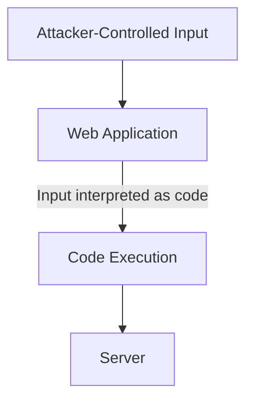

RCE vulnerabilities can occur when an application insecurely handles user-controlled input and passes it to dangerous functionality, such as:

- Command execution functions
- Code evaluation functions
- Template engines
- Deserialization mechanisms
- File upload or processing functionality
- Vulnerable third-party components

The impact of RCE depends on the permissions of the vulnerable application. An attacker may be able to execute code with the same privileges as the affected process, potentially leading to:

- Access to sensitive data
- Modification or deletion of files
- Access to internal systems
- Further privilege escalation
- Complete compromise of the affected server in severe cases

**RCE is one of the most critical vulnerability impacts because an attacker may gain control over what the vulnerable system executes.**


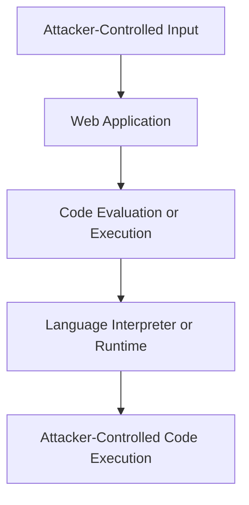

## Code Injection

One common path to RCE is **Code Injection**.

Code injection occurs when an application takes attacker-controlled input and passes it to a mechanism that interprets the input as source code.

For example:

```php
<?php

$code = $_GET['code'];

eval($code);

?>
```

The application receives the value of `code` from the HTTP request and passes it directly to `eval()`.

The fundamental problem is:

```text
User Input → Code Evaluation
```

Instead of:

```text
User Input → Data Processing
```

The vulnerability occurs because untrusted input can influence the program instructions being executed.

---

## `eval()`

`eval()` is a function that evaluates a string as source code.

For example:

```php
<?php

$code = "2 + 2";

$result = eval("return $code;");

echo $result;

?>
```

Output:

```text
4
```

The string stored in `$code` is interpreted as PHP code.

Conceptually:

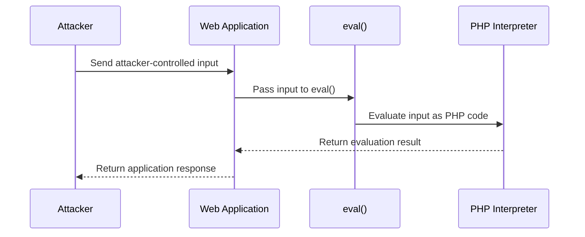

<Callout type="danger" title="Security risk">
  `eval()` is not automatically a vulnerability in every possible use. The security issue arises when untrusted input reaches a code-evaluation mechanism in a way that allows the input to alter the executed code.
</Callout>

---

## A Simple RCE Example

Consider:

```php
<?php

$code = $_GET['code'];

eval($code);

?>
```

The application accepts the `code` parameter and evaluates it as PHP source code.

For example, the endpoint might accept a request in this format:

```text
/code.php?code=...
```

The important point is that the application does not treat the parameter as ordinary data. It passes the value directly to the PHP interpreter.

If an attacker can control the evaluated source code, the result may be arbitrary PHP code execution within the privileges and restrictions of the application process.

---

## Breaking Out of an Existing Context

Sometimes the application does not pass input directly to `eval()`.

Instead, it may construct a larger piece of code:

```php
<?php

$echo = $_GET['echo'];

eval("print('$echo');");

?>
```

Here, the attacker-controlled value is inserted inside an existing PHP string:

```php
print('$echo');
```

The input is therefore being evaluated inside a specific **syntactic context**.

Conceptually:

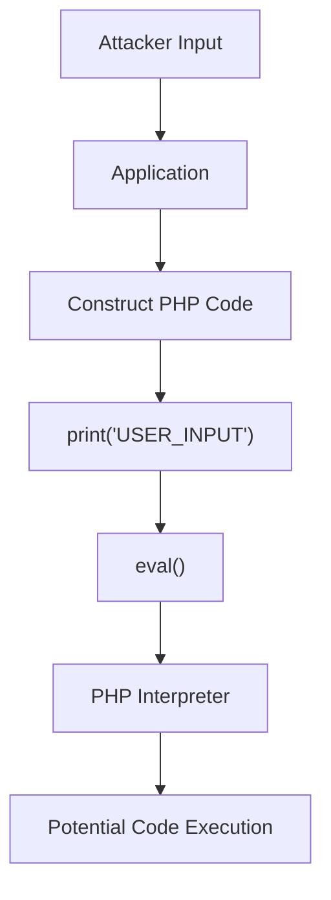

This is an important concept when analyzing code injection vulnerabilities.

The attacker must understand the context in which their input is placed.

Possible contexts include:

- String context
- Numeric context
- Expression context
- Function argument
- Template expression
- JavaScript context
- SQL context

The exact behavior depends on the programming language and how the application constructs and evaluates the code.

<Callout type="warning" title="Context matters">
  Escaping rules differ between languages and syntactic contexts. A technique that changes the meaning of input inside a PHP string may not work in a numeric expression, JavaScript expression, or template context.
</Callout>

---

## Python Example

The same concept exists in other programming languages.

Python provides functions such as:

```python
eval()
exec()
```

A simplified vulnerable Flask application could look like this:

```python
from flask import Flask, request

app = Flask(__name__)

@app.route("/eval")
def page():
    expression = request.args.get("expression", "")
    result = eval(expression)

    return str(result)

if __name__ == "__main__":
    app.run(host="127.0.0.1", port=8080)
```

The application receives attacker-controlled input through an HTTP request:

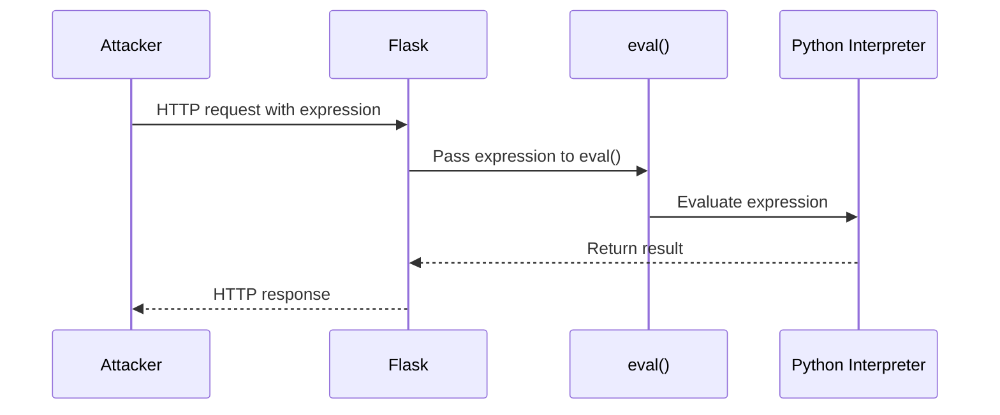

<Callout type="danger" title="Important">
  `eval()` and `exec()` should not be used with untrusted input unless a strong, carefully designed security boundary prevents the input from executing unintended code.

  Restricting the visible input characters is not a reliable substitute for avoiding dynamic code evaluation.
</Callout>

---

# RCE vs. Command Injection

RCE and OS Command Injection are closely related, but they are not the same vulnerability.

## OS Command Injection

OS Command Injection occurs when attacker-controlled input reaches an operating-system command or shell in an unsafe way.

Conceptually:

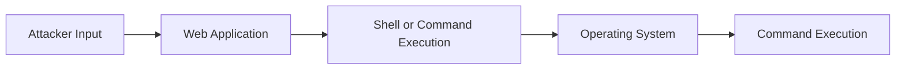

For example:

```php
<?php

$output = shell_exec($_GET["cmd"]);

echo "<pre>" . htmlspecialchars($output ?? "", ENT_QUOTES, "UTF-8") . "</pre>";

?>
```

The application receives the value of the `cmd` parameter and passes it to `shell_exec()`.

The shell then executes the resulting command.

<Callout type="danger" title="Security risk">
  If attacker-controlled input reaches `shell_exec()` without safe command construction, the attacker may be able to execute operating-system commands with the privileges of the web application.

  Escaping the displayed output with `htmlspecialchars()` helps prevent HTML injection in the response. It does **not** make the command execution safe.
</Callout>

---

## Code Injection

Code Injection targets the **application's programming-language interpreter or runtime**.

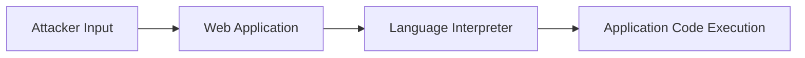

Examples include:

| Language | Code evaluation mechanisms |
|---|---|
| PHP | `eval()` |
| Python | `eval()`, `exec()` |
| JavaScript | `eval()`, `Function()` |

These mechanisms have different semantics and security implications depending on the language and execution context.

---

## Command Injection vs. Code Injection

| Vulnerability or concept | Target |
|---|---|
| Code Injection | Application language interpreter or runtime |
| OS Command Injection | Operating-system command or shell |
| RCE | The impact of remotely executing attacker-controlled code |

For example:

```text
eval()
```

is a code-evaluation mechanism.

Whereas:

```text
shell_exec()
```

is an operating-system command-execution mechanism.

RCE generally describes the ability to cause remote execution of attacker-controlled code. Therefore, an RCE vulnerability does not have to involve `eval()` or even a web application.

---

# Other Causes of RCE

`eval()` is only one possible path to RCE.

Other vulnerabilities can potentially result in remote code execution, including:

- Unsafe deserialization
- Server-Side Template Injection (SSTI)
- Certain file upload and file-processing vulnerabilities
- Vulnerable third-party components
- Expression Language Injection
- Server-side code injection
- Memory corruption vulnerabilities
- Other exploitable application or runtime vulnerabilities

A useful way to think about this is:

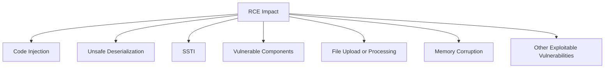

These vulnerabilities have different root causes, even though they may ultimately provide the same high-level impact: **attacker-controlled code execution**.

---

# Impact

The impact of RCE depends heavily on the privileges and environment of the vulnerable application.

If the vulnerable process has elevated privileges, the potential impact can be significantly greater.

Potential consequences include:

- Reading sensitive files
- Accessing application secrets
- Modifying application data
- Executing operating-system commands
- Accessing internal services
- Stealing credentials
- Modifying application behavior
- Establishing persistence
- Compromising the underlying server

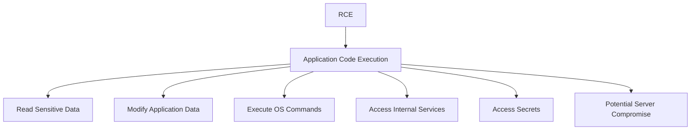

<Callout type="warning" title="Privileges matter">
  RCE does not automatically mean unrestricted control of the entire server. The actual impact depends on the privileges of the vulnerable process, sandboxing, container isolation, operating-system restrictions, network controls, and other security mechanisms.
</Callout>

---

# `shell_exec()`

PHP provides several functions for executing operating-system commands.

One example is:

```php
shell_exec()
```

A vulnerable example:

```php
<?php

$output = shell_exec($_GET["cmd"]);

echo "<pre>" . htmlspecialchars($output ?? "", ENT_QUOTES, "UTF-8") . "</pre>";

?>
```

The application accepts the `cmd` parameter and passes it to `shell_exec()`.

The execution flow is:

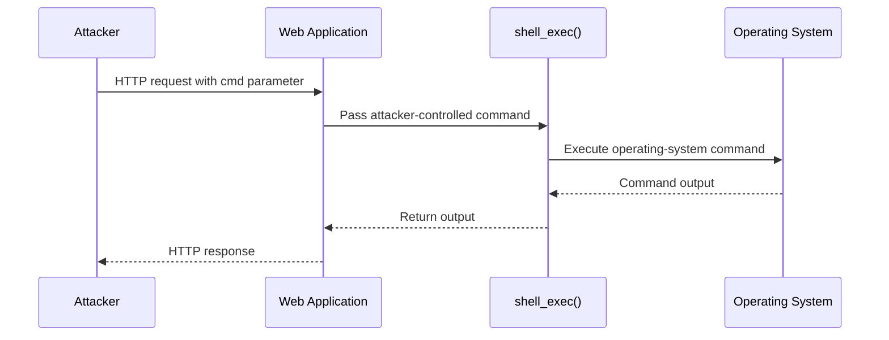

For example, an application might expose a URL in this format:

```text
shell.php?cmd=whoami
```

If the application executes the parameter directly, the operating system receives the resulting command.

<Callout type="danger" title="Vulnerable pattern">
  The dangerous pattern is not simply using `shell_exec()`. The problem is allowing attacker-controlled input to influence OS command execution without an appropriate security boundary.
</Callout>

---

# Detection Methodology

When testing an application for potential code execution, first identify where user-controlled input reaches an interpreter or command-execution function.

A simplified process is:

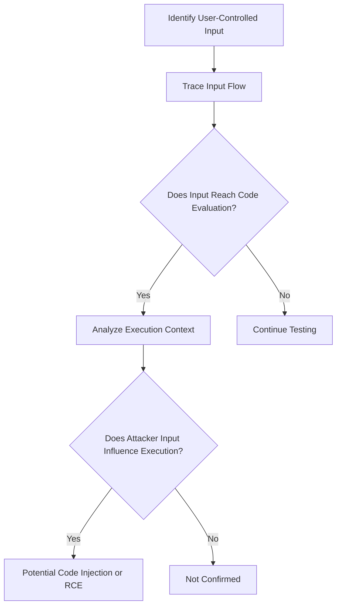

Useful functions to investigate during source-code review include:

```text
eval()
exec()
system()
shell_exec()
passthru()
popen()
proc_open()
```

Similar functions exist in other languages and frameworks.

However, finding one of these functions does not automatically prove a vulnerability.

The important question is:

> **Can attacker-controlled input reach the execution mechanism in a way that changes what gets executed?**

---

# Root Cause

The fundamental security problem can be summarized as:

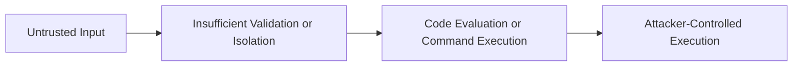

The application fails to maintain a proper separation between:

```text
Data
```

and:

```text
Code
```

A secure design should treat user input as **data**, not executable instructions.

---

# Prevention

The best defense is to avoid evaluating untrusted input as code.

Recommended practices include:

- Avoid `eval()` whenever possible.
- Never pass untrusted input directly to command-execution functions.
- Use allowlists and strict validation appropriate to the expected input.
- Use safe APIs instead of invoking a shell whenever possible.
- Separate user-controlled data from executable code.
- Apply least-privilege permissions to application processes.
- Keep dependencies and server software updated.
- Use sandboxing or container isolation where appropriate.
- Validate input according to its expected data type and format.
- Use language-specific safe APIs and avoid relying on blacklists of dangerous characters.

A safer architecture looks like:

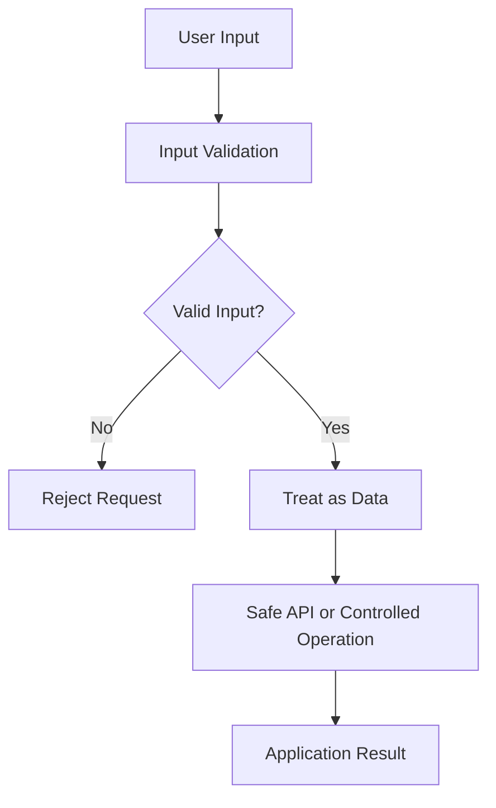

---

# Key Takeaways

- **RCE** means an attacker can cause a remote system to execute attacker-controlled code.
- RCE is an **impact**, while code injection, unsafe deserialization, SSTI, and memory corruption are possible paths to that impact.
- `eval()` evaluates a string as source code.
- Passing untrusted input to `eval()` can result in code injection.
- `shell_exec()` executes operating-system commands and can become dangerous when attacker-controlled input reaches it.
- **Code Injection** targets the application's language interpreter.
- **OS Command Injection** targets operating-system commands or a shell.
- `eval()` is not required for RCE.
- Successful RCE can potentially result in application or server compromise.
- The actual impact depends on the privileges and security boundaries of the vulnerable process.
- The primary defense is to maintain a strict separation between **untrusted data** and **executable code**.
