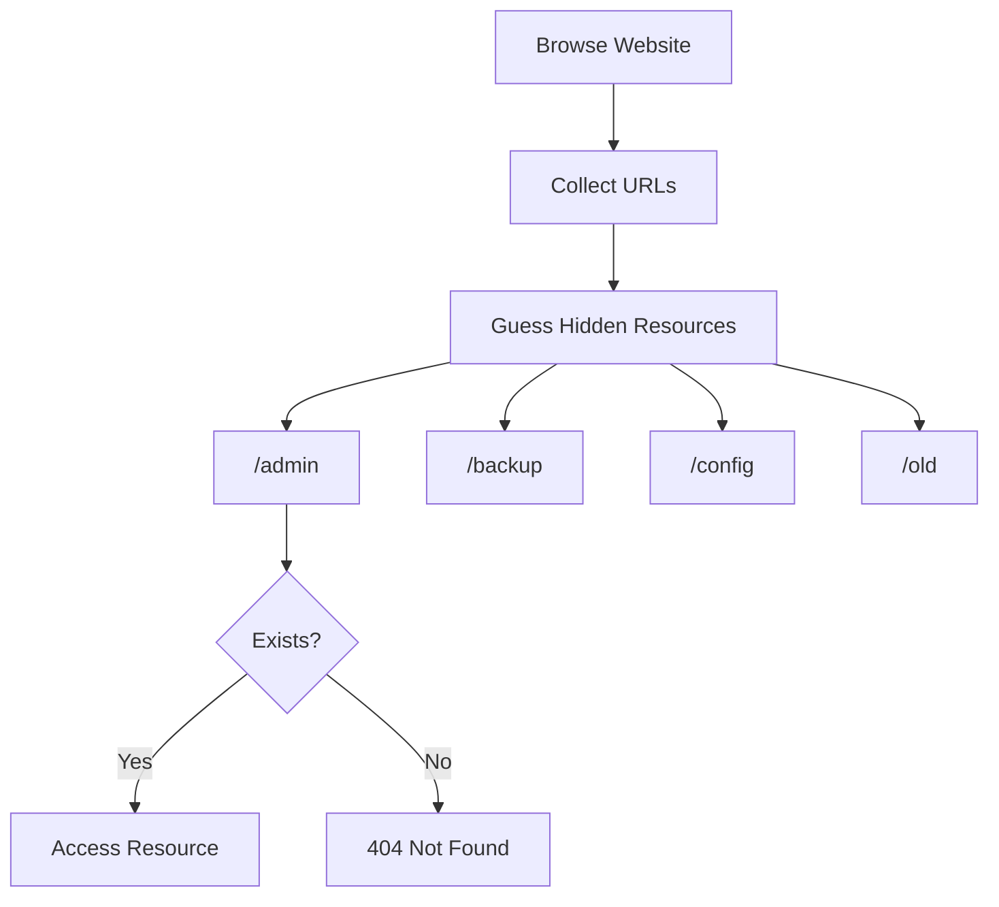

# Force Browsing

<Callout type="info">
**Force Browsing**, also known as **Direct Browsing**, **Predictable Resource Location**, or **Forced Resource Discovery**, is a technique where an attacker manually requests files, directories, or endpoints that are not linked by the application but are still accessible on the server.

Unlike directory brute-forcing, Force Browsing is based on **guessing or knowing common resource names**.
</Callout>


## How It Works

A web application may hide sensitive resources from users but fail to protect them.

Example:

```text
/admin
```

This path is not linked anywhere on the website, but the endpoint still exists.

If an attacker manually requests:

```http
GET /admin
```

the server may return the page successfully if the resource is accessible to the requester.

---

## Attack Flow



---

## Force Browsing vs. Directory Brute Force

| Force Browsing | Directory Brute Force |
|---|---|
| Often manual discovery | Usually automated discovery |
| Based on known or common names | Commonly uses large wordlists |
| May involve only a few requests | May generate thousands of requests |
| No special tool required | Often uses fuzzing tools |

<Callout type="tip">
Force Browsing is often an initial discovery step before using automated directory brute-forcing. The distinction is mainly about the discovery method: manual requests and automated enumeration can both uncover unlinked resources.
</Callout>

---

## Common Targets

```text
/admin
/login
/dashboard
/backup
/config
/uploads
/private
/test
/dev
/staging
/api
/docs
/swagger
```

---

## Testing with curl

### Request a Hidden Directory

```bash
curl -i https://target.com/admin
```

Example response:

```http
HTTP/1.1 200 OK
```

A `200 OK` response indicates that the server returned a successful HTTP response, but the response body must still be inspected to determine what resource was returned.

### Test a Backup File

```bash
curl -i https://target.com/backup.zip
```

Possible response:

```http
HTTP/1.1 200 OK
```

A successful response may indicate that the backup file is publicly accessible.

---

### Test Configuration Files

```bash
curl -i https://target.com/config.php.bak
```

```bash
curl -i https://target.com/.env
```

```bash
curl -i https://target.com/web.config
```

```bash
curl -i https://target.com/config.yml
```

---

### Test Common Admin Panels

```bash
curl -i https://target.com/admin
```

```bash
curl -i https://target.com/admin/login
```

```bash
curl -i https://target.com/dashboard
```

---

## Interesting Files

Common files that may reveal useful information include:

```text
robots.txt
sitemap.xml
crossdomain.xml
clientaccesspolicy.xml
security.txt
```

Example:

```bash
curl -i https://target.com/robots.txt
```

Sometimes, `robots.txt` contains entries such as:

```text
Disallow: /backup/
Disallow: /private/
Disallow: /admin/
```

<Callout type="warning">
`robots.txt` is **not** an access-control mechanism. It provides crawling instructions to compliant search engine bots. It does not prevent users or attackers from requesting the listed paths directly.
</Callout>

---

## Backup Files

Developers sometimes leave backup files on production servers.

Examples:

```text
index.php.bak
index.php.old
config.php~
config.zip
backup.tar.gz
website.rar
```

Testing:

```bash
curl -i https://target.com/index.php.bak
```

If a backup file is accessible, it may disclose source code, configuration details, credentials, or other sensitive information.

---

## Hidden Git Repository

Sometimes, a Git repository is exposed through the web server.

```bash
curl -i https://target.com/.git/HEAD
```

Example response:

```text
ref: refs/heads/main
```

This usually indicates that the `.git` directory is publicly accessible. Further exposure depends on which repository files the server permits clients to retrieve.

An exposed repository may reveal source code, historical changes, internal paths, or secrets that were committed previously.

---

## Hidden Environment Files

Examples:

```text
.env
.env.production
.env.local
.env.backup
```

Testing:

```bash
curl -i https://target.com/.env
```

Potential contents:

```text
DB_PASSWORD=password
API_KEY=xxxxxxxx
SECRET_KEY=xxxxxxxx
```

These values are illustrative placeholders. An exposed environment file may contain real database credentials, API keys, application secrets, or other sensitive configuration.

---

## API Endpoints

REST APIs often expose undocumented endpoints.

Examples:

```text
/api
/api/v1
/api/v2
/api/debug
/api/internal
```

Testing:

```bash
curl -i https://target.com/api/v1
```

An undocumented endpoint is not necessarily vulnerable. Its access controls, returned data, and intended behavior must be evaluated separately.

---

## Status Codes

| Code | Meaning | Interpretation during testing |
|---|---|---|
| `200` | OK | The server returned a successful response. Inspect the content. |
| `301` | Moved Permanently | The resource or route redirects elsewhere. |
| `302` | Found | The resource or route redirects temporarily. |
| `401` | Unauthorized | Authentication is required or the supplied credentials were not accepted. |
| `403` | Forbidden | The server refuses the request. The resource may exist, but this is not guaranteed. |
| `404` | Not Found | The server reports that the requested resource was not found. Some applications also use this response to conceal resources. |

<Callout type="info">
A **403 Forbidden** response can be more interesting than a **404 Not Found** response because it may indicate that the server recognizes the path but refuses access. However, custom error pages, reverse proxies, and access-control policies can produce misleading responses. Compare response bodies, headers, redirects, and behavior before concluding that a resource exists.
</Callout>

---

## Force Browsing Checklist

Use this checklist during authorized assessments:

- [ ] Check `robots.txt`.
- [ ] Check `sitemap.xml`.
- [ ] Test common admin panels.
- [ ] Test backup files.
- [ ] Test configuration files.
- [ ] Check for an exposed `.git` directory.
- [ ] Check for exposed `.env` files.
- [ ] Test `/uploads`.
- [ ] Test `/api`.
- [ ] Compare `403` and `404` responses.
- [ ] Look for versioned directories.
- [ ] Test old application paths.

---

## Prevention

<Callout type="success">
- Remove unused files and directories.
- Delete backup files from production servers.
- Disable public access to `.git`, `.svn`, and sensitive configuration files.
- Protect sensitive resources with appropriate authentication and authorization.
- Return consistent error responses where appropriate, without relying on obscurity as an access-control mechanism.
- Regularly review exposed files and directories during deployment.
</Callout>

---

## Related Vulnerabilities

- Information Disclosure
- Broken Access Control
- Sensitive File Exposure
- Insecure Direct Object References (IDOR)
- Directory Listing
- Security Misconfiguration

---

## References

- OWASP Web Security Testing Guide
- OWASP Top 10
- PortSwigger Web Security Academy
- CWE-425: Direct Request (Forced Browsing)

---

## FFUF

`ffuf` is a web fuzzer that can automate resource discovery by replacing the `FUZZ` keyword with entries from a wordlist. Use it only against systems you own or are explicitly authorized to test.

<Accordion title="Fuzz directories and files">

```bash
ffuf -w wordlist.txt -u https://site.com/FUZZ
```

Replace `FUZZ` with each entry in the wordlist to test possible directory and file paths.

</Accordion>

<Accordion title="Fuzz for .zip files">

```bash
ffuf -w wordlist.txt -u https://site.com/FUZZ -e .zip
```

The `-e` option adds the specified extension to wordlist entries, helping discover paths that end in `.zip`.

</Accordion>

<Accordion title="Fuzz with a custom Cookie header">

```bash
ffuf -w wordlist.txt -u https://site.com/FUZZ -H "Cookie: some_cookie"
```

Use a valid session cookie when testing authenticated resources in an authorized environment. Treat session cookies as secrets.

</Accordion>

<Accordion title="Filter out 403 responses">

```bash
ffuf -w wordlist.txt -u https://site.com/FUZZ -fc 403
```

The `-fc` option filters responses by HTTP status code. Here, responses with status `403` are excluded from the results.

</Accordion>

<Accordion title="Fuzz an HTTP header">

```bash
ffuf -w wordlist.txt -u https://site.com/ -H "header: FUZZ"
```

This replaces `FUZZ` in the selected header value with entries from the wordlist. Replace `header` with the actual header name being tested.

</Accordion>

<Accordion title="Match selected HTTP status codes">

```bash
ffuf -w wordlist.txt \
  -u http://site.com/FUZZ \
  -mc 200,204,301,302,307,401,403,405,500,404
```

The `-mc` option selects which status codes should be included in the results. This example includes common success, redirect, client-error, and server-error responses.

</Accordion>

<Accordion title="Test authentication input handling with two wordlists">

```bash
ffuf \
  -w users.txt:UU \
  -w passwords.txt:PP \
  -u https://site.com/api/v1/auth \
  -H "Content-Type: application/json" \
  -d '{"user":"UU","pass":"PP"}' \
  -X POST \
  -mode clusterbomb
```

This example substitutes values from two wordlists into a JSON request body. In `clusterbomb` mode, `ffuf` tests combinations of the supplied wordlists.

Use this technique only in a controlled lab or under explicit authorization. Prefer dedicated test accounts and a small test dataset when validating authentication behavior.
</Accordion>

<Accordion title="Load a wordlist from a remote source">

```bash
ffuf \
  -w <(curl -fsSL https://raw.githubusercontent.com/OWNER/REPO/BRANCH/wordlist.txt) \
  -u https://site.com/admin/FUZZ \
  -c \
  -mc all \
  -fs 276,279
```

Replace the example repository URL with a real, trusted wordlist URL. This uses Bash process substitution to pass downloaded content to `ffuf`.

- `-c` enables colored output.
- `-mc all` matches all HTTP status codes.
- `-fs 276,279` filters responses with body sizes of 276 or 279 bytes.

The original command's remote URL was a placeholder and would not identify a usable wordlist as written. Review remote wordlists before using them, because downloading random internet content is an impressively efficient way to outsource your problems.
</Accordion>

<Accordion title="Discover PHP files and filter 404 responses">

```bash
ffuf \
  -w wordlist.txt:CNA \
  -u https://site.com/CNA.php \
  -mc all \
  -fc 404 \
  -c
```

The custom keyword `CNA` is replaced by each wordlist entry, followed by `.php`. The `-fc 404` option excludes responses with status `404`, and `-mc all` initially allows all status codes to be considered.
</Accordion>